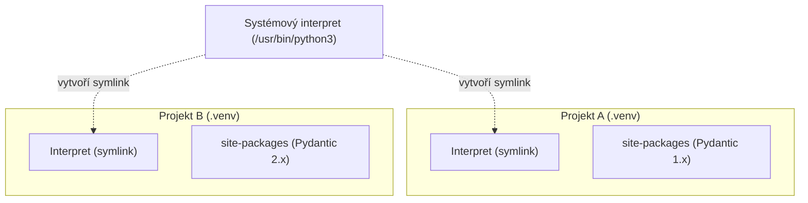
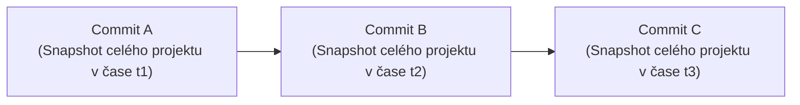
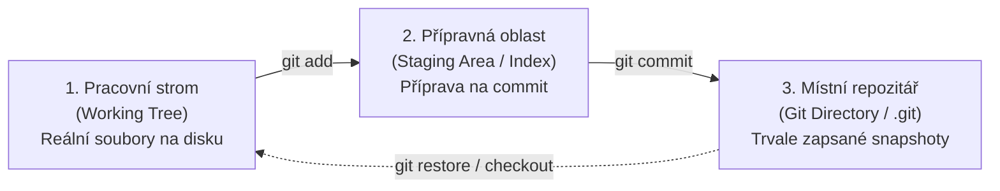
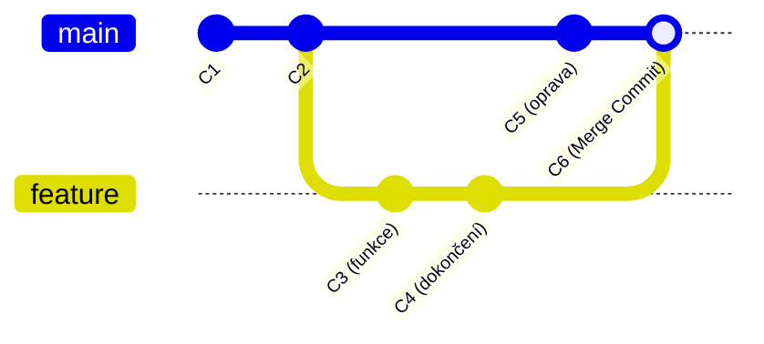

<!-- slide: id=id1 title="Úvod a osnova" tags="Core" diff="basics" -->
## Master Přednáška 0: Vývojové prostředí, Verzování a Ekosystém Pythonu

Vítejte v kurzu programování v jazyce Python. Tento kurz je určen pro studenty se zkušenostmi s procedurálním či objektovým programováním v kompilovaných jazycích (C/C++, Java).

### Osnova dnešní 90minutové přednášky:
1. **Architektonický model**: C/C++ a Java vs. virtuální stroj CPython.
2. **Životní cyklus programu**: Od zdrojového textu k bajtkódu `.pyc`.
3. **Izolace závislostí**: Proč potřebujeme virtuální prostředí (`venv`, PEP 405 a PEP 668).
4. **Balíčkování a standardy**: Od imperativního `setup.py` k deklarativnímu `pyproject.toml` (PEP 621).
5. **Verzovací systém Git**: Mentální model obsahově adresovatelné databáze a moderní workflow (`git switch`, `git restore`).
6. **Interaktivní prostředí**: REPL, nový PyREPL v Pythonu 3.13 a JupyterLab.
7. **Produkční most (2026)**: Nástroje nové generace v Rustu — **`uv`** a **`ruff`**.

---
<!-- slide: id=id2 title="C/Java vs. Python: Mentální model" tags="Core" diff="paradigm" -->
## Architektonický kontrast: Kompilace vs. CPython interpret

V jazycích C/C++ kompilátor přeloží zdrojový kód do nativního strojového kódu konkrétního procesoru (ELF binárka, `.exe`). V Javě kompilátor vytvoří bajtkód `.class`, který za běhu optimalizuje Just-In-Time (JIT) kompilátor JVM:

```text
[ C/C++ ]  Zdroj (.c/.cpp) ──[ GCC/Clang ]──> Strojový kód (CPU instrukce)
[ Java  ]  Zdroj (.java)   ──[ javac ]──────> Bajtkód (.class) ──[ JVM HotSpot JIT ]──> CPU
[ Python]  Zdroj (.py)     ──[ CPython ]────> Bajtkód (.pyc v paměti) ──[ Ceval Loop ]──> OS/C runtime
```

### Zásadní rozdíly pro vývojáře:
- **Žádný samostatný kompilátor**: Spuštěním `python main.py` interpret provede překlad i běh v jediném kroku.
- **Dynamické typování za běhu**: Typy se nekontrolují předem v kompilátoru, ale až ve chvíli, kdy virtuální stroj vykonává konkrétní operaci.
- **Vše je alokováno na haldě**: V C může být struktura uložena přímo na zásobníku (*stack allocation*). V Pythonu je každé číslo, řetězec i funkce plnohodnotným objektem (`PyObject`) žijícím na haldě.

---
<!-- slide: id=id3 title="Jak CPython vykonává kód" tags="Core" diff="newconcept" -->
## Životní cyklus CPythonu: Od textu k instrukcím virtuálního stroje

Když zavoláte `python main.py`, interpret provede následující kroky:

1. **Tokenizace (Lexer/Scanner)**: Převede textový proud znaků na proud syntaktických tokenů (např. `NAME`, `NUMBER`, `INDENT`).
2. **Parsování (PEG Parser)**: Od Pythonu 3.9 staví abstraktní syntaktický strom (*AST – Abstract Syntax Tree*) pomocí moderního PEG parseru.
3. **Kompilace do bajtkódu**: AST je přeložen do sekvence instrukcí zásobníku virtuálního stroje (*Python Bytecode*).
4. **Ceval Loop (Vyhodnocovací smyčka)**: Jádro CPythonu (napsané v C) ve velké smyčce čte instrukce a provádí odpovídající C operace.

```python
import dis

def secti(a: int, b: int) -> int:
    return a + b

# Prozkoumání instrukcí bajtkódu
dis.dis(secti)
```

Výstup disassembleru:
```text
  LOAD_FAST     0 (a)
  LOAD_FAST     1 (b)
  BINARY_OP     0 (+)
  RETURN_VALUE
```

> [!NOTE]
> Soubory v adresáři `__pycache__/*.pyc` jsou pouze uloženou mezipamětí přeloženého bajtkódu pro importované moduly, aby se při příštím spuštění ušetřil čas parsování.

---
<!-- slide: id=id4 title="Správa paměti: Reference Counting a GC" tags="Core" diff="paradigm" -->
## Správa paměti: Reference Counting vs. Garbage Collector

V C alokujete paměť pomocí `malloc()` a uvolňujete přes `free()`. V Javě probíhá automatický tracing garbage collection (Mark & Sweep).

Python používá **dvoustupňovou správu paměti**:

### 1. Počítání referencí (*Reference Counting* – primární mechanismus)
Každý objekt v CPythonu má hlavičku `PyObject`, která obsahuje čítač `ob_refcnt`:
- Když přiřadíte objekt do nové proměnné: `ob_refcnt` se zvýší o 1.
- Když proměnná zanikne (např. opuštěním funkce) nebo je přepsána: `ob_refcnt` klesne o 1.
- **Jakmile `ob_refcnt == 0`**: Paměť objektu je **okamžitě a deterministicky uvolněna**.

### 2. Cyklický Garbage Collector (sekundární mechanismus)
Pokud dva objekty odkazují navzájem na sebe (`a.dalsi = b; b.predchozi = a`), jejich čítač referencí nikdy neklesne na nulu, i když se stanou z programu nedostupnými:
- Pro tyto případy obsahuje CPython generátorský cyklický GC, který periodicky prochází podezřelé kontejnery a cyklické vazby detekuje a vyčistí.

---
<!-- slide: id=id5 title="Problém závislostí a kolizí" tags="Core" diff="basics" -->
## Problém sdílených knihoven: Proč nestačí globální instalace?

V C/C++ se knihovny typicky linkují staticky nebo dynamicky ze systémových cest (`/usr/lib`). V Javě řeší Maven či Gradle závislosti per-projekt stažením JAR souborů do lokálního repozitáře.

Historický Python však standardně ukládal všechny instalované knihovny do **jediného sdíleného adresáře** v operačním systému:
```text
/usr/lib/python3.12/site-packages/
```

### Proč je globální instalace katastrofou:
- **Konflikt verzí (Dependency Hell)**: Projekt A vyžaduje `pydantic 1.10`, ale Projekt B vyžaduje novou verzi `pydantic 2.8` s nekompatibilním API. V globálním adresáři může existovat pouze jedna verze!
- **Ohrožení operačního systému**: Distribuce Linuxu (Ubuntu, Fedora) využívají systémový Python pro běh kritických utilit (správci sítě, instalační nástroje). Pokud globálním příkazem `pip install` přepíšete systémovou knihovnu, můžete poškodit stabilitu celého OS.

---
<!-- slide: id=id6 title="PEP 405: Virtuální prostředí (venv)" tags="Core" diff="newconcept" -->
## Virtuální prostředí: Izolace podle standardu PEP 405

Řešením je **virtuální prostředí** (*virtual environment*, zkráceně `venv`): zcela izolovaný adresářový strom obsahující vlastní interpret, binárky a privátní složku `site-packages`.



Každý projekt má své vlastní virtuální prostředí, které obvykle umisťujeme přímo do kořene projektu do skryté složky `.venv`.

---
<!-- slide: id=id7 title="Jak venv funguje pod kapotou" tags="Core" diff="newconcept" -->
## Anatomie venv: Konfigurační soubor `pyvenv.cfg`

Jak Python pozná, že běží uvnitř virtuálního prostředí a kde má hledat balíčky?

Vytvořením prostředí vestavěným modulem:
```bash
python3 -m venv .venv
```

Vznikne následující adresářová struktura:
```text
.venv/
├── pyvenv.cfg            <-- Klíč k celé magii!
├── bin/                  (Scripts/ na Windows)
│   ├── python -> /usr/bin/python3
│   ├── python3 -> python
│   └── activate          (bash/zsh skript)
└── lib/python3.12/
    └── site-packages/    <-- Zde se instalují balíčky pouze pro tento projekt
```

### Algoritmus vyhledávání knihoven:
1. Při spuštění binárky `.venv/bin/python` interpret zkontroluje svůj nadřazený adresář.
2. Nalezne soubor `pyvenv.cfg`, který obsahuje řádek `home = /usr/bin`.
3. Interpret nastaví proměnnou `sys.prefix` na cestu k `.venv/`.
4. Složka `site-packages` systémového Pythonu je zcela ignorována a používá se výhradně `.venv/.../site-packages`!

---
<!-- slide: id=id8 title="Aktivace prostředí a PEP 668" tags="Core" diff="basics" -->
## Práce s virtuálním prostředím a ochrana PEP 668

Pro práci s virtuálním prostředím v terminálu existují dva rovnocenné způsoby:

### Způsob 1: Explicitní volání binárky (nejbezpečnější v automatizaci)
Nemusíte nic aktivovat, stačí přímo zavolat python z dané složky:
```bash
./.venv/bin/python main.py
./.venv/bin/pip install requests
```

### Způsob 2: Aktivace shellu (komfortní pro interaktivní práci)
```bash
# Na Linuxu / macOS:
source .venv/bin/activate

# Na Windows (PowerShell):
.venv\Scripts\Activate.ps1
```
Aktivace pouze upraví proměnnou prostředí `$PATH` tak, že `.venv/bin/` zařadí na první místo, a přidá vizuální indikátor `(.venv)` do promptu.

> [!WARNING]
> **PEP 668 — Externally Managed Environments**:
> Na moderních systémech (Ubuntu 23+, Debian 12+, macOS Homebrew) vám příkaz `pip install <balicek>` mimo aktivní virtuální prostředí selže s chybou `error: externally-managed-environment`. Jde o záměrnou ochranu, která vám brání zničit systémový OS. **Vždy tvořte `.venv`!**

---
<!-- slide: id=id9 title="Správce balíčků pip a PyPI" tags="Core" diff="basics" -->
## Balíčkovací manažer pip a PyPI

Oficiálním registrem otevřeného softwaru pro Python je **PyPI** (*Python Package Index*, [pypi.org](https://pypi.org/)).

K instalaci slouží vestavěný nástroj `pip`:

```bash
# Instalace balíčku do aktivního prostředí
python -m pip install httpx

# Instalace přesné verze
python -m pip install "pydantic>=2.5.0,<3.0.0"

# Odinstalace
python -m pip uninstall httpx
```

> [!TIP]
> **Proč volat `python -m pip` namísto pouhého `pip`?**
> Příkaz `pip` může v systému ukazovat na jinou verzi Pythonu, než kterou máte aktuálně spuštěnou. Zápis `python -m pip` garantuje, že se použije modul `pip` patřící k přesně tomu interpretu, který zrovna spouštíte.

---
<!-- slide: id=id10 title="Distribuce balíčků: Wheels vs. Sdists" tags="Core" diff="newconcept" -->
## Formáty balíčků: Wheels (PEP 427) vs. Zdrojové distribuce

Při instalaci balíčku z PyPI můžete narazit na dva různé formáty:

### 1. Source Distribution (`.tar.gz`, sdist)
- Obsahuje surové zdrojové kódy.
- Pokud balíček obsahuje rozšíření v C/C++ (např. NumPy, cryptography), **musí se zkompilovat přímo na vašem počítači**.
- Vyžaduje přítomnost C kompilátoru (`gcc`, `MSVC`) a hlavičkových souborů knihoven.

### 2. Wheel (`.whl`, PEP 427 — standard od roku 2012)
- Již **předkompilovaný binární balíček** zabalený ve formátu ZIP.
- Instalace spočívá v pouhém rozbalení souborů do složky `site-packages`.
- Je okamžitá (vteřiny) a nevyžaduje na cílovém stroji žádný kompilátor ani C vývojové nástroje.

PyPI dnes pro hlavní platformy (Linux x86_64, Windows x64, macOS ARM64/Apple Silicon) standardně distribuuje hotové Wheels.

---
<!-- slide: id=id11 title="Deklarativní standard: pyproject.toml" tags="Core" diff="resyntax" -->
## Od imperativního setup.py k deklarativnímu pyproject.toml

Historicky se konfigurace Python projektů psala do spustitelného skriptu `setup.py` za pomoci modulu `distutils`. To přinášelo bezpečnostní rizika (kód se musel spustit, aby se zjistilo, jaké má balíček závislosti) a vedlo ke křehkým instalacím.

Dnes je jednotným standardem **deklarativní soubor `pyproject.toml`** (PEP 517, PEP 518, PEP 621):

```toml
[project]
name = "muj-projekt"
version = "0.1.0"
description = "Příklad moderní konfigurace v Pythonu 3.12+"
readme = "README.md"
requires-python = ">=3.12"
authors = [
    { name = "Jan Novák", email = "novak@vscht.cz" }
]
dependencies = [
    "httpx>=0.27.0",
    "pydantic>=2.8.0",
]

[project.optional-dependencies]
dev = [
    "pytest>=8.0.0",
    "ruff>=0.5.0",
]
```

Soubor `pyproject.toml` sjednocuje metadata projektu, závislosti i konfiguraci vývojových nástrojů na jednom místě.

---
<!-- slide: id=id12 title="Verze Pythonu a spouštěče" tags="Skip" diff="basics" -->
## Správa verzí Pythonu a spouštěcí mechanismy

Na jednom počítači můžete mít nainstalováno více různých verzí Pythonu (např. 3.10, 3.12 a 3.13):

### 1. Na operačním systému Windows (`py.exe`)
Instalátor pro Windows instaluje standardní spouštěč **`py.exe`**:
```powershell
py --list           # vypíše všechny nainstalované verze
py -3.12 main.py    # spustí skript v Pythonu 3.12
py -3.13 main.py    # spustí skript v Pythonu 3.13
```

### 2. Na systémech Linux a macOS
Verze se rozlišují příponou binárky v `/usr/bin/`:
```bash
python3.11 -m venv .venv311
python3.12 -m venv .venv312
```

### 3. Hlavička Shebang v unixových skriptech
Na první řádek skriptu uvádějte přenosný shebang:
```python
#!/usr/bin/env python3
```
Příkaz `env` dynamicky vyhledá první dostupný `python3` v aktuální proměnné `$PATH` (což spolehlivě zacílí aktivní virtuální prostředí).

---
<!-- slide: id=id13 title="Git: Mentální model verzování" tags="Core" diff="paradigm" -->
## Verzovací systém Git: Obsahově adresovatelná databáze

Většina starších verzovacích systémů (např. Subversion / SVN nebo CVS) přemýšlí o verzování jako o **seznamu změn a souborových rozdílů (delta storage)**:

```text
[ SVN ]  Soubor 1 (v1) ───> Delta 1 ───> Delta 2 ───> Delta 3
```

**Git funguje zcela odlišně**: Git přemýšlí o svých datech jako o **řadě snímků (snapshots)** celého souborového systému v čase.



Pokud se soubor v daném commitu nezměnil, Git nevytváří novou kopii, ale uloží pouze odkaz na již existující identický objekt v interní databázi.

---
<!-- slide: id=id14 title="Git pod kapotou: Objekty v .git" tags="Core" diff="newconcept" -->
## Git pod kapotou: Čtyři základní typy objektů

Vše v Gitu je uloženo v adresáři `.git/objects/` a adresováno pomocí kryptografického kontrolního součtu (SHA-1 / SHA-256):

1. **Blob (*Binary Large Object*)**:
   - Ukládá čistý obsah souboru bez jeho názvu, práv či časového razítka.
2. **Strom (*Tree*)**:
   - Reprezentuje adresář. Obsahuje seznam odkazů na bloby (soubory) a další vnořené stromy (podadresáře) včetně jejich názvů a oprávnění.
3. **Commit**:
   - Ukazuje na kořenový *Tree* daného stavu projektu.
   - Obsahuje jméno autora, časové razítko, zprávu commitu a odkaz na rodičovský commit (*Parent Commit*).
4. **Značka (*Annotated Tag*)**:
   - Trvalý pojmenovaný ukazatel na konkrétní commit (např. verze `v1.0.0`).

> [!NOTE]
> Větev v Gitu (*branch*) není nic víc než **obyčejný textový soubor obsahující 40znakový heš commitu**, na který aktuálně ukazuje. Vytvoření větve trvá zlomek milisekundy a spotřebuje 41 bajtů na disku.

---
<!-- slide: id=id15 title="Tři stavy a tři oblasti Gitu" tags="Core" diff="basics" -->
## Třístupňová architektura Gitu

Při práci s Gitem se vaše soubory nacházejí v jedné ze tří oblastí:



### Klíčové fáze práce:
1. **Upraveno (*Modified*)**: Provedli jste změny v souborech v editoru, ale Git o nich ještě neví v připravovaném commitu.
2. **Připraveno (*Staged*)**: Příkazem `git add` jste označili aktuální podobu souboru a zařadili ji do přípravné oblasti (*Index*).
3. **Zapsáno (*Committed*)**: Příkazem `git commit` jste vzali stav z Indexu a trvale jej uložili do databáze objektů v `.git`.

---
<!-- slide: id=id16 title="Základní workflow: init, add, commit" tags="Core" diff="basics" -->
## Zahájení práce: Inicializace a první commit

### 1. Nastavení globální identity (nutné před prvním commitem):
```bash
git config --global user.name "Jan Novák"
git config --global user.email "novak@vscht.cz"
git config --global init.defaultBranch main
```

### 2. Vytvoření repozitáře:
```bash
# Vytvoření prázdného repozitáře v aktuální složce
git init

# Příprava souborů do Staging Area
git add main.py pyproject.toml

# Zápis commitu s výstižnou technickou zprávou
git commit -m "feat: inicializace projektu a základní konfigurace"
```

### 3. Kontrola stavu projektu:
Nejdůležitější a nejčastěji používaný příkaz je `git status`:
```bash
git status
```
Poskytne vám okamžitý přehled o tom, jaké soubory jsou změněné, jaké jsou připravené k zápisu a na jaké větvi se nacházíte.

---
<!-- slide: id=id17 title="Projektová hygiena: Soubor .gitignore" tags="Core" diff="basics" -->
## Projektová hygiena: Pravidla pro soubor `.gitignore`

V Pythonu vzniká během překladu a běhu programů řada generovaných souborů a mezipamětí. **Tyto soubory do gitu nikdy nepatří!**

Do kořene repozitáře vždy umístěte soubor **`.gitignore`**:

```text
# Virtuální prostředí (každý vývojář si tvoří své lokálně)
.venv/
env/

# Mezipaměť bajtkódu CPythonu
__pycache__/
*.py[cod]

# Výstupy testovacích a lintovacích nástrojů
.pytest_cache/
.ruff_cache/
.coverage
htmlcov/

# Konfigurace konkrétního editoru a citlivé klíče
.idea/
.vscode/
.env
```

> [!CAUTION]
> Nikdy do Gitu necommitujte soubory s hesly, API klíči nebo privátními daty (např. `.env`). Jakmile je tajný klíč jednou commitnut, zůstává v historii gitu navždy, i když soubor v dalším commitu smažete!

---
<!-- slide: id=id18 title="Moderní Git: switch a restore" tags="Core" diff="pythonic" -->
## Moderní příkazy Gitu: git switch & git restore

Dlouhá léta byl příkaz `git checkout` nechvalně proslulý tím, že dělal dvě zcela nesouvisející věci najednou: přepínal větve a zároveň zahazoval neuložené změny v souborech.

Od verze Git 2.23 (rok 2019) jsou k dispozici dva moderní a bezpečné příkazy:

### 1. `git switch` — určen výhradně pro větve:
```bash
# Vytvoření a okamžité přepnutí do nové větve
git switch -c nova-funkce

# Přepnutí zpět na hlavní větev
git switch main
```

### 2. `git restore` — určen výhradně pro obnovu a zahazování změn:
```bash
# Zahodit lokální změny v souboru a vrátit stav z commitu
git restore main.py

# Vyřadit soubor ze Staging Area zpět mezi modified (unstage)
git restore --staged main.py
```

---
<!-- slide: id=id19 title="Větvení a slučování (Branches & Merges)" tags="Core" diff="newconcept" -->
## Větvení a slučování: Fast-Forward vs. 3-Way Merge

Větve umožňují paralelní práci na nových vlastnostech v izolaci:



### Dva základní typy sloučení:
1. **Fast-Forward Merge**:
   - Pokud na hlavní větvi `main` od odpojení větve `feature` nepřibyl žádný nový commit, Git pouze posune ukazatel `main` dopředu. Nevzniká žádný speciální commit.
2. **Three-Way Merge (3-cestné sloučení)**:
   - Pokud na `main` mezitím vznikly jiné commity (např. C5), Git vyhledá společného předka (C2), porovná obě linie a vytvoří nový **Merge Commit** (C6), který spojí obě historie dohromady.

---
<!-- slide: id=id20 title="Vzdálené repozitáře a spolupráce" tags="Core" diff="basics" -->
## Vzdálené repozitáře: GitHub, GitLab a týmová spolupráce

Git je distribuovaný — každý vývojář má na svém počítači plnohodnotnou kopii celé historie projektu.

K synchronizaci se vzdáleným serverem (*remote*, typicky GitHub, GitLab či univerzitní server) slouží:

```bash
# Propojení s existujícím vzdáleným repozitářem přes SSH
git remote add origin git@github.com:uzivatel/projekt.git

# Odeslání lokálních commitů na server
git push -u origin main

# Stažení nových změn ze serveru a jejich začlenění
git pull --rebase
```

> [!TIP]
> **Proč preferovat `git pull --rebase`?**
> Standardní `git pull` vytvoří zbytečný "Merge branch 'main' of ..." commit pokaždé, když vaši kolegové mezitím něco nahráli. Příkaz `git pull --rebase` vezme vaše lokální commity, dočasně je odloží stranou, stáhne novinky ze serveru a vaše commity položí čistě navrch. Historie projektu zůstává lineární a přehledná.

---
<!-- slide: id=id21 title="Interaktivní prostředí: REPL a PyREPL" tags="Core" diff="basics" -->
## Interaktivní interpret: REPL a nový PyREPL v Pythonu 3.13

Kromě spouštění skriptů nabízí Python interaktivní smyčku **REPL** (*Read-Eval-Print-Loop*). Spustíte ji pouhým zadáním `python`:

```pycon
>>> a = 40 + 2
>>> a
42
>>> import math
>>> math.sqrt(a)
6.48074069840786
```

### Revoluce v Pythonu 3.13: PyREPL
Až do verze 3.12 byla základní konzole Pythonu na terminálu poměrně spartánská (např. na Windows neuměla pohodlnou víceřádkovou editaci ani vkládání bloků kódu).

V **Pythonu 3.13** přichází nový **PyREPL**:
- Plnohodnotná **víceřádková editace** s možností vracet se šipkami nahoru v rámci bloku.
- Integrované barevné **zvýrazňování syntaxe** přímo při psaní.
- Okamžitá interaktivní nápověda stiskem klávesy `F1`.

---
<!-- slide: id=id22 title="Interaktivní vědecký vývoj: JupyterLab" tags="Core" diff="basics" -->
## Interaktivní vědecké prostředí: Jupyter Notebooky

Ve vědecké a datové praxi (chemie, bioinformatika, fyzika) je standardem prostředí **Jupyter Notebook** (resp. moderní rozhraní **JupyterLab**):

```text
┌───────────────────────────────────────────────────────────────┐
│ [In 1]: import numpy as np                                    │
│         data = np.random.normal(size=1000)                    │
├───────────────────────────────────────────────────────────────┤
│ [In 2]: import matplotlib.pyplot as plt                       │
│         plt.hist(data, bins=30);                              │
│ [Out 2]: [ Zde se přímo v dokumentu vykreslí interaktivní graf ]│
└───────────────────────────────────────────────────────────────┘
```

### Proč je Jupyter oblíbený:
- **Buňková struktura**: Kód rozdělíte do bloků, které lze spouštět nezávisle na sobě.
- **Data zůstávají v paměti**: Pokud načtení velkého chemického datasetu trvá 30 vteřin, provedete ho v buňce 1 jednou a v dalších buňkách již pracujete s daty v paměti bez nutnosti neustálého restartu skriptu.
- **Bohatý multimediální výstup**: Možnost kombinovat text v Markdownu, vzorce v LaTeXu $\left(\frac{-\hbar^2}{2m}\nabla^2\psi + V\psi = E\psi\right)$, tabulky a interaktivní 3D molekuly.

---
<!-- slide: id=id23 title="Pasti a chyby začátečníků" tags="Tricky" diff="basics" -->
## Časté pasti v úvodu studia a jak se jim vyhnout

1. **Záměna interpretů (Missing Virtualenv)**:
   - *Příznak*: Nainstalujete balíček přes `pip install pandas`, spustíte skript ve VS Code a dostanete `ModuleNotFoundError: No module named 'pandas'`.
   - *Příčina*: VS Code nebo terminál běží v systémovém Pythonu, nikoli v `.venv`.
   - *Řešení*: Ve VS Code stiskněte `Ctrl+Shift+P` $\rightarrow$ `Python: Select Interpreter` a vyberte interpret ze složky `.venv`.

2. **Commitnutí složky `.venv` do Gitu**:
   - Složka `.venv` obsahuje desítky tisíc binárních souborů specifických pro váš konkrétní operační systém a počítač. **Nikdy ji nesdílejte přes Git.** Ostatní vývojáři si prostředí vytvoří z `pyproject.toml`.

3. **Chybějící konfigurace identity v Gitu**:
   - Pokud před prvním commitem nenastavíte `user.name` a `user.email`, Git selže nebo použije anonymní systémové jméno stroje.

---
<!-- slide: id=id24 title="Produkční most: Nástroj uv" tags="WOW" diff="pythonic" -->
## Produkční most: Nástroj uv (Nová éra Python ekosystému)

Standardní nástroje `pip`, `venv` a `virtualenv` jsou napsány v Pythonu a jejich instalace složitějších závislostí trvá desítky vteřin.

V roce 2024 vytvořil tým Astral projekt **`uv`** — extrémně rychlého správce balíčků a projektů napsaného v **Rustu**:

```bash
# Instalace uv (jednorázově do systému)
curl -LsSf https://astral.sh/uv/install.sh | sh
```

### Srovnání rychlosti a funkcionality:
- **10× až 100× rychlejší než pip**: Využívá paralelní stahování, sdílenou globální mezipaměť a efektivní SAT solver pro řešení verzí.
- **All-in-One nástroj**: Zastoupí `pip`, `venv`, `pip-tools` i `pyenv`.
- Dokáže dokonce **sám stáhnout a nainstalovat správnou verzi CPythonu**, aniž byste museli instalovat Python z webu:
  ```bash
  uv python install 3.12
  uv venv --python 3.12
  uv pip install httpx
  ```

---
<!-- slide: id=id25 title="Produkční most: Spouštění přes uvx" tags="WOW" diff="pythonic" -->
## Spouštění nástrojů v izolaci: uvx / pipx

Často potřebujete jednorázově spustit nějaký globální nástroj (např. formátovač kódu, generátor dokumentace nebo CLI utilitu), ale nechcete si kvůli němu instalovat závislosti do systémového Pythonu ani do vašeho aktuálního projektu.

K tomu slouží nástroj **`uvx`** (resp. standardní `pipx`):

```bash
# Spustí nástroj Ruff v izolovaném dočasném prostředí
uvx ruff check .

# Spustí JupyterLab bez nutnosti instalovat ho do projektového venv
uvx --with numpy jupyter lab

# Spustí interaktivní konzoli bpython
uvx bpython
```

`uvx` stáhne nástroj do vyrovnávací paměti, spustí jej a neznečistí žádné z vašich pracovních prostředí.

---
<!-- slide: id=id26 title="Produkční most: Linter a formátovač Ruff" tags="WOW" diff="pythonic" -->
## Formátování a statická analýza: Nástroj Ruff

V profesionálním vývoji se dříve používalo několik různých nástrojů najednou: `black` (formátování kódu), `flake8` (kontrola chyb), `isort` (řazení importů) a `pydocstyle`.

Dnes je standardem **`Ruff`**:
- Napsán v Rustu, **10–100× rychlejší** než původní nástroje.
- Zastupuje formátovač i linter v jediné binárce.
- Okamžitá kontrola v reálném čase přímo ve vašem editoru (VS Code rozšíření *Ruff*).

```bash
# Kontrola chyb a porušení konvencí PEP 8
ruff check .

# Automatická oprava většiny nalezených problémů
ruff check --fix .

# Formátování kódu (podle standardu Black)
ruff format .
```

### Konfigurace v `pyproject.toml`:
```toml
[tool.ruff]
line-length = 100
target-version = "py312"

[tool.ruff.lint]
select = ["E", "F", "I", "UP"]  # E/F: chyby, I: isort, UP: pyupgrade na 3.12+
```

---
<!-- slide: id=id27 title="Shrnutí a přechod na cvičení" tags="Core" diff="basics" -->
## Shrnutí přednášky a checklist pro laboratorní cvičení

Dnes jsme si osvojili fundamentální základy ekosystému a architektury:

1. **CPython** interpretuje bajtkód v paměti na virtuálním stroji; proměnné jsou reference na `PyObject`.
2. **Virtuální prostředí (`venv`)** je nezbytnou podmínkou pro každý projekt — zabraňuje konfliktům knihoven a chrání operační systém (PEP 405 / PEP 668).
3. **`pyproject.toml`** je moderní deklarativní standard pro konfiguraci projektu a definici závislostí.
4. **Git** ukládá snapshoty celé adresářové struktury v čase; základem je lineární hygiena, `.gitignore` a používání moderních příkazů `git switch` a `git restore`.
5. **Moderní nástroje (2026)**: `uv` pro bleskovou správu prostředí a `ruff` pro čistý a bezchybný kód.

### Checklist pro následující 90minutové cvičení:
- [ ] Ověření verze: `python3 --version` (vyžadován Python 3.12+).
- [ ] Vytvoření a aktivace prvního virtuálního prostředí `.venv`.
- [ ] Nastavení Git identity (`git config`) a inicializace cvičného repozitáře.
- [ ] Vytvoření souboru `.gitignore` a první commit.
- [ ] Vyzkoušení interaktivního REPLu a spuštění prvního Python skriptu.
