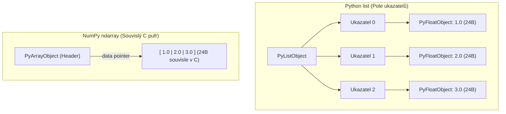

<!-- lecture: week-08 title="⭐ Master Přednáška 8: Vědecké Výpočty: Homogenní Pole NumPy & Vektorizace" estMinutes=90 -->

<!-- slide: id=id1 title="Úvod a osnova" tags="Core" diff="basics" -->
# Úvod a osnova

Vítejte v osmé přednášce kurzu programování v jazyce Python. Dnešním tématem je přechod od obecného programování k **vysoce výkonným vědeckým a numerickým výpočtům**. Seznámíme se se základním stavebním kamenem celého vědeckého ekosystému Pythonu — knihovnou **NumPy** a jejím n-dimenzionálním polem **`ndarray`**.

Pokud jste se v předchozích týdnech divili, proč je Python dominantním jazykem pro Data Science, Machine Learning a vědecké simulace, přestože samotný interpret CPython je relativně pomalý, dnešní přednáška vám dá jednoznačnou odpověď: **Vektorizace a přesun výpočtů do nativního C/Fortran kódu**.

### Osnova dnešní 90minutové přednášky:
1. **Problém výkonu v Pythonu**: Proč jsou interpretované cykly pomalé a co je režie `PyObject` boxing.
2. **C pole vs. Python list vs. NumPy ndarray**: Porovnání paměťové architektury.
3. **Architektura `ndarray`**: Interní struktura `PyArrayObject` (data pointer, shape, strides, dtype).
4. **Datové typy (`dtype`)**: Homogenita, pevná bitová šířka a paměťová úspora.
5. **Vytváření polí**: `array`, `zeros`, `ones`, `empty`, `arange`, `linspace`, `eye`.
6. **Tvary a dimenze**: Vlastnosti `shape`, `ndim`, `size`, `itemsize`, `nbytes`.
7. **Indexování a řezy (Slicing)**: Vícerozměrný přístup a syntaxe.
8. **Klíčový koncept: Pohledy (Views) vs. Kopie (Copies)**: Sdílená paměť a detekce přes `.base`.
9. **Pokročilé indexování (Fancy Indexing)**: Celočíselná pole a kdy vzniká nová alokace.
10. **Logické maskování**: Podmíněný výběr `arr[arr > 0]` a bitové operátory `&`, `|`, `~`.
11. **Paměťové kroky (Strides)**: Matematický výpočet adresy prvku v paměti.
12. **C-order vs. Fortran-order**: Řádkové vs. sloupcové rozložení a vliv na CPU cache.
13. **Změna tvaru a transpozice**: `.reshape()`, transpozice `.T` jako $O(1)$ krok a `.ravel()` vs. `.flatten()`.
14. **Vektorizace & Universal Functions (`ufuncs`)**: Odstranění for-cyklů v Pythonu.
15. **Výkonnostní benchmark**: Porovnání rychlosti čistého for-cyklu a vektorizovaného NumPy.
16. **Přehled ufuncs a in-place operace**: Aritmetika, trigonometrie a parametr `out=`.
17. **Mechanismus vysílání (Broadcasting)**: Výpočty nad poli různých tvarů bez kopírování.
18. **Pravidla broadcastingu v praxi**: Zarovnání zprava doleva a pravidlo shody dimenzí.
19. **Rozšiřování dimenzí**: Využití `np.newaxis` a `None`.
20. **Agregace a redukce podél os**: Metody `sum`, `mean`, `min`, `max`, `std`, `argmax`.
21. **Význam parametru `axis`**: Redukce řádků (`axis=0`) vs. redukce sloupců (`axis=1`).
22. **Lineární algebra**: Maticové násobení `@`, `np.matmul()`, `np.dot()`.
23. **Dekompozice a soustavy rovnic**: Modul `np.linalg` (`solve`, `inv`, `eig`, `norm`).
24. **Vědecká vizualizace s Matplotlib**: Objektový model `Figure` a `Axes`.
25. **Vykreslení signálů a grafů**: Spojité funkce, bodové grafy, mřížka a legendy.
26. **2D data a heatmapy**: Zobrazení matic pomocí `imshow` a barevné palety.
27. **Most k akceleraci: JIT s Numba**: Kompilace pythoních funkcí do strojového kódu a Milestone 3.

---

<!-- slide: id=id2 title="Problém výkonu v Pythonu: Režie PyObject" tags="Core" diff="paradigm" -->
# Problém výkonu v Pythonu: Režie PyObject

V jazyce C nebo C++ představuje 64bitové číslo s plovoucí řádovou čárkou (`double`) přesně **8 bajtů** v paměti. Sto milionů takových čísel zabere přesně $800\text{ MB}$ v jednom souvislém paměťovém bloku.

V interpretovaném Pythonu je však **všechno objekt na haldě**. Každé číslo je instancí `PyFloatObject`, což znamená obrovskou paměťovou a výpočetní režii:

```c
// CPython interní reprezentace čísla (zjednodušeno):
typedef struct {
    PyObject_HEAD    // 16 bajtů: 8B čítač referencí (ob_refcnt) + 8B ukazatel na typ (ob_type)
    double ob_fval;  // 8 bajtů: samotná hodnota typu double
} PyFloatObject;     // Celkem 24 bajtů na jedno jediné číslo!
```

### Proč jsou pythoní `for` cykly pomalé?
Pokud v čistém Pythonu sečteme dvě pole čísel pomocí for-cyklu:
1. **Pointer Chasing (Neefektivita paměti)**: Pythoní `list` je pole ukazatelů (`PyObject**`). Pro každé číslo musí procesor načíst adresu ukazatele a skočit na úplně jiné místo v haldě (cache miss).
2. **Dynamický type dispatching**: V každé iteraci cyklu musí interpret zkontrolovat typ operandů (`ob_type`), zjistit, zda podporují metodu sčítání `__add__`, a vyhledat její C implementaci.
3. **Alokace nového objektu**: Výsledek každého dílčího součtu vytvoří nový `PyFloatObject` na haldě a zvýší čítač referencí.
4. **Režie bytecode interpretru**: Každá instrukce `FOR_ITER`, `BINARY_OP`, `STORE_FAST` prochází obrovským `switch` příkazem vyhodnocovací smyčky CPythonu.

---

<!-- slide: id=id3 title="C pole vs. Python list vs. NumPy ndarray" tags="Core" diff="paradigm" -->
# C pole vs. Python list vs. NumPy ndarray

Podívejme se na porovnání paměťového rozložení tří přístupů:

### 1. Nativní C pole: `double arr[4]`
- Souvislý homogenní blok paměti o velikosti $4 \times 8 = 32\text{ bajtů}$.
- Prvky leží přímo za sebou v paměti $\rightarrow$ ideální pro L1/L2 cache a vektorové instrukce SIMD (AVX-512).

### 2. Standardní Python `list`: `[1.0, 2.0, 3.0, 4.0]`
- Samotný `list` je pole ukazatelů (8 bajtů na ukazatel).
- Ukazatele směřují na různé objekty `PyFloatObject` (každý 24 bajtů) roztroušené po paměti.
- Celková paměť: cca $4 \times 8\text{B (ukazatele)} + 4 \times 24\text{B (objekty)} + 56\text{B (hlavička listu)} \approx 184\text{ bajtů}$ ($> 5\times$ více než v C!).

### 3. NumPy pole: `np.ndarray`
- Kombinuje to nejlepší z obou světů:
  - **Uživatelské rozhraní v Pythonu**: Pohodlný objekt s bohatými metodami.
  - **Paměťové jádro v C**: Uvnitř obsahuje ukazatel na **jeden souvislý homogenní blok paměti**, identický s polem v C/Fortranu.
  - Žádné balení prvků do `PyObject` — data jsou uložena jako surové bajty.



---

<!-- slide: id=id4 title="Architektura ndarray: Interní struktura" tags="Core" diff="internals" -->
# Architektura ndarray: Interní struktura

Když vytvoříte pole `a = np.array([[1, 2, 3], [4, 5, 6]], dtype=np.int32)`, NumPy na pozadí vytvoří C strukturu `PyArrayObject`.

Tato struktura odděluje **metadata pole** od **samotných dat**:

```c
// Zjednodušená struktura PyArrayObject v C jádře NumPy:
typedef struct tagPyArrayObject {
    PyObject_HEAD
    char *data;             // Přímý ukazatel na začátek souvislého bloku dat v RAM
    int ndim;               // Počet dimenzí (rank pole, např. 2 pro matici)
    npy_intp *dimensions;   // Pole velikostí v jednotlivých osách (shape, např. [2, 3])
    npy_intp *strides;      // Počet bajtů k přeskočení na další prvek v dané ose
    PyArray_Descr *descr;   // Popisovač datového typu (dtype, např. int32, float64)
    int flags;              // Příznaky (C-CONTIGUOUS, F-CONTIGUOUS, WRITEABLE, OWNDATA)
    PyObject *base;         // Odkaz na mateřský objekt (pokud je pole pouze výřezem/view)
} PyArrayObject;
```

### Proč je toto oddělení revoluční?
1. **Okamžité operace bez kopírování**: Změna tvaru (`reshape`), transpozice (`.T`) nebo výřez pole (`slicing`) **nevyžadují kopírování dat**. Změní se pouze metadata (`dimensions`, `strides`) a ukazatel `data`.
2. **Přímá integrace s C/Fortran knihovnami**: Pole lze bez jakékoliv konverze přímo předat nativním knihovnám BLAS, LAPACK, FFTW nebo grafickým ovladačům přes ukazatel `data`.

---

<!-- slide: id=id5 title="Datové typy (dtype): Homogenita a bitová šířka" tags="Core" diff="basics" -->
# Datové typy (dtype): Homogenita a bitová šířka

V NumPy má každé pole striktně definovaný **homogenní datový typ** (`dtype`). Všechny prvky pole mají identickou binární velikost a interpretaci:

| NumPy typ | C ekvivalent | Velikost v RAM | Rozsah / Význam |
| :--- | :--- | :--- | :--- |
| `np.int8`, `np.uint8` | `int8_t`, `uint8_t` | 1 bajt | $-128 \dots 127$ / $0 \dots 255$ (ideální pro obrázky) |
| `np.int32`, `np.uint32` | `int32_t`, `uint32_t` | 4 bajty | $-2 \cdot 10^9 \dots 2 \cdot 10^9$ |
| `np.int64` | `int64_t` | 8 bajtů | Výchozí celé číslo na 64bitových OS |
| `np.float32` | `float` (IEEE 754) | 4 bajty | Jednoduchá přesnost (grafické karty, deep learning) |
| `np.float64` | `double` | 8 bajtů | Dvojitá přesnost (výchozí pro float v NumPy) |
| `np.bool_` | `bool` | 1 bajt | Logické hodnoty `True` / `False` |
| `np.complex128` | `double _Complex` | 16 bajtů | Komplexní číslo ($2 \times 64\text{bit float}$) |

### Příklad specifikace a přetypování:
```python
import numpy as np

# Automatická inference typu:
a = np.array([1, 2, 3])
print(a.dtype)  # int64 (nebo int32 na Windows)

# Explicitní specifikace pro úsporu paměti:
b = np.array([1, 2, 3], dtype=np.int8)
print(b.nbytes)  # 3 bajty celkem!

# Přetypování pomocí metody .astype() (vytváří kopii):
c = a.astype(np.float64)
print(c.dtype)   # float64
```

> [!WARNING] Celočíselné přetečení (Overflow)
> Na rozdíl od vestavěného pythoního typu `int` (který má libovolnou přesnost), typy v NumPy mají **pevnou bitovou šířku** a při překročení limitu tiše přetečou podle pravidel jazyka C:
> `np.array([127], dtype=np.int8) + 1` vrátí `-128`!

---

<!-- slide: id=id6 title="Vytváření polí: Generátory a inicializace" tags="Core" diff="basics" -->
# Vytváření polí: Generátory a inicializace

Vytváření polí převodem z pythoních seznamů (`np.array([...])`) je pro velké objemy dat pomalé, protože vyžaduje iteraci přes pythoní objekty. NumPy nabízí vysoce optimalizované C funkce pro přímou inicializaci v paměti:

```python
import numpy as np

# 1. Pole naplněná konstantami
z = np.zeros((3, 4), dtype=np.float64)   # Matice 3x4 plná nul (alokováno a vynulováno)
o = np.ones((2, 3), dtype=np.int32)      # Matice 2x3 plná jedniček
f = np.full((2, 2), 3.14)                # Matice 2x2 naplněná hodnotou 3.14

# 2. Rychlá neinicializovaná alokace (pozor na náhodná smetí v paměti!)
e = np.empty((1000, 1000), dtype=np.float64)  # Blesková alokace bez zápisu hodnot

# 3. Sekvence a rozsahy
r1 = np.arange(0, 10, 2)                 # [0, 2, 4, 6, 8] - obdoba range() s krokem
r2 = np.linspace(0.0, 1.0, num=5)        # [0.0, 0.25, 0.5, 0.75, 1.0] - rovnoměrné dělení

# 4. Jednotkové a diagonální matice
eye = np.eye(3)                          # Jednotková matice 3x3 (1.0 na hlavní diagonále)
diag = np.diag([10, 20, 30])             # Čtvercová matice s danou diagonálou

# 5. Generování náhodných čísel (moderní Generator API od NumPy 1.17+)
rng = np.random.default_rng(seed=42)
rand_uniform = rng.uniform(low=0.0, high=1.0, size=(3, 3))
rand_normal  = rng.normal(loc=0.0, scale=1.0, size=(1000,))
```

> [!TIP] `np.arange` vs. `np.linspace`
> Pro čísla s plovoucí řádovou čárkou (`float`) se vyhněte `np.arange(0, 1, 0.1)`, protože zaokrouhlovací chyby typu float mohou způsobit nepředvídatelný počet prvků. Vždy preferujte `np.linspace(start, stop, count)`.

---

<!-- slide: id=id7 title="Tvary a dimenze: Vlastnosti ndarray" tags="Core" diff="basics" -->
# Tvary a dimenze: Vlastnosti ndarray

Každý objekt `ndarray` poskytuje klíčové atributy popisující jeho rozměry a paměťovou náročnost:

```python
import numpy as np

matrix = np.zeros((3, 5), dtype=np.float64)

# 1. Počet dimenzí (rank)
print(matrix.ndim)      # 2

# 2. Tvar (shape) - n-tice udávající délku v každé ose
print(matrix.shape)     # (3, 5) -> 3 řádky, 5 sloupců

# 3. Celkový počet prvků
print(matrix.size)      # 15  (3 * 5)

# 4. Velikost jednoho prvku v bajtech
print(matrix.itemsize)  # 8  (float64 = 8 bajtů)

# 5. Celková spotřeba paměti datového pufru
print(matrix.nbytes)    # 120 bajtů (15 * 8 bajtů)
```

### Porovnání dimenzí:
- **0D Skalár**: `np.array(42)` $\rightarrow$ `shape = ()`, `ndim = 0`.
- **1D Vektor**: `np.array([1, 2, 3])` $\rightarrow$ `shape = (3,)`, `ndim = 1`.
- **2D Matice**: `np.array([[1, 2], [3, 4]])` $\rightarrow$ `shape = (2, 2)`, `ndim = 2`.
- **3D Tenzor**: např. RGB obrázek o velikosti $1920 \times 1080 \times 3$ $\rightarrow$ `shape = (1080, 1920, 3)`.
- **4D Tenzor**: dávka (batch) 32 obrázků pro neuronovou síť $\rightarrow$ `shape = (32, 1080, 1920, 3)`.

---

<!-- slide: id=id8 title="Indexování a základní řezy (Slicing)" tags="Core" diff="basics" -->
# Indexování a základní řezy (Slicing)

Indexování v NumPy rozšiřuje standardní pythoní syntaxi `[start:stop:step]` do **více dimenzí najednou** oddělených čárkou.

V C nebo Javě přistupujete k 2D poli pomocí dvou závorek `matrix[i][j]`. V NumPy se používá **jedna závorka s čárkami `matrix[i, j]`**:

```python
import numpy as np

# Vytvoříme matici 4x5:
m = np.arange(20).reshape(4, 5)
# [[ 0,  1,  2,  3,  4],
#  [ 5,  6,  7,  8,  9],
#  [10, 11, 12, 13, 14],
#  [15, 16, 17, 18, 19]]

# 1. Přístup k jednomu prvku
val = m[1, 2]       # 7 (řádek index 1, sloupec index 2)

# 2. Celý řádek vs. celý sloupec
row_1 = m[1, :]     # array([5, 6, 7, 8, 9]) - 1D vektor délky 5
col_2 = m[:, 2]     # array([2, 7, 12, 17])   - 1D vektor délky 4

# 3. Podmatice (Sub-matrix)
sub = m[1:3, 1:4]
# [[ 6,  7,  8],
#  [11, 12, 13]]

# 4. Krok a obrácení pořadí
every_second = m[::2, ::2]  # každý druhý řádek a každý druhý sloupec
reversed_rows = m[::-1, :]  # obrácení pořadí řádků
```

> [!IMPORTANT] Proč ne `m[i][j]`?
> Zápis `m[i][j]` v NumPy funguje, ale je **extrémně neefektivní**! Výraz `m[i]` nejprve vytvoří dočasný objekt 1D pole (mezivýsledek) a teprve z něj operátor `[j]` vytáhne prvek. Zápis `m[i, j]` přistupuje přímo k adrese v paměti jedinou C operací.

---

<!-- slide: id=id9 title="Pohledy (Views) vs. Kopie (Copies)" tags="Core" diff="internals" -->
# Pohledy (Views) vs. Kopie (Copies)

Toto je nejdůležitější koncept práce s pamětí v NumPy a nejčastější zdroj záludných chyb programátorů přecházejících z čistého Pythonu.

V čistém Pythonu vytvoří řez seznamu `b = my_list[:]` **novou mělkou kopii**.
V NumPy vytvoří základní řez `b = arr[1:3]` **POHLED (VIEW)**, který sdílí stejnou paměť!

```python
import numpy as np

orig = np.array([10, 20, 30, 40, 50])
view = orig[1:4]  # View ukazující na prvky 20, 30, 40

# Změna v pohledu přepíše data v původním poli!
view[0] = 999

print(orig)  # [ 10, 999,  30,  40,  50] -> PŮVODNÍ POLE BYLO ZMĚNĚNO!
```

### Jak zjistit, zda pole vlastní paměť?
Objekt pole má atribut `.base`:
- Pokud je `.base is None`, pole vlastní svá data (`OWNDATA` flag).
- Pokud `.base` ukazuje na jiné pole, jedná se o pohled (view).
- Funkce `np.shares_memory(a, b)` vrátí `True`, pokud pole sdílejí paměťový blok.

```python
print(view.base is orig)        # True
print(np.shares_memory(orig, view))  # True

# Pokud chcete skutečnou kopii, musíte ji explicitně vyžádat:
safe_copy = orig[1:4].copy()
safe_copy[0] = -1
print(orig[1])  # 999 (nezměněno)
```

---

<!-- slide: id=id10 title="Pokročilé indexování (Fancy Indexing)" tags="Core" diff="basics" -->
# Pokročilé indexování (Fancy Indexing)

Zatímco základní řezání (`:`) vrací pohledy (views), **pokročilé indexování (Fancy Indexing)** pomocí polí indexů nebo celočíselných seznamů **VŽDY vytváří novou kopii v paměti**.

```python
import numpy as np

a = np.arange(10, 100, 10)
# [10, 20, 30, 40, 50, 60, 70, 80, 90]

# 1. Výběr prvků na libovolných pozicích pomocí seznamu indexů:
idx = [1, 3, 5, 1]  # Index 1 je vybrán dvakrát!
subset = a[idx]
print(subset)       # [20, 40, 60, 20] -> Nové alokované pole!

print(subset.base is None)  # True -> Je to nová kopie, ne pohled!

# 2. Vícerozměrné pokročilé indexování:
m = np.arange(12).reshape(3, 4)
# [[ 0,  1,  2,  3],
#  [ 4,  5,  6,  7],
#  [ 8,  9, 10, 11]]

# Vybereme prvky na souřadnicích (0, 1) a (2, 3):
row_indices = np.array([0, 2])
col_indices = np.array([1, 3])
print(m[row_indices, col_indices])  # [1, 11]

# 3. Zápis pomocí Fancy Indexing:
a[[0, 2]] = -99
print(a)  # [-99, 20, -99, 40, 50, 60, 70, 80, 90]
```

### Shrnutí paměťového chování:
- Základní řez (`m[1:3, :]`): **View** ($O(1)$ čas i paměť).
- Pokročilý index (`m[[1, 2], :]`): **Kopie** ($O(N)$ čas i alokace).

---

<!-- slide: id=id11 title="Logické masky a booleovské indexování" tags="Core" diff="basics" -->
# Logické masky a booleovské indexování

Jedním z nejmocnějších nástrojů pro filtrování a čištění dat jsou **booleovské masky**.

Porovnání pole se skalárem provede vektorizovanou operaci na všech prvcích a vrátí pole typu `bool_`:

```python
import numpy as np

data = np.array([-5, 12, 0, -2, 45, 18, -1])

# Vektorizované porovnání vytvoří masku:
mask = data > 0
print(mask)
# [False,  True, False, False,  True,  True, False]

# Aplikace masky: vybere pouze prvky, kde je maska True:
positive = data[mask]
print(positive)  # [12, 45, 18] -> Vrací vždy 1D kopii!

# In-place modifikace podle podmínky (velmi rychlé!):
data[data < 0] = 0
print(data)      # [ 0, 12,  0,  0, 45, 18,  0]
```

### Složené podmínky: Bitové vs. Logické operátory
Při kombinování podmínek **NESMÍTE** použít pythoní operátory `and`, `or`, `not`. Tyto operátory vyžadují převod celého pole na jednu pravdivostní hodnotu (`bool(arr)`), což vyvolá chybu `ValueError`.

Vždy musíte použít **bitové operátory `&`, `|`, `~`** a jednotlivé podmínky uzavřít do závorek:

```python
x = np.arange(10)

# Chyba: x > 2 and x < 7  -> ValueError: The truth value of an array is ambiguous!

# Správně:
filtered = x[(x > 2) & (x < 7)]  # [3, 4, 5, 6]
inverted = x[~(x > 5)]            # [0, 1, 2, 3, 4, 5]
```

---

<!-- slide: id=id12 title="Paměťové kroky (Strides): Architektura skoků" tags="Core" diff="internals" -->
# Paměťové kroky (Strides): Architektura skoků

Jak interpretuje NumPy n-dimenzionální matici uloženou v 1D lineární paměti RAM? Odpovědí je pole **`strides`**.

`strides` je n-tice celých čísel, která říká: **„O kolik bajtů se musím posunout v lineární paměti, abych se dostal na další prvek v dané dimenzi?“**

Adresa prvku na indexech $(i, j)$ se v paměti vypočítá okamžitým vzorcem:
$$\text{offset} = i \cdot \text{strides}[0] + j \cdot \text{strides}[1]$$

```python
import numpy as np

# Matice 3x4 typu int64 (každý prvek = 8 bajtů):
m = np.arange(12, dtype=np.int64).reshape(3, 4)

print(m.shape)    # (3, 4)
print(m.strides)  # (32, 8)
```

### Proč jsou strides `(32, 8)`?
- V řádku jsou 4 prvky. Pro posun o 1 sloupec doprava (`j + 1`) skočíme o **8 bajtů** (velikost 1 `int64`).
- Pro posun o 1 řádek dolů (`i + 1`) musíme přeskočit celý řádek (4 prvky) $\rightarrow 4 \times 8 = \mathbf{32\text{ bajtů}}$.

```mermaid
graph LR
    subgraph RAM["Lineární paměť RAM (1D buffer)"]
        direction LR
        E0["0"] --- E1["1"] --- E2["2"] --- E3["3"] --- E4["4"] --- E5["5"] --- E6["6"] --- E7["7"]
    end
    E0 -->|stride[1] = +8B| E1
    E0 -->|stride[0] = +32B| E4
```

Díky strides může NumPy manipulovat s maticemi bez dotyku dat v paměti!

---

<!-- slide: id=id13 title="C-order vs. Fortran-order: Cache spatial locality" tags="Core" diff="internals" -->
# C-order vs. Fortran-order: Cache spatial locality

V paměti počítače existují dvě základní konvence pro ukládání vícerozměrných polí:

1. **C-order (Row-Major / Řádkové uspořádání)**:
   - Výchozí nastavení v C, C++ a NumPy.
   - Poslední index se v paměti mění nejrychleji. Prvky v řádku leží těsně vedle sebe.
   - Strides pro tvar $(3, 4)$ typu `float64`: `(32, 8)`.

2. **Fortran-order (Column-Major / Sloupcové uspořádání)**:
   - Výchozí nastavení ve Fortranu, MATLABu a knihovně R.
   - První index se mění nejrychleji. Prvky ve sloupci leží těsně vedle sebe.
   - Strides pro tvar $(3, 4)$ typu `float64`: `(8, 24)`.

```python
import numpy as np

c_arr = np.ones((3, 4), order='C')
f_arr = np.ones((3, 4), order='F')

print("C strides:", c_arr.strides)  # (32, 8)  -> posun o řádek = 32B
print("F strides:", f_arr.strides)  # (8, 24)  -> posun o sloupec = 24B
```

### Vliv na výkonnost CPU Cache (Spatial Locality)
Když procesor načte z RAM jedno číslo, natáhne do L1 cache celou **cache linku** (typicky 64 bajtů = 8 čísel `float64`).
- Pokud procházíte pole v C-order po řádcích, dalších 7 čísel už čeká v L1 cache $\rightarrow$ **Cache Hit**.
- Pokud procházíte pole v C-order po sloupcích (skoky o 32 bajtů), procesor neustále vyhazuje cache linky $\rightarrow$ **Cache Miss** a až $5\times$ pomalejší výpočet!

---

<!-- slide: id=id14 title="Změna tvaru a transpozice: O(1) stride magie" tags="Core" diff="basics" -->
# Změna tvaru a transpozice: O(1) stride magie

Díky oddělení metadat a strides jsou operace změny tvaru v NumPy téměř bezplatné ($O(1)$ časová složitost):

### 1. Transpozice matice (`.T` nebo `np.transpose()`)
Transpozice matice v C nebo Javě vyžaduje alokaci nového pole a vnořený cyklus kopírující `m_trans[j][i] = m[i][j]`.
V NumPy transpozice **nezkopíruje ani jediný bajt dat**! Pouze prohodí hodnoty v polích `shape` a `strides`:

```python
import numpy as np

m = np.arange(6, dtype=np.int64).reshape(2, 3)
print(m.shape, m.strides)   # (2, 3), strides = (24, 8)

t = m.T  # Transponovaná matice 3x2
print(t.shape, t.strides)   # (3, 2), strides = (8, 24) -> POUZE PROHOZENÉ STRIDES!
print(t.base is m)          # True -> Data v paměti jsou 100% sdílená
```

### 2. Změna tvaru (`.reshape()`)
Umožňuje reinterpretovat 1D pole jako 2D matici nebo naopak:
```python
v = np.arange(12)              # 1D vektor (12,)
mat = v.reshape(3, 4)          # 2D matice (3, 4)
tensor = v.reshape(2, 2, 3)    # 3D tenzor (2, 2, 3)

# Automatický výpočet jedné dimenze pomocí -1:
auto = v.reshape(2, -1)        # NumPy automaticky spočítá druhý rozměr jako 6
```

### 3. Zploštění pole: `.ravel()` vs. `.flatten()`
- `arr.ravel()`: Vrací 1D **pohled (view)**, kdykoliv je to paměťově možné. Bleskové $O(1)$.
- `arr.flatten()`: Vždy alokuje a vrací novou 1D **kopii** dat ($O(N)$).

---

<!-- slide: id=id15 title="Vektorizace & Universal Functions (ufuncs)" tags="Core" diff="basics" -->
# Vektorizace & Universal Functions (ufuncs)

Co je to **vektorizace**?
Vektorizace je technika, kdy operace aplikovaná na pole jako celek neprobíhá explicitním for-cyklem v Pythonu, ale je delegována do kompilovaného nativního C kódu, který provádí operaci nad paměťovými bloky v těsných vnitřních smyčkách.

Jádrem vektorizace v NumPy jsou **Universal Functions (`ufuncs`)**:

```python
import numpy as np

a = np.array([1.0, 2.0, 3.0, 4.0])
b = np.array([10.0, 20.0, 30.0, 40.0])

# Vektorizovaný součet dvou polí:
c = a + b  # Volá interně np.add(a, b)
print(c)   # array([11., 22., 33., 44.])
```

### Co se stane na pozadí při `c = a + b`?
1. NumPy alokuje jeden cílový C pufr pro výsledek.
2. Zkontroluje shodu tvarů a datových typů.
3. Spustí vysoce optimalizovanou C smyčku:
   ```c
   // C implementace uvnitř NumPy ufunc:
   for (npy_intp i = 0; i < n; i++) {
       c_ptr[i] = a_ptr[i] + b_ptr[i]; // Moderní C kompilátory auto-vektorizují do AVX2/AVX-512!
   }
   ```
4. Žádné vytváření dočasných pythoních objektů, žádný type dispatch, žádný bytecode overhead.

---

<!-- slide: id=id16 title="Výkonnostní benchmark: Python vs. NumPy" tags="Core" diff="basics" -->
# Výkonnostní benchmark: Python vs. NumPy

O kolik je vektorizovaný NumPy kód skutečně rychlejší než běžný Python? Otestujme operaci výpočtu eukleidovské vzdálenosti ($c_i = \sqrt{a_i^2 + b_i^2}$) na poli o $1\,000\,000$ prvcích:

```python
import time
import math
import numpy as np

N = 1_000_000
py_a = [float(x) for x in range(N)]
py_b = [float(x * 2) for x in range(N)]

np_a = np.array(py_a)
np_b = np.array(py_b)

# 1. Čistý Python: klasický for-cyklus
t0 = time.perf_counter()
py_res = []
for i in range(N):
    py_res.append(math.sqrt(py_a[i]**2 + py_b[i]**2))
t_loop = time.perf_counter() - t0

# 2. Python: List Comprehension
t0 = time.perf_counter()
py_comp = [math.sqrt(x**2 + y**2) for x, y in zip(py_a, py_b)]
t_comp = time.perf_counter() - t0

# 3. Vektorizovaný NumPy
t0 = time.perf_counter()
np_res = np.sqrt(np_a**2 + np_b**2)
t_numpy = time.perf_counter() - t0

print(f"Python for cyklus:     {t_loop:.4f} s (1.0x)")
print(f"List comprehension:    {t_comp:.4f} s ({t_loop/t_comp:.1f}x)")
print(f"NumPy vektorizace:     {t_numpy:.4f} s ({t_loop/t_numpy:.1f}x zrychlení!)")
```

### Typické naměřené výsledky:
- Python for-cyklus: **~280 ms**
- List comprehension: **~210 ms**
- NumPy vektorizace: **~3.2 ms** $\longrightarrow$ **Více než 85× zrychlení!**

Pokud použijeme ještě specializovanou funkci `np.hypot(np_a, np_b)`, čas klesne pod 2 ms ($> 140\times$).

---

<!-- slide: id=id17 title="Přehled ufuncs a in-place operace" tags="Core" diff="basics" -->
# Přehled ufuncs a in-place operace

NumPy obsahuje desítky vestavěných `ufunc` funkcí pokrývajících veškerou matematiku:

```python
import numpy as np

x = np.linspace(0, np.pi, 5)

# Matematické a goniometrické funkce
s = np.sin(x)
c = np.cos(x)
e = np.exp(x)
l = np.log(x + 1e-9)

# Zaokrouhlování a absolutní hodnota
abs_val = np.abs(np.array([-1.5, 2.3, -0.7]))
rounded = np.round(abs_val, decimals=1)
```

### Paměťová optimalizace: Parametr `out=`
Když napíšete `c = a + b * 2`, NumPy musí alokovat **dočasné pole** pro výsledek `b * 2` a další pole pro součet `a + ...`. U obřích polí (desítky GB) to může vést k pádu programu z důvodu vyčerpání RAM (`MemoryError`).

Všechny `ufuncs` přijímají parametr `out=`, který provede výpočet přímo do existujícího pufru bez jakékoliv alokace:

```python
large_arr = np.ones((10000, 10000), dtype=np.float64)  # ~800 MB

# Místo: large_arr = np.sin(large_arr) (alokuje dalších 800 MB)
# Použijeme in-place výpočet do stejného pufru:
np.sin(large_arr, out=large_arr)  # 0 bajtů dodatečné alokace!

# Zkrácený zápis pro základní aritmetiku:
large_arr += 5.0   # in-place přičtení (volá np.add(..., out=large_arr))
large_arr *= 2.0   # in-place násobení
```

---

<!-- slide: id=id18 title="Mechanismus vysílání (Broadcasting) – Princip" tags="Core" diff="basics" -->
# Mechanismus vysílání (Broadcasting) – Princip

Co když chceme sečíst matici o rozměrech $(3, 3)$ s 1D vektorem o 3 prvcích?

V běžném programovacím jazyce byste museli napsat vnořený for-cyklus, nebo vektor v paměti třikrát zreplikovat pod sebe na velikost $(3, 3)$.

NumPy přichází s revolučním mechanismem zvaným **Broadcasting (vysílání)**:
Umožňuje aritmetické operace mezi poli **různých tvarů**, aniž by docházelo k fyzickému kopírování dat v paměti RAM!

```python
import numpy as np

# Matice 3x3:
matrix = np.array([[1,  2,  3],
                   [4,  5,  6],
                   [7,  8,  9]])

# 1D vektor o 3 prvcích:
row_vector = np.array([10, 20, 30])

# Sečtení matice s vektorem:
result = matrix + row_vector
print(result)
# [[11, 22, 33],
#  [14, 25, 36],
#  [17, 28, 39]]
```

### Jak to funguje bez kopírování paměti?
NumPy vektor nevynásobí v RAM. Nastaví jeho vnitřní stride v chybějící dimenzi na **0**! To znamená, že při posunu v řádku procesor čte stále stejné hodnoty z L1 cache, aniž by alokoval jediný bajt navíc.

---

<!-- slide: id=id19 title="Pravidla broadcastingu v praxi" tags="Core" diff="basics" -->
# Pravidla broadcastingu v praxi

Aby mohla být dvě pole automaticky vysílána, musí vyhovět formálním **Pravidlům Broadcastingu**:

### Algoritmus vyhodnocení:
1. Porovnávají se tvary (`shape`) obou polí **ZPRAVA DOLEVA** (od poslední osy k první).
2. Dvě dimenze jsou kompatibilní, pokud:
   - Jsou **naprosto shodné**, NEBO
   - Jedna z nich má velikost **přesně 1**.
3. Pokud má jedno pole méně dimenzí než druhé, jeho tvar se zleva pomyslně doplní jedničkami ($1$).

### Příklad 1: Kompatibilní tvary
```text
Pole A:   (8, 1, 6, 1)
Pole B:      (7, 1, 5)
------------------------
Výsledek: (8, 7, 6, 5)  -> Platný broadcasting!
```
- Osa 3: $1$ vs $5 \rightarrow 5$ (osa A se virtuálně natáhne)
- Osa 2: $6$ vs $1 \rightarrow 6$ (osa B se virtuálně natáhne)
- Osa 1: $1$ vs $7 \rightarrow 7$ (osa A se virtuálně natáhne)
- Osa 0: $8$ vs doplňková $1 \rightarrow 8$ (B se doplní)

### Příklad 2: Nekompatibilní tvary (Chyba)
```python
a = np.ones((3, 4))
b = np.ones((3,))

# a + b -> ValueError: operands could not be broadcast together with shapes (3,4) (3,)
# Proč? Zprava: 4 vs 3 -> Nejsou shodné a ani jedna není 1!
```

---

<!-- slide: id=id20 title="Rozšiřování dimenzí: np.newaxis a None" tags="Core" diff="basics" -->
# Rozšiřování dimenzí: np.newaxis a None

V předchozím příkladu jsme viděli, že sečíst matici tvaru `(3, 4)` s vektorem tvaru `(3,)` selže, protože dimenze 3 se zarovná k pravému rozměru 4.

Co když ale chceme přičíst hodnoty vektoru ke **každému sloupci** (vektor jako sloupec tvaru `(3, 1)`)?

K tomu slouží konstanta `np.newaxis` (nebo její synonymum `None`), která vloží do tvaru pole novou dimenzi o velikosti $1$:

```python
import numpy as np

matrix = np.ones((3, 4))      # Tvar: (3, 4)
vector = np.array([10, 20, 30]) # Tvar: (3,)

# Vložíme novou osu na konec:
col_vector = vector[:, np.newaxis]  # Tvar se změní na: (3, 1)
print(col_vector.shape)             # (3, 1)

# Nyní broadcasting zafunguje perfektně:
# (3, 4) + (3, 1) -> (3, 4)
result = matrix + col_vector
print(result)
# [[11., 11., 11., 11.],
#  [21., 21., 21., 21.],
#  [31., 31., 31., 31.]]
```

### Vnější součin jedním řádkem díky broadcastingu:
```python
u = np.array([1, 2, 3])     # (3,)
v = np.array([4, 5, 6, 7])  # (4,)

# Vnější součin (Outer Product) matice 3x4:
outer = u[:, None] * v[None, :]  # (3, 1) * (1, 4) -> (3, 4)
print(outer)
# [[ 4,  5,  6,  7],
#  [ 8, 10, 12, 14],
#  [12, 15, 18, 21]]
```

---

<!-- slide: id=id21 title="Agregace a redukce podél os" tags="Core" diff="basics" -->
# Agregace a redukce podél os

Agregace v NumPy slouží ke shrnutí dat přes celé pole nebo podél vybraných os. Na rozdíl od vestavěných pythoních funkcí `sum()` a `min()` jsou NumPy metody bleskově kompilované:

```python
import numpy as np

arr = np.array([[10, 20, 30],
                [40, 50, 60]])

# 1. Globální agregace přes celé pole (výsledkem je skalár):
total = np.sum(arr)     # 210
avg   = np.mean(arr)    # 35.0
std   = np.std(arr)     # 17.078...
vmin  = np.min(arr)     # 10
vmax  = np.max(arr)     # 60

# 2. Hledání indexu extrému (Argmin / Argmax)
# Kde v poli leží největší hodnota?
idx_flat = np.argmax(arr)  # 5 (index v lineárním zploštěném poli)
row, col = np.unravel_index(idx_flat, arr.shape)
print(f"Maximum je na pozici [{row}, {col}]")  # [1, 2]
```

> [!WARNING] Vyhněte se vestavěným funkcím Pythonu na NumPy polích
> Nikdy nevolejte `sum(np_array)` ani `min(np_array)`! Vestavěný `sum()` z Pythonu iteruje přes pole prvek po prvku v Pythonu a převádí každé C číslo zpět na `PyObject`. Vždy volejte `np.sum(np_array)` nebo metodu `np_array.sum()`.

---

<!-- slide: id=id22 title="Význam parametru axis: Řádky vs. Sloupce" tags="Core" diff="basics" -->
# Význam parametru axis: Řádky vs. Sloupce

Parametr `axis` je zdrojem častých omylů začátečníků.

**Zlaté pravidlo pro `axis`:**
> Hodnota `axis` neudává, *co zachováváte*, ale **podél které osy provádíte redukci (kterou osu hroutíte / mažete)**!

Představme si matici o tvaru $(3, 4)$ (3 řádky, 4 sloupce):
- **`axis=0`**: Hroutí se **řádky** (osa 0). Operace se provádí shora dolů přes každý sloupec zvlášť $\rightarrow$ výsledkem je 1D pole o délce 4 (sloupcové součty).
- **`axis=1`**: Hroutí se **sloupce** (osa 1). Operace se provádí zleva doprava přes každý řádek zvlášť $\rightarrow$ výsledkem je 1D pole o délce 3 (řádkové součty).

```python
import numpy as np

m = np.array([[1, 2, 3, 4],
              [5, 6, 7, 8],
              [9, 10, 11, 12]])

# Součet podél sloupců (zhroucení řádků):
col_sums = m.sum(axis=0)  # array([15, 18, 21, 24]) - tvar (4,)

# Součet podél řádků (zhroucení sloupců):
row_sums = m.sum(axis=1)  # array([10, 26, 42])     - tvar (3,)

# Zachování počtu dimenzí pomocí keepdims=True:
row_sums_2d = m.sum(axis=1, keepdims=True)  # tvar (3, 1)
# Umožňuje okamžitou normalizaci řádků pomocí broadcastingu:
normalized = m / row_sums_2d
```

---

<!-- slide: id=id23 title="Lineární algebra: Maticové násobení" tags="Core" diff="basics" -->
# Lineární algebra: Maticové násobení

V NumPy musíte striktně rozlišovat dva druhy násobení:

### 1. Prvkový součin (Hadamard product): Operátor `*`
- Násobí odpovídající prvky na stejných pozicích: $C_{ij} = A_{ij} \cdot B_{ij}$.
- Vyžaduje stejné tvary (nebo broadcasting).

### 2. Maticový součin (Dot product): Operátor `@` nebo `np.matmul()`
- Standardní algebraické násobení matic: $C_{ik} = \sum_j A_{ij} B_{jk}$.
- Počet sloupců první matice se musí rovnat počtu řádků druhé matice: $(M, K) \times (K, N) \rightarrow (M, N)$.

```python
import numpy as np

A = np.array([[1, 2],
              [3, 4]])

B = np.array([[10, 20],
              [30, 40]])

# 1. Prvkové násobení:
elem = A * B
print(elem)
# [[ 10,  40],
#  [ 90, 160]]

# 2. Skutečné maticové násobení (PEP 465 operátor @):
mat = A @ B  # ekvivalent np.matmul(A, B)
print(mat)
# [[ 70, 100],   (1*10 + 2*30 = 70)
#  [150, 220]]   (3*10 + 4*30 = 150)

# Vektorový skalární součin dvou 1D vektorů:
v1 = np.array([1, 2, 3])
v2 = np.array([4, 5, 6])
dot_prod = v1 @ v2  # 1*4 + 2*5 + 3*6 = 32 (skalár)
```

---

<!-- slide: id=id24 title="Dekompozice a soustavy rovnic: np.linalg" tags="Core" diff="basics" -->
# Dekompozice a soustavy rovnic: np.linalg

Podmodul `np.linalg` poskytuje rozhraní k vysoce optimalizovaným C a Fortran knihovnám **BLAS** a **LAPACK** (OpenBLAS, Intel MKL nebo Apple Accelerate).

### Řešení soustavy lineárních rovnic $A \cdot x = b$
Představme si soustavu 3 rovnic o 3 neznámých:
$$\begin{aligned}
3x + y - 2z &= 5 \\
2x - 4y + z &= -3 \\
x + 2y + 3z &= 8
\end{aligned}$$

```python
import numpy as np

# Matice koeficientů A a vektor pravých stran b:
A = np.array([[3.0,  1.0, -2.0],
              [2.0, -4.0,  1.0],
              [1.0,  2.0,  3.0]])

b = np.array([5.0, -3.0, 8.0])

# Přímé vyřešení soustavy bez invertování matice:
x = np.linalg.solve(A, b)
print("Řešení [x, y, z]:", x)  # [1.909..., 1.090..., 0.909...]

# Ověření přesnosti (A @ x - b by mělo být ~ 0):
print("Chyba:", np.allclose(A @ x, b))  # True
```

### Další pokročilé algebraické funkce:
- `np.linalg.inv(A)`: Výpočet inverzní matice $A^{-1}$ (pro řešení soustav raději volte `solve()`).
- `np.linalg.det(A)`: Determinant matice.
- `np.linalg.norm(v)`: Eukleidovská norma vektoru / Frobeniova norma matice.
- `eigenvalues, eigenvectors = np.linalg.eig(A)`: Vlastní čísla a vlastní vektory.

---

<!-- slide: id=id25 title="Vědecká vizualizace s Matplotlib: Figure a Axes" tags="Core" diff="basics" -->
# Vědecká vizualizace s Matplotlib: Figure a Axes

Vědecká analýza dat je neúplná bez okamžité vizuální interpretace. Knihovna **Matplotlib** je standardem pro 2D vizualizaci v Pythonu a s poli NumPy nativně spolupracuje.

Vždy preferujte moderní **Objektově orientované rozhraní (`Figure` & `Axes`)** před starým imperativním stylem `plt.plot()`:

```python
import numpy as np
import matplotlib.pyplot as plt

# 1. Generování dat pomocí NumPy:
x = np.linspace(0, 10, 500)
signal_clean = np.sin(x)
noise = np.random.default_rng(42).normal(0, 0.1, size=x.shape)
signal_noisy = signal_clean + noise

# 2. Vytvoření plátna (fig) a osy (ax):
fig, ax = plt.subplots(figsize=(8, 4), dpi=100)

# 3. Kreslení dat:
ax.plot(x, signal_noisy, label="Měřený signál (šum)", color="#94a3b8", alpha=0.7)
ax.plot(x, signal_clean, label="Čistá sinusoida", color="#2563eb", linewidth=2.0)

# 4. Formátování grafu:
ax.set_title("Vzorkování a filtrace signálu")
ax.set_xlabel("Čas [s]")
ax.set_ylabel("Amplituda [V]")
ax.grid(True, linestyle="--", alpha=0.5)
ax.legend(loc="upper right")

# 5. Uložení výstupu do souboru:
fig.savefig("signal_plot.png", dpi=300, bbox_inches="tight")
plt.close(fig)
```

---

<!-- slide: id=id26 title="2D data a heatmapy: Zobrazení matic" tags="Core" diff="basics" -->
# 2D data a heatmapy: Zobrazení matic

Pro zobrazení 2D matic, obrazových dat, korelací nebo fyzikálních polí nabízí Matplotlib funkci `ax.imshow()`:

```python
import numpy as np
import matplotlib.pyplot as plt

# Vytvoření 2D vlnového pole pomocí broadcastingu:
x = np.linspace(-3, 3, 200)
y = np.linspace(-3, 3, 200)
X, Y = np.meshgrid(x, y)  # Vytvoří 2D souřadnicové sítě
Z = np.sin(X**2 + Y**2) / (X**2 + Y**2 + 0.1)  # 2D matice 200x200

fig, ax = plt.subplots(figsize=(6, 5), dpi=100)

# Zobrazení matice jako tepelné mapy:
cax = ax.imshow(Z, extent=[-3, 3, -3, 3], origin="lower", cmap="viridis")

# Přidání barevné škály (Colorbar):
fig.colorbar(cax, ax=ax, label="Intenzita pole")

ax.set_title("2D Vlnová funkce (imshow)")
ax.set_xlabel("Osa X")
ax.set_ylabel("Osa Y")

fig.savefig("wave_field.png", dpi=300)
plt.close(fig)
```

### Proč je `imshow` tak rychlý?
`imshow` neinterpretuje každý prvek matice jako pythoní grafický objekt. Celý NumPy pufr předá grafickému vykreslovači (Agg / C++ backend), který matici převede na bitmapovou texturu v jediném C volání.

---

<!-- slide: id=id27 title="Most k akceleraci: JIT s Numba & Shrnutí" tags="Core" diff="wow" -->
# Most k akceleraci: JIT s Numba & Shrnutí

Co když váš algoritmus nelze snadno zapsat vektorizovaně (např. stavové simulace, Monte Carlo s adaptivními kroky nebo rekurzivní filtry)?

Zde nastupuje **Numba** — JIT (Just-In-Time) kompilátor, který vezme obyčejný pythoní for-cyklus pracující s NumPy poli a za běhu jej zkompiluje přímo do **strojového kódu procesoru pomocí LLVM**:

```python
import numpy as np
from numba import jit

# Dekorátor @jit(nopython=True) zakáže CPython interpret a kompiluje do C rychlosti:
@jit(nopython=True, fastmath=True)
def mandelbrot_simulace(size: int, max_iter: int) -> np.ndarray:
    result = np.zeros((size, size), dtype=np.int32)
    for i in range(size):
        for j in range(size):
            c = complex(-2.0 + 3.0 * i / size, -1.5 + 3.0 * j / size)
            z = 0.0j
            iters = 0
            while abs(z) <= 2.0 and iters < max_iter:
                z = z * z + c
                iters += 1
            result[i, j] = iters
    return result

# První volání zkompiluje funkci do nativního kódu; další volání běží plnou C rychlostí!
img = mandelbrot_simulace(1000, 100)
```

### Shrnutí 8. přednášky:
1. **NumPy `ndarray`** ukládá homogenní data do souvislého C pufru v paměti RAM bez režie `PyObject`.
2. **Strides a Views**: Řezy a transpozice jsou bleskové $O(1)$ operace manipulující s paměťovými kroky bez alokace kopie.
3. **Vektorizace a ufuncs**: Eliminují interpretované smyčky Pythonu a dosahují $100\times$ vyššího výkonu.
4. **Broadcasting**: Umožňuje bezešvé operace mezi různě tvarovanými poli bez plýtvání RAM.
5. V příštím týdnu propojíme tyto dovednosti se **souborovým systémem, SQLite databázemi a knihovnou Pandas**!
