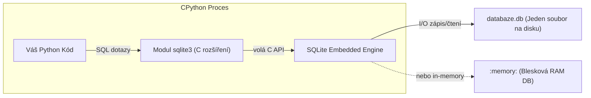
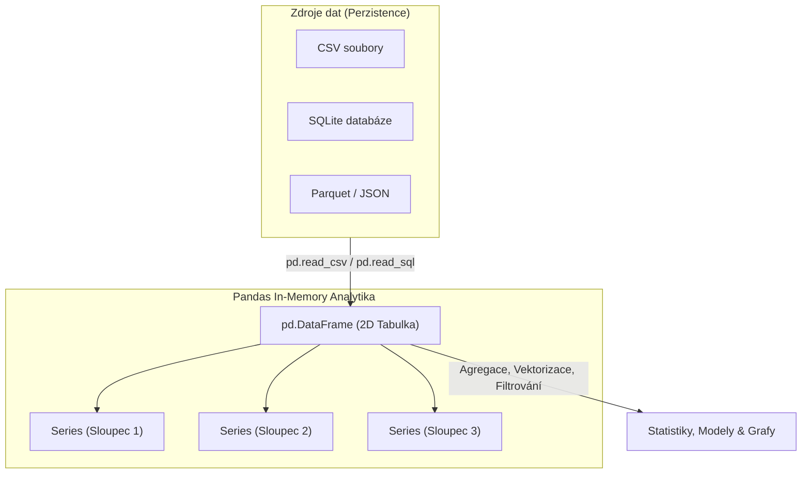
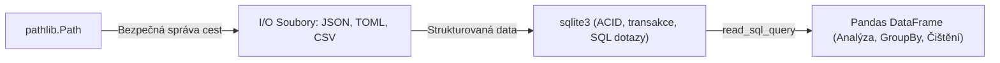

<!-- lecture: week-09 title="⭐ Master Přednáška 9: Soubory, Moderní I/O, SQLite3 & Úvod do Analýzy Dat (Pandas)" estMinutes=90 -->

<!-- slide: id=id1 title="Úvod a osnova" tags="Core" diff="basics" -->
# Úvod a osnova

Vítejte v deváté přednášce kurzu programování v jazyce Python. Dnes opustíme čistě výpočetní operace v operační paměti a zaměříme se na **perzistenci, práci se souborovým systémem, relačními databázemi a tabulkovou analýzu dat**.

Data žijí v souborech různých formátů (textové logy, binární struktury, JSON, TOML, CSV) nebo v relačních databázích. Seznámíme se s moderním objektovým přístupem ke správě cest **`pathlib.Path`**, ukážeme si, jak bezpečně pracovat s vestavěnou relační databází **`sqlite3`** bez rizika SQL Injection, a položíme základy práce s de facto standardem pro datovou analýzu v Pythonu — knihovnou **Pandas** (`Series` a `DataFrame`).

### Osnova dnešní 90minutové přednášky:
1. **C/Java vs. Python I/O paradigma**: Od `FILE*` a streamů k bezpečnému Python RAII kontextu.
2. **Textový vs. Binární režim**: Konec řádků (`\r\n` vs. `\n`), UTF-8 kódování a PEP 597/686.
3. **Základy práce se soubory**: Funkce `open()`, přístupové režimy, buffering a metody čtení.
4. **Ukazatel v souboru (Seek & Tell)**: Náhodný přístup v proudech a binární hlavičky.
5. **Problém starého přístupu `os.path`**: Proč jsou textové řetězce nevhodnou abstrakcí.
6. **Objektové cesty s `pathlib.Path`**: Operátor `/`, absolutní cesty a anatomie cesty (`stem`, `suffix`).
7. **Manipulace se souborovým systémem**: `.exists()`, `.is_file()`, `.mkdir()`, mazání a přesuny.
8. **Bleskové čtení a zápis s Path**: Metody `.read_text()`, `.write_text()`, `.read_bytes()`.
9. **Vyhledávání a procházení složek**: Masky `.glob()` a rekurzivní stromy s `.rglob()`.
10. **Serializace strukturovaných dat: JSON**: Modul `json`, párování typů a serializační pasti.
11. **Moderní konfigurace s `tomllib`**: Proč formát TOML nahradil INI/YAML (PEP 680).
12. **Tabulková data s modulem `csv`**: `reader`, `writer`, `DictReader` a parametr `newline=""`.
13. **Bezpečnost serializace (Proč ne pickle)**: Riziko spuštění libovolného kódu a bezpečné alternativy.
14. **Relační databáze v Pythonu: SQLite3**: Architektura bezserverové transakční databáze.
15. **Připojení a kurzor**: `connect()`, `cursor.execute()`, `fetchone()` a `fetchall()`.
16. **Kritická bezpečnost: Ochrana před SQL Injection**: Parametrizované dotazy (`?`) vs. f-stringy.
17. **Transakční integrita**: Správce kontextu `with conn:` a automatický `COMMIT` / `ROLLBACK`.
18. **Dávkové operace a výkon**: Metoda `executemany()` a hromadné vkládání tisíců řádků.
19. **Most k tabulkové analýze: Proč Pandas?**: Omezení SQL pro in-memory analytiku.
20. **Základní stavební kámen: `pd.Series`**: 1D vektor s pojmenovaným indexem a vektorizace.
21. **Dvourozměrné tabulky: `pd.DataFrame`**: Sloupce, řádky, sdílený index a tvorba tabulek.
22. **Načítání dat do Pandas**: `pd.read_csv()`, `pd.read_sql_query()` a binární `read_parquet()`.
23. **Selekce dat: `.loc[]` vs. `.iloc[]`**: Výběr podle návěští vs. celočíselné pozice.
24. **Logické filtrování v Pandas**: Booleovské masky a složené podmínky.
25. **Čištění dat a chybějící hodnoty**: Práce s `NaN`, metody `isna()`, `dropna()`, `fillna()`.
26. **Agregace a seskupování (GroupBy)**: Princip Split-Apply-Combine a metoda `.agg()`.
27. **Most k praxi a labu**: Cvičení NetPBM + Analýza ornitologických dat & Příprava na Week 11.

---

<!-- slide: id=id2 title="C/Java vs. Python I/O: Kontextové paradigma" tags="Core" diff="paradigm" -->
# C/Java vs. Python I/O: Kontextové paradigma

V jazycích C a Java bylo tradiční čtení souboru spojeno s rizikem **úniku souborových deskriptorů** (Resource Leaks). Pokud v C zapomenete zavolat `fclose(f)`, nebo v Javě vyletí výjimka před voláním `in.close()`, operační systém drží soubor otevřený až do vyčerpání systémových limitů:

```c
// C: Nebezpečný procedurální přístup s rizikem memory/handle leaku
FILE *f = fopen("mereni.dat", "r");
if (f == NULL) { return -1; }
// Pokud zde nastane chyba nebo předčasný return, soubor zůstane otevřený!
fclose(f);
```

```java
// Java: Verbózní try-with-resources
try (BufferedReader br = new BufferedReader(new FileReader("mereni.dat"))) {
    String line = br.readLine();
} catch (IOException e) {
    e.printStackTrace();
}
```

### Python: Elegantní RAII přes správce kontextu `with`
V Pythonu se soubory **nikdy neotevírají bez správce kontextu `with`**:
- Interpret garantuje zavolání metody `__exit__()` (a tedy uzavření deskriptoru na úrovni CPythonu i jádra OS) za všech okolností — i při nečekané výjimce nebo příkazu `return`.

```python
with open("mereni.dat", mode="r", encoding="utf-8") as f:
    obsah: str = f.read()
# Zde je soubor již garantovaně bezpečně uzavřen
```

---

<!-- slide: id=id3 title="Textový vs. Binární režim & Kódování UTF-8" tags="Core" diff="basics" -->
# Textový vs. Binární režim & Kódování UTF-8

Při volání `open(cesta, mode=...)` musíte striktně rozlišovat mezi dvěma světy:

### 1. Textový režim (výchozí: `'r'`, `'w'`, `'a'`)
- Pracuje s pythoním typem **`str`** (řetězec Unicode znaků).
- **Automatický překlad konců řádků (Universal Newlines)**:
  - Na Windows ukládají programy konce řádků jako `\r\n` (CRLF), na Linuxu/macOS jako `\n` (LF).
  - V textovém režimu Python transparentně převádí všechny varianty (`\r\n`, `\r`) na jednotné `\n` při čtení a zpět při zápisu.
- **Kódování znaků (Encoding)**:
  - Vždy **explicitně uvádějte `encoding="utf-8"`**!
  - Spoléhání se na výchozí kódování systému je nejčastější příčinou chyb `UnicodeDecodeError` při přenosu kódu mezi Linuxem a Windows (kde bývalo výchozí cp1250).
  - *Novinka*: PEP 686 (Python 3.15) činí UTF-8 globálním výchozím standardem.

### 2. Binární režim (`'rb'`, `'wb'`, `'ab'`)
- Pracuje s pythoním typem **`bytes`** (surová sekvence bajtů $0 \dots 255$).
- Žádný překlad konců řádků ani kódování znaků neprobíhá — data jsou čtena a zapisována přesně tak, jak leží na disku.
- Nezbytné pro obrázky (JPEG, PNG, NetPBM), komprimované archivy (ZIP), audio/video a databáze.

---

<!-- slide: id=id4 title="Práce se soubory: Režimy a metody čtení" tags="Core" diff="basics" -->
# Práce se soubory: Režimy a metody čtení

### Přehled přístupových režimů:
| Režim | Význam | Chování při neexistenci | Pozice ukazatele |
| :--- | :--- | :--- | :--- |
| `'r'` | Čtení (výchozí) | Vyvolá `FileNotFoundError` | Začátek (0) |
| `'w'` | Zápis (přepsání) | Vytvoří nový soubor | Začátek (smaže původní obsah!) |
| `'a'` | Připojení (Append) | Vytvoří nový soubor | Konec souboru |
| `'x'` | Výhradní vytvoření | Vyvolá `FileExistsError`, pokud existuje | Začátek |
| `'+'` | Čtení i zápis | Aktualizace existujícího souboru | Kombinace (`'r+'`, `'w+'`) |

### Tři způsoby čtení textového souboru:
```python
with open("data.txt", mode="r", encoding="utf-8") as f:
    # 1. Celý soubor najednou do paměti jako jeden řetězec:
    vsechno: str = f.read()

with open("data.txt", mode="r", encoding="utf-8") as f:
    # 2. Celý soubor jako seznam řádků:
    radky: list[str] = f.readlines()

with open("data.txt", mode="r", encoding="utf-8") as f:
    # 3. IDIOMATICKÝ ZPŮSOB: Iterace přes řádky (paměťově O(1)!):
    for radek in f:
        zpracuj(radek.rstrip("\n"))
```

> [!TIP] Proč iterovat přes soubor přímo?
> Objekt otevřeného souboru je iterátor. Čte řádky líně přes vnitřní vyrovnávací paměť (buffer). Zpracování stogigabajtového logovacího souboru pomocí `for radek in f:` spotřebuje pouze několik kilobajtů RAM!

---

<!-- slide: id=id5 title="Ukazatel v souboru: Seek & Tell" tags="Core" diff="internals" -->
# Ukazatel v souboru: Seek & Tell

Operační systém udržuje pro každý otevřený souborový deskriptor **ukazatel aktuální pozice** (file pointer):

```python
with open("priklad.dat", mode="rb") as f:
    # Kde se právě nacházíme? (offset v bajtech od začátku)
    pozice: int = f.tell()  # 0

    hlavicka = f.read(4)    # Přečteme první 4 bajty
    print(f.tell())         # 4
```

### Posun ukazatele: Metoda `seek(offset, whence)`
Metoda `seek()` umožňuje náhodný přístup k datům v souboru:
- **`whence = 0`** (`os.SEEK_SET`): Od začátku souboru (výchozí).
- **`whence = 1`** (`os.SEEK_CUR`): Relativně k aktuální pozici (vyžaduje binární režim).
- **`whence = 2`** (`os.SEEK_END`): Relativně ke konci souboru (vyžaduje binární režim).

```python
import os

with open("obrazek.ppm", mode="rb") as f:
    # Skočit na bajt 100 od začátku souboru:
    f.seek(100, os.SEEK_SET)

    # Posunout se o 16 bajtů dopředu:
    f.seek(16, os.SEEK_CUR)

    # Skočit na posledních 10 bajtů souboru:
    f.seek(-10, os.SEEK_END)
    paticka = f.read(10)
```

> [!CAUTION] `seek()` v textovém režimu
> V textovém režimu s UTF-8 kódováním neodpovídá 1 znak vždy 1 bajtu (česká diakritika zabírá 2 bajty). V textovém režimu je povoleno volat `seek()` pouze s hodnotou 0 (návrat na začátek) nebo s hodnotou dříve získanou z `tell()`.

---

<!-- slide: id=id6 title="Od os.path k modernímu pathlib.Path" tags="Core" diff="basics" -->
# Od os.path k modernímu pathlib.Path

Historicky se v Pythonu (a jazyce C) manipulovalo s cestami jako s **obyčejnými textovými řetězci** pomocí modulu `os.path`:

```python
# Zastaralý přístup (Python 2 / raný Python 3):
import os

adresar = "/home/kolar/projekt"
soubor = "vysledky.csv"

# Manuální lepení řetězců funkcemi:
cesta = os.path.join(adresar, "vystupy", soubor)
nazev = os.path.basename(cesta)
pripona = os.path.splitext(cesta)[1]
je_soubor = os.path.isfile(cesta)
```

### Proč je `os.path` zastaralý a neergonomický?
1. **Stringly-typed API**: Cesta je pouze `str`. Nelze z jejího typu poznat, zda reprezentuje existující soubor, složku nebo neplatný řetězec.
2. **Nekonečné vnořování funkcí**: `os.path.dirname(os.path.abspath(os.path.join(...)))` je nečitelné.
3. **Rozdíly mezi platformami**: Lomítka `/` (POSIX) vs. zpětná lomítka `\` (Windows).

Od Pythonu 3.4 nabízí standardní knihovna modul **`pathlib`** (PEP 428):
- Cesta je **plnohodnotný objekt** se zapouzdřenými metodami a přetíženými operátory.

---

<!-- slide: id=id7 title="Objektové cesty s pathlib.Path" tags="Core" diff="basics" -->
# Objektové cesty s pathlib.Path

Třída `pathlib.Path` poskytuje jednotné a bezpečné rozhraní pro práci s cestami napříč všemi operačními systémy:

```python
from pathlib import Path

# Vytvoření cesty (aktuální složka):
koren = Path.cwd()

# Elegantní operátor / pro skládání cest (nahrazuje os.path.join):
cesta: Path = koren / "data" / "mereni" / "teplota.csv"

# Domovská složka uživatele:
home = Path.home() / "dokumenty"
```

### Anatomie objektu Path:
Představme si cestu `p = Path("/home/kolar/analyza/vystup_v2.tar.gz")`:

```python
p = Path("/home/kolar/analyza/vystup_v2.tar.gz")

print(p.name)      # "vystup_v2.tar.gz"  (celé jméno souboru)
print(p.stem)      # "vystup_v2.tar"     (jméno bez poslední přípony)
print(p.suffix)    # ".gz"               (poslední přípona)
print(p.suffixes)  # [".tar", ".gz"]     (všechny přípony!)
print(p.parent)    # Path("/home/kolar/analyza") (rodičovská složka)
print(p.parts)     # ('/', 'home', 'kolar', 'analyza', 'vystup_v2.tar.gz')

# Snadná změna přípony nebo jména:
nova_cesta = p.with_suffix(".zip")      # .../vystup_v2.tar.zip
jiny_nazev = p.with_name("zaloha.dat")  # .../zaloha.dat
```

---

<!-- slide: id=id8 title="Manipulace se souborovým systémem" tags="Core" diff="basics" -->
# Manipulace se souborovým systémem

Objekt `Path` obsahuje veškeré metody pro zjišťování stavu a modifikaci souborového systému:

```python
from pathlib import Path

cesta = Path("vystupy/grafy/trend.png")

# 1. Testování existence a typu:
if cesta.exists():
    print(f"Existuje! Je to soubor? {cesta.is_file()}, Je to složka? {cesta.is_dir()}")

# 2. Vytvoření složky (včetně všech chybějících nadřazených složek):
slozka = Path("vystupy/export/2026/leden")
slozka.mkdir(parents=True, exist_ok=True)
# parents=True  -> obdoba 'mkdir -p' (vytvoří celou cestu)
# exist_ok=True -> nevyvolá chybu, pokud složka již existuje

# 3. Informace o souboru (metadata, velikost, čas změny):
info = cesta.stat()
print(f"Velikost: {info.st_size} bajtů")
print(f"Čas poslední změny: {info.st_mtime}")

# 4. Mazání a přejmenování:
if cesta.exists():
    cesta.unlink(missing_ok=True)  # Smaže soubor (missing_ok zabrání chybě)

prázdná_složka = Path("docasne")
prázdná_složka.rmdir()             # Smaže prázdnou složku

# Přejmenování nebo přesun souboru:
zdroj = Path("stare_jmeno.txt")
cil = Path("archiv/nove_jmeno.txt")
zdroj.rename(cil)                  # Přesun / přejmenování
```

---

<!-- slide: id=id9 title="Bleskové čtení a zápis s Path" tags="Core" diff="basics" -->
# Bleskové čtení a zápis s Path

Pro rychlé načtení nebo uložení souboru již nemusíte psát blok `with open(...) as f:`. `Path` obsahuje vysoce optimalizované jednorázové metody:

```python
from pathlib import Path

konfigurace = Path("app_config.toml")

# 1. Přečtení celého textu jedním voláním (automaticky otevře, přečte a zavře):
obsah: str = konfigurace.read_text(encoding="utf-8")

# 2. Zápis textu jedním voláním:
report = Path("vystupy/souhrn.txt")
report.write_text("Všechny testy prošly úspěšně.\n", encoding="utf-8")

# 3. Binární čtení a zápis (vrací a přijímá typ bytes):
binarni_soubor = Path("ikona.png")
surova_data: bytes = binarni_soubor.read_bytes()

zaloha = Path("ikona_kopie.png")
zaloha.write_bytes(surova_data)
```

### Kdy použít `read_text()` a kdy `open()`?
- **`Path.read_text()` / `write_text()`**: Ideální pro konfigurační soubory, JSON, šablony a menší data, která se pohodlně vejdou do paměti RAM.
- **`with cesta.open() as f:`**: Nezbytné pro velké soubory (proudové zpracování po řádcích), proudový zápis logů nebo práci s binárními proudy.

---

<!-- slide: id=id10 title="Vyhledávání v souborovém systému: glob a rglob" tags="Core" diff="basics" -->
# Vyhledávání v souborovém systému: glob a rglob

Procházení adresářové struktury v jazyce C vyžadovalo funkce `opendir`, `readdir` a rekurzivní volání. V Pythonu stačí metody **`.glob()`** a **`.rglob()`**:

```python
from pathlib import Path

projekt = Path.cwd()

# 1. Ploché vyhledávání v jedné složce (.glob):
# Najdi všechny CSV soubory přímo ve složce data:
for csv_file in (projekt / "data").glob("*.csv"):
    print("Nalezen CSV:", csv_file.name)

# 2. REKURZIVNÍ vyhledávání celým podstromem (.rglob):
# Najdi všechny pythoní skripty kdekoli v projektu (odpovídá vzoru '**/*.py'):
python_skripty = list(projekt.rglob("*.py"))
print(f"Nalezeno {len(python_skripty)} pythoních skriptů v projektu.")

# 3. Filtrování a proudové zpracování generátorem:
velke_logy = (
    soubor for soubor in projekt.rglob("*.log")
    if soubor.is_file() and soubor.stat().st_size > 10 * 1024 * 1024  # > 10 MB
)

for log in velke_logy:
    print(f"Pozor: Obří log soubor {log.relative_to(projekt)} ({log.stat().st_size / 1e6:.1f} MB)")
```

Metody `.glob()` a `.rglob()` vracejí **generátory**, takže nezpůsobují alokaci seznamu tisíců souborů najednou.

---

<!-- slide: id=id11 title="Serializace strukturovaných dat: Modul json" tags="Core" diff="basics" -->
# Serializace strukturovaných dat: Modul json

Formát **JSON** (JavaScript Object Notation) je univerzálním standardem pro výměnu dat mezi webovými rozhraními a ukládání strukturovaných dokumentů.

Standardní knihovna Pythonu obsahuje vestavěný modul **`json`**:

```python
import json
from pathlib import Path

data = {
    "uzivatel": "Jan Novak",
    "id": 4821,
    "role": ["admin", "editor"],
    "aktivni": True,
    "nastaveni": {"dark_mode": True, "limit": None}
}

# 1. Serializace do textového řetězce (dumps = dump string):
json_text: str = json.dumps(data, indent=2, ensure_ascii=False)

# 2. Serializace přímo do souboru (dump):
with open("user.json", "w", encoding="utf-8") as f:
    json.dump(data, f, indent=2, ensure_ascii=False)

# 3. Deserializace z textového řetězce (loads = load string):
nactena_data: dict = json.loads(json_text)

# 4. Deserializace přímo ze souboru (load):
with open("user.json", "r", encoding="utf-8") as f:
    soubor_data: dict = json.load(f)
```

> [!IMPORTANT] Klíčové parametry modulu `json`
> - `indent=2`: Pěkné formátování s odsazením (pretty print).
> - `ensure_ascii=False`: Zabraňuje převodu českých znaků na nevzhledné `\u010d\u00ed`. Znaky jsou uloženy přímo v UTF-8.

---

<!-- slide: id=id12 title="Moderní konfigurace s tomllib (Python 3.11+)" tags="Core" diff="basics" -->
# Moderní konfigurace s tomllib (Python 3.11+)

Zatímco JSON je skvělý pro přenos dat, pro konfigurační soubory psané člověkem je nevhodný (nepodporuje komentáře a vyžaduje přísnou syntaxi čárek).

V moderním Pythonu se formát **TOML** (Tom's Obvious Minimal Language) stal standardem pro konfiguraci projektů (`pyproject.toml`). Od verze Python 3.11 je čtečka TOML integrována přímo ve standardní knihovně jako modul **`tomllib`** (PEP 680):

```toml
# config.toml
[databaze]
hostitel = "localhost"
port = 5432
timeout = 30.5
povolene_tabulky = ["uzivatele", "faktury", "logy"]

[autentizace]
vyzadovat_mfa = true
admin_email = "admin@vscht.cz"
```

### Načtení TOML v Pythonu 3.11+:
```python
import tomllib
from pathlib import Path

cesta = Path("config.toml")

# tomllib.load() vyžaduje otevření v BINÁRNÍM režimu ("rb"):
with cesta.open("rb") as f:
    config: dict = tomllib.load(f)

# Alternativně z textového řetězce:
# config = tomllib.loads(cesta.read_text(encoding="utf-8"))

print(config["databaze"]["port"])           # 5432 (int)
print(config["databaze"]["povolene_tabulky"]) # ['uzivatele', 'faktury', 'logy'] (list)
```

---

<!-- slide: id=id13 title="Tabulková data s modulem csv" tags="Core" diff="basics" -->
# Tabulková data s modulem csv

Formát CSV (Comma-Separated Values) je nejrozšířenějším formátem pro export dat ze سنجů a databází.

Nikdy neparsujte CSV soubory vlastnoručně pomocí `line.split(",")`! Takový kód okamžitě selže, jakmile buňka obsahuje čárku v uvozovkách (`"Praha, Dejvice"`) nebo odřádkování uvnitř buňky.

Standardní modul **`csv`** řeší veškerá úskalí specifikace RFC 4180:

```python
import csv
from pathlib import Path

# 1. Objektové čtení přes DictReader (vrací slovníky podle záhlaví):
with open("studenti.csv", mode="r", encoding="utf-8", newline="") as f:
    reader = csv.DictReader(f, delimiter=";")
    for radek in reader:
        print(f"Student: {radek['jmeno']}, Body: {radek['body']}")

# 2. Zápis slovníků přes DictWriter:
data_k_zapisu = [
    {"jmeno": "Eva", "obor": "Bioinformatika", "rocnik": 3},
    {"jmeno": "Petr", "obor": "Chemoinformatika", "rocnik": 2},
]

with open("vystup.csv", mode="w", encoding="utf-8", newline="") as f:
    fieldnames = ["jmeno", "obor", "rocnik"]
    writer = csv.DictWriter(f, fieldnames=fieldnames, delimiter=";")
    
    writer.writeheader()      # Zapíše první řádek se jmény sloupců
    writer.writerows(data_k_zapisu)
```

> [!WARNING] Zásadní parametr `newline=""`
> Při otevírání souboru pro modul `csv` **vždy předejte `newline=""`**. Zabráníte tím zdvojování prázdných řádků na operačním systému Windows (`\r\r\n`).

---

<!-- slide: id=id14 title="Bezpečnost serializace: Proč se vyhnout modulu pickle" tags="Core" diff="internals" -->
# Bezpečnost serializace: Proč se vyhnout modulu pickle

V mnoha starších učebnicích Pythonu narazíte na modul **`pickle`**. Slouží k binární serializaci libovolných pythoních objektů (včetně instancí vlastních tříd, funkcí a referencí).

### Proč je `pickle` v moderním vývoji zapovězen?
Modul `pickle` **není bezpečný**. Deserializace neznámého nebo nedůvěryhodného souboru `.pickle` pomocí `pickle.load()` může vést k **okamžitému spuštění libovolného kódu útočníka (Remote Code Execution)**!

Mechanismus `__reduce__` uvnitř serializovaného streamu totiž umožňuje instruovat interpret, aby spustil jakoukoli funkci operačního systému (např. `os.system('rm -rf /')`):

```python
# Útočný pickle stream (ukázka bezpečnostního rizika):
import pickle, base64

class Utok:
    def __reduce__(self):
        import os
        return (os.system, ("echo HACKED BY PICKLE",))

podvrzena_data = pickle.dumps(Utok())

# Oběť načte data v dobré víře:
# pickle.loads(podvrzena_data)  -> OKAMŽITĚ PROVEDE SYSTÉMOVÝ PŘÍKAZ!
```

### Moderní a bezpečné alternativy:
1. **JSON / TOML**: Pro strukturované konfigurace a výměnu dat.
2. **SQLite / Parquet**: Pro tabulková data a analytické datasety.
3. **Pydantic / dataclasses**: Pro validaci a rekonstrukci objektů z bezpečných JSON formátů.

---

<!-- slide: id=id15 title="Relační databáze: Modul sqlite3" tags="Core" diff="basics" -->
# Relační databáze: Modul sqlite3

Pokud vaše data přesahují možnosti plochých souborů a vyžadují transakce, indexy a relační integritu, Python nabízí plnohodnotný SQL engine přímo v základní instalaci: **`sqlite3`**.

SQLite je nejrozšířenější databázový engine na světě:
- **Zero Configuration**: Žádný databázový server, žádné konfigurační porty, žádné přihlašovací údaje.
- **Serverless & In-Process**: Databázový stroj běží přímo v procesu vaší aplikace.
- **Single File**: Celá databáze (tabulky, indexy, triggery) je uložena v jediném kompaktním souboru na disku (nebo v operační paměti `:memory:`).



Pro práci se SQLite v Pythonu nepotřebujete instalovat žádné externí ovladače (žádný JDBC driver ani pip balíčky) — stačí `import sqlite3`.

---

<!-- slide: id=id16 title="Připojení a kurzor v SQLite" tags="Core" diff="basics" -->
# Připojení a kurzor v SQLite

Práce se SQLite se řídí standardem **Python DB-API 2.0 (PEP 249)**:

```python
import sqlite3
from pathlib import Path

db_path = Path("vyzkum.db")

# 1. Navázání spojení (Connection):
conn = sqlite3.connect(db_path)

# 2. Vytvoření kurzoru (Cursor) pro vykonávání SQL příkazů:
cursor = conn.cursor()

# 3. Vytvoření tabulky pomocí DDL dotazu:
cursor.execute("""
    CREATE TABLE IF NOT EXISTS vzorky (
        id INTEGER PRIMARY KEY AUTOINCREMENT,
        oznaceni TEXT NOT NULL UNIQUE,
        teplota REAL,
        koncentrace REAL,
        cas_mereni TIMESTAMP DEFAULT CURRENT_TIMESTAMP
    )
""")

# 4. Vložení jednoho záznamu (DML):
cursor.execute("""
    INSERT INTO vzorky (oznaceni, teplota, koncentrace)
    VALUES ('VZ-2026-A', 23.4, 0.15)
""")

# Potvrzení změn a uzavření:
conn.commit()
conn.close()
```

---

<!-- slide: id=id17 title="Kritická bezpečnost: Ochrana před SQL Injection" tags="Core" diff="internals" -->
# Kritická bezpečnost: Ochrana před SQL Injection

Toto je nejdůležitější bezpečnostní pravidlo pro práci s jakoukoli databází v libovolném programovacím jazyce:

> [!CAUTION] ZÁKAZ vkládání hodnot do SQL pomocí f-stringů nebo formátování řetězců!
> Nikdy, za žádných okolností, neskládejte SQL dotaz pomocí `f"SELECT ... WHERE jmeno = '{vstup}'"`! Otevíráte tím dveře fatální zranitelnosti **SQL Injection**.

### Příklad zranitelného kódu:
```python
# ŠPATNĚ A NEBEZPEČNĚ:
hledane_jmeno = "Novak' OR '1'='1"
# Dotaz se vyhodnotí jako: SELECT * FROM uzivatele WHERE jmeno = 'Novak' OR '1'='1'
# Útočník právě získal data všech uživatelů v systému!
cursor.execute(f"SELECT * FROM uzivatele WHERE jmeno = '{hledane_jmeno}'")
```

### Správné řešení: Parametrizované dotazy (`?` zástupný symbol)
Při použití zástupného symbolu `?` předáte parametry jako **samostatnou n-tici (tuple)**. Databázový engine nejprve dotaz zkompiluje a parametry dosadí bezpečně jako surové literály:

```python
# SPRÁVNĚ A BEZPEČNĚ:
hledane_jmeno = "Novak"
# Hodnoty předáváme jako n-tici (tuple) v druhém argumentu:
cursor.execute("SELECT * FROM uzivatele WHERE jmeno = ?", (hledane_jmeno,))

# Vícenásobné parametry:
cursor.execute("""
    SELECT id, teplota FROM vzorky
    WHERE teplota > ? AND koncentrace < ?
""", (20.0, 0.5))

vysledky: list[tuple] = cursor.fetchall()
```

---

<!-- slide: id=id18 title="Správa transakcí a kontextový manažer" tags="Core" diff="basics" -->
# Správa transakcí a kontextový manažer

V relačních databázích musí být změny atomické (**ACID** vlastnosti). Pokud převádíte peníze z jednoho účtu na druhý, musíte provést odečtení i přičtení v jediné transakci. Pokud druhá operace selže, celá transakce musí být vrácena zpět (**ROLLBACK**).

Objekt spojení `conn` v `sqlite3` funguje jako **správce kontextu transakcí**:

```python
import sqlite3

conn = sqlite3.connect("banka.db")

try:
    # Blok 'with conn:' automaticky řídí transakci:
    with conn:
        conn.execute("UPDATE ucty SET zustatek = zustatek - 500 WHERE id = 1")
        
        # Představme si neočekávanou chybu:
        if stav_chyby:
            raise ValueError("Chyba platební brány!")
            
        conn.execute("UPDATE ucty SET zustatek = zustatek + 500 WHERE id = 2")
    # Pokud blok proběhne bez výjimky -> automaticky proběhne conn.commit()

except Exception as e:
    # Při jakékoli výjimce správce kontextu automaticky provedl conn.rollback()!
    print("Transakce selhala a byla bezpečně vrácena:", e)

finally:
    conn.close()
```

> [!NOTE] Pozor na rozdíl mezi `with conn:` a `with open():`
> V `sqlite3` správce kontextu `with conn:` **neuzavírá spojení**, ale pouze ohraničuje transakci (`commit`/`rollback`). Uzavření spojení `conn.close()` musíte provést explicitně (např. ve `finally`).

---

<!-- slide: id=id19 title="Výkon v SQLite: executemany a dávkové vkládání" tags="Core" diff="internals" -->
# Výkon v SQLite: executemany a dávkové vkládání

Pokud potřebujete do databáze vložit $100\,000$ naměřených bodů, volání `cursor.execute("INSERT ...")` v obyčejném pythoním for-cyklu s autocommitem může trvat desítky sekund, protože disk provádí synchronní zápis pro každou transakci zvlášť.

### 1. Dávkové vkládání pomocí `cursor.executemany()`
Metoda `executemany()` zkompiluje SQL příkaz v C jádře pouze jednou a aplikuje jej na celou sekvenci n-tic:

```python
import sqlite3

conn = sqlite3.connect("velka_data.db")
cursor = conn.cursor()

# Generátor nebo seznam 100 000 měření:
namerena_data = [
    (f"SENZOR_{i % 10}", 20.0 + (i * 0.01), 0.5)
    for i in range(100_000)
]

# Zabalení do jediné transakce a executemany:
with conn:
    cursor.executemany("""
        INSERT INTO vzorky (oznaceni, teplota, koncentrace)
        VALUES (?, ?, ?)
    """, namerena_data)

# Výsledek: Vložení 100 000 záznamů proběhne za méně než 0.2 sekundy!
```

### 2. Čtení výsledků jako slovníků: `sqlite3.Row`
Ve výchozím stavu vrací SQLite řádky jako obyčejné n-tice indexované čísly `row[0]`. Nastavením `row_factory` získáte přístup ke sloupcům podle jejich názvů:

```python
conn.row_factory = sqlite3.Row
cursor = conn.cursor()
cursor.execute("SELECT id, oznaceni, teplota FROM vzorky LIMIT 1")
row = cursor.fetchone()

print(row["oznaceni"], row["teplota"])  # Přístup jako ve slovníku!
```

---

<!-- slide: id=id20 title="Most k tabulkové analýze: Proč Pandas?" tags="Core" diff="basics" -->
# Most k tabulkové analýze: Proč Pandas?

SQLite je skvělá pro perzistentní ukládání a SQL filtrování. Jakmile ale potřebujete data:
- Statisticky agregovat a počítat korelace,
- Čistit chybějící hodnoty (`NaN`),
- Přeskupovat tabulky (pivot tables, reshape),
- Spojovat nesourodé datasety (Merge/Join) v paměti RAM,
- Okamžitě vykreslovat grafy,

SQL jazyk se stává těžkopádným.

Zde nastupuje **knihovna Pandas** — absolutní standard moderní datové vědy v Pythonu.
Pandas přináší koncept **Data Frame (datový rámec)** — virtuální relační tabulku žijící přímo v operační paměti RAM, postavenou na bleskovém homogenním základu **NumPy** a **Apache Arrow**.



---

<!-- slide: id=id21 title="Základní struktura 1: pd.Series" tags="Core" diff="basics" -->
# Základní stavební kámen: pd.Series

Objekt **`pd.Series`** je jednorozměrné pole schopné pojmout libovolný datový typ.

Na rozdíl od 1D pole v NumPy má `Series` navíc **pojmenovaný Index** (popisky řádků):

```python
import pandas as pd
import numpy as np

# 1. Vytvoření Series ze seznamu s výchozím celočíselným indexem (0, 1, 2...):
s1 = pd.Series([10.5, 21.0, 18.2, 33.7], name="Teplota")
print(s1)

# 2. Vytvoření Series s vlastním pojmenovaným indexem:
teploty = pd.Series(
    [21.5, 19.8, 24.2, 18.0],
    index=["Praha", "Brno", "Ostrava", "Plzen"],
    name="Teplota_C"
)
print(teploty)
# Praha      21.5
# Brno       19.8
# Ostrava    24.2
# Plzen      18.0
# Name: Teplota_C, dtype: float64
```

### Vektorizované operace nad Series:
Stejně jako v NumPy probíhají veškeré aritmetické operace vektorizovaně bez pythoních cyklů:

```python
# Převod na Kelviny jedním příkazem:
teploty_k = teploty + 273.15

# Vektorizované filtrování (booleovská maska):
teple_mesta = teploty[teploty > 20.0]
print(teple_mesta)  # Praha: 21.5, Ostrava: 24.2
```

---

<!-- slide: id=id22 title="Dvourozměrné tabulky: pd.DataFrame" tags="Core" diff="basics" -->
# Dvourozměrné tabulky: pd.DataFrame

Objekt **`pd.DataFrame`** reprezentuje 2D tabulku. Můžete si jej představit jako tabulku v Excelu, relační SQL tabulku nebo slovník objektů `Series`, které sdílejí společný index:

```python
import pandas as pd

# Vytvoření DataFrame ze slovníku seznamů:
data = {
    "Mesto": ["Praha", "Brno", "Ostrava", "Plzen"],
    "Kraj": ["Hlavní město", "Jihomoravský", "Moravskoslezský", "Plzeňský"],
    "Obyvatel": [1335000, 380000, 280000, 175000],
    "Nadmorska_vyska": [235, 220, 210, 310]
}

df = pd.DataFrame(data)
print(df)
```

```text
     Mesto             Kraj  Obyvatel  Nadmorska_vyska
0    Praha     Hlavní město   1335000              235
1     Brno     Jihomoravský    380000              220
2  Ostrava  Moravskoslezský    280000              210
3    Plzen         Plzeňský    175000              310
```

### Rychlá inspekce DataFrame:
- `df.head(n)`: Zobrazí prvních $n$ řádků tabulky.
- `df.tail(n)`: Zobrazí posledních $n$ řádků tabulky.
- `df.info()`: Přehled sloupců, jejich typů (`dtypes`) a počtu nenulových hodnot.
- `df.describe()`: Blesková deskriptivní statistika číselných sloupců (průměr, směrodatná odchylka, kvartily, min, max).

---

<!-- slide: id=id23 title="Načítání dat do Pandas: CSV, SQL a Parquet" tags="Core" diff="basics" -->
# Načítání dat do Pandas: CSV, SQL a Parquet

Pandas disponuje sadou vysoce optimalizovaných I/O funkcí začínajících předponou `read_*`:

```python
import sqlite3
import pandas as pd

# 1. Načtení z CSV souboru (C parser pod kapotou, nesrovnatelně rychlejší než modul csv):
df_csv = pd.read_csv("data/mereni.csv", sep=";", encoding="utf-8")

# 2. Načtení přímo z relační SQL databáze:
conn = sqlite3.connect("vyzkum.db")
df_sql = pd.read_sql_query("""
    SELECT oznaceni, teplota, koncentrace
    FROM vzorky
    WHERE teplota > 20.0
""", conn)
conn.close()

# 3. Moderní binární formát Apache Parquet (sloupcové ukládání, komprese Snappy):
df_parquet = pd.read_parquet("data/velka_data.parquet")

# 4. Uložení výsledků zpět:
df_sql.to_csv("vystupy/filtrovano.csv", index=False)
df_sql.to_parquet("vystupy/vysledky.parquet")
```

> [!TIP] Proč Parquet místo CSV?
> Formát **Parquet** uchovává datové typy (datum, float, int) v binární podobě a je sloupcově komprimovaný. Načtení gigabajtového datasetu z Parquetu je často **$10\times$ až $50\times$ rychlejší** než parsování textového CSV.

---

<!-- slide: id=id24 title="Selekce dat: .loc[] vs. .iloc[]" tags="Core" diff="basics" -->
# Selekce dat: .loc[] vs. .iloc[]

Nejčastější začátečnickou chybou v Pandas je chaotické používání hranatých závorek `df[...]`.
V moderním Pandas se pro výběr řádků a sloupců používají dva explicitní indexery:

### 1. `df.iloc[...]` (Integer Location — celočíselné indexy jako v NumPy/C)
Přistupuje k řádkům a sloupcům výhradně podle jejich **číselných pozic od 0 do $N-1$**:

```python
# První dva řádky, první tři sloupce:
sub1 = df.iloc[0:2, 0:3]

# Poslední řádek, všechny sloupce:
last_row = df.iloc[-1, :]
```

### 2. `df.loc[...]` (Label Location — výběr podle textových návěští / jmen)
Přistupuje k datům podle **názvů sloupců** a **popisků indexu**:

```python
# Nastavíme Město jako index tabulky:
df_mesta = df.set_index("Mesto")

# Výběr řádku 'Praha' a sloupce 'Obyvatel':
obyv_prahy = df_mesta.loc["Praha", "Obyvatel"]  # 1335000

# Výběr více měst a konkrétních sloupců:
sub2 = df_mesta.loc[["Praha", "Brno"], ["Obyvatel", "Nadmorska_vyska"]]
```

> [!WARNING] Rozdíl v řezání (Slicing endpoint)
> Pozor: Zatímco `iloc[0:2]` končí před indexem 2 (jak je v Pythonu zvykem), `loc["Praha":"Ostrava"]` je **včetně koncového prvku**!

---

<!-- slide: id=id25 title="Čištění dat a chybějící hodnoty (NaN)" tags="Core" diff="basics" -->
# Čištění dat a chybějící hodnoty (NaN)

V reálných datech z laboratorních přístrojů nebo senzorů se neustále setkáte s chybějícími hodnotami. V Pandas jsou chybějící data reprezentována hodnotou `NaN` (Not a Number z IEEE 754) nebo novým `pd.NA`:

```python
import pandas as pd
import numpy as np

df = pd.DataFrame({
    "Senzor": ["A1", "A2", "A3", "A4"],
    "Tlak": [101.3, np.nan, 102.1, np.nan],
    "Vlhkost": [45.0, 52.0, np.nan, 48.0]
})

# 1. Detekce chybějících hodnot (vrací booleovskou tabulku):
print(df.isna())
print(df.isna().sum())  # Počet chybějících hodnot v jednotlivých sloupcích

# 2. Odstranění řádků s chybějícími hodnotami:
df_ciste = df.dropna()               # Zahodí řádek, pokud obsahuje jakékoli NaN
df_tlak_ok = df.dropna(subset=["Tlak"]) # Zahodí pouze pokud chybí Tlak

# 3. Nahrazení chybějících hodnot (Imputace):
# Nahradíme chybějící tlak průměrnou hodnotou:
prumer_tlak = df["Tlak"].mean()
df["Tlak"] = df["Tlak"].fillna(prumer_tlak)

# Dopředné vyplnění (Forward Fill — vezme poslední známou hodnotu v čase):
df["Vlhkost"] = df["Vlhkost"].ffill()
```

---

<!-- slide: id=id26 title="Agregace a seskupování: GroupBy" tags="Core" diff="basics" -->
# Agregace a seskupování: GroupBy

Metoda **`groupby()`** implementuje slavné analytické paradigma **Split-Apply-Combine**:
1. **Split**: Rozdělí data na skupiny podle hodnot v jednom nebo více sloupcích.
2. **Apply**: Aplikuje na každou skupinu agregační nebo transformační funkci.
3. **Combine**: Spojí dílčí výsledky do nové přehledné tabulky.

```python
import pandas as pd

mereni = pd.DataFrame({
    "Laborator": ["Lab_A", "Lab_B", "Lab_A", "Lab_B", "Lab_A"],
    "Metoda": ["Spektro", "Spektro", "HPLC", "HPLC", "Spektro"],
    "Vitezek": [88.5, 91.2, 76.4, 79.1, 89.0],
    "Doba_min": [45, 42, 120, 115, 40]
})

# 1. Průměrný výtěžek podle laboratoře:
avg_lab = mereni.groupby("Laborator")["Vitezek"].mean()
print(avg_lab)
# Laborator
# Lab_A    84.63
# Lab_B    85.15

# 2. Vícenásobná agregace přes metodu .agg():
souhrn = mereni.groupby("Laborator").agg(
    prumerny_vitezek=("Vitezek", "mean"),
    max_vitezek=("Vitezek", "max"),
    pocet_mereni=("Vitezek", "count"),
    prumerna_doba=("Doba_min", "mean")
)
print(souhrn)
```

Tento dotaz odpovídá SQL příkazu `SELECT Laborator, AVG(Vitezek), MAX(Vitezek), COUNT(*) FROM mereni GROUP BY Laborator`.

---

<!-- slide: id=id27 title="Most k praxi a shrnutí 9. přednášky" tags="Core" diff="wow" -->
# Most k praxi a shrnutí 9. přednášky

Dnešní přednáška propojila základní perzistenci se skutečnou datovou analytikou:



### Shrnutí klíčových bodů:
1. **`open()` a správce kontextu `with`**: Vždy používejte `with` a explicitní `encoding="utf-8"`, abyste předešli leakům a chybám kódování.
2. **`pathlib.Path`**: Nahrazuje starý `os.path`. Používejte operátor `/` a metody `.read_text()` / `.write_text()`.
3. **Serializace dat**: Zvolte `json` pro API, `tomllib` pro konfigurace a **vyhněte se modulu `pickle`**.
4. **`sqlite3`**: Vestavěná relační databáze bez nutnosti serveru. Vždy používejte **parametrizované dotazy (`?`)** proti SQL Injection a transakční blok `with conn:`.
5. **Pandas `Series` a `DataFrame`**: Výkonný most mezi relačními databázemi a numerickými maticemi NumPy. Používejte `.loc[]` a `.iloc[]` pro selekci a `.groupby()` pro agregace.

### Co nás čeká v laboratoři:
- **NetPBM (PPM) formát**: Nízkoúrovňové binární I/O a čtení obrazových pixelů po bajtech.
- **Ornitologická analýza**: Zpracování reálné terénní datové sady pozorování vodních ptáků v Pandas!
