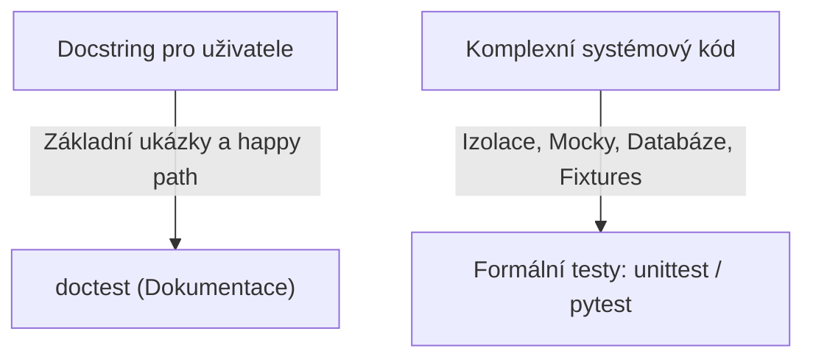
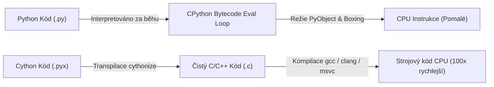
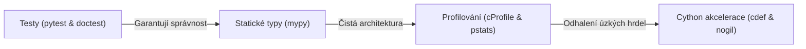

<!-- lecture: week-11 title="⭐ Master Přednáška 11: Kvalita Kódu, Testování, Profilování & Cython" estMinutes=90 -->

<!-- slide: id=id1 title="Úvod a osnova" tags="Core" diff="basics" -->
# Úvod a osnova

Vítejte v jedenácté přednášce kurzu programování v jazyce Python. V předchozích týdnech jsme prozkoumali syntaxi jazyka, objektový model, manipulaci s daty i vědecké knihovny. Dnešní téma představuje zlom v inženýrském myšlení: **Kvalita kódu, automatizované testování, výkonnostní profilování a nativní C-akcelerace v Cythonu**.

V dynamickém jazyce, kde neprobíhá kompilace do striktního binárního tvaru před spuštěním, leží veškerá tíha odhalování chyb na **automatizovaných testech a statických analyzátorech**. Současně se naučíme, jak exaktně měřit výkon kódu a jak odstranit úzká hrdla pomocí přímé kompilace do jazyka C.

### Osnova dnešní 90minutové přednášky:
1. **C/Java vs. Python mentalita kvality**: Kompilátorové garance vs. dynamický runtime testbed.
2. **Spustitelná dokumentace: Modul `doctest`**: Interaktivní příklady v docstringách a ověřování.
3. **Limity doctestu**: Kdy přejít k formálnímu testovacímu frameworku.
4. **Standardní knihovna: Modul `unittest`**: Třída `unittest.TestCase` a životní cyklus testu.
5. **Assert metody v `unittest`**: `assertEqual`, `assertRaises` a nástrahy porovnávání `float`.
6. **Test Discovery**: Automatické vyhledávání a spouštění testovacích sad.
7. **Moderní standard: Framework `pytest`**: Proč svět opustil těžkopádné OOP testy ve prospěch funkcí.
8. **Kouzlo nativního `assert` v pytestu**: Magie AST introspekce a detailní reporty chyb.
9. **Správa testovacích stavů: `@pytest.fixture`**: Dependency Injection a oddělení inicializace od logiky.
10. **Životní cyklus fixture**: Klíčové slovo `yield`, teardown a úrovně platnosti (`scope`).
11. **Parametrizace testů: `@pytest.mark.parametrize`**: Expanze testovacích scénářů bez duplicitního kódu.
12. **Programová varování: Modul `warnings`**: `warnings.warn()` vs. výjimky a kategorie varování.
13. **Filtrování varování v praxi**: Potlačování hlášek a režim `python -W error` v CI/CD pipeline.
14. **Měření výkonu: Modul `timeit`**: Proč `time.time()` selhává pro mikrobenchmarky.
15. **Použití modulu `timeit`**: CLI rozhraní a programové měření v kódu.
16. **Deterministické profilování: Modul `cProfile`**: Kde program tráví čas a kolikrát co volal.
17. **Analýza profilu: Modul `pstats`**: Kumulativní vs. vlastní čas a odhalení úzkých hrdel.
18. **Statické typové anotace: PEP 484 & Modul `typing`**: Statická bezpečnost v dynamickém těle.
19. **Moderní typová syntaxe (Python 3.10–3.12)**: Operátor `|`, generické typy a `type` aliasy (PEP 695).
20. **Statický typový kontrolor `mypy`**: Odhalení chyb bez jediného spuštění programu.
21. **Přechod k akceleraci: Proč je CPython pomalý?**: Dynamický dispatch, `PyObject` boxing a GIL.
22. **Úvod do Cythonu**: Nadmnožina Pythonu kompilovaná přímo do jazyka C/C++.
23. **Statické typování v Cythonu: Klíčové slovo `cdef`**: C typy bez paměťového overheadu.
24. **Tři typy funkcí v Cythonu**: Rozdíly mezi `def`, `cdef` a hybridním `cpdef`.
25. **Uvolnění GIL: Klíčové slovo `nogil`**: Skutečný vícevláknový paralelismus v C sekcích.
26. **Kompilace Cython kódu**: Modul `setuptools`, soubory `.pyx` a příkaz `cythonize`.
27. **Most k praxi a shrnutí 11. přednášky**: Synergie testů, typů a C-akcelerace.

---

<!-- slide: id=id2 title="C/Java vs. Python: Mentalita kvality kódu" tags="Core" diff="paradigm" -->
# C/Java vs. Python: Mentalita kvality kódu

V programovacích jazycích se statickým typováním (C, C++, Java) funguje kompilátor jako **první přísná obranná linie**:

```java
// Java: Kompilátor okamžitě odmítne kód s nekompatibilními typy
public int secti(int a, int b) {
    return a + b;
}
// secti("10", 20); -> CHYBA PŘI KOMPILACI: incompatible types
```

Kompilátor Javy nebo C++ prověří existenci metod, typy parametrů a návratové hodnoty dříve, než se vygeneruje jediný bajt spustitelného kódu.

### Python: Dynamická svoboda vyžaduje inženýrskou disciplínu
V Pythonu se typy nekontrolují při načítání souboru, ale až v okamžiku, kdy procesor narazí na konkrétní instrukci za běhu (**Dynamic Duck Typing**):

```python
def secti(a, b):
    return a + b

# Zcela validní kód pro interpret! Chyba nastane až v produkci o půlnoci:
secti("10", 20)  # TypeError: can only concatenate str (not "int") to str
```

> [!IMPORTANT] Paradox dynamických jazyků
> Protože Python nemá kompilátor, který by garantoval typovou integritu a existenci metod, **potřebuje robustnější sadu automatizovaných testů než kompilované jazyky**. Testy v Pythonu nenahrazují pouze integrační scénáře, ale i základní typové ověření.

---

<!-- slide: id=id3 title="Spustitelná dokumentace: Modul doctest" tags="Core" diff="basics" -->
# Spustitelná dokumentace: Modul doctest

Jedním z nejunikátnějších nástrojů standardní knihovny Pythonu je modul **`doctest`**.
Vychází z filozofie, že **nejlepší dokumentace je ta, která obsahuje ověřitelné ukázky kódu**.

Přímo do dokumentačního řetězce (docstringu) funkce napíšete příklady formátované přesně tak, jak vypadají v interaktivním shellu Pythonu (`>>>`):

```python
# matematika.py
def faktorial(n: int) -> int:
    """Spočítá faktoriál nezáporného celého čísla n.

    Příklady použití:
    >>> faktorial(0)
    1
    >>> faktorial(1)
    1
    >>> faktorial(5)
    120
    >>> faktorial(-1)
    Traceback (most recent call last):
        ...
    ValueError: Číslo n nesmí být záporné!
    """
    if n < 0:
        raise ValueError("Číslo n nesmí být záporné!")
    vysledek = 1
    for i in range(2, n + 1):
        vysledek *= i
    return vysledek

if __name__ == "__main__":
    import doctest
    doctest.testmod()
```

### Spuštění z příkazové řádky:
```bash
# Pokud všechny testy projdou, nevypíše nic (tichý režim):
python -m doctest matematika.py

# Verbózní režim s detailním výpisem každého ověření:
python -m doctest -v matematika.py
```

---

<!-- slide: id=id4 title="Limity doctestu a přechod k formálnímu testování" tags="Core" diff="basics" -->
# Limity doctestu a přechod k formálnímu testování

Modul `doctest` je skvělý pro rychlou dokumentaci a jednoduché čisté funkce. Má však zásadní omezení:

### Kdy je `doctest` nevhodný?
1. **Nestabilní výstupy**: Slovníky před Pythonem 3.7 nebo množiny vypisují prvky v nedefinovaném pořadí. Adresy objektů v paměti (`<Objekt at 0x7f8a...>`) selžou při každém spuštění.
2. **Složité testovací stavy**: Inicializace databáze, vytváření falešných síťových požadavků (Mocking) a vícestupňový setup promění docstring v nečitelný zmatek.
3. **Příliš dlouhé výstupy**: Pokud funkce vrací tabulku o 1 000 řádcích, nelze ji celou vepsat do docstringu.
4. **Smíchání dokumentace a testů**: Docstring má sloužit člověku jako návod k použití, nikoli jako skladiště hraničních testovacích případů (Edge Cases).



Proto se pro reálné aplikace používají dedikované testovací frameworky: vestavěný **`unittest`** a moderní de facto standard **`pytest`**.

---

<!-- slide: id=id5 title="Standardní knihovna: Modul unittest" tags="Core" diff="basics" -->
# Standardní knihovna: Modul unittest

Modul **`unittest`** (historicky nazývaný *PyUnit*) je součástí standardní knihovny a byl přímo inspirován Javovským frameworkem **JUnit**:

- Testy se píší jako metody ve třídách dědících z **`unittest.TestCase`**.
- Každá testovací metoda musí začínat předponou **`test_`**.

```python
# test_kalkulacka.py
import unittest

def deleni(a: float, b: float) -> float:
    if b == 0:
        raise ZeroDivisionError("Dělení nulou není povoleno!")
    return a / b

class TestKalkulacka(unittest.TestCase):
    def setUp(self):
        """Spustí se před KAŽDOU testovací metodou (příprava stavu)."""
        self.vychozi_hodnota = 100.0

    def tearDown(self):
        """Spustí se po KAŽDÉ testovací metodě (úklid prostředků)."""
        pass

    def test_kladne_deleni(self):
        self.assertEqual(deleni(10.0, 2.0), 5.0)

    def test_deleni_nulou(self):
        with self.assertRaises(ZeroDivisionError):
            deleni(10.0, 0.0)

if __name__ == "__main__":
    unittest.main()
```

---

<!-- slide: id=id6 title="Assert metody v unittest" tags="Core" diff="basics" -->
# Assert metody v unittest

Třída `unittest.TestCase` nabízí bohatou škálu specializovaných metod pro ověřování podmínek:

| Metoda unittestu | Co ověřuje | Ekvivalent v čistém Pythonu |
| :--- | :--- | :--- |
| `self.assertEqual(a, b)` | $a == b$ | `assert a == b` |
| `self.assertNotEqual(a, b)` | $a \neq b$ | `assert a != b` |
| `self.assertTrue(x)` | `bool(x) is True` | `assert x` |
| `self.assertFalse(x)` | `bool(x) is False` | `assert not x` |
| `self.assertIs(a, b)` | $a$ je identický objekt jako $b$ | `assert a is b` |
| `self.assertIsNone(x)` | $x$ je `None` | `assert x is None` |
| `self.assertIn(a, b)` | $a$ se nachází v kontejneru $b$ | `assert a in b` |
| `self.assertAlmostEqual(a, b, places=7)` | Čísla s plovoucí řádovou čárkou | `assert round(abs(a - b), 7) == 0` |

### Pozor na porovnávání reálných čísel (`float`)!
V binární reprezentaci IEEE 754 platí, že `0.1 + 0.2 != 0.3` (výsledkem je `0.30000000000000004`).

```python
# ŠPATNĚ: Selže kvůli zaokrouhlovací chybě reprezentace v paměti:
# self.assertEqual(0.1 + 0.2, 0.3)

# SPRÁVNĚ: Ověření shody na daný počet desetinných míst:
self.assertAlmostEqual(0.1 + 0.2, 0.3, places=7)
```

---

<!-- slide: id=id7 title="Test Discovery: Organizace testovacích sad" tags="Core" diff="basics" -->
# Test Discovery: Organizace testovacích sad

V reálných projektech netestujeme voláním jednotlivých skriptů. Používá se mechanismus **Test Discovery**, který automaticky rekurzivně projde celý adresář projektu, najde všechny testy a spustí je najednou.

### Standardní struktura projektu:
```text
muj_projekt/
├── pyproject.toml
├── src/
│   └── balicek/
│       ├── __init__.py
│       └── jadro.py
└── tests/
    ├── __init__.py
    ├── test_jadro.py
    └── test_databaze.py
```

### Spuštění vyhledávání testů z terminálu:
```bash
# Spustí všechny testy odpovídající vzoru 'test*.py' v aktuální složce:
python -m unittest discover -s tests -p "test_*.py"

# Zkrácený zápis (pokud jsou testy ve složce tests/):
python -m unittest
```

CPython projde soubory, instancuje všechny třídy dědící z `TestCase` a vygeneruje souhrnnou zprávu:

```text
....F...s.
======================================================================
FAIL: test_vypocet (tests.test_jadro.TestJadro)
----------------------------------------------------------------------
Ran 10 tests in 0.045s

FAILED (failures=1)
```

---

<!-- slide: id=id8 title="Moderní standard v praxi: Framework pytest" tags="Core" diff="basics" -->
# Moderní standard v praxi: Framework pytest

Ačkoli je `unittest` součástí standardní knihovny, **více než 90 % moderních pythoních projektů používá framework `pytest`**.

### Proč svět přešel od unittest k pytestu?
1. **Žádné zbytečné OOP třídy**: Test je **obyčejná pythoní funkce**, nikoli rigidní třída.
2. **Konec desítek assert metod**: Používá se **čistý vestavěný příkaz `assert`**.
3. **Méně boilerplatu**: O 50–70 % méně kódu pro stejný testovací scénář.
4. **Mnohem bohatší ekosystém**: Tisíce pluginů (`pytest-cov`, `pytest-asyncio`, `pytest-xdist`).

```python
# Srovnání syntaxe: unittest vs. pytest

# 1. Zastaralý unittest styl:
import unittest
class TestStary(unittest.TestCase):
    def test_scitani(self):
        self.assertEqual(secti(2, 3), 5)

# 2. Moderní elegantní pytest styl:
def test_scitani():
    assert secti(2, 3) == 5
```

Spuštění testů v terminálu je triviální: stačí spustit příkaz `pytest` (nebo `uv run pytest`).

---

<!-- slide: id=id9 title="Kouzlo nativního assert v pytestu" tags="Core" diff="internals" -->
# Kouzlo nativního assert v pytestu

V čistém Pythonu příkaz `assert a == b` při selhání vyvolá pouze strohý `AssertionError` bez jakýchkoli doplňujících informací.

V `unittestu` jste proto museli volat `self.assertEqual(a, b)`, aby se vypsalo, jaké hodnoty proměnné měly.

### Jak funguje magie v pytestu? (AST Rewriting)
`pytest` při importu testovacích souborů **přepíše jejich abstraktní syntaktický strom (AST - Abstract Syntax Tree)**. Nahradí obyčejný `assert` komplexním inspekčním kódem.

Když test selže, pytest vypíše **hloubkovou dekompozici výrazu**:

```python
def test_analyza_vysledku():
    seznam = [10, 20, 30]
    hledany = 99
    assert hledany in seznam
```

### Výstup v terminálu:
```text
>       assert hledany in seznam
E       AssertionError: assert 99 in [10, 20, 30]
E        +  where 99 = hledany
E        +  and   [10, 20, 30] = seznam
```

Nemusíte se učit žádné speciální assertovací metody — píšete přirozený Python a o zbytek se postará interpret.

---

<!-- slide: id=id10 title="Správa testovacích stavů: @pytest.fixture" tags="Core" diff="basics" -->
# Správa testovacích stavů: @pytest.fixture

V `unittestu` se stav před testem inicializoval v metodě `setUp()`. To vedlo k problémům: pokud 10 testů potřebovalo různé konfigurace, třída se rozrostla o nepřehledné pomocné proměnné v `self`.

`pytest` řeší správu testovacích závislostí pomocí **Fixtures** na principu **Dependency Injection**:

```python
import pytest
import sqlite3

# 1. Definice fixture jako funkce s dekorátorem:
@pytest.fixture
def testovaci_databaze():
    """Vytvoří dočasnou SQLite databázi v paměti a naplní ji testovacími daty."""
    conn = sqlite3.connect(":memory:")
    conn.execute("CREATE TABLE uzivatele (id INT, jmeno TEXT)")
    conn.execute("INSERT INTO uzivatele VALUES (1, 'Karel'), (2, 'Eva')")
    return conn

# 2. Použití v testu: jméno fixture předáme jako parametr funkce:
def test_pocet_uzivatelu(testovaci_databaze):
    cursor = testovaci_databaze.cursor()
    cursor.execute("SELECT COUNT(*) FROM uzivatele")
    pocet = cursor.fetchone()[0]
    assert pocet == 2

def test_jmeno_prvniho(testovaci_databaze):
    cursor = testovaci_databaze.cursor()
    cursor.execute("SELECT jmeno FROM uzivatele WHERE id = 1")
    assert cursor.fetchone()[0] == "Karel"
```

Pytest automaticky rozpozná, že parametr `testovaci_databaze` odpovídá stejnojmenné fixture, spustí ji a předá její návratovou hodnotu do testu.

---

<!-- slide: id=id11 title="Životní cyklus fixture: yield a scope" tags="Core" diff="basics" -->
# Životní cyklus fixture: yield a scope

Často potřebujete po skončení testu uklidit prostředky (zavřít soubor, smazat dočasnou složku, odpojit se od sítě).

V pytestu se to řeší klíčovým slovem **`yield`**:

```python
import pytest
from pathlib import Path

@pytest.fixture
def docasny_soubor(tmp_path: Path):
    # Kód PŘED yield = setUp (inicializace):
    f = tmp_path / "mereni.txt"
    f.write_text("10.5\n20.3\n30.1\n", encoding="utf-8")
    
    yield f  # Zde se předá řízení testu
    
    # Kód PO yield = tearDown (úklid po skončení testu):
    if f.exists():
        f.unlink()
```

### Úrovně platnosti (`scope`):
Ve výchozím stavu se fixture spouští znovu pro každý test (`scope="function"`). Pokud je inicializace náročná (např. spuštění Docker kontejneru nebo trénování modelu), můžeme platnost rozšířit:

```python
@pytest.fixture(scope="module")  # Spustí se 1x pro celý testovací soubor
def natrenovany_model():
    return nacti_obri_model()
```

Možné hodnoty `scope`: `"function"` (výchozí), `"class"`, `"module"`, `"package"`, `"session"` (jednou pro celý běh pytestu).

---

<!-- slide: id=id12 title="Parametrizace testů: @pytest.mark.parametrize" tags="Core" diff="basics" -->
# Parametrizace testů: @pytest.mark.parametrize

Představte si, že chcete otestovat validátor e-mailových adres na 20 různých vstupech (správné, neplatné domény, chybějící zavináče).
V `unittestu` byste museli psát for-cyklus uvnitř testu nebo 20 samostatných metod.

V pytestu použijeme dekorátor **`@pytest.mark.parametrize`**:

```python
import pytest

def je_validni_vek(vek: int) -> bool:
    return 0 <= vek <= 120

@pytest.mark.parametrize("zadany_vek, ocekavany_vysledek", [
    (25, True),      # Běžný věk
    (0, True),       # Spodní hraniční hodnota
    (120, True),     # Horní hraniční hodnota
    (-1, False),     # Záporné číslo (neplatné)
    (121, False),    # Příliš vysoký věk (neplatné)
    (1000, False),   # Extrém
])
def test_validace_veku(zadany_vek: int, ocekavany_vysledek: bool):
    assert je_validni_vek(zadany_vek) == ocekavany_vysledek
```

### Výhoda v reportu:
Pytest nespustí jeden test s cyklem, ale vygeneruje **6 samostatných nezávislých testů**:
- `test_validace_veku[25-True] PASSED`
- `test_validace_veku[-1-False] PASSED`
- Pokud jeden vstup selže, ostatní normálně proběhnou!

---

<!-- slide: id=id13 title="Programová varování: Modul warnings" tags="Core" diff="basics" -->
# Programová varování: Modul warnings

Často potřebujete upozornit uživatele vaší knihovny na problém, který ale **není fatální chybou**:
- Zastaralá funkce, která bude v příští verzi smazána (*Deprecation*).
- Neoptimální konfigurace (např. pomalý fallback algoritmus).
- Podezřelé hodnoty parametrů.

V takovém případě nevyvoláváme výjimku (`raise Exception`), ale odešleme varování pomocí modulu **`warnings`**:

```python
import warnings

def stary_vypocet(x: float) -> float:
    warnings.warn(
        "Funkce 'stary_vypocet' je zastaralá a bude v Pythonu 3.14 odstraněna. "
        "Použijte 'novy_vypocet'.",
        category=DeprecationWarning,
        stacklevel=2
    )
    return x * 2.0
```

> [!TIP] Význam parametru `stacklevel=2`
> Ve výchozím stavu (`stacklevel=1`) varování ukazuje na řádek s příkazem `warnings.warn(...)` uvnitř knihovny. Nastavením `stacklevel=2` se hlášení připíše **kódu, který funkci zavolal**, což programátorovi přesně ukáže místo v jeho vlastním skriptu.

---

<!-- slide: id=id14 title="Kategorie a filtrování varování" tags="Core" diff="basics" -->
# Kategorie a filtrování varování

Standardní knihovna rozlišuje několik zabudovaných kategorií varování (dědí z `Warning`):
- **`UserWarning`**: Obecné uživatelské upozornění (výchozí).
- **`DeprecationWarning`**: Varování pro vývojáře o zastaralé funkcionalitě.
- **`SyntaxWarning`**: Podezřelá syntaxe v kódu (např. chybějící čárka v n-tici).
- **`RuntimeWarning`**: Podezřelé chování za běhu (např. dělení nulou v NumPy vracející `inf`).

### Řízení varování přes `filterwarnings`:
Pomocí `warnings.filterwarnings()` můžete chování programově měnit:

```python
import warnings

# Potlačit všechna DeprecationWarning:
warnings.filterwarnings("ignore", category=DeprecationWarning)

# Změnit všechna varování na výjimky (zastaví běh programu):
warnings.filterwarnings("error", category=UserWarning)
```

### Osvědčená praxe v CI/CD pipeline:
Při spouštění testů v produkci nebo na GitHub Actions spouštějte Python s přepínačem **`-W error`**:
```bash
python -W error -m pytest
```
Tím zajistíte, že žádná zastaralá volání ani skrytá varování neprojdou do produkce bez povšimnutí!

---

<!-- slide: id=id15 title="Měření výkonu: Proč time.time() nestačí?" tags="Core" diff="internals" -->
# Měření výkonu: Proč time.time() nestačí?

Když začátečník měří rychlost kódu v Pythonu, obvykle sáhne po modulu `time`:

```python
# NAIVNÍ A NEPŘESNÉ MĚŘENÍ:
import time

start = time.time()
vysledek = [x**2 for x in range(1_000_000)]
konec = time.time()

print(f"Doba běhu: {konec - start} sekund")
```

### Proč je toto měření pro mikrobenchmarky zcela nespolehlivé?
1. **Nízké rozlišení hodin systému**: Na starších OS může mít `time.time()` rozlišení jen 10–15 milisekund.
2. **Rušení Garbage Collectorem (GC)**: Pokud během vašeho jediného měření proběhne cyklus vyhledávání kruhových referencí (GC collection), naměříte falešně vysoký čas.
3. **Plánovač operačního systému (OS Context Switching)**: Přepnutí na jiný proces v systému zkreslí jednorázové měření.
4. **Vliv teplé CPU cache**: První průchod je pomalejší kvůli načítání instrukcí do L1/L2 cache procesoru.

Správným nástrojem je vestavěný modul **`timeit`**:
- Spustí kód milionkrát ve smyčce,
- Dočasně **vypne Garbage Collector**,
- Zvolí nejvyšší rozlišení systémového čítače (`time.perf_counter_ns`),
- Z více sérií vybere **minimální naměřený čas** (protože minimum představuje běh s nejmenším rušením systému).

---

<!-- slide: id=id16 title="Použití modulu timeit v praxi" tags="Core" diff="basics" -->
# Použití modulu timeit v praxi

Modul `timeit` lze používat jak z příkazové řádky, tak přímo uvnitř pythoního kódu:

### 1. Rychlé porovnání z příkazové řádky (CLI):
```bash
# Porovnání rychlosti tvorby seznamu: list() vs. []
python -m timeit "list()"
# 20000000 loops, best of 5: 14.5 nsec per loop

python -m timeit "[]"
# 50000000 loops, best of 5: 5.8 nsec per loop (2.5x rychlejší - přímý bytecode instrukce!)

# Porovnání list comprehension vs. map:
python -m timeit "[x*2 for x in range(100)]"
python -m timeit "list(map(lambda x: x*2, range(100)))"
```

### 2. Programové měření v kódu:
```python
import timeit

priprava = "data = list(range(1000))"
kod_hledani = "999 in data"

# timeit.timeit(stmt, setup, number):
doba = timeit.timeit(stmt=kod_hledani, setup=priprava, number=10_000)
print(f"Průměrný čas jednoho testu: {doba / 10_000 * 1e6:.2f} mikrosekund")

# timeit.repeat() provede více nezávislých sérií (např. 5 sérií po 10 000 bězích):
serie = timeit.repeat(stmt=kod_hledani, setup=priprava, repeat=5, number=10_000)
print(f"Nejlepší čas: {min(serie) / 10_000 * 1e6:.2f} µs")
```

---

<!-- slide: id=id17 title="Deterministické profilování: Modul cProfile" tags="Core" diff="basics" -->
# Deterministické profilování: Modul cProfile

Zatímco `timeit` měří konkrétní izolovaný řádek kódu, **profilování (Profiling)** odpovídá na otázku: **Ve kterých funkcích mé komplexní aplikace se ztrácí nejvíce času?**

Podle Pareto principu platí, že 80 % času běhu stráví program v pouhých 20 % kódu (často v jediném vnitřním cyklu).

Python obsahuje standardní C-rozšíření **`cProfile`**:
- Jedná se o **deterministický profiler** — zaznamenává každé volání každé funkce, čas strávený uvnitř funkce i čas v podvoláních.

### Spuštění profilování celého skriptu z terminálu:
```bash
python -m cProfile -s cumulative muj_skript.py
```

### Profilování konkrétní části kódu:
```python
import cProfile

def slozity_vypocet():
    # ... tisíce volání funkcí ...
    pass

profiler = cProfile.Profile()
profiler.enable()

slozity_vypocet()

profiler.disable()
profiler.dump_stats("vysledek.prof")  # Uloží binární statistiku pro další analýzu
```

---

<!-- slide: id=id18 title="Analýza profilu: Modul pstats" tags="Core" diff="basics" -->
# Analýza profilu: Modul pstats

Pro čtení a formátování výsledků profilování slouží modul **`pstats`**:

```python
import pstats

p = pstats.Stats("vysledek.prof")

# Odstranit dlouhé systémové cesty k souborům:
p.strip_dirs()

# Seřadit podle kumulativního času a vypsat prvních 10 funkcí:
p.sort_stats("cumulative").print_stats(10)
```

### Význam sloupců v reportu cProfile:
```text
   ncalls  tottime  percall  cumtime  percall filename:lineno(function)
        1    0.001    0.001    2.450    2.450 simulace.py:10(hlavni_beh)
     1000    1.820    0.002    1.820    0.002 matice.py:45(nasobeni)
   500000    0.510    0.000    0.620    0.000 util.py:12(over_vektor)
```

- **`ncalls`**: Počet volání dané funkce.
- **`tottime` (Total Time)**: Čistý čas strávený **výhradně v těle dané funkce** (bez započtení volání jiných podfunkcí). *Klíčový ukazatel pro optimalizaci!*
- **`cumtime` (Cumulative Time)**: Celkový čas od vstupu do funkce až po její opuštění (včetně všech volaných podfunkcí).
- **`percall`**: Průměrný čas na jedno volání (`tottime / ncalls` resp. `cumtime / ncalls`).

> [!TIP] Kam zaměřit optimalizaci?
> Vždy hledejte funkce s vysokým **`tottime`**. Pokud funkce volá jinou knihovnu (vysoký `cumtime`, ale nízký `tottime`), problém není v ní, ale v podfunkci.

---

<!-- slide: id=id19 title="Statické typové anotace: PEP 484 & Modul typing" tags="Core" diff="basics" -->
# Statické typové anotace: PEP 484 & Modul typing

Od Pythonu 3.5 zavedl standard **PEP 484** do jazyka volitelný systém **typových anotací (Type Hints)**.

Anotace nemají **žádný vliv na chování programu za běhu**. Interpret CPython je v runtime ignoruje (pouze je uloží do atributu `__annotations__`).

Slouží však pro:
1. **Statickou analýzu kódu** nástroji jako `mypy`, `pyright`, `ruff`.
2. **Chytré našeptávání (IntelliSense) a refaktoring** v moderních IDE (VS Code, PyCharm).
3. **Dokumentaci rozhraní** pro ostatní vývojáře.

```python
# Základní syntaxe anotací proměnných a funkcí:
jmeno: str = "Alice"
vek: int = 30
vaha: float = 65.5
je_student: bool = False

def spocitej_index(vahy: list[float], faktor: float = 1.0) -> float:
    return sum(vahy) * faktor
```

---

<!-- slide: id=id20 title="Moderní typová syntaxe (Python 3.10–3.12)" tags="Core" diff="basics" python="3.12+" -->
# Moderní typová syntaxe (Python 3.10–3.12)

Typový systém v Pythonu prošel obrovským vývojem. Ve starších verzích (Python 3.6–3.8) bylo nutné importovat desítky pomocných typů z modulu `typing` (`List`, `Dict`, `Union`, `Optional`).

V moderním Pythonu 3.10+ je syntaxe čistá a nativní:

### 1. Sjednocení typů operátorem `|` (PEP 604 - Python 3.10+)
Nahrazuje staré `Union[int, str]` a `Optional[int]`:
```python
# Starý styl:
# from typing import Optional, Union
# def najdi_id(dotaz: Union[str, int]) -> Optional[int]: ...

# Moderní styl:
def najdi_id(dotaz: str | int) -> int | None:
    if isinstance(dotaz, str) and not dotaz.isdigit():
        return None
    return int(dotaz)
```

### 2. Vestavěné generické kontejnery (PEP 585 - Python 3.9+)
Přímo používáme `list`, `dict`, `set`, `tuple`:
```python
uzivatele: dict[str, list[int]] = {"admin": [1, 2, 3]}
souradnice: tuple[float, float, float] = (10.0, 20.0, 5.0)
```

### 3. Nový příkaz `type` pro type aliasy (PEP 695 - Python 3.12+)
```python
type MaticovyRadek = list[float]
type Matice = list[MaticovyRadek]
```

---

<!-- slide: id=id21 title="Statický typový kontrolor: Nástroj mypy" tags="Core" diff="basics" -->
# Statický typový kontrolor: Nástroj mypy

**`mypy`** je nezávislý statický typový analyzátor pro Python vyvíjený pod záštitou Dropboxu a tvůrce jazyka Guida van Rossuma.

Spouští se **před spuštěním kódu** a analyzuje celý projekt podobně jako kompilátor v Javě nebo C++.

```python
# priklad_chyby.py
def ziskej_delku(text: str | None) -> int:
    # mypy zde nahlásí CHYBU: Item "None" of "str | None" has no attribute "strip"
    return len(text.strip())
```

### Spuštění kontroly v terminálu:
```bash
mypy priklad_chyby.py
```

### Chybový report mypy:
```text
priklad_chyby.py:3: error: Item "None" of "str | None" has no attribute "strip"  [union-attr]
Found 1 error in 1 file (checked 1 source file)
```

Mypy odhalilo, že parametr může být `None`, což by v produkci vedlo k pádu `AttributeError: 'NoneType' object has no attribute 'strip'`.

### Oprava kódu s využitím Type Guard:
```python
def ziskej_delku(text: str | None) -> int:
    if text is None:
        return 0
    # Mypy ví, že za if podmínkou už text MŮŽE BÝT POUZE str (Type Narrowing):
    return len(text.strip())
```

---

<!-- slide: id=id22 title="Přechod k akceleraci: Proč je CPython pomalý?" tags="Core" diff="internals" -->
# Přechod k akceleraci: Proč je CPython pomalý?

Pokud jste otestovali kód a zkontrolovali typy, dalším inženýrským krokem je **výkon**.

Standardní referenční interpret CPython je zhruba **$10\times$ až $100\times$ pomalejší než kompilované jazyky C nebo Rust** na čistě CPU-bound úlohách:

### Tři hlavní důvody pomalosti CPythonu:
1. **Interpretovaný Bytecode**: Každá operace `BINARY_OP_ADD` prochází vyhodnocovací smyčkou virtuálního stroje (velký `switch` v C jádře interpretu).
2. **Boxing do `PyObject`**: Jak jsme viděli u NumPy, každé číslo v Pythonu je 28bajtový objekt na haldě s čítačem referencí a dynamickým typovým deskriptorem.
3. **Dynamický method lookup**: Při volání `obj.metoda()` interpret v každé iteraci prochází slovník třídy `__dict__` a lineární strom MRO.
4. **Global Interpreter Lock (GIL)**: Zabraňuje paralelnímu běhu více nativních vláken v jednom procesu Pythonu.



---

<!-- slide: id=id23 title="Úvod do Cythonu: Most mezi Pythonem a C" tags="Core" diff="basics" -->
# Úvod do Cythonu: Most mezi Pythonem a C

**Cython** je programovací jazyk a kompilátor, který představuje **nadmnožinu jazyka Python s podporou C datových typů**.

### Základní koncept:
1. Vezmete existující pythoní kód a uložíte jej s příponou **`.pyx`**.
2. Již pouhá kompilace čistého Python kódu Cythonem přinese $2\times$ až $5\times$ zrychlení (odstraní se režie interpretace bytekódu).
3. Pokud do kódu doplníte **statické typové deklarace v jazyce C**, Cython vygeneruje C kód, který pracuje přímo se surovými registry a pamětí procesoru.
4. Výsledek dosahuje **$100\times$ až $200\times$ zrychlení**, srovnatelného s ručně psaným C++.

Knihovny jako **NumPy, SciPy, Pandas a scikit-learn** mají své nejrychlejší vnitřní algoritmy napsané právě v Cythonu!

---

<!-- slide: id=id24 title="Statické typování v Cythonu: Klíčové slovo cdef" tags="Core" diff="basics" -->
# Statické typování v Cythonu: Klíčové slovo cdef

Klíčem k extrémnímu výkonu v Cythonu je klíčové slovo **`cdef`**.
Umožňuje deklarovat proměnné se **statickými typy jazyka C**:

```cython
# vypocet_cy.pyx
def prvocisla_cython(int limit):
    # Deklarace C typů: tyto proměnné nealokují žádný PyObject!
    cdef int i, j, n
    cdef bint je_prvocislo
    cdef list vysledky = []

    for n in range(2, limit):
        je_prvocislo = True
        for i in range(2, int(n ** 0.5) + 1):
            if n % i == 0:
                je_prvocislo = False
                break
        if je_prvocislo:
            vysledky.append(n)
            
    return vysledky
```

### Co se stalo uvnitř?
- Proměnné `i`, `j`, `n` jsou uloženy přímo v **CPU registrech** nebo na zásobníku jako 32/64bitová celá čísla.
- Smyčka `for n in range(...)` se přeloží na nativní instrukce procesoru `for (n = 2; n < limit; n++)`.
- Žádný `PyLongObject` se nevytváří ani neruší uvnitř vnitřního cyklu!

---

<!-- slide: id=id25 title="Tři typy funkcí v Cythonu: def, cdef a cpdef" tags="Core" diff="internals" -->
# Tři typy funkcí v Cythonu: def, cdef a cpdef

Cython rozlišuje tři způsoby definice funkcí podle toho, odkud a jak mají být volány:

### 1. `def` (Standardní Python funkce)
- Volatelná z běžného Python kódu.
- Vstupní parametry a návratová hodnota se převádějí mezi C typy a `PyObject`.
- Má mírnou režii při volání, ale je plně kompatibilní.

### 2. `cdef` (Čistá C funkce)
- **Nelze volat z čistého Pythonu!** Slouží jako rychlá vnitřní pomocná funkce v Cythonu.
- Přímé volání na úrovni C stacku bez jakékoliv režie Pythonu (žádný `PyObject`).

### 3. `cpdef` (Hybridní obojetná funkce)
- To nejlepší z obou světů!
- Při volání z Pythonu se chová jako `def` (provede konverzi).
- Při volání z jiných Cython funkcí se volá přímo jako blesková `cdef` C funkce.

```cython
# Ukázka cdef a cpdef:
cdef double euklid_c(double x1, double y1, double x2, double y2):
    # Čistá C funkce - bleskový inline výpočet v CPU registrech
    return ((x2 - x1)**2 + (y2 - y1)**2)**0.5

cpdef double spocitej_vzdalenost(double x1, double y1, double x2, double y2):
    # Volatelné z Pythonu i Cythonu!
    return euklid_c(x1, y1, x2, y2)
```

---

<!-- slide: id=id26 title="Uvolnění GIL v Cythonu: nogil paralelismus" tags="Core" diff="internals" -->
# Uvolnění GIL v Cythonu: nogil paralelismus

Jak víme, CPython má **GIL (Global Interpreter Lock)**, který brání skutečnému vícevláknovému běhu pythoního kódu na vícejádrových procesorech.

Protože čistý C kód nepotřebuje přistupovat k interním strukturám CPythonu ani k `PyObject`, Cython umožňuje **uvolnit GIL pomocí klíčového slova `nogil`**:

```cython
# acely_vypocet.pyx
from cython.parallel import prange

def paralelni_zpracovani(double[:] vstup, double[:] vystup, int n):
    cdef int i
    
    # Blok 'with nogil' uvolní GIL -> CPU jádra mohou běžet 100% paralelně!
    with nogil:
        # prange = paralelní for-cyklus v OpenMP (využije všechna CPU jádra):
        for i in prange(n, schedule='static'):
            vystup[i] = vstup[i] * 2.5 + 1.2
```

> [!CAUTION] Pravidla v bloku `nogil`
> Uvnitř sekce `with nogil:` **nesmíte vytvořit ani použít žádný pythoní objekt** (žádné seznamy, slovníky, `print()`, ani volání běžných Python funkcí). Pracovat lze výhradně se surovými C typy, poli a C knihovnami.

---

<!-- slide: id=id27 title="Most k praxi a shrnutí 11. přednášky" tags="Core" diff="wow" -->
# Most k praxi a shrnutí 11. přednášky

Dnešní přednáška završila přechod od skriptování k profesionálnímu softwarovému inženýrství:



### Shrnutí klíčových bodů:
1. **`doctest`**: Skvělý pro živou, ověřitelnou dokumentaci v docstringách.
2. **`unittest` vs. `pytest`**: `unittest` poskytuje formální OOP základ ve stdlib, ale moderní standard je **`pytest`** s přirozeným příkazem `assert` a mocnými `@pytest.fixture`.
3. **Varování (`warnings`)**: Používejte `warnings.warn()` pro zastaralý kód a parametr `-W error` v CI/CD pipeline.
4. **Měření a profilování**: Nikdy nepoužívejte `time.time()` pro mikrobenchmarky (použijte `timeit`). Hledejte úzká hrdla pomocí `cProfile` a řaďte podle `tottime`.
5. **Typová kontrola (`mypy`)**: Statické typové anotace v Pythonu 3.10+ (`|`, generika) eliminují celou třídu běhových chyb ještě před nasazením.
6. **Cython**: Umožňuje kompilaci do nativního C/C++ kódu, odstranění `PyObject` režie přes `cdef` a skutečný paralelismus uvolněním GIL (`with nogil:`).

V závěrečné 12. přednášce propojíme tyto znalosti se **systémovým programováním, CLI rozhraními a Milestone 3**!
