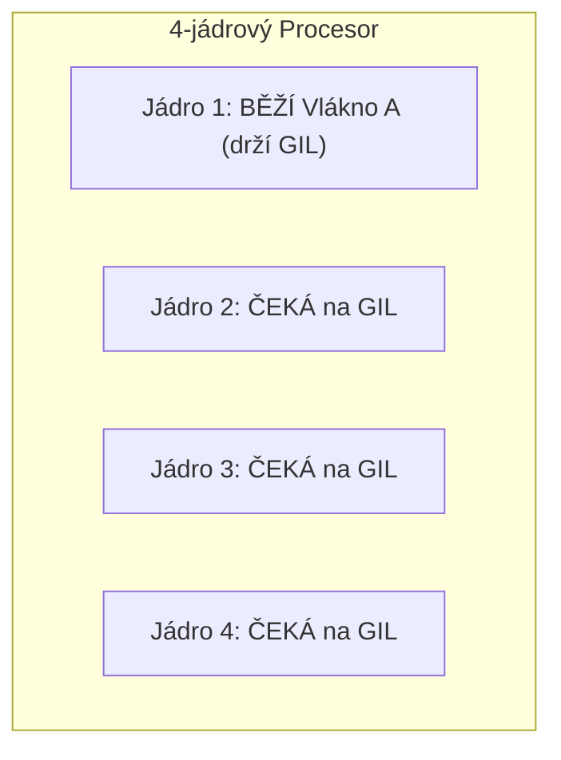
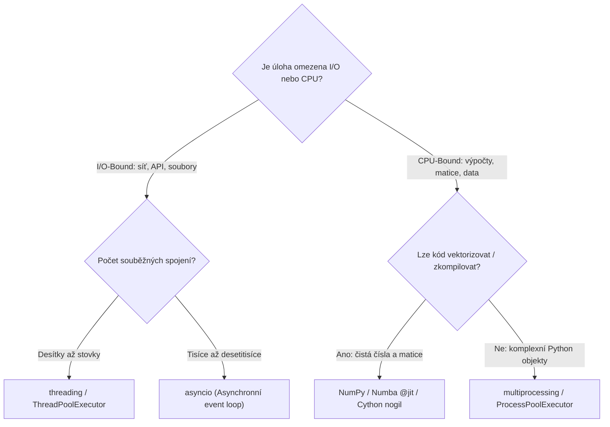

<!-- lecture: week-12 title="⭐ Master Přednáška 12: Systémové Programování, CLI, C-FFI, JIT Akcelerace & Paralelismus" estMinutes=90 -->

<!-- slide: id=id1 title="Úvod a osnova" tags="Core" diff="basics" -->
# Úvod a osnova

Vítejte v závěrečné dvanácté přednášce kurzu programování v jazyce Python. Dnes propojíme všechny dosud získané znalosti a proměníme naše skripty v **profesionální systémové aplikace, vysoce výkonné CLI nástroje a paralelní výpočetní enginy**.

Python se v inženýrské praxi často nazývá „lepidlem systémů“ (*glue language*). V této přednášce se naučíme, jak toto lepidlo ovládat na nejvyšší úrovni: od robustního parsování příkazové řádky a bezpečné správy procesů přes nízkoúrovňové binární struktury a mapování souborů do paměti (`mmap`) až po přímé volání C knihoven přes **`ctypes`**, JIT kompilaci v **Numbě** a překonání limitů **GIL** pomocí víceprocesového paralelismu.

### Osnova dnešní 90minutové přednášky:
1. **C/Java vs. Python v systémovém programování**: Od `main(argc, argv)` a POSIXu k Python stdlib.
2. **Příkazová řádka: `sys.argv` a návratové kódy**: Standardní toky, `sys.exit()` a unixové konvence.
3. **Standardní parser argumentů: Modul `argparse`**: Třída `ArgumentParser`, poziční vs. volitelné přepínače.
4. **Pokročilé prvky `argparse`**: Typové konverze, volby `choices`, nápověda a podřízené příkazy (`subparsers`).
5. **Moderní deklarativní CLI: Knihovna `typer`**: Tvorba CLI nástrojů z typových anotací funkcí (PEP 484).
6. **Spouštění procesů: Zastaralý `os.system` vs. `subprocess`**: Riziko Shell Injection a moderní paradigma.
7. **Bleskový a bezpečný běh: `subprocess.run()`**: Parametry v seznamu, `capture_output`, `text` a `check=True`.
8. **Roury a proudové propojování procesů**: Přesměrování `stdout` do `stdin` dalšího procesu (`subprocess.PIPE`).
9. **Binární data: `bytes` a `bytearray`**: Neměnné sekvence vs. měnitelné bajtové vyrovnávací paměti.
10. **Strukturovaná binární data: Modul `struct`**: Balení C struktur (`pack`, `unpack`), endianita a zarovnání v paměti.
11. **Mapování souborů do paměti: Modul `mmap`**: Koncept virtuální paměti OS a Zero-Copy práce s gigabajty dat.
12. **Práce s `mmap` v Pythonu**: Čtení a zápis do diskového souboru jako do obyčejného bajtového pole.
13. **C-Interoperabilita & FFI**: Co je Foreign Function Interface a proč volat C knihovny přímo.
14. **Standardní modul `ctypes`**: Načítání `.so` a `.dll`, mapování C datových typů a ukazatelů.
15. **Předávání polí a struktur v `ctypes`**: Propojení NumPy polí s C funkcemi bez kopírování.
16. **Just-In-Time (JIT) akcelerace: Knihovna Numba**: Kompilace pythoních funkcí do strojového kódu přes LLVM.
17. **Numba v praxi**: Dekorátor `@jit(nopython=True)`, vektorizace a paralelní smyčky `prange`.
18. **Architektura CPythonu: Global Interpreter Lock (GIL)**: Proč GIL existuje a co znamená pro vícejádrová CPU.
19. **Vlákna v Pythonu: Modul `threading`**: Kdy vlákna pomáhají (I/O-bound) a proč nepomohou u CPU výpočtů.
20. **Vícejádrový paralelismus: Modul `multiprocessing`**: Izolované procesy, obcházení GIL a paměťová architektura.
21. **Komunikace mezi procesy**: Bezpečné fronty `Queue` a roury `Pipe`.
22. **Moderní paralelní rozhraní: `concurrent.futures`**: `ThreadPoolExecutor` vs. `ProcessPoolExecutor`.
23. **Rozhodovací strom souběžnosti**: Kdy zvolit threading, multiprocessing, asyncio nebo C-FFI.
24. **Architektura produkčního CLI nástroje**: Návrhový vzor pro robustní systémové utility.
25. **Most k Milestone 3**: Akcelerovaný CLI signálový filtr (zadání a architektonické požadavky).
26. **Retrospektiva semestru**: Co vše jste zvládli od Týdne 0 do Týdne 12.
27. **Závěr kurzu a kudy dál**: Cesta k pokročilému softwarovému inženýrství v Pythonu.

---

<!-- slide: id=id2 title="C/Java vs. Python v systémovém programování" tags="Core" diff="paradigm" -->
# C/Java vs. Python v systémovém programování

V jazyce C začíná každý program známou signaturou funkce `main`:

```c
// C: Přímý přístup k argumentům operačního systému
int main(int argc, char *argv[]) {
    if (argc < 2) {
        fprintf(stderr, "Chyba: Chybí parametr!\n");
        return 1; // Návratový kód chyby pro operační systém
    }
    printf("Zadán parametr: %s\n", argv[1]);
    return 0; // Úspěch
}
```

V Javě je vstupem pole řetězců `public static void main(String[] args)`.

### Python: Skript je spustitelný od prvního řádku
V Pythonu žádná povinná funkce `main` neexistuje — interpret vyhodnocuje kód shora dolů. Přesto se v profesionálním kódu striktně dodržuje idiom **`if __name__ == "__main__":`**:

```python
import sys

def main() -> int:
    if len(sys.argv) < 2:
        sys.stderr.write("Chyba: Chybí parametr!\n")
        return 1
    print(f"Zadán parametr: {sys.argv[1]}")
    return 0

if __name__ == "__main__":
    sys.exit(main())
```

> [!IMPORTANT] Proč předávat návratový kód do `sys.exit()`?
> Operační systém vyhodnocuje návratový kód procesu (v shellu dostupný přes `$?` v Linuxu nebo `$LASTEXITCODE` v PowerShellu). Hodnota `0` značí úspěch, jakékoli nenulové číslo ($1 \dots 255$) signalizuje chybu. To je zásadní pro skládání skriptů do CI/CD pipeline a bashových rour.

---

<!-- slide: id=id3 title="Příkazová řádka: sys.argv a standardní toky" tags="Core" diff="basics" -->
# Příkazová řádka: sys.argv a standardní toky

Seznam **`sys.argv`** obsahuje surové textové argumenty předané programu z terminálu:
- **`sys.argv[0]`**: Cesta ke spuštěnému skriptu (nebo jeho název).
- **`sys.argv[1]` až `sys.argv[n]`**: Jednotlivé argumenty oddělené mezerami.

```python
# skript.py
import sys

print("Spuštěný program:", sys.argv[0])
print("Počet argumentů:", len(sys.argv) - 1)
print("Seznam parametrů:", sys.argv[1:])
```

Při spuštění `python skript.py --vstup data.csv --pocet 10` bude `sys.argv`:
`['skript.py', '--vstup', 'data.csv', '--pocet', '10']`.

### Standardní I/O toky v modulu `sys`:
Každý proces operačního systému má otevřené tři standardní deskriptory:
1. **`sys.stdin`**: Standardní vstup (čtení dat přesměrovaných rourou z jiného programu).
2. **`sys.stdout`**: Standardní výstup (běžný text, kam zapisuje `print()`).
3. **`sys.stderr`**: Standardní chybový výstup (kam patří varování a chybové hlášky, aby neznečistily datový proud).

```python
import sys

# Zápis čistých dat do výstupního proudu:
sys.stdout.write("Vysledek: 42\n")

# Zápis diagnostické zprávy do chybového proudu:
sys.stderr.write("LOG: Výpočet dokončen za 0.12 s\n")
```

---

<!-- slide: id=id4 title="Standardní parser argumentů: Modul argparse" tags="Core" diff="basics" -->
# Standardní parser argumentů: Modul argparse

Manuální parsování `sys.argv` pomocí podmínek `if arg == "-v":` je pracné, náchylné k chybám a neumí vygenerovat nápovědu.

Standardní knihovna Pythonu obsahuje modul **`argparse`** — plnohodnotný deklarativní parser:

```python
# cli_nastroj.py
import argparse
from pathlib import Path

# 1. Vytvoření parseru s popisem utility:
parser = argparse.ArgumentParser(
    prog="signalfir",
    description="Inženýrský CLI nástroj pro filtraci signálů a obrazů."
)

# 2. Definice POZIČNÍHO argumentu (povinný):
parser.add_argument("vstup", type=Path, help="Cesta ke vstupnímu binárnímu souboru")

# 3. Definice VOLITELNÉHO přepínače s hodnotou:
parser.add_argument("-o", "--vystup", type=Path, default=Path("vystup.bin"),
                    help="Cesta k cílovému souboru (výchozí: vystup.bin)")

# 4. Definice PŘEPÍNAČE bez hodnoty (booleovská vlajka):
parser.add_argument("-v", "--verbose", action="store_true",
                    help="Zapne podrobný diagnostický výpis")

# 5. Parsování argumentů z příkazové řádky:
args = parser.parse_args()

print(f"Zpracovávám soubor: {args.vstup}")
if args.verbose:
    print(f"Výstup bude uložen do: {args.vystup}")
```

---

<!-- slide: id=id5 title="Pokročilé prvky argparse: Typy, volby a podřízené příkazy" tags="Core" diff="basics" -->
# Pokročilé prvky argparse: Typy, volby a podřízené příkazy

`argparse` automaticky kontroluje platnost vstupů a převádí řetězce na požadované typy:

```python
parser.add_argument(
    "--zisk",
    type=float,
    default=1.0,
    help="Zesílení filtru jako reálné číslo"
)

parser.add_argument(
    "--metoda",
    choices=["lowpass", "highpass", "median"],
    default="lowpass",
    help="Algoritmus filtrace (povoleny pouze uvedené varianty)"
)
```

### Automaticky generovaná nápověda (`--help` / `-h`):
Při spuštění `python cli_nastroj.py --help` modul automaticky zformátuje přehlednou nápovědu a při chybě uživatele srozumitelně navede:

```text
usage: signalfir [-h] [-o VYSTUP] [-v] [--zisk ZISK] [--metoda {lowpass,highpass,median}] vstup

Inženýrský CLI nástroj pro filtraci signálů a obrazů.

positional arguments:
  vstup                 Cesta ke vstupnímu binárnímu souboru

options:
  -h, --help            show this help message and exit
  -o, --vystup VYSTUP   Cesta k cílovému souboru (výchozí: vystup.bin)
  -v, --verbose         Zapne podrobný diagnostický výpis
  --zisk ZISK           Zesílení filtru jako reálné číslo
  --metoda {lowpass,highpass,median}
                        Algoritmus filtrace
```

---

<!-- slide: id=id6 title="Moderní deklarativní CLI: Knihovna typer" tags="Core" diff="basics" python="3.12+" -->
# Moderní deklarativní CLI: Knihovna typer

Ačkoli je `argparse` ve standardní knihovně, v moderním pythoním ekosystému dominuje knihovna **`typer`** (vytvořená autorem FastAPI).

`typer` využívá **statické typové anotace (Type Hints)** k tomu, aby z obyčejné funkce automaticky vygeneroval kompletní CLI rozhraní bez jediného řádku boilerplatu:

```python
# moderni_cli.py
import typer
from pathlib import Path
from typing import Annotated

app = typer.Typer(help="Moderní CLI nástroj s automatickým typováním.")

@app.command()
def filtruj(
    vstup: Annotated[Path, typer.Argument(help="Cesta ke vstupním datům")],
    vystup: Annotated[Path, typer.Option("-o", "--out", help="Výstupní soubor")] = Path("out.bin"),
    zisk: float = 1.0,
    verbose: bool = False
):
    """Aplikuje numerický filtr na binární soubor."""
    if verbose:
        typer.echo(f"Aplikuji filtr se ziskem {zisk} na {vstup}")
    typer.secho("Zpracování úspěšně dokončeno!", fg=typer.colors.GREEN)

if __name__ == "__main__":
    app()
```

Knihovna automaticky vygeneruje nápovědu, zvaliduje typy, obarví výstup v terminálu a nabídne automatické doplňování v shellu (Tab completion).

---

<!-- slide: id=id7 title="Spouštění procesů: Zastaralý os.system vs. subprocess" tags="Core" diff="internals" -->
# Spouštění procesů: Zastaralý os.system vs. subprocess

Ve starších učebnicích se pro spuštění systémového příkazu doporučovala funkce `os.system("příkaz")`.

### Proč je `os.system` nebezpečný a zakázaný v moderním kódu?
1. **Zranitelnost Shell Injection**: `os.system` předává řetězec přímo systémovému shellu (`/bin/sh` na Unixu, `cmd.exe` na Windows). Pokud je součástí příkazu uživatelský vstup, útočník může připojit středník a spustit libovolný příkaz:
   ```python
   # EXTRÉMNĚ NEBEZPEČNÝ KÓD:
   jmeno_souboru = "test.txt; rm -rf /"
   os.system(f"cat {jmeno_souboru}")  # Provede vymazání disku!
   ```
2. **Nemožnost zachytit výstup**: `os.system` vrátí pouze návratový kód celého shellu, ale nedovolí vám přečíst vygenerovaná data z RAM.
3. **Závislost na shellu**: Různé interpretace speciálních znaků, uvozovek a mezer napříč OS.

Od verze Python 3.5 je jediným správným standardem modul **`subprocess`** a jeho sjednocená funkce **`subprocess.run()`**.

---

<!-- slide: id=id8 title="Bleskový a bezpečný běh: subprocess.run()" tags="Core" diff="basics" -->
# Bleskový a bezpečný běh: subprocess.run()

Funkce `subprocess.run()` spouští externí proces přímo přes systémové volání operačního systému (`execve` na Linuxu, `CreateProcess` na Windows) **bez spouštění shellu**:

```python
import subprocess
from pathlib import Path

# Bezpečné spuštění: argumenty předáváme jako SEZNAM řetězců:
vysledek = subprocess.run(
    ["git", "status", "--short"],
    capture_output=True,  # Zachytí stdout i stderr do paměti
    text=True,            # Převede bajty na pythoní řetězec (str) přes UTF-8
    check=True            # Pokud proces vrátí kód != 0, vyvolá CalledProcessError!
)

# Získání výstupu:
print("Výstup gitu:")
print(vysledek.stdout)
print("Návratový kód:", vysledek.returncode)
```

### Čtyři klíčové parametry:
- **`args: list[str]`**: Bezpečná sekvence parametrů. Žádné escapování mezer ani riziko Shell Injection.
- **`capture_output=True`**: Zpřístupní `vysledek.stdout` a `vysledek.stderr`.
- **`text=True`**: Automaticky dekóduje výstup jako `str`. Bez tohoto parametru vrací surové `bytes`.
- **`check=True`**: Zaručí, že tichá chyba externího programu nezůstane ignorována.

---

<!-- slide: id=id9 title="Roury a proudové propojování procesů" tags="Core" diff="basics" -->
# Roury a proudové propojování procesů

Co když potřebujete napodobit unixovou rouru: `cat velka_data.log | grep ERROR | wc -l`?

V modulu `subprocess` lze propojit výstup jednoho běžícího procesu přímo do vstupu druhého bez ukládání mezivýsledků na disk:

```python
import subprocess

# 1. První proces: vygeneruje data (např. vypsání souboru)
p1 = subprocess.Popen(
    ["cat", "system.log"],
    stdout=subprocess.PIPE
)

# 2. Druhý proces: převezme stdout prvního procesu jako svůj stdin
p2 = subprocess.Popen(
    ["grep", "ERROR"],
    stdin=p1.stdout,
    stdout=subprocess.PIPE,
    text=True
)

# Umožníme p1 obdržet signál SIGPIPE, pokud p2 skončí dříve:
p1.stdout.close()

# 3. Získání finálního filtrovaného výstupu:
vystup, _ = p2.communicate()
print("Chybové řádky:")
print(vystup)
```

Data proudí v reálném čase přes vyrovnávací paměť jádra OS (kernel pipe buffer) bez alokace gigabajtů paměti v Pythonu.

---

<!-- slide: id=id10 title="Binární data: bytes a bytearray" tags="Core" diff="basics" -->
# Binární data: bytes a bytearray

Při systémovém programování, síťové komunikaci a zpracování multimédií (zvuk, video, senzory) nepracujeme s textem, ale se **surovými bajty**.

Python rozlišuje dva základní binární typy:

### 1. `bytes` (Neměnná sekvence bajtů)
- Obdoba `str`, ale jednotlivé prvky jsou celá čísla $0 \dots 255$.
- Nelze modifikovat na místě.

```python
# Zápis binárního literálu pomocí předpony b'':
hlavicka: bytes = b"\x89PNG\r\n\x1a\n"  # Magická čísla PNG formátu
print(hlavicka[0])  # 137 (celé číslo uint8!)
print(len(hlavicka)) # 8 bajtů
```

### 2. `bytearray` (Měnitelná vyrovnávací paměť)
- Obdoba `list[int]`, ale uložena jako souvislý C blok paměti o šířce 1 bajt na prvek.
- Umožňuje in-place modifikace bez alokace nového objektu:

```python
pufr = bytearray(b"\x00\x00\x00\x00")
pufr[0] = 255
pufr.append(128)
print(pufr)  # bytearray(b'\xff\x00\x00\x00\x80')
```

---

<!-- slide: id=id11 title="Strukturovaná binární data: Modul struct" tags="Core" diff="internals" -->
# Strukturovaná binární data: Modul struct

Představte si binární hlavičku souboru z jazyka C:

```c
struct ZaznamSenzoru {
    uint16_t id_zarizeni;  // 2 bajty
    uint32_t casova_znacka;// 4 bajty
    float namerena_teplota; // 4 bajty (IEEE 754 float)
};
```

K převodu mezi pythoními objekty a binárními C strukturami slouží vestavěný modul **`struct`**:

```python
import struct

# Formátovací řetězec:
# '<' = Little-Endian (Intel x86/ARM standard)
# 'H' = unsigned short (uint16, 2B)
# 'I' = unsigned int (uint32, 4B)
# 'f' = float (IEEE 754, 4B)
format_struktury = "<HIf"

# 1. ZABALENÍ (Python hodnoty -> surové bajty):
binarni_blok: bytes = struct.pack(format_struktury, 42, 1714567890, 23.75)
print(f"Velikost bloku v RAM: {len(binarni_blok)} bajtů")  # Přesně 10 bajtů!

# 2. ROZBALENÍ (Surové bajty -> Python hodnoty):
id_z, cas, teplota = struct.unpack(format_struktury, binarni_blok)
print(f"Zařízení: {id_z}, Čas: {cas}, Teplota: {teplota:.2f} °C")
```

Modul `struct` je základním kamenem pro tvorbu dekodérů vlastních binárních formátů a síťových paketů.

---

<!-- slide: id=id12 title="Mapování souborů do paměti: Modul mmap" tags="Core" diff="internals" -->
# Mapování souborů do paměti: Modul mmap

Představte si, že máte binární soubor o velikosti **10 GB** a potřebujete v něm přečíst nebo upravit několik bajtů na náhodných pozicích.

Pokud soubor otevřete přes `open().read()`, program okamžitě zhaví na vyčerpání RAM (`MemoryError`). Pokud použijete `seek()`, operační systém musí neustále provádět diskové systémové I/O volání.

### Řešení: Systémové volání `mmap` (Memory Mapping)
Operační systém namapuje soubor na disku přímo do **virtuálního adresního prostoru vašeho procesu**:

```mermaid
graph LR
    DISK["Soubor na disku (10 GB)"] <-->|Stránkování na vyžádání (Paging)| MMAP["Virtuální paměťový blok procesu"]
    APP["Python kód: mm[100:200]"] -->|Přímé čtení z RAM| MMAP
```

- Soubor se **nenačítá celý do RAM**.
- Jádro OS načte do paměti pouze ty stránky (typicky 4 KB), na které váš program právě sáhne (*demand paging*).
- Čtení probíhá rychlostí přístupu do RAM bez přepínání kontextu jádra (**Zero-Copy I/O**).

---

<!-- slide: id=id13 title="Práce s mmap v Pythonu" tags="Core" diff="basics" -->
# Práce s mmap v Pythonu

V Pythonu poskytuje třída `mmap.mmap` rozhraní, které se chová současně jako **otevřený soubor** i jako **měnitelné bajtové pole (bytearray)**:

```python
import mmap
from pathlib import Path

cesta = Path("obri_mereni.dat")

# 1. Otevřeme soubor v binárním režimu pro čtení i zápis:
with open(cesta, mode="r+b") as f:
    # 2. Namapujeme celý soubor (délka 0 = celý soubor):
    with mmap.mmap(f.fileno(), length=0, access=mmap.ACCESS_WRITE) as mm:
        # Přečteme prvních 16 bajtů jako obyčejný slice:
        hlavicka = mm[0:16]
        print("Hlavička souboru:", hlavicka)
        
        # Bleskové vyhledávání podřetězce v gigabajtovém souboru:
        pozice = mm.find(b"CHYBA_SENZORU")
        if pozice != -1:
            print(f"Chyba nalezena na offsetu: {pozice}")
            
            # Modifikace přímo na disku pouhým přiřazením do paměti!
            mm[pozice:pozice+5] = b"OPRAV"
            mm.flush()  # Vynutí synchronizaci změn na fyzický disk
```

Objekt `mmap` lze přímo předat i regulárním výrazům v modulu `re` nebo do NumPy polí přes `np.frombuffer(mm, dtype=...)`.

---

<!-- slide: id=id14 title="C-Interoperabilita & FFI: Co je ctypes?" tags="Core" diff="basics" -->
# C-Interoperabilita & FFI: Co je ctypes?

Co když máte vysoce optimalizovanou C/C++ knihovnu (např. digitální signálový filtr, fyzikální model nebo proprietární ovladač měřicího přístroje) a chcete ji volat z Pythonu?

Máte dvě možnosti:
1. Napsat CPython rozšíření v C nebo Cythonu a zkompilovat jej jako pythoní modul.
2. Použít **FFI (Foreign Function Interface)**: Načíst již existující zkompilovanou sdílenou knihovnu (`.so` na Linuxu, `.dll` na Windows) přímo za běhu.

Ve standardní knihovně Pythonu k tomu slouží modul **`ctypes`**:
- Umožňuje volat libovolné C funkce ze sdílených knihoven,
- Poskytuje C-kompatibilní datové typy (`c_int`, `c_double`, `c_char_p`),
- Umožňuje předávat ukazatele a pracovat se surovou pamětí.

```python
import ctypes

# Načtení standardní C knihovny (libc):
# Na Linuxu: libc = ctypes.CDLL("libc.so.6")
# Na Windows: msvcrt = ctypes.cdll.msvcrt

# Volání standardní C funkce puts():
# libc.puts(b"Ahoj ze standardni C knihovny!")
```

---

<!-- slide: id=id15 title="Předávání polí a struktur v ctypes" tags="Core" diff="internals" -->
# Předávání polí a struktur v ctypes

Pro bezpečné volání C funkcí je nutné explicitně definovat typy argumentů (`argtypes`) a návratový typ (`restype`):

```python
import ctypes
import numpy as np

# Představme si C funkci: double spocitej_prumer(const double *pole, int n);
# Načteme naši zkompilovanou knihovnu filtr.so:
lib = ctypes.CDLL("./libfiltr.so")

# 1. Striktní definice signatury funkce:
lib.spocitej_prumer.argtypes = [
    ctypes.POINTER(ctypes.c_double),  # const double *
    ctypes.c_int                      # int n
]
lib.spocitej_prumer.restype = ctypes.c_double

# 2. Příprava NumPy pole v paměti:
data = np.array([10.5, 20.0, 30.5, 40.0], dtype=np.float64)

# 3. Získání přímého ukazatele na surová data bez kopírování:
ukazatel = data.ctypes.data_as(ctypes.POINTER(ctypes.c_double))

# 4. Přímé bleskové volání C kódu:
vysledek = lib.spocitej_prumer(ukazatel, len(data))
print("Průměr z C funkce:", vysledek)
```

Tento mechanismus je základem pro propojování Pythonu s existujícími C/C++ knihovnami bez nutnosti psát speciální bindery.

---

<!-- slide: id=id16 title="Just-In-Time (JIT) akcelerace: Knihovna Numba" tags="Core" diff="basics" -->
# Just-In-Time (JIT) akcelerace: Knihovna Numba

Co když nechcete konfigurovat C kompilátor, spravovat Makefile ani psát soubory `.pyx` v Cythonu, ale přesto potřebujete, aby váš numerický algoritmus běžel plnou C rychlostí?

Řešením je **Numba** — specializovaný JIT (Just-In-Time) kompilátor pro Python zaměřený na numerické výpočty s NumPy poli.

### Jak Numba funguje pod kapotou?
1. Numba vezme pythoní funkci a analyzuje její bytekód.
2. V okamžiku prvního zavolání funkce s konkrétními typy argumentů provede typovou inferenci.
3. Přeloží kód do mezireprezentace **LLVM** (stejný kompilátorový backend, jaký používá Clang, Swift a Rust).
4. LLVM optimalizuje instrukce a vygeneruje **vysoce optimalizovaný strojový kód procesoru (SIMD, AVX-512)**.
5. Všechna další volání funkce běží plnou rychlostí nativního C kódu!

---

<!-- slide: id=id17 title="Numba v praxi: Dekorátor @jit a paralelismus" tags="Core" diff="basics" -->
# Numba v praxi: Dekorátor @jit a paralelismus

Základním stavebním kamenem je dekorátor **`@jit`**:

```python
import numpy as np
from numba import jit, prange

# nopython=True zaručí, že kód poběží bez CPython interpretu (jinak vyvolá chybu):
@jit(nopython=True, fastmath=True)
def klouzavy_prumer(signal: np.ndarray, okno: int) -> np.ndarray:
    n = len(signal)
    vystup = np.zeros(n - okno + 1, dtype=np.float64)
    
    # Obyčejný for-cyklus v Pythonu, který Numba zkompiluje do strojového kódu:
    for i in range(len(vystup)):
        soucet = 0.0
        for j in range(okno):
            soucet += signal[i + j]
        vystup[i] = soucet / okno
        
    return vystup
```

### Automatický paralelismus s `parallel=True` a `prange`:
Pokud nahradíte `range` za `prange`, Numba automaticky rozloží iterace cyklu mezi všechna dostupná jádra procesoru přes OpenMP:

```python
@jit(nopython=True, parallel=True)
def paralelni_inverze(obraz: np.ndarray) -> np.ndarray:
    vystup = np.empty_like(obraz)
    # Tento cyklus poběží paralelně na všech jádrech CPU:
    for i in prange(obraz.shape[0]):
        for j in range(obraz.shape[1]):
            vystup[i, j] = 255 - obraz[i, j]
    return vystup
```

Výsledkem je často **$100\times$ až $300\times$ zrychlení** bez nutnosti opustit syntaxi čistého Pythonu.

---

<!-- slide: id=id18 title="Architektura CPythonu: Global Interpreter Lock (GIL)" tags="Core" diff="internals" -->
# Architektura CPythonu: Global Interpreter Lock (GIL)

V jazycích C, C++ a Java může programátor vytvořit několik vláken (`std::thread`, `java.lang.Thread`) a operační systém je spustí současně na různých jádrech procesoru, čímž lineárně zrychlí výpočet.

V referenčním interpretu CPython to **u čistého pythoního kódu nefunguje**. Důvodem je **Global Interpreter Lock (GIL)**:

### Proč GIL existuje?
- Správa paměti v CPythonu je založena na **čítačích referencí (`ob_refcnt`)**.
- Pokud by dvě vlákna současně upravovala čítač referencí stejného objektu, vznikl by souběh (*race condition*), vedoucí k poškození paměti nebo pádům interpretu.
- Tvůrci CPythonu proto zavedli jeden globální mutex: **Pouze jedno vlákno může v daný okamžik vykonávat pythoní bytekód**.



> [!WARNING] Vlákna a CPU-bound úlohy v Pythonu
> Pokud v čistém Pythonu rozdělíte těžký matematický výpočet mezi 4 vlákna (`threading.Thread`), program **nepoběží rychleji**. Naopak poběží mírně pomaleji kvůli neustálému přepínání zámku GIL!

---

<!-- slide: id=id19 title="Vlákna v Pythonu: Kdy modul threading exceluje?" tags="Core" diff="basics" -->
# Vlákna v Pythonu: Kdy modul threading exceluje?

Znamená existence GILu, že modul **`threading`** je v Pythonu k ničemu?
Rozhodně ne! Musíme striktně rozlišovat dva typy úloh:

### 1. I/O-Bound úlohy (Zde jsou vlákna PERFEKTNÍ):
- Stahování dat z webu, síťové dotazy, čtení z disku, čekání na odpověď databáze.
- Když vlákno čeká na I/O operaci jádra OS, **CPython automaticky uvolní GIL**!
- Zatímco jedno vlákno čeká na stažení stránky ze sítě, ostatní vlákna mohou běžet.

```python
import threading
import time

def stahuj_data(url: str):
    print(f"Začínám stahovat: {url}")
    time.sleep(2.0)  # Simulace síťového čekání (uvolňuje GIL!)
    print(f"Staženo: {url}")

vlakna = []
for i in range(5):
    t = threading.Thread(target=stahuj_data, args=(f"https://api.vscht.cz/data/{i}",))
    vlakna.append(t)
    t.start()

# Počkáme na dokončení všech vláken:
for t in vlakna:
    t.join()
# 5 požadavků trvajících 2 s proběhne současně za cca 2 sekundy celkem!
```

---

<!-- slide: id=id20 title="Vícejádrový paralelismus: Modul multiprocessing" tags="Core" diff="basics" -->
# Vícejádrový paralelismus: Modul multiprocessing

Jak tedy v Pythonu efektivně využít všechna jádra procesoru pro **výpočetně náročné úlohy (CPU-bound)**?

Řešením je spuštění **samostatných procesů** pomocí vestavěného modulu **`multiprocessing`**:
- Každý proces má svůj **vlastní interpret CPythonu**.
- Každý proces má svůj **vlastní nezávislý zámek GIL**.
- Každý proces má svůj **vlastní izolovaný paměťový prostor**.
- Operační systém naplánuje procesy na různá fyzická jádra CPU — dosahujeme **skutečného paralelismu**!

```python
import multiprocessing
import math

def tezky_vypocet(cislo: int) -> int:
    return sum(math.isqrt(i) for i in range(cislo))

if __name__ == "__main__":
    vstupy = [10_000_000, 10_000_000, 10_000_000, 10_000_000]
    
    # Pool procesů podle počtu jader CPU:
    with multiprocessing.Pool(processes=multiprocessing.cpu_count()) as pool:
        # pool.map paralelně rozdistribuuje vstupy mezi procesy:
        vysledky = pool.map(tezky_vypocet, vstupy)
        
    print("Všechny výpočty dokončeny:", vysledky)
```

---

<!-- slide: id=id21 title="Komunikace mezi procesy: Queue a Pipe" tags="Core" diff="basics" -->
# Komunikace mezi procesy: Queue a Pipe

Protože procesy nesdílejí paměťový prostor, nelze data předávat přes obyčejné globální proměnné.

Modul `multiprocessing` nabízí bezpečné meziprocesové komunikační kanály:

### 1. Meziprocesová fronta: `multiprocessing.Queue`
Funguje na principu FIFO (First In, First Out) a je plně bezpečná pro souběžný přístup více procesů (*Process-safe*):

```python
import multiprocessing

def delnik(fronta: multiprocessing.Queue, data: list[int]):
    mezisoucet = sum(data)
    fronta.put(mezisoucet)  # Vloží výsledek do fronty (serializováno pickle pod kapotou)

if __name__ == "__main__":
    fronta = multiprocessing.Queue()
    
    p1 = multiprocessing.Process(target=delnik, args=(fronta, [1, 2, 3]))
    p2 = multiprocessing.Process(target=delnik, args=(fronta, [4, 5, 6]))
    
    p1.start()
    p2.start()
    
    res1 = fronta.get()
    res2 = fronta.get()
    
    p1.join()
    p2.join()
    
    print("Celkový součet:", res1 + res2)  # 21
```

---

<!-- slide: id=id22 title="Moderní paralelní rozhraní: concurrent.futures" tags="Core" diff="basics" -->
# Moderní paralelní rozhraní: concurrent.futures

Od Pythonu 3.2 nabízí standardní knihovna modul **`concurrent.futures`**, který poskytuje **jednotné, moderní a vysoce ergonomické rozhraní** pro vlákna i procesy pomocí návrhového vzoru *Executor*:

```python
from concurrent.futures import ProcessPoolExecutor, ThreadPoolExecutor, as_completed
import time

def zpracuj_polozku(identifikator: int) -> str:
    time.sleep(0.1)
    return f"Hotovo-{identifikator}"

if __name__ == "__main__":
    # Jednoduchá záměna mezi ThreadPoolExecutor a ProcessPoolExecutor:
    with ProcessPoolExecutor(max_workers=4) as executor:
        # 1. Metoda map: zachovává pořadí výsledků:
        vysledky = list(executor.map(zpracuj_polozku, range(10)))
        print(vysledky)
        
        # 2. Metoda submit: vrací Future objekt s možností asynchronního odběru:
        budoucnosti = [executor.submit(zpracuj_polozku, i) for i in range(5)]
        
        # as_completed zpracovává výsledky v pořadí, jak postupně dobíhají:
        for fut in as_completed(budoucnosti):
            print("Přišel hotový výsledek:", fut.result())
```

Jednotné rozhraní umožňuje změnou jediného slova (`ThreadPoolExecutor` $\leftrightarrow$ `ProcessPoolExecutor`) přepnout celou aplikaci mezi vlákny a procesy.

---

<!-- slide: id=id23 title="Rozhodovací strom souběžnosti v Pythonu" tags="Core" diff="paradigm" -->
# Rozhodovací strom souběžnosti v Pythonu

Jakou technologii zvolit pro konkrétní inženýrskou úlohu?



| Technologie | Vhodné pro | Výhody | Nevýhody |
| :--- | :--- | :--- | :--- |
| **`threading`** | I/O, stahování, GUI | Nízká režie paměti, sdílená RAM | Nezrychlí CPU výpočty (GIL) |
| **`asyncio`** | Webové servery (FastAPI) | Extrémní škálování (10 000+ spojení) | Vyžaduje asynchronní knihovny |
| **`multiprocessing`** | CPU simulace, parsování | Skutečný běh na všech jádrech CPU | Overhead serializace paměti |
| **`Numba / Cython`** | Maticové algoritmy, filtry | Plná rychlost C ($100\times$), uvolnění GIL | Omezeno na numerické typy |

---

<!-- slide: id=id24 title="Architektura produkčního systémového nástroje" tags="Core" diff="basics" -->
# Architektura produkčního systémového nástroje

Jak poskládat všechny dnešní technologie do jednoho profesionálního celku?

### Inženýrský návrhový vzor CLI aplikace:
```text
projekt_cli/
├── pyproject.toml         # Metadata projektu a definice konzolového skriptu
├── src/
│   └── signaly/
│       ├── __init__.py
│       ├── cli.py         # argparse / typer rozhraní
│       ├── jadro.py       # Řízení procesů a I/O (mmap, subprocess)
│       └── akcelerace.py  # Numba @jit / ctypes integrace
└── tests/
    └── test_cli.py        # pytest integrační testy
```

```python
# cli.py - Vstupní bod programu:
import sys
import argparse
from pathlib import Path
from .jadro import zpracuj_proud

def main() -> int:
    parser = argparse.ArgumentParser(prog="sigfilt")
    parser.add_argument("vstup", type=Path)
    parser.add_argument("-o", "--vystup", type=Path, default=Path("out.bin"))
    parser.add_argument("-j", "--jobs", type=int, default=1, help="Počet procesů")
    
    args = parser.parse_args()
    try:
        zpracuj_proud(args.vstup, args.vystup, workers=args.jobs)
        return 0
    except Exception as e:
        sys.stderr.write(f"Kritická chyba: {e}\n")
        return 1

if __name__ == "__main__":
    sys.exit(main())
```

---

<!-- slide: id=id25 title="Most k Milestone 3: Akcelerovaný CLI signálový filtr" tags="Core" diff="wow" -->
# Most k Milestone 3: Akcelerovaný CLI filtr

V závěrečném projektu **Milestone 3** zužitkujete všechny klíčové dovednosti získané v kurzu:


### Cíle Milestone 3:
1. **Robustní CLI**: Parsování vstupů, validace existujících souborů, automatická nápověda `--help` a návratové kódy.
2. **Efektivní I/O**: Čtení binárních vzorků (např. signály nebo PPM obrazy) pomocí paměťového mapování **`mmap`** bez zbytečného plýtvání RAM.
3. **Akcelerace**: Implementace jádra filtru (konvoluce, mediánový filtr, FFT) s využitím **Cythonu s `nogil`** nebo **Numby `@jit`**.
4. **Paralelizace**: Rozdělení velkého signálu mezi procesy pomocí **`ProcessPoolExecutor`**.
5. **Empirické srovnání**: Měření zrychlení čistého Pythonu vs. akcelerované varianty pomocí **`timeit`**.

---

<!-- slide: id=id26 title="Retrospektiva semestru: Co jste dokázali" tags="Core" diff="basics" -->
# Retrospektiva semestru: Co jste dokázali

Během dvanácti týdnů jste ušli cestu od základních konceptů interpretu až po systémové inženýrství:

- **Týden 0–1**: Moderní prostředí (`uv`, `ruff`), paměťový model CPythonu, reference a mutabilita.
- **Týden 2–3**: Neměnné textové řetězce, formátování, hashovací tabulky a složitost $O(1)$ kolekcí.
- **Týden 4–5**: Řízení toku, uzávěry, dekorátory, líný iterační protokol a generátory.
- **Týden 6–7**: Bezpečné RAII kontexty `with`, hierarchie výjimek a plnohodnotný OOP datový model s dunder metodami.
- **Týden 8–9**: Vědecké numerické výpočty v NumPy (`ndarray`, strides, broadcasting), moderní souborové cesty `pathlib`, transakční SQLite3 a analýza dat v Pandas.
- **Týden 11–12**: Automatizované testování (`pytest`, fixtures), statické typování (`mypy`), profilování `cProfile`, přímá kompilace do C v Cythonu, systémové nástroje `argparse` a paralelismus.

Získali jste nejen znalost syntaxe, ale **hluboké porozumění vnitřnímu fungování jazyka a kontrastu s C/C++ a Javou**.

---

<!-- slide: id=id27 title="Závěr kurzu a kudy dál" tags="Core" diff="wow" -->
# Závěr kurzu a kudy dál

Python je dnes univerzálním jazykem moderní vědy, umělé inteligence a systémové integrace. Dnešní přednáškou výuka nekončí, ale začíná:

### Kudy pokračovat dál?
1. **Asynchronní architektury**: Prozkoumejte modul `asyncio` a framework **FastAPI** pro tvorbu vysoce škálovaných webových služeb.
2. **Machine Learning & AI**: Využijte své znalosti NumPy a maticového modelu při práci s **PyTorch** a **scikit-learn**.
3. **Výkonnostní inženýrství**: Prozkoumejte **Rust FFI (PyO3)** jako moderní a bezpečnou alternativu k Cythonu pro psaní nativních rozšíření.
4. **Čistý kód a architektura**: Ponořte se do knihy *Fluent Python* (Luciano Ramalho) a standardů moderního vývoje.

> [!TIP] Závěrečná rada pro praxi
> Nehledejte v Pythonu náhradu za C++ nebo Javu tam, kde jsou potřeba mikrosekundové latence. Síla Pythonu spočívá v **maximální rychlosti vývoje (Developer Velocity)** v kombinaci se schopností delegovat kritická výpočetní jádra do nativního kódu.

Děkuji za pozornost a přeji mnoho úspěchů při řešení Milestone 3 i v dalším inženýrském studiu!
