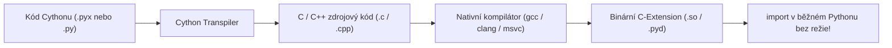
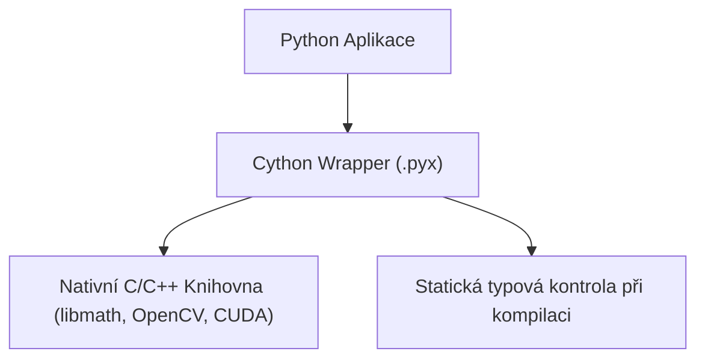
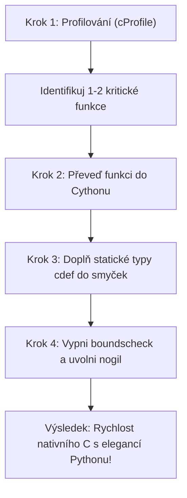

<!-- slide: id1, Úvod, Core, newconcept -->
## Cython: Programovací jazyk a C-kompilátor pro Python

[Cython](https://cython.org/) (ve verzi 3.0+) je jedním z nejmocnějších a nejpoužívanějších nástrojů pro akceleraci kódu v ekosystému Pythonu (využívají jej klíčové vědecké knihovny jako **NumPy**, **SciPy**, **Pandas** a **scikit-learn**).

Cython představuje dvě provázané věci:
1. **Programovací jazyk**: Rozšířená nadmnožina Pythonu, která umožňuje přímo deklarovat **statické C/C++ typy**, struktury a ukazatele.
2. **Optimalizující kompilátor (transpiler)**: Překládá kód v Cythonu (nebo čistém Pythonu!) do vysoce optimalizovaného zdrojového kódu v jazyce C nebo C++, který se následně zkompiluje nativním kompilátorem (GCC, Clang, MSVC) do binárního modulu (`.so` na Linuxu, `.pyd` na Windows).



Výsledný binární modul lze v běžném Pythonu importovat pomocí standardního příkazu `import modul` jako jakýkoliv jiný balíček.

---
<!-- slide: id2, Použití, Core, paradigm -->
## Kdy a na co se Cython používá?

Cython řeší dvě hlavní domény:

### 1. Akcelerace výpočetně náročných úzkých hrdel (*Speedup*)
- Těsné výpočetní smyčky, práce s pixely obrazu, numerické simulace, šifrování nebo parsing textu.
- Nahrazením dynamických `PyObject` referencí za nativní celá čísla a paměťové C buffery dochází k eliminaci režie interpretu.
- Možnost uvolnit **GIL** (*Global Interpreter Lock*) klíčovým slovem `nogil` a dosáhnout skutečného vícevláknového paralelismu na všech jádrech CPU.

### 2. Tvorba Python rozhraní k existujícím C/C++ knihovnám (*Wrapping*)
- Propojení hotových podnikových a vědeckých C/C++ knihoven s Pythonem.
- Na rozdíl od `ctypes` (které volá C funkce dynamicky přes reflexi za běhu) generuje Cython statické, typově bezpečné C-API volání s nulovou režií.



---
<!-- slide: id3, Historie a struktura, Core, newconcept -->
## Vývoj Cythonu: Od Pyrexu k Cythonu 3.0

Cython vznikl v roce 2007 jako fork dřívějšího projektu **Pyrex** s cílem poskytnout komplexní podporu pro vědecké výpočty (zejména balík SageMath).

### Klíčové milníky:
- **Pyrex**: Původní myšlenka doplňování C-typů do Pythonu.
- **Cython 0.x**: Vynucoval speciální syntaxi v souborech s příponou `.pyx`. Vyžadoval samostatný buildovací krok.
- **Cython 3.0+ (Moderní standard)**:
  - Plná podpora moderního Pythonu 3.10–3.12+ (PEP 634 `match/case`, PEP 570 `/`, PEP 604 `|`).
  - **Pure Python Mode**: Možnost psát veškerý kód v čistých souborech `.py` s využitím standardních typových anotací z modulu `typing`!

> [!TIP]
> Díky **Pure Python Mode** můžete tentýž soubor ladit v běžném Python debuggeru (PDB / VS Code) bez kompilace, a pro produkční nasazení jej nechat zkompilovat Cythonem do nativní C-rychlosti.

---
<!-- slide: id4, Prostředky, Core, paradigm -->
## Klíčové konstrukce Cythonu: `cdef`, `cpdef` a `nogil`

Cython rozšiřuje standardní Python o nová klíčová slova:

### 1. Rozdíly ve funkcích:
- **`def`**: Běžná Python funkce. Má dynamické `PyObject` rozhraní, přijímá i vrací pythonní objekty. Lze volat z Pythonu.
- **`cdef`**: Čistá C funkce. Přijímá a vrací nativní C typy. Nelze ji volat z běžného Pythonu, ale volání mezi `cdef` funkcemi má **nulovou režii** (přímý instrukční skok `CALL` v procesoru).
- **`cpdef`**: Hybrid. Vygeneruje rychlé C volání pro Cython a současně pythonní obálku pro volání z běžného Python kódu.

### Praktická ukázka v `.pyx`:
```cython
# cython: language_level=3
cimport cython

@cython.boundscheck(False)
@cython.wraparound(False)
cpdef double eukleidovska_vzdalenost(double[:] a, double[:] b) nogil:
    cdef int i
    cdef int n = a.shape[0]
    cdef double soucet = 0.0
    cdef double diff

    for i in range(n):
        diff = a[i] - b[i]
        soucet += diff * diff

    return soucet ** 0.5
```

> [!NOTE]
> Zápis `double[:]` představuje **Typed Memoryview** — přímý přístup do souvislé paměti pole NumPy bez nutnosti volat CPython C-API!

---
<!-- slide: id5, Poznámka k rychlosti, WOW, newconcept -->
## Rychlostní zisky a doporučená strategie

Jakého zrychlení lze s Cythonem reálně dosáhnout?

| Stupeň úpravy kódu | Typické zrychlení | Co se odehrává pod kapotou |
|---|---|---|
| **Čistý Python kód** (bez úprav) | **1.2× – 2×** | Cython odstraní režii bajtkódového interpretu, ale stále manipuluje s `PyObject`. |
| **Doplnění C-typů proměnných v cyklech** | **10× – 50×** | Celá čísla a indexy se alokují přímo v registrech CPU bez referenčního počítání. |
| **Vektorizace + Typed Memoryviews + `nogil`** | **100× – 500×** | Úplná eliminace CPythonu v těle smyčky. Rychlost je **identická s čistým C/C++**. |



### Závěrečné shrnutí Week 11:
- Pro měření malých úseků použijte **`timeit`**.
- Pro nalezení úzkých hrdel aplikace použijte **`cProfile`** a **`pstats`**.
- Pro ověření dokumentace pište **`doctest`**.
- Pro statickou verifikaci doplňujte **typové anotace** (kontrola přes `mypy`).
- Pro nefatální upozornění využívejte modul **`warnings`**.
- Pro maximální výpočetní výkon nasazujte **NumPy**, **Numbu** a **Cython**.
