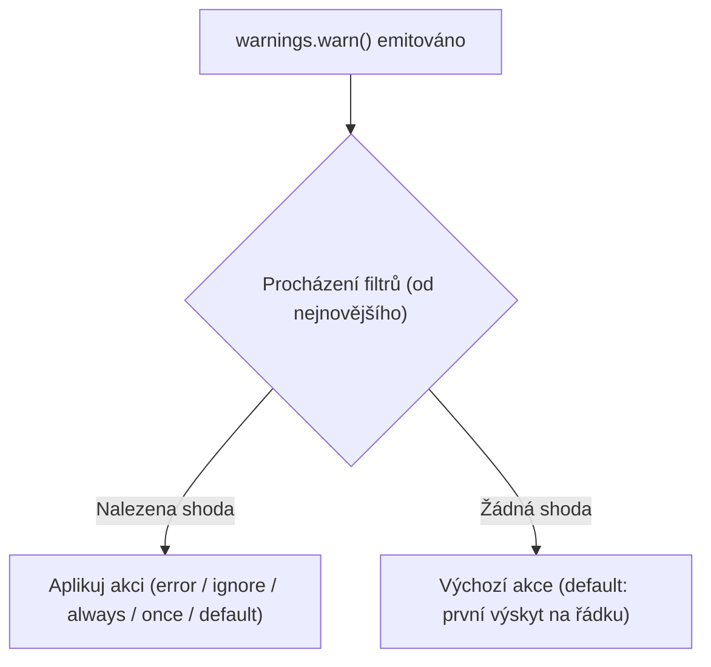

<!-- slide: id1, Úvod, Core, newconcept -->
## Varování v Pythonu: Modul `warnings`

Zatímco **výjimky** (*exceptions*) slouží k okamžitému přerušení toku programu při vzniku fatální chyby (např. `FileNotFoundError`, `ZeroDivisionError`), **varování** (*warnings*) informují programátora nebo uživatele o nestandardním stavu, který **nezabraňuje dalšímu běhu programu**.

### Kdy se varování používají?
- **Deprekace API (*Deprecation*)**: Funkce nebo třída je zastaralá a v budoucí verzi knihovny bude odstraněna (`DeprecationWarning`, `FutureWarning`).
- **Nekorektní použití knihovny**: Předání neoptimálních parametrů, které však program stále dokáže zpracovat (`UserWarning`).
- **Běhové anomálie**: Chybějící uzavření souboru v GC (`ResourceWarning`), nebezpečné přetypování bajtů (`BytesWarning`), nebo chybějící UTF-8 specifikace (`EncodingWarning` — PEP 597).

> [!NOTE]
> Ve výchozím nastavení se varování vypisují na standardní chybový výstup (`sys.stderr`) a program plynule pokračuje v provádění dalšího kódu.

---
<!-- slide: id2, Hierarchie varování, Core, basics -->
## Třídní hierarchie varování

Všechna varování v Pythonu jsou odvozena od bázové třídy **`Warning`**, která sama dědí z obecné třídy **`Exception`**:

```text
BaseException
└── Exception
    └── Warning
        ├── UserWarning (výchozí kategorie pro uživatelská varování)
        ├── DeprecationWarning (upozornění na zastaralý kód pro vývojáře)
        ├── PendingDeprecationWarning (plánované zastarání v budoucnu)
        ├── SyntaxWarning (podezřelá syntaxe v kódu)
        ├── RuntimeWarning (podezřelé chování za běhu, např. dělení nulou v NumPy)
        ├── FutureWarning (upozornění pro koncové uživatele na budoucí změnu sémantiky)
        ├── ImportWarning (problémy při importování modulů)
        ├── UnicodeWarning (potíže s Unicode kódováním)
        ├── BytesWarning (problematické míchání bytes a str)
        ├── EncodingWarning (PEP 597: nezadaný encoding při otevírání souborů)
        └── ResourceWarning (neuzavřené soubory nebo sokety při likvidaci GC)
```

Díky tomu, že `Warning` dědí z `Exception`, lze varování v případě potřeby povýšit na skutečnou výjimku!

---
<!-- slide: id3, Vlastní varování, Tricky, pythonic -->
## Vlastní třídy varování: Dědění z `Warning`

Můžete definovat vlastní specifické třídy varování odvozením od `Warning` nebo některé z jeho podtříd:

```python
import warnings


class KonfiguracniWarning(UserWarning):
    """Varování při nalezení zastaralého konfiguračního klíče."""
    pass


# Ačkoliv technicky lze varování vyvolat pomocí raise jako výjimku:
try:
    raise KonfiguracniWarning("Klíč 'port' je zastaralý, použijte 'server_port'!")
except KonfiguracniWarning as w:
    print(f"Zachyceno jako výjimka: {w}")
```

> [!CAUTION]
> Použití `raise MyWarning(...)` nedává v praxi smysl — okamžitě tím zastavíte běh programu stejně jako u obyčejné chyby. Pro správné emitování nefatálního upozornění je nutné použít funkci **`warnings.warn()`**!

---
<!-- slide: id4, Výpis varování (na „stderr“), Core, basics -->
## Funkce `warnings.warn()` a standardní chybový výstup

Správný způsob emitování varování představuje volání **`warnings.warn()`**:

```python
import warnings

print("Krok 1: Inicializace...")
warnings.warn("Databázový soubor je téměř plný!")
print("Krok 2: Program pokračuje bez přerušení...")
```

### Chování v konzoli:

```bash
$ python skript.py
Krok 1: Inicializace...
skript.py:4: UserWarning: Databázový soubor je téměř plný!
  warnings.warn("Databázový soubor je téměř plný!")
Krok 2: Program pokračuje bez přerušení...
```

### Přesměrování proudů:
Varování putuje do **`stderr`**, nikoliv do `stdout`:
```bash
$ python skript.py > vystup.log
skript.py:4: UserWarning: Databázový soubor je téměř plný!
  warnings.warn("Databázový soubor je téměř plný!")

$ cat vystup.log
Krok 1: Inicializace...
Krok 2: Program pokračuje bez přerušení...
```

---
<!-- slide: id5, Určení typu varování, Skip, basics -->
## Specifikace kategorie varování

Druhým parametrem funkce `warnings.warn()` je kategorie (třída potomka `Warning`):

```python
import warnings

# 1. Varování pro vývojáře o zastaralé funkci:
warnings.warn(
    "Funkce stary_vypocet() bude v příští verzi odstraněna.",
    DeprecationWarning
)

# 2. Vlastní specializovaná kategorie:
class DatabazovyWarning(UserWarning):
    pass

warnings.warn(
    "Index v tabulce není optimalizován.",
    DatabazovyWarning
)
```

Pokud kategorii nezadáte, použije se výchozí **`UserWarning`**.

> [!NOTE]
> V moderním Pythonu je `DeprecationWarning` pro kód samotného uživatele standardně skrytý (ignorovaný), aby neobtěžoval koncové uživatele v produkčních CLI aplikacích.

---
<!-- slide: id6, Filtrování varování, Core, newconcept -->
## Filtrování varování: Koncept filtrů

Největší síla modulu `warnings` spočívá v **možnosti programového i globálního řízení toho, co se s varováním stane**.

Můžete si vybrat:
- Chcete varování zcela **ignorovat**?
- Chcete jej vypsat **pouze jednou** za celý běh aplikace?
- Chcete jej v testovacím prostředí proměnit v **tvrdou výjimku**, aby testy okamžitě selhaly při použití zastaralého API?



Filtry se aplikují v pořadí od nejnověji přidaného k nejstaršímu.

---
<!-- slide: id7, Identifikace varování, Skip, basics -->
## Pět složek filtru varování

Každé varování je v systému identifikováno pěticí parametrů:

1. **`action`**: Požadovaná akce (jak má systém zareagovat).
2. **`message`**: Regulární výraz odpovídající textu chybové zprávy (case-insensitive).
3. **`category`**: Třída varování (např. `DeprecationWarning`, `UserWarning`). Zachytí i všechny její potomky.
4. **`module`**: Regulární výraz odpovídající názvu modulu, kde k varování došlo (např. `__main__`, `numpy.*`).
5. **`lineno`**: Konkrétní číslo řádku kódu (nebo `0` pro libovolný řádek).

Tato pětice umožňuje chirurgicky přesné filtrování napříč celým projektem i externími knihovnami.

---
<!-- slide: id8, Akce = typy filtrů, Tricky, newconcept -->
## Šest akcí filtru varování

| Akce | Popis | Typické použití |
|---|---|---|
| **`"error"`** | Povýší varování na **plnohodnotnou výjimku**. Běh se okamžitě zastaví. | **CI/CD testy (`pytest -W error`)**: Zajistí, že projekt nepoužívá žádné zastaralé funkce! |
| **`"ignore"`** | Varování je **zcela potlačeno** a nikam se nevypisuje. | Potlačení známých neškodných varování z externích knihoven třetích stran. |
| **`"always"`** | Varování se vypíše **při každém průchodu** daným místem v kódu. | Ladění horkých smyček. |
| **`"default"`** | Vypíše se pouze **při prvním výskytu z daného řádku** programu. | Výchozí standardní chování Pythonu. |
| **`"module"`** | Vypíše se pouze **jednou za každý importovaný modul**. | Přehledné reporty ve velkých balíčcích. |
| **`"once"`** | Vypíše se pouze **jedenkrát za celý běh programu** (bez ohledu na místo). | Hromadná varování. |

---
<!-- slide: id9, Struktura filtru, Core, pythonic -->
## Globální filtry z příkazové řádky: Přepínač `-W`

Chování varování lze konfigurovat přímo při spuštění Pythonu bez úpravy kódu pomocí přepínače **`-W`**:

```bash
python -W "action:message:category:module:line" skript.py
```

### Praktické příklady použití v CLI:

```bash
# 1. Změň VŠECHNA varování na výjimky (skvělé pro CI testy!):
python -W error testy.py

# 2. Ignoruj všechna UserWarning:
python -W "ignore::UserWarning" skript.py

# 3. Vypiš všechna DeprecationWarning i v produkčním kódu:
python -W "default::DeprecationWarning" skript.py

# 4. Proměnná prostředí PYTHONWARNINGS:
export PYTHONWARNINGS="error,ignore::UserWarning"
python skript.py
```

---
<!-- slide: id10, „filterwarnings()“ I, Core, pythonic -->
## Programové filtry: Funkce `warnings.filterwarnings()`

Pro nastavení filtru uvnitř Python kódu slouží funkce **`warnings.filterwarnings()`**:

```python
import warnings

warnings.filterwarnings(
    action="error",             # Požadovaná akce
    message=r".*zastaral.*",    # Regex pro text zprávy
    category=DeprecationWarning,# Třída varování
    module=r"moje_knihovna\..*",# Regex pro modul
    lineno=0,                   # 0 = libovolný řádek
    append=False                # False = vložit na začátek (nejvyšší priorita)
)
```

> [!NOTE]
> Parametr `append=False` (výchozí) zajistí, že nové pravidlo se zařadí na začátek seznamu aktivních filtrů a vyhodnotí se před dříve definovanými pravidly.

---
<!-- slide: id11, „filterwarnings()“ – příklad, Skip, basics -->
## Příklady použití `warnings.filterwarnings()`

### 1. Filtrování podle textu zprávy:
```python
import warnings

# Potlačí varování obsahující slovo 'testovaci':
warnings.filterwarnings("ignore", message=r".*testovaci.*")

warnings.warn("Toto je ostré varování!")       # Vypíše se
warnings.warn("Toto je testovaci varování!")   # Ignorováno (ticho)
```

### 2. Filtrování podle modulu:
```python
import warnings

# Povýší varování z modulu legacy_api na výjimku:
warnings.filterwarnings("error", module=r"legacy_api")
```

---
<!-- slide: id12, „simplefilter()“, Core, basics -->
## Jednoduchý filtr: Funkce `warnings.simplefilter()`

Pokud nepotřebujete regulární výrazy na text zprávy ani moduly a chcete filtrovat plošně podle kategorie, nabízí modul zjednodušenou funkci **`warnings.simplefilter()`**:

```python
warnings.simplefilter(action, category=Warning, lineno=0, append=False)
```

### Rychlá pravidla jedním řádkem:
```python
import warnings

# 1. Ignoruj všechna varování typu FutureWarning v celém programu:
warnings.simplefilter("ignore", FutureWarning)

# 2. Všechna ResourceWarning proměň v chybu (hlídání neuzavřených souborů):
warnings.simplefilter("error", ResourceWarning)
```

---
<!-- slide: id13, „simplefilter()“ – příklad, WOW, pythonic -->
## Praktický příklad: Změna varování na výjimku v testech

Proč je změna varování na výjimku tak užitečná? Umožňuje odhalit zastaralý kód během vývoje dříve, než nová verze knihovny odstraní podporované API:

```python
import warnings

def vypocitej():
    warnings.warn("Staré API, přejděte na novou verzi!", DeprecationWarning)
    return 42

# V běžném režimu:
print(vypocitej())
# Vypíše varování na stderr a vrátí 42

# V přísném režimu (např. v testovacím prostředí):
warnings.simplefilter("error", DeprecationWarning)

try:
    vypocitej()
except DeprecationWarning as e:
    print(f"Test zachytil chybu: Zastaralé API nesmí být voláno! ({e})")
```

---
<!-- slide: id14, Místo vyvolání varování, Tricky, newconcept -->
## Problém původu varování: Parametr `stacklevel`

Představme si knihovní funkci, která je označena jako zastaralá:

```python
import warnings

def stara_funkce() -> None:
    warnings.warn("stara_funkce() je zastaralá, použijte nova_funkce()!")

def aplikace() -> None:
    stara_funkce()  # Volání z uživatelského kódu

aplikace()
```

### Výchozí výstup:
```text
knihovna.py:4: UserWarning: stara_funkce() je zastaralá...
    warnings.warn(...)
```
Chybová hláška ukazuje na řádek 4 uvnitř knihovny (na samotný řádek s `warnings.warn`).
Pro uživatele je to však k ničemu — on potřebuje vědět, **na kterém řádku své aplikace starou funkci zavolal**!

Řešením je parametr **`stacklevel`**:
- `stacklevel=1`: Místo volání `warnings.warn` (výchozí).
- `stacklevel=2`: Místo, odkud byla volána funkce obsahující `warnings.warn` (volající kód).

---
<!-- slide: id15, „warn()“ – příklad na „stacklevel“, WOW, pythonic -->
## Správné použití `stacklevel=2` v knihovnách

```python
import warnings

def stara_funkce() -> None:
    # stacklevel=2 ukáže přesně na řádek v uživatelském skriptu:
    warnings.warn(
        "stara_funkce() je zastaralá, použijte nova_funkce()!",
        DeprecationWarning,
        stacklevel=2
    )

def aplikace() -> None:
    # Řádek 12:
    stara_funkce()

aplikace()
```

### Výsledný výstup:
```text
skript.py:12: DeprecationWarning: stara_funkce() je zastaralá, použijte nova_funkce()!
  stara_funkce()
```
Nyní výstup ukazuje přesně na řádek 12 v aplikaci, kde vývojář musí provést refaktoring.

> [!TIP]
> **Pravidlo pro autory knihoven**: Kdykoliv voláte `warnings.warn()` uvnitř pomocné nebo zastaralé funkce, vždy nastavte `stacklevel=2` (případně vyšší, pokud jde o hlubší wrapper)!

---
<!-- slide: id16, Poznámka, Skip, pythonic -->
## Lokální zachytávání varování: Kontextový manažer `catch_warnings()`

Pokud chcete varování otestovat v unit testech nebo dočasně potlačit v rámci jednoho bloku kódu bez ovlivnění globálního stavu aplikace, použijte kontextový manažer **`warnings.catch_warnings()`**:

```python
import warnings

def citliva_operace():
    # Změny filtrů uvnitř with bloku se po jeho opuštění automaticky vrátí!
    with warnings.catch_warnings():
        warnings.simplefilter("ignore")
        # Zde jsou všechna varování potlačena:
        legacy_vypocet()

    # Zde vně bloku jsou původní filtry plně obnoveny!
```

### Záznam varování do seznamu pro unit testy:
```python
with warnings.catch_warnings(record=True) as zaznam:
    warnings.simplefilter("always")
    stara_funkce()

    # Ověření v testu:
    assert len(zaznam) == 1
    assert issubclass(zaznam[0].category, DeprecationWarning)
    assert "zastaralá" in str(zaznam[0].message)
```
Tento elegantní přístup je základem pro testování varování v moderních testovacích sadách.
