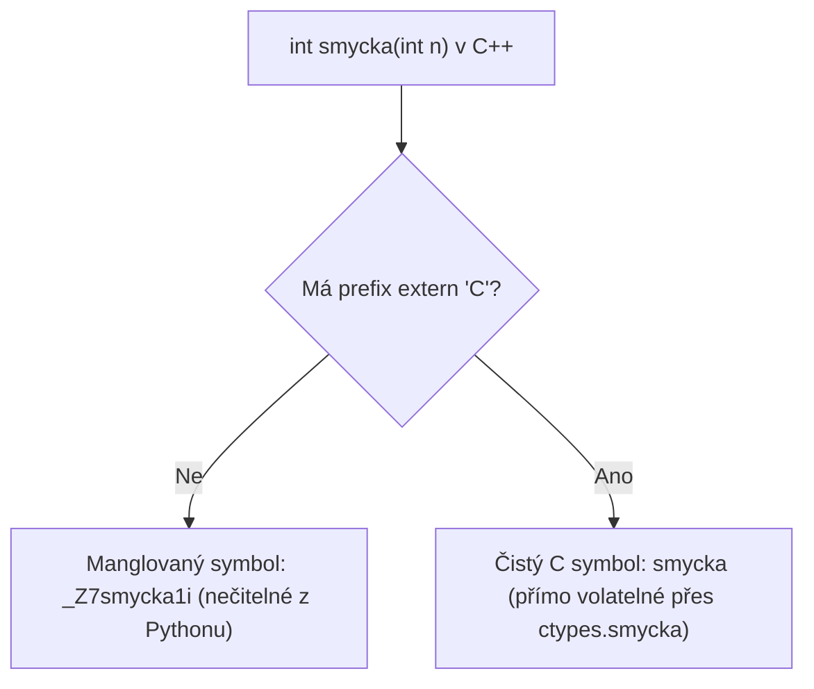

<!-- slide: id1, Úvod, Core, newconcept -->
## Příprava a kompilace sdílených knihoven (C, C++, D, Haskell, Ada)

Pro volání nativních binárních funkcí z Pythonu přes modul **`ctypes`** musí být zdrojový kód zkompilován do podoby **sdílené dynamické knihovny** (*Shared Library* — `.so` na Linuxu, `.dll` na Windows, `.dylib` na macOS).

Každý programovací jazyk a překladač má však odlišný způsob:
- Exportu symbolů a jmen funkcí do tabulky dynamických symbolů.
- Zacházení s typy a jmennými prostory (*Name Mangling*).
- Inicializace a finalizace vlastního běhového prostředí (*Runtime startup/cleanup*).

V této přednášce si ukážeme, jak správně připravit a zkompilovat sdílenou knihovnu v jazycích **C, C++, D, Haskell a Ada**, a jak tyto funkce spolehlivě zavolat z Pythonu.

---
<!-- slide: id2, C, Core, newconcept -->
## 1. Jazyk C: Export symbolů a multiplatformní makra

V čistém jazyce C je export nejpřímočařejší, protože C ABI je nativním jazykem pro `ctypes`. Chování exportu se však liší mezi operačními systémy:

1. **Linux / GCC (Výchozí chování)**:
   Ve výchozím nastavení exportuje `gcc -shared` všechny ne-statické funkce.
   Pro skrytí interních funkcí se používá přepínač `-fvisibility=hidden` a atribut viditelnosti:
   `__attribute__((visibility("default")))`
2. **Windows / MSVC / MinGW**:
   Ve výchozím stavu se neexportuje nic. Každá veřejná funkce musí být explicitně označena:
   `__declspec(dllexport)`

### Multiplatformní exportní makro (`export.h`):
```c
#if defined(_WIN32) || defined(__CYGWIN__)
    #define EXPORT_API __declspec(dllexport)
#else
    #define EXPORT_API __attribute__((visibility("default")))
#endif

EXPORT_API int smycka(int n);
```

---
<!-- slide: id3, C – volání, Already Studied, basics -->
## Kompilace a volání C knihovny z Pythonu

### C kód (`mylib.c`):
```c
#include "export.h"

EXPORT_API int smycka(int n) {
    int i = 0;
    while (i <= n) {
        i++;
    }
    return n;
}
```

### Příkaz pro kompilaci:
```bash
# Linux / WSL:
gcc -O3 -shared -fPIC mylib.c -o libmylib.so

# Windows:
gcc -O3 -shared mylib.c -o mylib.dll
```

### Volání z Pythonu:
```python
import ctypes
from pathlib import Path

knihovna_cesta = Path("./libmylib.so").resolve()
mylib = ctypes.CDLL(str(knihovna_cesta))

mylib.smycka.argtypes = [ctypes.c_int]
mylib.smycka.restype = ctypes.c_int

vysledek = mylib.smycka(1_000_000)
print(f"Výsledek z C: {vysledek}")
```

---
<!-- slide: id4, C++, Tricky, newconcept -->
## 2. Jazyk C++: Problém s Name Mangling a `extern "C"`

V jazyce C++ mohou existovat přetížené funkce se stejným názvem lišící se pouze typy parametrů (*function overloading*). Kompilátor C++ proto při překladu provádí **Name Mangling** — zakóduje typy parametrů přímo do exportovaného symbolu (např. `smycka1(int)` se změní na `_Z7smycka1i`).



### Pravidla pro C++:
- Funkce označené `static` jsou privátní pro danou překladovou jednotku a nelze je exportovat.
- Běžné funkce bez obalení vyjdou ven se zkomoleným (manglovaným) názvem.
- Aby funkce byla v Pythonu viditelná pod svým původním názvem, **musí být označena blokem `extern "C"`**!

---
<!-- slide: id5, C++ – volání, Core, resyntax -->
## Ukázka C++ kódu a volání z Pythonu

### C++ kód (`mylib.cc`):
```cpp
#if defined(_WIN32)
    #define EXPORT_API __declspec(dllexport)
#else
    #define EXPORT_API __attribute__((visibility("default")))
#endif

// 1. Bez extern "C" -> vygeneruje manglovaný symbol (např. _Z7smycka1i):
EXPORT_API int smycka1(int n) {
    return n * 2;
}

// 2. S extern "C" -> vygeneruje čistý C-symbol 'smycka2':
extern "C" EXPORT_API int smycka2(int n) {
    return n * 2;
}
```

### Volání v Pythonu:
```python
import ctypes

lib = ctypes.CDLL("./libmylib.so")

# A) Volání funkce s extern "C" (krásná tečková notace):
lib.smycka2.argtypes = [ctypes.c_int]
lib.smycka2.restype = ctypes.c_int
print(lib.smycka2(50))  # 100

# B) Manglovanou funkci lze zavolat pouze přes getattr() nebo zkomolené jméno:
mangled_fn = getattr(lib, "_Z7smycka1i")
mangled_fn.restype = ctypes.c_int
print(mangled_fn(50))  # 100
```

---
<!-- slide: id6, D, Skip, newconcept -->
## 3. Jazyk D (Dlang): Moderní systémový jazyk

Jazyk D kombinuje efektivitu C++ s moderní syntaxí a paměťovou bezpečností. Pro export C-kompatibilních funkcí nabízí specifikátor **`extern(C) export`**:

```d
// mylib.d
module mylib;

extern(C) export int smycka(int n) {
    int soucet = 0;
    for (int i = 0; i <= n; i++) {
        soucet += i;
    }
    return soucet;
}
```

### Kompilace přes DMD nebo LDC:
```bash
# Na Linuxu:
dmd -shared -defaultlib=libphobos2.so mylib.d -oflibmylib.so

# Na Windows:
dmd -shared mylib.d -ofmylib.dll
```

Klíčové slovo `extern(C)` vypne manglování Déčka a exportuje čistý symbol kompatibilní s C ABI.

---
<!-- slide: id7, D – volání, Skip, newconcept -->
## Volání knihovny z jazyka D v Pythonu

```python
import ctypes
from pathlib import Path

cesta = Path("./libmylib.so").resolve()
d_lib = ctypes.CDLL(str(cesta))

# Nastavení C-kompatibilních typů:
d_lib.smycka.argtypes = [ctypes.c_int]
d_lib.smycka.restype = ctypes.c_int

vysledek = d_lib.smycka(100)
print(f"Výsledek výpočtu v D: {vysledek}")
```

Pokud byste v Déčku nepoužili `extern(C)`, funkce by byla exportována s D manglingem (např. `_D5mylib6smyckaiZi`).

---
<!-- slide: id8, Haskell, Skip, newconcept -->
## 4. Jazyk Haskell: Funkcionální kód v C-knihovně

Haskell (překladač GHC) je čistě funkcionální jazyk s líným vyhodnocováním a vlastním běhovým prostředím (*GHC Runtime System — RTS*).

Abychom mohli volat Haskellovskou funkci z C/Pythonu, musíme:
1. Použít direktivu **`foreign export ccall`**.
2. Inicializovat a ukončit Haskell RTS runtime funkcemi `hs_init()` a `hs_exit()`.

### Haskell kód (`Mylib.hs`):
```haskell
{-# LANGUAGE ForeignFunctionInterface #-}
module Mylib where

import Foreign.C.Types

-- Exportovaná funkce:
soucetCisel :: CInt -> CInt -> IO CInt
soucetCisel x y = return (x + y)

foreign export ccall soucetCisel :: CInt -> CInt -> IO CInt
```

---
<!-- slide: id9, Haskell – volání, Skip, newconcept -->
## Inicializace RTS a volání Haskellu z Pythonu

Před voláním funkcí zkompilovaných GHC musíme inicializovat runtime wrapper `HsStart()`:

```python
import ctypes

lib = ctypes.CDLL("./libmylib.so")

# 1. Inicializace Haskell Runtime:
lib.hs_init(None, None)

try:
    # 2. Nastavení typů:
    lib.soucetCisel.argtypes = [ctypes.c_int, ctypes.c_int]
    lib.soucetCisel.restype = ctypes.c_int

    # 3. Spuštění výpočtu:
    vysledek = lib.soucetCisel(15, 27)
    print(f"Výsledek z Haskellu: {vysledek}")  # 42
finally:
    # 4. Korektní uvolnění RTS a garbage collectoru:
    lib.hs_exit()
```

---
<!-- slide: id10, Ada, Skip, newconcept -->
## 5. Jazyk Ada: Robustní vestavěné systémy

Jazyk Ada (překladač GNAT) je standardem v letectví, železniční dopravě a kritických bezpečnostních systémech. Vytvoření C-kompatibilní knihovny vyžaduje pragmu **`pragma Export (C, ...)`**:

```ada
-- ada_module.ads
package Ada_Module is
    function Secti (A, B : Integer) return Integer;
    pragma Export (C, Secti, "ada_secti");
end Ada_Module;

-- ada_module.adb
package body Ada_Module is
    function Secti (A, B : Integer) return Integer is
    begin
        return A + B;
    end Secti;
end Ada_Module;
```

Podobně jako Haskell má Ada svůj runtime, který vyžaduje zavolání `ada_moduleinit()` a `ada_modulefinal()`.

---
<!-- slide: id11, Ada – volání, Skip, newconcept -->
## Volání Ada knihovny v Pythonu

```python
import ctypes

ada_lib = ctypes.CDLL("./libada_module.so")

# 1. Inicializace Ada runtime:
ada_lib.ada_moduleinit.restype = None
ada_lib.ada_moduleinit()

try:
    # 2. Volání Ada funkce přes C-export jméno:
    ada_lib.ada_secti.argtypes = [ctypes.c_int, ctypes.c_int]
    ada_lib.ada_secti.restype = ctypes.c_int

    vysledek = ada_lib.ada_secti(100, 250)
    print(f"Výsledek z Ada: {vysledek}")
finally:
    # 3. Finalizace Ada runtime:
    ada_lib.ada_modulefinal.restype = None
    ada_lib.ada_modulefinal()
```

### Shrnutí:
Díky **C ABI** a modulu **`ctypes`** může Python fungovat jako univerzální řídicí jazyk integrující komponenty napsané v C, C++, Rustu, Déčku, Haskellu i Adě.
