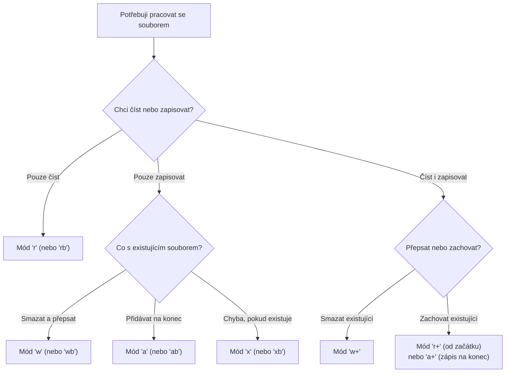

<!-- slide: id1, Úvod, Core, basics -->
## Práce se soubory: Základní I/O operace

Práce se soubory v Pythonu je postavena na vestavěné funkci **`open()`**, která vrací datový proud (*stream* neboli souborový popisovač):

```python
# Základní životní cyklus: otevřít -> zpracovat -> uzavřít
f = open("data.txt", mode="r", encoding="utf-8")
obsah = f.read()
f.close()
```

> [!CAUTION]
> **Proč je `encoding="utf-8"` kriticky povinný?**
> Parametr `encoding` je až třetím pojmenovaným parametrem funkce `open(file, mode='r', buffering=-1, encoding=None)`.
> Pokud `encoding` vynecháte, Python se pokusí použít výchozí systémové kódování (na Windows historicky `cp1250` nebo `windows-1252`), což vede k nekompatibilitě a pádům při přesunu kódu na Linux/macOS.
> V moderním Pythonu (PEP 597 / PEP 686) je standardem vždy explicitně uvádět **`encoding="utf-8"`**.

---
<!-- slide: id2, Operační kontext „with“, Tricky, basics -->
## Správce kontextu: Příkaz `with`

Při ručním volání `f.close()` hrozí, že pokud mezi `open()` a `close()` dojde k výjimce, soubor zůstane otevřený a data v mezipaměti (*buffer*) se nezapíší na disk.

V moderním Pythonu **vždy používáme kontextový manažer `with`**:

```python
with open("zaznamy.txt", mode="w", encoding="utf-8") as f:
    f.write("První řádek protokolu\n")
    f.write("Druhý řádek protokolu\n")
# Zde je soubor již garantovaně bezpečně uzavřen a buffer zapsán na disk!
```

> [!NOTE]
> Objekt souboru implementuje protokol správce kontextu:
> - Při vstupu do bloku `with` zavolá `__enter__()`.
> - Při opuštění bloku (i v případě neošetřené výjimky) zavolá `__exit__()`, která provede `flush()` a `close()`.

V Pythonu 3.10+ můžeme v závorkách otevírat více souborů najednou:
```python
with (
    open("vstup.txt", mode="r", encoding="utf-8") as zdroj,
    open("vystup.txt", mode="w", encoding="utf-8") as cil
):
    cil.write(zdroj.read())
```

---
<!-- slide: id3, Vlastnosti proudu, Core, pythonic -->
## Vlastnosti souborového proudu

Otevřený textový soubor je instancí třídy `_io.TextIOWrapper` a nabízí užitečné introspekční atributy a dotazovací metody:

```python
with open("test.txt", mode="r", encoding="utf-8") as f:
    print(f.name)        # 'test.txt' (cesta k souboru)
    print(f.mode)        # 'r' (mód otevření)
    print(f.encoding)    # 'utf-8' (použité kódování)
    print(f.readable())  # True (lze z proudu číst?)
    print(f.writable())  # False (lze do proudu zapisovat?)
    print(f.seekable())  # True (podporuje přesun ukazatele přes seek?)
    print(f.closed)      # False (soubor je stále otevřen)

print(f.closed)          # True (po opuštění bloku with je již uzavřen!)
```

---
<!-- slide: id4, Konstruktor „open()“, Core, resyntax -->
## Signatura funkce `open()` a parametry

Plný předpis vestavěné funkce:

```python
open(
    file,
    mode="r",
    buffering=-1,
    encoding=None,
    errors=None,
    newline=None,
    closefd=True,
    opener=None
)
```

- **`file`**: cesta k souboru (řetězec `str` nebo objekt `pathlib.Path`).
- **`mode`**: režim přístupu (`'r'`, `'w'`, `'a'`, `'x'`, `'b'`, `'t'`, `'+'`).
- **`buffering`**: `-1` (výchozí systémový buffer, typicky 4–8 KB), `0` (vypnuto, pouze binární mód), `1` (řádkový buffer pro text).
- **`encoding`**: název kodeku (např. `"utf-8"`, `"ascii"`, `"cp1250"`).
- **`errors`**: strategie při neplatných bajtech (`"strict"` vyvolá výjimku, `"ignore"` přeskočí, `"replace"` nahradí znakem `\ufffd`).
- **`newline`**: řízení překladu konců řádků (`\n`, `\r\n`).

---
<!-- slide: id5, Módy otevření souboru I, Skip, resyntax -->
## Módy otevření souboru

| Mód | Význam | Existující soubor | Ukazatel |
| :--- | :--- | :--- | :--- |
| **`r`** | Čtení (výchozí) | Musí existovat (jinak `FileNotFoundError`) | Na začátku |
| **`w`** | Zápis | **Smaže a přepíše!** (Truncate na 0 B) | Na začátku |
| **`a`** | Připojování (*Append*) | Zachová data, nový soubor vytvoří | Na konci |
| **`x`** | Exkluzivní vytvoření | Selže s **`FileExistsError`**, pokud soubor existuje | Na začátku |
| **`r+`** | Čtení i zápis | Musí existovat | Na začátku |
| **`w+`** | Čtení i zápis | Smaže původní obsah | Na začátku |
| **`a+`** | Čtení i připojování | Zachová data | Čtení volné, zápis na konec |

> [!NOTE]
> Ke každému písmenu můžeme připojit:
> - **`t`** (textový mód, výchozí): vrací a přijímá `str`.
> - **`b`** (binární mód): vrací a přijímá `bytes`. V binárním módu je parametr `encoding` zakázán!

---
<!-- slide: id6, Módy otevření souboru II, Skip, basics -->
## Rozhodovací diagram pro volbu módu



---
<!-- slide: id7, Čtení z proudu, Core, pythonic -->
## Čtení ze souboru: `read()`, `readline()` a iterace

Z textového souboru můžeme číst několika způsoby:

```python
# 1. Načtení celého souboru do jednoho řetězce (pro menší soubory):
with open("data.txt", encoding="utf-8") as f:
    cely_text = f.read()

# 2. Načtení přesně N znaků:
with open("data.txt", encoding="utf-8") as f:
    prvnich_deset = f.read(10)

# 3. Načítání po řádcích (NEJLEPŠÍ PRAXE pro velké soubory):
# Souborový objekt je iterátor! Načítá řádky líně (lazy) s pamětí O(1):
with open("velky_log.txt", encoding="utf-8") as f:
    for cislo_radku, radek in enumerate(f, start=1):
        if "ERROR" in radek:
            print(f"Řádek {cislo_radku}: {radek.strip()}")
```

> [!CAUTION]
> Vyhněte se volání `f.readlines()`, které načte všechny řádky do obrovského Python seznamu v paměti. Vždy iterujte přímo přes soubor `for line in f:`.

---
<!-- slide: id8, Zápis do proudu, Core, resyntax -->
## Zápis do souboru: `write()` a `writelines()`

```python
with open("vystup.txt", mode="w", encoding="utf-8") as f:
    # write() přijímá řetězec a vrací počet zapsaných znaků:
    zapsano = f.write("Ahoj, světe!\n")
    print(f"Zapsáno {zapsano} znaků.")

    # writelines() zapíše sekvenci řetězců (nepřidává automaticky konce řádků!):
    radky = ["První řádek\n", "Druhý řádek\n", "Třetí řádek\n"]
    f.writelines(radky)
```

> [!NOTE]
> Do textového souboru lze zapisovat také pomocí vestavěné funkce `print()` s parametrem `file=`:
> ```python
> with open("log.txt", mode="a", encoding="utf-8") as f:
>     print(f"Chyba v modulu: {err}", file=f)
> ```

---
<!-- slide: id9, Znaky vs bajty I, Core, paradigm -->
## Znaky vs. Bajty: Textový vs. Binární režim

Základní rozdíl mezi `TextIO` a `BinaryIO`:

1. **Pracovní jednotka**:
   - V textovém režimu (`'r'`, `'w'`) operujeme se **znaky** (`str`).
   - V binárním režimu (`'rb'`, `'wb'`) operujeme s **bajty** (`bytes`).
   - Jeden Unicode znak může v UTF-8 zabírat 1 až 4 bajty!

2. **Překlad konců řádků (Universal Newlines)**:
   - V textovém režimu Python automaticky převádí platformní konce řádků (`\r\n` na Windows, `\n` na Linuxu) na jednotné `\n` při čtení a zpět při zápisu.
   - V binárním režimu nedochází k žádné úpravě dat; bajty `\r\n` (0x0D 0x0A) zůstávají nedotčeny.

---
<!-- slide: id10, Znaky vs bajty II, Tricky, paradigm -->
## Pozice v souboru: `tell()` a `seek()`

- **`f.tell()`**: vrátí aktuální pozici v souboru.
- **`f.seek(offset, whence)`**: přesune čtecí/zapisovací ukazatel.
  - `whence=0`: od začátku souboru (výchozí).
  - `whence=1`: od aktuální pozice.
  - `whence=2`: od konce souboru.

```python
with open("soubor.txt", mode="w+", encoding="utf-8") as f:
    f.write("Čeština")  # 'Č' zabírá v UTF-8 2 bajty, ostatní písmena také!
    print(f.tell())     # 9 bajtů (ačkoliv text má jen 7 znaků!)

    # Přesun na začátek souboru:
    f.seek(0)
    print(f.read())     # 'Čeština'
```

---
<!-- slide: id11, Znaky vs bajty III, Tricky, paradigm -->
## Záludnost `seek()` v textových souborech

> [!WARNING]
> **Nikdy neprovádějte libovolný `seek(N)` v textovém souboru s vícebajtovým kódováním (UTF-8)!**
> Pokud skočíte na lichý bajt uprostřed vícebajtového Unicode znaku, následné čtení selže s chybou `UnicodeDecodeError`:
> ```python
> f.seek(1)
> f.read(1)  # UnicodeDecodeError: 'utf-8' codec can't decode byte...
> ```

V textových souborech je bezpečné:
1. `f.seek(0)` — návrat na úplný začátek souboru.
2. `f.seek(0, 2)` — skok na konec souboru.
3. `f.seek(pozice)` — skok pouze na pozici dříve vrácenou voláním `f.tell()`.

Pro libovolné posuny v bajtech vždy otevřete soubor v **binárním režimu (`'rb'`)**!

---
<!-- slide: id12, Mezipaměť („buffer“) I, Core, newconcept -->
## Mezipaměť (Buffering) a metoda `flush()`

Operační systém nezapisuje data na fyzický disk po každém znaku, ale shromažďuje je v mezipaměti (*buffer*), typicky o velikosti 4096 nebo 8192 bajtů.

Fyzický zápis proběhne:
1. Když se buffer zcela naplní.
2. Při korektním uzavření souboru metodou `close()` nebo na konci bloku `with`.
3. Při explicitním zavolání metody **`f.flush()`**.

```python
with open("vystup.log", mode="a", encoding="utf-8") as f:
    f.write("Kritická událost zaznamenána.\n")
    f.flush()  # Vynutí okamžité odeslání dat operačnímu systému
```

> [!TIP]
> U funkce `print()` můžeme okamžitý výpis na terminál vynutit parametrem `flush=True`:
> ```python
> print("Pracuji...", end="", flush=True)
> ```

---
<!-- slide: id13, Mezipaměť („buffer“) II, Skip, newconcept -->
## Řízení parametru `buffering` v `open()`

Při otevírání souboru lze chování mezipaměti explicitně nastavit:

| Hodnota `buffering` | Textový mód (`'t'`) | Binární mód (`'b'`) |
| :--- | :--- | :--- |
| **`0`** | Zakázáno (`ValueError`) | **Nebufferováno** (okamžitý zápis po bajtech) |
| **`1`** | **Řádkový buffer** (zápis při každém `\n`) | Zakázáno |
| **`> 1`** | Velikost bufferu v bajtech | Velikost bufferu v bajtech |
| **`-1` (výchozí)** | Heuristika systému (řádkový pro terminál, blokový pro disk) | Výchozí velikost bloku (typicky 4–8 KB) |

Pro běžnou práci v moderním Pythonu ponechte výchozí hodnotu `-1`, která je optimálně vyladěna pro operační systém.
