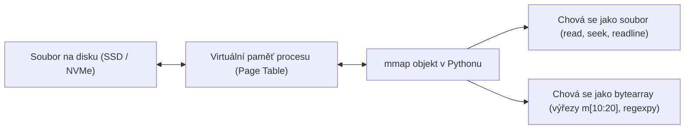

<!-- slide: id1, Úvod, Core, newconcept -->
## Paměťové mapování souborů: Modul `mmap`

Při práci s objemnými soubory (gigabajtové databáze, genomické FASTQ sekvence, binární mapy nebo logy) naráží klasické I/O operace (`file.read()`, `file.seek()`) na výkonnostní strop:
- Data musí být z disku přes operační systém zkopírována do kernel bufferu a odtud znovu zkopírována do paměti Pythonu (*double buffering*).
- Pokus o načtení celého 10 GB souboru do paměti přes `f.read()` vyústí v `MemoryError`.

Modul **`mmap`** (*Memory-Mapped File*) využívá systémové volání jádra (`mmap()` na POSIXu, `CreateFileMapping()` na Windows) a namapuje obsah souboru přímo do **virtuálního adresního prostoru procesu**.



### Proč je `mmap` tak rychlý?
Data se z disku načítají do RAM **líně (na vyžádání)** po jednotlivých stránkách virtuální paměti (*page faults*). Zápis do `mmap` objektu modifikuje paměťové stránky, které operační systém na pozadí asynchronně zapisuje na disk bez blokování programu.

---
<!-- slide: id2, Založení – „mmap()“, Core, newconcept -->
## Vytvoření objektu `mmap`: Dva hlavní režimy

### 1. Mapování existujícího souboru na disku (Doporučený zápis s kontextovým manažerem)

```python
import mmap
from pathlib import Path

cesta = Path("data.bin")

# Soubor musí být otevřen v binárním režimu (rb nebo rb+):
with open(cesta, "rb") as f:
    # f.fileno() předá nízkoúrovňový souborový deskriptor (int)
    # length=0 znamená: namapuj celý soubor od začátku do konce
    with mmap.mmap(f.fileno(), length=0, access=mmap.ACCESS_READ) as m:
        print(f"Velikost namapovaného souboru: {len(m)} bajtů")
        prvnich_deset_bajtu = m[:10]
```

### 2. Anonymní sdílená paměť v RAM (bez diskového souboru)
Pokud předáme jako deskriptor `-1`, vytvoříme blok v paměti RAM pro rychlé meziprocesové sdílení dat (*IPC*):
```python
# Alokace 1 MB čisté paměti v RAM:
with mmap.mmap(-1, length=1024 * 1024) as m:
    m.write(b"Data v RAM")
```

> [!NOTE]
> **Režimy přístupu (`access`)**:
> - `mmap.ACCESS_READ`: Pouze pro čtení (pokus o zápis vyvolá `TypeError`).
> - `mmap.ACCESS_WRITE`: Čtení i zápis přímo do souboru na disku.
> - `mmap.ACCESS_COPY`: *Copy-on-write* — zápisy zůstávají pouze v lokální paměti procesu a nepromítnou se zpět do souboru na disku.

---
<!-- slide: id3, Vlastnosti I, Core, pythonic -->
## Dvojí povaha `mmap`: Soubor i sekvence bajtů

Objekt `mmap` kombinuje rozhraní **proudového souboru** s rozhraním **měnitelného bajtového pole** (`bytearray`):

```python
import mmap

with open("databaze.bin", "rb+") as f:
    with mmap.mmap(f.fileno(), 0) as m:
        # A) Chování jako soubor (seek, tell, read, readline):
        m.seek(100)
        radek = m.readline()
        pozice = m.tell()

        # B) Metody pro vyhledávání binárních vzorů:
        idx = m.find(b"HLEDANY_VZOR")
        if idx != -1:
            print(f"Vzor nalezen na offsetu {idx}")

        # C) Zápis na aktuální pozici ukazatele:
        m.seek(0)
        m.write(b"HEADER_V2")
```

---
<!-- slide: id4, Vlastnosti II, WOW, pythonic -->
## Indexace a výřezy (Slicing) přímo v paměti

Největší elegancí `mmap` je možnost pracovat s gigabajtovým souborem pomocí běžné Python syntaxe hranatých závorek `m[od:do]`:

```python
import mmap

with open("zaznamy.dat", "rb+") as f:
    with mmap.mmap(f.fileno(), 0, access=mmap.ACCESS_WRITE) as m:
        # Čtení prvních 4 bajtů jako hlavičky (např. Magic Bytes):
        magic = m[:4]
        print(f"Magic bytes: {magic}")

        # In-place modifikace bajtů bez přepisování celého souboru:
        # Změníme bajty na indexech 10 až 14 přímo na disku:
        m[10:14] = b"TEST"

        # Přístup k jednotlivému bajtu vrátí celé číslo (0-255):
        prvni_bajt = m[0]
        print(f"První bajt (int): {prvni_bajt}")
```

> [!WARNING]
> Při přiřazování do výřezu `m[a:b] = nove_bajty` musí mít vkládaný řetězec přesně stejnou délku jako výřez `b - a`. Velikost namapovaného souboru nelze měnit pouhým přiřazením do výřezu!

---
<!-- slide: id5, Vlastnosti III, Skip, newconcept -->
## Pokročilé metody: `flush()`, `resize()` a `madvise()`

Pro nízkoúrovňovou správu paměťového mapování nabízí `mmap` specializované metody:

- **`m.flush()`**: Vynutí okamžitý synchronní zápis všech pozměněných paměťových stránek z RAM na fyzický disk.
- **`m.resize(nova_velikost)`**: Změní velikost namapované paměti i podkladového souboru na disku (pouze v režimu `ACCESS_WRITE`).
- **`m.move(cil, zdroj, pocet)`**: Ekvalient funkce `memmove()` v C — ultra-rychlý přesun bloku paměti i při překrývajících se oblastech.
- **`m.madvise(option)`** (POSIX): Předá jádru operačního systému nápovědu pro optimalizaci stránkování paměti:
  - `mmap.MADV_SEQUENTIAL`: Oznámí jádru, že data budeme číst sekvenčně od začátku do konce (jádro zapne agresivní *read-ahead*).
  - `mmap.MADV_RANDOM`: Oznámí náhodný přístup (vypne read-ahead pro úsporu I/O).

---
<!-- slide: id6, Srovnání rychlosti, WOW, paradigm -->
## Výkonnostní srovnání: Klasické I/O vs. `mmap`

Představme si procházení velkého 5 GB bioinformatického souboru FASTQ se čtením řádek po řádku:

```python
# Varianta A: Běžné souborové čtení přes f.readline()
with open("genom.fastq", "rb") as f:
    while True:
        h, s, p, q = f.readline(), f.readline(), f.readline(), f.readline()
        if not h: break
# Typický naměřený čas: ~41 sekund (režie bufferů a systémových volání read)

# Varianta B: Paměťově namapovaný soubor mmap
with open("genom.fastq", "rb") as f:
    with mmap.mmap(f.fileno(), 0, access=mmap.ACCESS_READ) as m:
        while True:
            h, s, p, q = m.readline(), m.readline(), m.readline(), m.readline()
            if not h: break
# Typický naměřený čas: ~24 sekund (o 40 % rychlejší, nulové zbytečné kopírování!)
```

### Proč je rozdíl tak markantní?
`mmap` eliminuje přepínání kontextu mezi uživatelským a jádrovým prostorem (*zero-copy architecture*). Procesor čte data přímo z mezipaměti stránek operačního systému (*Page Cache*).

---
<!-- slide: id7, Použití, Core, pythonic -->
## Typické scénáře nasazení `mmap` v praxi

1. **Rychlé prohledávání obřích souborů regulárními výrazy (`re`)**:
   Standardní modul `re` umí operovat přímo nad objektem `mmap` bez nutnosti načíst soubor do paměti!
   ```python
   import mmap
   import re

   with open("server.log", "rb") as f:
       with mmap.mmap(f.fileno(), 0, access=mmap.ACCESS_READ) as m:
           # Hledáme všechny výskyty IP adres přímo v namapovaném souboru:
           vzor = re.compile(rb"\b\d{1,3}\.\d{1,3}\.\d{1,3}\.\d{1,3}\b")
           for shoda in vzor.finditer(m):
               print(f"Nalezena IP na offsetu {shoda.start()}: {shoda.group().decode()}")
   ```
2. **Sdílená meziprocesová paměť (IPC)**:
   Více nezávislých Python procesů může namapovat tentýž soubor a bleskově komunikovat přes paměť bez režie soketů nebo rour.
3. **Binární databáze a formáty (HDF5, SQLite, indexy)**:
   Přímočaré čtení C-struktur pomocí modulu `struct` z libovolného offsetu bez alokace dočasných řetězců.
