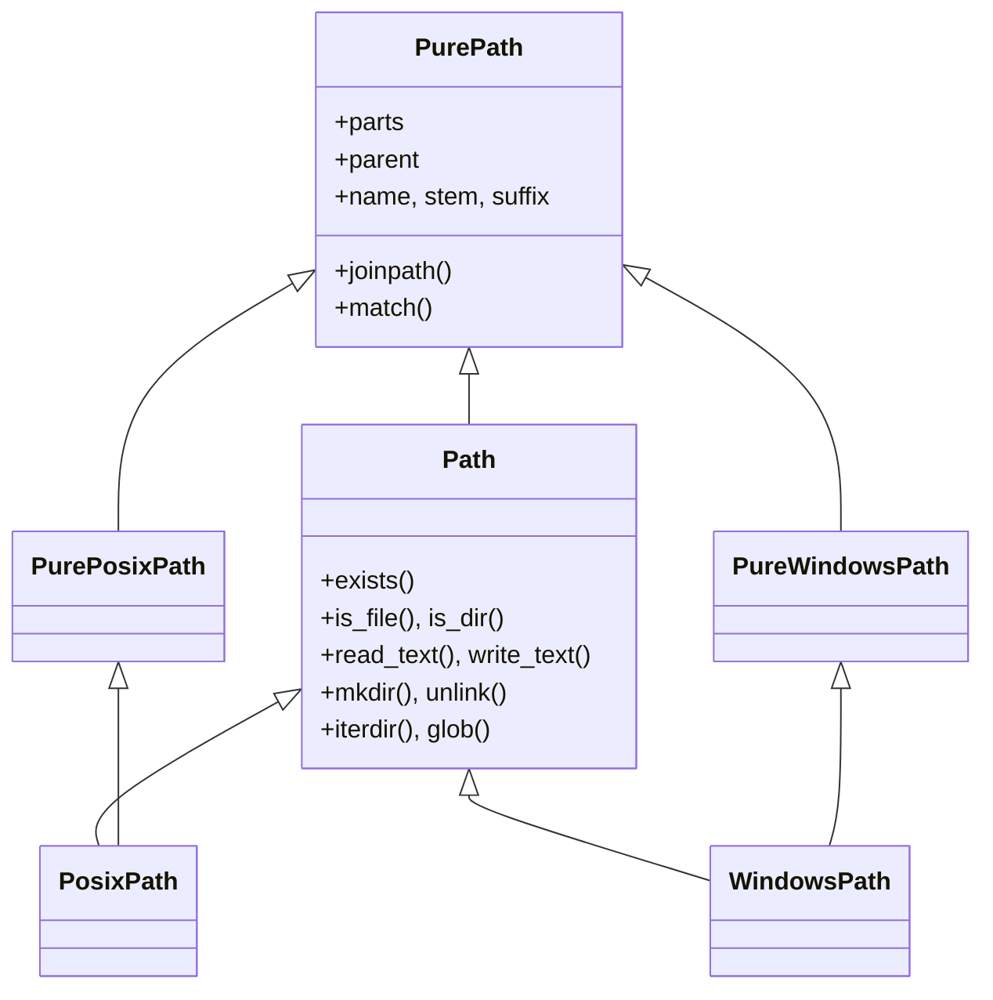

<!-- slide: id1, Úvod, Core, pythonic -->
## Moderní cesty v souborovém systému: Modul `pathlib`

Historicky se v Pythonu (a jazycích C/Java) cesty k souborům reprezentovaly jako obyčejné textové řetězce (`str`), které se spojovaly funkcemi z modulu `os.path` (např. `os.path.join("data", "vystup.csv")`). Tento přístup byl náchylný k chybám:
- Rozdílné oddělovače adresářů (`/` na Linuxu/macOS vs. `\` na Windows).
- Zmatek při práci s relativními a absolutními cestami.
- Nekonzistentní API roztříštěné mezi moduly `os`, `os.path`, `glob`, `shutil`.

Od Pythonu 3.4 přináší standardní knihovna modul **`pathlib`** (PEP 428):
- **Objektový přístup**: Cesta je plnohodnotný objekt třídy `Path`.
- **Přetížený operátor `/`**: Přirozené a multiplatformní spojování cest.
- **Sjednocené metody**: Vyhledávání souborů, čtení, zápis, zjišťování metadat i mazání přímo na objektu cesty.

```python
from pathlib import Path

# Cesta jako objekt:
cesta = Path("projekt") / "data" / "mereni.json"
print(cesta)  # 'projekt/data/mereni.json' (na Linuxu) nebo 'projekt\data\mereni.json' (na Windows)
```

---
<!-- slide: id2, Ochutnávka, WOW, pythonic -->
## Ochutnávka práce s `pathlib.Path`

Rychlé srovnání starého céčkovského přístupu vs. moderní `pathlib`:

```python
from pathlib import Path

# 1. Spojování cest a zjištění absolutní cesty:
p = Path.cwd() / "konfigurace" / "nastaveni.toml"
print(p.resolve())

# 2. Inspekce částí cesty:
print(p.name)      # 'nastaveni.toml'
print(p.stem)      # 'nastaveni' (bez přípony)
print(p.suffix)    # '.toml'
print(p.parent)    # adresář 'konfigurace'

# 3. Přímý zápis a čtení bez nutnosti ručního otevírání proudu:
data_soubor = Path("pokus.txt")
data_soubor.write_text("Příliš žluťoučký kůň", encoding="utf-8")
print(data_soubor.read_text(encoding="utf-8"))

# 4. Úklid (smazání souboru):
data_soubor.unlink(missing_ok=True)
```

> [!NOTE]
> Všechny moderní knihovny Pythonu (NumPy, Pandas, PyTorch, `open()`, `shutil`) implementují protokol **PEP 519 (`os.PathLike`)** a přijímají objekty `Path` napřímo.

---
<!-- slide: id3, Celkový přehled, Core, paradigm -->
## Architektura modulu `pathlib`

Hierarchie tříd v modulu `pathlib` dělí cesty do dvou kategorií:
1. **`PurePath` (Čisté / Abstraktní cesty)**:
   - Provádějí čistě logické řetězcové operace s cestou bez jakéhokoliv I/O na disk.
   - Umožňují manipulovat s Windows cestami na Linuxu (`PureWindowsPath`) a naopak (`PurePosixPath`).
2. **`Concrete Path` (Konkrétní cesty)**:
   - Dědí z `PurePath` a navíc přistupují na fyzický souborový systém (vytváření, čtení, mazání).
   - Třída **`Path`** je systémový generátor: na Windows automaticky vrátí instanci `WindowsPath`, na Linuxu/macOS vrátí `PosixPath`.



---
<!-- slide: id4, A) Abstraktní „Pure“-cesty, Core, paradigm -->
## Abstraktní cesty: `PurePath`

Abstraktní cesta **nekomunikuje se souborovým systémem**. Nemůže nic smazat, vytvořit ani zkontrolovat existenci souboru. Slouží k bezpečné parsování a konstrukci cest:

```python
from pathlib import PurePath, PurePosixPath, PureWindowsPath

# Manipulace s cestou z Windows na Linuxovém serveru:
win_cesta = PureWindowsPath(r"C:\Users\Student\Dokumenty\projekt.zip")
print(win_cesta.drive)   # 'C:'
print(win_cesta.name)    # 'projekt.zip'
print(win_cesta.parent)  # 'C:\Users\Student\Dokumenty'

# Převod na standardní POSIX tvar pro webové URL nebo konfiguraci:
print(win_cesta.as_posix())  # 'C:/Users/Student/Dokumenty/projekt.zip'
```

---
<!-- slide: id5, Vytvoření cesty, Tricky, pythonic -->
## Tvorba cest: Operátor `/` a `joinpath()`

Cesty můžeme skládat několika způsoby:

```python
from pathlib import Path

# 1. Operátor dělení / (doporučeno):
# Alespoň jeden z operandů (typicky ten první) musí být instancí Path!
p1 = Path("projekt") / "data" / "vstup.csv"

# 2. Předání více argumentů do konstruktoru:
p2 = Path("projekt", "data", "vstup.csv")

# 3. Metoda joinpath():
p3 = Path("projekt").joinpath("data", "vstup.csv")

print(p1 == p2 == p3)  # True
```

> [!CAUTION]
> **Záludnost absolutních cest při spojování**:
> Pokud k cestě připojíte řetězec začínající lomítkem `/`, operátor `/` to vyhodnotí jako novou absolutní cestu a všechno předchozí zahodí:
> ```python
> p = Path("/var/log") / "/etc/hosts"
> print(p)  # '/etc/hosts' (cesta /var/log byla zahozena!)
> ```

---
<!-- slide: id6, Informace o složkách cesty, WOW, pythonic -->
## Rozklad cesty na komponenty

Objekt `Path` poskytuje přehledné vlastnosti pro extrakci všech částí cesty:

```python
from pathlib import Path

p = Path("/home/student/projekty/analyza.tar.gz")

print(p.parts)     # ('/', 'home', 'student', 'projekty', 'analyza.tar.gz')
print(p.parent)    # PosixPath('/home/student/projekty')
print(p.name)      # 'analyza.tar.gz' (celé jméno)
print(p.stem)      # 'analyza.tar' (jméno bez poslední přípony)
print(p.suffix)    # '.gz' (poslední přípona)
print(p.suffixes)  # ['.tar', '.gz'] (všechny přípony složeného archívu)

# Iterace přes všechny nadřazené adresáře:
for rodic in p.parents:
    print(rodic)
# /home/student/projekty
# /home/student
# /home
# /
```

---
<!-- slide: id7, Řetězcová reprezentace cesty, Skip, basics -->
## Řetězcová reprezentace a URI

```python
from pathlib import Path

p = Path("/tmp/data/mereni.csv")

# 1. Převod na standardní systémový řetězec:
str_cesta = str(p)

# 2. Vynucení dopředných lomítek (standard pro web a POSIX):
posix_cesta = p.as_posix()

# 3. Převod na file:// URI protokol:
uri = p.as_uri()
print(uri)  # 'file:///tmp/data/mereni.csv'
```

---
<!-- slide: id8, Relativní cesta, Core, basics -->
## Výpočet relativní cesty: `relative_to()`

Metoda **`p.relative_to(baze)`** spočítá relativní cestu objektu `p` vůči zadanému nadřazenému adresáři:

```python
from pathlib import Path

p = Path("/var/www/html/app/index.html")
baze = Path("/var/www/html")

rel = p.relative_to(baze)
print(rel)  # PosixPath('app/index.html')
```

> [!NOTE]
> V Pythonu 3.12+ přibyla také metoda **`p.is_relative_to(baze)`**, která vrátí `True`/`False` namísto vyhození výjimky `ValueError`.

---
<!-- slide: id9, Filtrování cest – „match()“, Core, pythonic -->
## Globbing a test vzorů: `match()`

Metoda **`p.match(pattern)`** zkontroluje, zda cesta odpovídá vzoru zadanému zástupnými znaky (*wildcards*):

```python
from pathlib import Path

p = Path("/var/log/nginx/access.log.2.gz")

print(p.match("*.gz"))            # True
print(p.match("access.*.gz"))     # True
print(p.match("nginx/*.gz"))      # True
print(p.match("apache/*.gz"))     # False
print(p.match("/var/log/**/*.gz")) # True
```

---
<!-- slide: id10, Test absolutnosti (a rezervace), Skip, basics -->
## Absolutní vs. Relativní cesty

```python
from pathlib import Path

p1 = Path("/usr/local/bin")
print(p1.is_absolute())  # True

p2 = Path("data/vstup.txt")
print(p2.is_absolute())  # False
```

Na Windows mají absolutní cesty kořen (`root`) i písmeno jednotky (`drive`), např. `C:\Windows`.

---
<!-- slide: id11, Přejmenovávání, WOW, pythonic -->
## Odvození nové cesty: `with_name()` a `with_suffix()`

Objekty `Path` jsou **neměnné (immutable)**. Pro vytvoření cesty s jiným názvem nebo příponou slouží metody:

```python
from pathlib import Path

p = Path("obrazky/diagram.png")

# 1. Změna přípony:
p_jpg = p.with_suffix(".jpg")
print(p_jpg)  # 'obrazky/diagram.jpg'

# 2. Odstranění přípony (předáním prázdného řetězce):
p_bez_pripony = p.with_suffix("")
print(p_bez_pripony)  # 'obrazky/diagram'

# 3. Změna celého názvu souboru v témže adresáři:
p_nova = p.with_name("schema.png")
print(p_nova)  # 'obrazky/schema.png'

# 4. Změna kořene jména bez změny přípony (Python 3.9+):
p_novy_stem = p.with_stem("novy_diagram")
print(p_novy_stem)  # 'obrazky/novy_diagram.png'
```

---
<!-- slide: id12, B) Konkrétní cesty, Core, basics -->
## Konkrétní cesty: Fyzický souborový systém

Zatímco `PurePath` pouze počítá řetězce, třída **`Path`** komunikuje s reálným diskem:
- Kontrola existence souborů a složek.
- Vytváření a mazání adresářů (`mkdir`, `rmdir`).
- Vyhledávání souborů na disku (`iterdir`, `glob`, `rglob`).
- Čtení a zápis dat (`read_text`, `write_text`, `read_bytes`, `write_bytes`).

---
<!-- slide: id13, Vytvoření cesty, Skip, basics -->
## Inicializace konkrétní cesty

```python
from pathlib import Path

# Prázdný konstruktor odpovídá aktuálnímu adresáři '.':
tento_adresar = Path()

# Relativní cesta:
vstup = Path("data/konfigurace.json")

# Získání absolutní cesty ze zadaného řetězce:
koren = Path("/etc/passwd")
```

---
<!-- slide: id14, Získání cesty, Core, basics -->
## Zjištění aktuální a domovské cesty

Objekt `Path` obsahuje pohodlné metody třídy (*class methods*):

```python
from pathlib import Path

# 1. Aktuální pracovní adresář procesu (Current Working Directory):
cwd = Path.cwd()
print(f"Pracovní adresář: {cwd}")

# 2. Domovský adresář přihlášeného uživatele (~):
home = Path.home()
print(f"Domovský adresář: {home}")
```

---
<!-- slide: id15, Normalizace cesty, Core, pythonic -->
## Normalizace a kanonizace cesty: `resolve()` a `expanduser()`

```python
from pathlib import Path

# 1. Expanze domovské vlnovky ~:
p_home = Path("~/projekty/skript.py").expanduser()
print(p_home)  # např. '/home/kolar/projekty/skript.py'

# 2. Kanonické vyřešení cesty (resolve):
# Odstraní tečky '.' a '..', rozbalí symbolické odkazy (symlinks) a vrátí absolutní cestu:
rel_cesta = Path("./podslozka/../data/./soubor.txt")
kanonicka = rel_cesta.resolve()
print(kanonicka)
```

> [!TIP]
> `Path.resolve(strict=True)` vyvolá `FileNotFoundError`, pokud cílový soubor fyzicky neexistuje na disku.

---
<!-- slide: id16, Informace o cestě I, Core, basics -->
## Existence, vlastnictví a metadata: `exists()` a `stat()`

```python
from pathlib import Path

p = Path("zaznamy.log")

# 1. Existence cesty na disku:
if p.exists():
    print("Soubor existuje!")

# 2. Informace o velikosti a časech z inode (os.stat_result):
info = p.stat()
print(f"Velikost: {info.st_size} bajtů")
print(f"Čas poslední změny: {info.st_mtime}")

# 3. Test, zda dvě cesty ukazují na stejný fyzický soubor (hardlink/symlink):
print(p.samefile(Path("./zaznamy.log")))  # True
```

---
<!-- slide: id17, Modul „stat“ – jak číst výstup metody „Path.stat()“, Skip, resyntax -->
## Interpretace metadat `stat()` a formátování práv

Číslo `st_mode` v `stat_result` je bitová maska práv a typu souboru:

```python
from pathlib import Path
from stat import filemode
from datetime import datetime

p = Path("skript.py")
if p.exists():
    st = p.stat()

    # Formátování unixových práv jako '-rwxr-xr--':
    prava_str = filemode(st.st_mode)
    print(f"Práva: {prava_str}")

    # Převedení časového razítka na čitelný datum a čas:
    posledni_zmena = datetime.fromtimestamp(st.st_mtime)
    print(f"Modifikováno: {posledni_zmena:%Y-%m-%d %H:%M:%S}")
```

---
<!-- slide: id18, Informace o cestě II, Skip, basics -->
## Testování typu cesty: `is_file()`, `is_dir()`, `is_symlink()`

```python
from pathlib import Path

p = Path("archiv.zip")

print(p.is_file())     # True (pokud je to běžný soubor)
print(p.is_dir())      # False (není to adresář)
print(p.is_symlink())  # False (není to symbolický odkaz)
```

---
<!-- slide: id19, Získání podcest – „iterdir()“, Core, pythonic -->
## Procházení adresáře: `iterdir()`

Metoda **`Path.iterdir()`** je generátor vracející objekty `Path` pro všechny položky v adresáři:

```python
from pathlib import Path

adresar = Path("dokumenty")

if adresar.is_dir():
    for polozka in adresar.iterdir():
        if polozka.is_file():
            print(f"Soubor: {polozka.name} ({polozka.stat().st_size} B)")
        elif polozka.is_dir():
            print(f"Podadresář: {polozka.name}/")
```

> [!NOTE]
> `iterdir()` prochází položky líně bez načtení všech jmen do paměti. Na rozdíl od starého `os.listdir()` nevrací pouhé řetězce, ale plnohodnotné instance `Path`.

---
<!-- slide: id20, Získání podcest – „glob()“ & „rglob()“, WOW, pythonic -->
## Hledání souborů podle masky: `glob()` a rekurzivní `rglob()`

```python
from pathlib import Path

koren = Path("projekt")

# 1. Hledání v konkrétním adresáři:
vsechny_py = koren.glob("*.py")

# 2. Rekurzivní hledání ve všech podadresářích (pattern '**/*'):
vsechny_testy = koren.glob("**/test_*.py")

# 3. Zkratka pro rekurzivní glob: rglob()
# Ekvivalent k koren.glob('**/*.csv')
vsechna_csv = koren.rglob("*.csv")

for soubor in vsechna_csv:
    print(f"Nalezeno CSV: {soubor.relative_to(koren)}")
```

---
<!-- slide: id21, Změna vlastností – „chmod()“ / „lchmod()“, Skip, resyntax -->
## Změna přístupových práv: `chmod()`

```python
from pathlib import Path

skript = Path("deploy.sh")

# Nastavení spustitelného příznaku rwxr-xr-x (oktalově 0o755):
if skript.exists():
    skript.chmod(0o755)
```

---
<!-- slide: id22, Tvorba a mazání souborů – „touch()“ & „unlink()“, Core, basics -->
## Tvorba a mazání souborů: `touch()` a `unlink()`

```python
from pathlib import Path

soubor = Path("data/zamek.lock")

# 1. Vytvoření prázdného souboru (nebo aktualizace času modifikace):
soubor.touch(exist_ok=True)

# 2. Bezpečné smazání souboru (Python 3.8+ parametr missing_ok):
# Nevyhodí chybu, pokud soubor již neexistuje!
soubor.unlink(missing_ok=True)
```

> [!TIP]
> Díky `missing_ok=True` již nemusíme psát zbytečné podmínky `if soubor.exists(): soubor.unlink()`.

---
<!-- slide: id23, Tvorba a mazání adresářů – „mkdir()“ & „rmdir()“, Core, pythonic -->
## Tvorba a mazání adresářů: `mkdir()` a `rmdir()`

```python
from pathlib import Path

cilovy_dir = Path("vystupy/2026/leden")

# 1. Vytvoření adresáře včetně všech chybějících rodičů (ekvivalent mkdir -p):
cilovy_dir.mkdir(parents=True, exist_ok=True)

# 2. Smazání PRÁZDNÉHO adresáře:
cilovy_dir.rmdir()
```

> [!CAUTION]
> Metoda `rmdir()` funguje **pouze na prázdné adresáře**.
> Pro rekurzivní smazání celého stromu adresářů i se soubory použijte funkci standardní knihovny:
> ```python
> import shutil
> shutil.rmtree(Path("vystupy"))
> ```

---
<!-- slide: id24, Přejmenovávání (přesouvání) cest – „replace()“, Core, basics -->
## Přesun a přejmenování: `replace()` a `rename()`

Metoda **`replace()`** atomicky přejmenuje nebo přesune soubor do nového umístění (pokud cíl existuje, tiše ho přepíše):

```python
from pathlib import Path

stary = Path("docasny.tmp")
novy = Path("vysledky.txt")

stary.write_text("Hotovo", encoding="utf-8")

# Přesun / přejmenování:
stary.replace(novy)

print(stary.exists())  # False
print(novy.exists())   # True
```

---
<!-- slide: id25, Kopírování souborů – „shutil.copy2()“, Core, basics -->
## Kopírování souborů a adresářů (`shutil`)

Modul `pathlib` záměrně neobsahuje metodu pro kopírování souborů. Ke kopírování slouží modul **`shutil`**, který přímo přijímá objekty `Path`:

```python
from pathlib import Path
import shutil

zdroj = Path("vzor.docx")
cil = Path("archiv/vzor_zaloha.docx")

# copy2 zkopíruje data souboru VČETNĚ časových značek a metadat:
shutil.copy2(zdroj, cil)

# Pro zkopírování celého adresáře rekurzivně:
# shutil.copytree(Path("data"), Path("zaloha_dat"))
```

---
<!-- slide: id26, Symbolický odkaz – „symlink_to()“, Skip, basics -->
## Symbolické odkazy: `symlink_to()`

```python
from pathlib import Path

skutecny_soubor = Path("verze_1.2.0.bin")
zástupce = Path("aktualni.bin")

# Vytvoření symlinku: zástupce -> skutečný soubor:
zástupce.symlink_to(skutecny_soubor)

# Ověření:
print(zástupce.is_symlink())  # True
print(zástupce.resolve())     # vrátí cestu k 'verze_1.2.0.bin'
```

---
<!-- slide: id27, Práce se soubory – „open()“, Core, basics -->
## Otevření souboru z objektu `Path`: `path.open()`

Objekt `Path` nabízí metodu `.open()`, která deleguje na vestavěnou funkci `open()`:

```python
from pathlib import Path

cesta = Path("konfigurace.json")

# Otevření jako kontextový manažer přímo z objektu cesty:
with cesta.open(mode="r", encoding="utf-8") as f:
    obsah = f.read()
```

---
<!-- slide: id28, Práce se soubory – vlastní metody, WOW, pythonic -->
## Pohodlné jednorázové metody: `read_text()` a `write_text()`

Pro rychlé načtení nebo zápis menších souborů není třeba psát blok `with open(...)`:

```python
from pathlib import Path

soubor = Path("vysledek.txt")

# 1. Zápis textu (automaticky otevře, zapíše UTF-8 a uzavře):
soubor.write_text("Ahoj z moderního Pythonu 3.12!\n", encoding="utf-8")

# 2. Načtení textu:
text = soubor.read_text(encoding="utf-8")
print(text)

# 3. Binární varianta pro bajty (read_bytes / write_bytes):
bin_soubor = Path("data.bin")
bin_soubor.write_bytes(b"\x00\x01\x02\x03\xff")
data = bin_soubor.read_bytes()
print(f"Načteno {len(data)} bajtů.")

# Úklid:
soubor.unlink()
bin_soubor.unlink()
```

> [!TIP]
> `Path.read_text(encoding="utf-8")` je nejelegantnější a nejčitelnější způsob načtení konfiguračních a datových souborů v moderním Pythonu.
