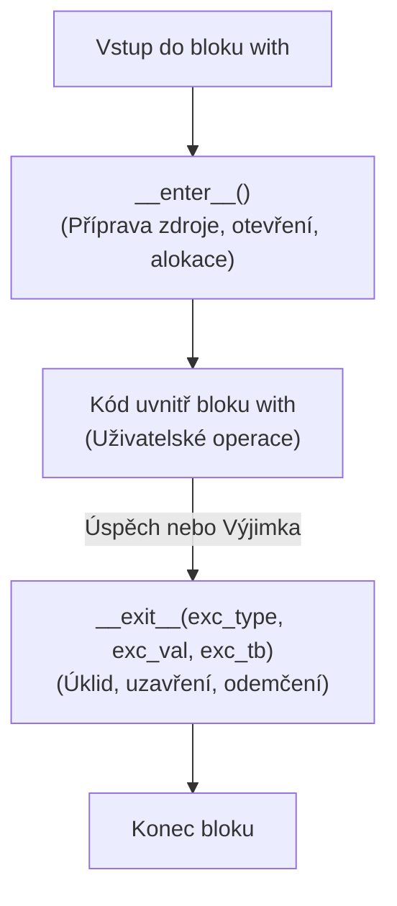

<!-- slide: id1, Úvod, Core, basics -->
## Kontextové manažery: Příkaz `with`

V programování neustále pracujeme se systémovými prostředky, které je nutné po použití korektně **uvolnit**:
- Otevřené soubory na disku.
- Síťové sokety a HTTP spojení.
- Databázové transakce (`commit` / `rollback`).
- Zámky vláken a procesů (`threading.Lock`).

Příkaz **`with`** (PEP 343) implementuje vzor *RAII* (*Resource Acquisition Is Initialization*) známý z C++ a ekvivalent `try-with-resources` z Javy. Zaručuje, že úklidový kód proběhne **vždy**, i když uvnitř bloku dojde k chybě nebo nečekané výjimce.

---
<!-- slide: id2, Práce se soubory I, Core, basics -->
## Správa zdrojů před příchodem `with`

Před zavedením kontextových manažerů musel programátor psát upovídaný blok `try-finally`:

```python
# Zastaralý přístup náchylný k chybám:
f = open("data.txt", "w", encoding="utf-8")
try:
    f.write("Důležitá data\n")
    # Pokud zde nastala neošetřená výjimka, blok finally zajistil uzavření:
finally:
    f.close()
```

Pokud vývojář na `try-finally` zapomněl, hrozilo vyčerpání souborových deskriptorů operačního systému (*file descriptor leak*) nebo poškození vyrovnávací paměti (*buffer flush*).

---
<!-- slide: id3, Práce se soubory II, Core, pythonic -->
## Idiomatický zápis s `with`

V moderním Pythonu je tento kód redukován na dva elegantní řádky:

```python
with open("data.txt", "w", encoding="utf-8") as f:
    f.write("Důležitá data\n")
```

Interpret automaticky:
1. Otevře soubor a předá referenci do proměnné `f`.
2. Spustí blok kódu.
3. Při opuštění bloku (ať už úspěšném doběhnutím, příkazem `return` nebo vyhozením výjimky) soubor **okamžitě a spolehlivě uzavře**.

---
<!-- slide: id4, Princip, Skip, newconcept -->
## Protokol kontextového manažeru

Kontextový manažer je jakýkoliv objekt, který implementuje dvě dunder metody:



1. **`__enter__()`**: Spustí se před provedením bloku. Návratová hodnota je přiřazena za klíčové slovo `as`.
2. **`__exit__()`**: Spustí se po opuštění bloku. Má na starost garantovaný úklid a případné ošetření výjimek.

---
<!-- slide: id5, Implementace pomocí třídy, Tricky, newconcept -->
## Vlastní kontextová třída

Vytvoření kontextového manažeru pomocí třídy s dunder metodami `__enter__` a `__exit__`:

```python
from types import TracebackType

class Transakce:
    def __enter__(self) -> "Transakce":
        print("[SETUP] Zahajuji databázovou transakci...")
        return self

    def __exit__(
        self,
        exc_type: type[BaseException] | None,
        exc_val: BaseException | None,
        exc_tb: TracebackType | None
    ) -> bool:
        if exc_type is not None:
            print(f"[ROLLBACK] Nastala chyba: {exc_val}! Změny vráceny zpět.")
            # Vrácení True potlačí výjimku (neprobublá ven z bloku with):
            return True
        
        print("[COMMIT] Vše v pořádku. Změny trvale uloženy.")
        # Vrácení False (nebo None) nechá výjimku normálně probublat
        return False
```

---
<!-- slide: id6, Příklad, Core, pythonic -->
## Chování třídního kontextu v praxi

Vyzkoušejme chování naší třídy `Transakce`:

```python
# 1. Scénář: Bezchybný průběh
with Transakce():
    print("  -> Ukládám uživatelský profil...")
# [SETUP] Zahajuji databázovou transakci...
#   -> Ukládám uživatelský profil...
# [COMMIT] Vše v pořádku. Změny trvale uloženy.

print()

# 2. Scénář: Výskyt chyby (výjimka je v __exit__ zachycena a potlačena)
with Transakce():
    print("  -> Ukládám platbu...")
    raise ValueError("Nedostatek prostředků na účtu")
# [SETUP] Zahajuji databázovou transakci...
#   -> Ukládám platbu...
# [ROLLBACK] Nastala chyba: Nedostatek prostředků na účtu! Změny vráceny zpět.
print("Program pokračuje bez pádu!")
```

---
<!-- slide: id7, Příklad pro „as“, Tricky, pythonic -->
## Návratová hodnota z `__enter__()`

Výraz za `as` nepředstavuje samotnou instanci kontextového manažeru, nýbrž **hodnotu, kterou vrátí metoda `__enter__()`**:

```python
class Casomira:
    def __enter__(self):
        import time
        self.start = time.perf_counter()
        # Vracíme slovník, do kterého lze v bloku zapisovat:
        self.vysledky = {}
        return self.vysledky

    def __exit__(self, *args):
        import time
        trvani = time.perf_counter() - self.start
        print(f"Blok trval: {trvani * 1000:.2f} ms")

with Casomira() as data:
    data["pocet"] = sum(range(500_000))
    print(f"Spočteno: {data['pocet']}")
# Spočteno: 124999750000
# Blok trval: 18.42 ms
```

---
<!-- slide: id8, Implementace pomocí generátoru – „@contextmanager“, WOW, pythonic -->
## Zkratka pomocí generátoru: `@contextlib.contextmanager`

Psát kvůli jednoduchému kontextu celou třídu s `__enter__` a `__exit__` je zbytečně zdlouhavé. Standardní knihovna nabízí dekorátor **`@contextmanager`**:

```python
from contextlib import contextmanager
from collections.abc import Iterator

@contextmanager
def muj_kontext() -> Iterator[str]:
    # 1. Část před yield == __enter__()
    print("[START] Příprava")
    try:
        # Hodnota za yield se přiřadí do 'as proměnná':
        yield "UŽITEČNÝ ZDROJ"
    finally:
        # 2. Část v bloku finally == __exit__()
        print("[KONEC] Úklid")
```

Generátor se po dosažení `yield` pozastaví, proběhne tělo bloku `with`, a následně se generátor probudí a provede úklid v `finally`.

---
<!-- slide: id9, Příklad, Core, pythonic -->
## Příklad: Dočasná změna pracovního adresáře

Praktický kontextový manažer, který dočasně změní aktuální adresář a po skončení bloku jej spolehlivě vrátí zpět:

```python
from contextlib import contextmanager
from pathlib import Path
import os

@contextmanager
def zmen_adresar(cil: Path | str):
    puvodni_cwd = Path.cwd()
    os.chdir(cil)
    try:
        yield Path.cwd()
    finally:
        os.chdir(puvodni_cwd)

# Použití:
print(f"Výchozí složka: {Path.cwd()}")
with zmen_adresar("/tmp") as temp_dir:
    print(f"Uvnitř bloku: {temp_dir}")
    # Práce v dočasném adresáři...

print(f"Po opuštění bloku: {Path.cwd()}")  # Spolehlivě zpět v původní složce!
```

---
<!-- slide: id10, Poznámka – práce se soubory, Skip, pythonic -->
## Jak je vnitřně implementován `open()`?

Pod kapotou funguje vestavěný `open()` přesně jako kontextový manažer:

```python
from contextlib import contextmanager

@contextmanager
def otevri_soubor(cesta: str, rezim: str = "r"):
    soubor = open(cesta, rezim, encoding="utf-8")
    try:
        yield soubor
    finally:
        soubor.close()
```

Díky tomu máme 100% jistotu, že i v případě výjimky (např. chyba parsování JSONu nebo formátu) se souborový deskriptor v OS okamžitě uzavře.

---
<!-- slide: id11, Třída vs generátor, Core, paradigm -->
## Třída vs. `@contextmanager`: Kdy co zvolit?

| Kritérium | Třída (`__enter__` / `__exit__`) | Generátor (`@contextmanager`) |
| :--- | :--- | :--- |
| **Složitost kódu** | Delší (nutno definovat třídu a 2 metody) | Velmi kompaktní a čitelný |
| **Vnitřní stav** | Snadná správa více atributů a pomocných metod | Stav žije v lokálních proměnných funkce |
| **Znovupoužitelnost** | Lze instanciovat a předávat jako objekt | Generátor je jednorázový |
| **Doporučené použití** | Komplexní síťové/DB klienty, SDK | Rychlé úklidové akce, zámky, mockování |

---
<!-- slide: id12, Poznámka – modul „contextlib“, Tricky, newconcept -->
## Užitečné nástroje v modulu `contextlib`

Standardní knihovna Pythonu nabízí řadu hotových kontextových manažerů:

1. **`contextlib.suppress(*exceptions)`**:
   - Bezpečné ignorování očekávaných výjimek bez prázdného `try-except: pass`:
   ```python
   from contextlib import suppress
   with suppress(FileNotFoundError):
       os.remove("docasny_soubor.tmp")
   ```
2. **`contextlib.redirect_stdout(stream)`**:
   - Přesměrování výstupu `print()` do souboru nebo řetězce `io.StringIO`.
3. **`contextlib.closing(obj)`**:
   - Automaticky zavolá metodu `.close()` na objektech, které nepodporují `with` nativně.

---
<!-- slide: id13, Vícenásobný kontext „with“, WOW, pythonic -->
## Vícenásobný kontext a závorková syntaxe (Python 3.10+)

Můžeme otevřít více zdrojů současně oddělených čárkou:

```python
# Zastaralý zápis s nepohodlným zpětným lomítkem:
with open("vstup.txt") as src, open("vystup.txt", "w") as dst:
    dst.write(src.read())
```

### Moderní Python 3.10+ (PEP 617 – Parenthesized Context Managers):
Konečně můžeme manažery přehledně **uzavřít do kulatých závorek** bez otravných lomítek:

```python
with (
    open("vstup.txt", "r", encoding="utf-8") as f_in,
    open("vystup.txt", "w", encoding="utf-8") as f_out,
    Casomira() as benchmark,
):
    f_out.write(f_in.read().upper())
```
