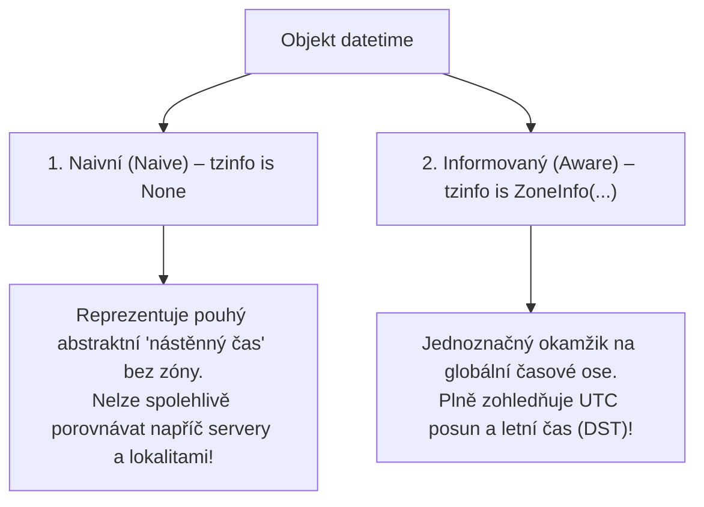

<!-- slide: id1, Úvod, Skip, basics -->
## Práce s datem a časem v Pythonu

Zpracování data, času a časových pásem je v programování proslulé svou skrytou komplexitou:
- Přestupné roky a přestupné sekundy.
- Přechody na letní a zimní čas (DST — *Daylight Saving Time*).
- Politické změny časových pásem a historické kalendářní reformy.
- Rozdíly mezi monotónními hodinami pro měření výkonu a systémovými nástěnnými hodinami (*Wall-clock time*).

Ve standardní knihovně Pythonu je práce s časem rozdělena do čtyř klíčových modulů:
1. **`datetime`**: Objektově orientovaná práce s datem a časem (`date`, `time`, `datetime`, `timedelta`, `timezone`).
2. **`zoneinfo`** (PEP 615, od Pythonu 3.9+): Plnohodnotná podpora IANA časových pásem ve standardní knihovně (nahrazuje dřívější nutnost instalovat externí balíček `pytz`).
3. **`time`**: Nízkoúrovňová systémová C-API volání epochového času (`time.time()`, `time.perf_counter()`, `struct_time`).
4. **`calendar`**: Kalendářní výpočty a maticové generování měsíců a roků.

---
<!-- slide: id2, Prerekvizity, Core, basics -->
## Počítačová epocha a reprezentace času

Základní časovou osou moderních operačních systémů je **Unixová epocha (POSIX time)**:
- Časový okamžik **půlnoc 1. ledna 1970 00:00:00 UTC**.
- Čas je měřen jako počet sekund (nebo nanosekund) uběhlých od tohoto okamžiku:

```python
import time

# Počet sekund od počátku epochy (float):
sekundy = time.time()
print(f"Sekund od 1. 1. 1970: {sekundy:.2f}")

# Monotónní nanosekundový čítač pro přesné profilování (od Pythonu 3.7+):
ns = time.perf_counter_ns()
print(f"Nanosekundový tick CPU: {ns}")
```

> [!WARNING]
> **Problém roku 2038 (Y2038)**:
> 32-bitové podepsané celé číslo pro uložení sekund přeteče 19. ledna 2038 v 03:14:07 UTC. 64-bitový Python a moderní 64-bitové operační systémy používají 64-bitová čísla, která vystačí na dalších 292 miliard let.

---
<!-- slide: id3, Naivní a informované časové údaje, Tricky, newconcept -->
## Naivní vs. Informované časové údaje (*Naive vs. Aware*)

Nejdůležitější koncept v modulu `datetime`:



> [!CAUTION]
> **Nikdy nemíchejte naivní a informované objekty!**
> Pokus o odečtení nebo porovnání naivního a informovaného času skončí v Pythonu chybou:
> `TypeError: can't subtract offset-naive and offset-aware datetimes`.

---
<!-- slide: id4, Naivní a informované časové údaje – „tzinfo“, Core, newconcept -->
## Moderní správa časových zón: Modul `zoneinfo` (PEP 615)

Zatímco dříve bylo nutné instalovat problematickou externí knihovnu `pytz`, od Pythonu 3.9 je standardem vestavěný modul **`zoneinfo`** využívající systémovou databázi IANA (*tzdata*):

```python
from datetime import datetime, timezone
from zoneinfo import ZoneInfo

# 1. Nejlepší praxe: Aktuální čas v UTC (zastaralé datetime.utcnow() je v 3.12+ zavržené!):
ted_utc = datetime.now(timezone.utc)
print(f"UTC čas: {ted_utc}")

# 2. Převod na lokální čas v Praze (automaticky vyřeší CET vs CEST / letní čas):
ted_praha = ted_utc.astimezone(ZoneInfo("Europe/Prague"))
print(f"Praha:   {ted_praha}")

# 3. Převod na čas v New Yorku:
ted_ny = ted_utc.astimezone(ZoneInfo("America/New_York"))
print(f"New York:{ted_ny}")
```

Oba časy ukazují na **tentýž fyzický okamžik**, ale mají odlišný formátovaný posun (`+01:00` vs `-05:00`).

---
<!-- slide: id5, Formát zápisu data a času, Core, resyntax -->
## C-struktura `time.struct_time`

Nízkoúrovňový modul `time` reprezentuje čas jako pojmenovanou 9-prvkovou n-tici **`time.struct_time`**:

```python
import time

# Získání struktury času v UTC a v lokálním čase:
utc_st = time.gmtime()
lokal_st = time.localtime()

print(lokal_st)
# time.struct_time(tm_year=2026, tm_mon=10, tm_mday=27, tm_hour=16, tm_min=30, tm_sec=0, tm_wday=1, tm_yday=300, tm_isdst=0)

# Přístup k položkám:
print(f"Rok: {lokal_st.tm_year}, Den v týdnu (0=pondělí): {lokal_st.tm_wday}")
```

Položka `tm_isdst` nabývá hodnoty `1` pro letní čas, `0` pro standardní čas a `-1`, pokud stav není znám.

---
<!-- slide: id6, Parsování data z/do řetězce, Core, resyntax -->
## Převody mezi textem a časem: `strftime` a `strptime`

Mnemotechnická pomůcka:
- **`strftime()`** = **Format**: objekt `datetime` $\rightarrow$ formátovaný textový řetězec `str`.
- **`strptime()`** = **Parse**: textový řetězec `str` $\rightarrow$ objekt `datetime`.

```python
from datetime import datetime

# 1. Parsování textu podle formátovacího vzoru (strptime):
text = "27.10.2026 14:35:00"
datum = datetime.strptime(text, "%d.%m.%Y %H:%M:%S")
print(f"Naparsováno: {datum}")

# 2. Formátování do lidsky čitelného textu (strftime):
vystup = datum.strftime("Dnes je %A, %d. %B %Y (týden %W)")
print(vystup)  # "Dnes je Tuesday, 27. October 2026 (týden 43)"

# 3. Moderní ISO 8601 standard (od Pythonu 3.11+ bez nutnosti formátovacího řetězce):
iso_text = datum.isoformat()
print(f"ISO formát: {iso_text}")  # '2026-10-27T14:35:00'
zpet = datetime.fromisoformat(iso_text)
```

---
<!-- slide: id7, „replace()“ & „fold“, WOW, pythonic -->
## Metoda `replace()` a záhada podzimního času (`fold`)

Objekty `datetime` jsou neměnné (*immutable*). Pro vytvoření nového objektu se změněnou komponentou slouží metoda **`replace()`**:

```python
from datetime import datetime
ted = datetime(2026, 10, 27, 12, 0)
zitra = ted.replace(day=28)
```

### Parametr `fold` (PEP 495, od Pythonu 3.6+):
Při podzimním přechodu z letního času na zimní se ručičky hodin v noci posunou o hodinu zpět (např. z 03:00 na 02:00). Čas mezi 02:00 a 03:00 tak v tentýž den **nastane dvakrát**!

Parametr `fold` rozlišuje tyto dva okamžiky:
- `fold=0`: První průchod (ještě v letním čase CEST, UTC+2).
- `fold=1`: Druhý průchod po vrácení ručiček (již v zimním čase CET, UTC+1).

---
<!-- slide: id8, Převod z data na sekundy, Tricky, pythonic -->
## Převod `datetime` na epochový timestamp: `.timestamp()`

Od Pythonu 3.3 má každý objekt `datetime` metodu **`.timestamp()`**, která vrací počet sekund od 1. 1. 1970 UTC:

```python
from datetime import datetime, timezone
from zoneinfo import ZoneInfo

# 1. Informovaný čas v UTC:
cas_utc = datetime(2026, 1, 1, 0, 0, tzinfo=timezone.utc)
print(cas_utc.timestamp())  # Přesně 1767225600.0

# 2. Informovaný čas v Praze v tentýž okamžik (CET = UTC+1):
cas_praha = datetime(2026, 1, 1, 1, 0, tzinfo=ZoneInfo("Europe/Prague"))
print(cas_praha.timestamp())  # Přesně totéž číslo: 1767225600.0
```

> [!CAUTION]
> Pokud zavoláte `.timestamp()` na **naivním** objektu, Python tiše předpokládá, že jde o lokální čas vašeho počítače. Na různých serverech (např. v cloudu nastaveném na UTC vs lokálním notebooku) proto dostanete odlišná čísla!

---
<!-- slide: id9, Převod ze sekund na datum, Core, resyntax -->
## Převod ze sekund na `datetime`: `fromtimestamp()`

Inverzní operaci provádí třídní metoda **`datetime.fromtimestamp()`**:

```python
from datetime import datetime, timezone
from zoneinfo import ZoneInfo

epoch_sekundy = 1767225600.0

# 1. Správný způsob: Explicitní specifikace časové zóny:
datum_utc = datetime.fromtimestamp(epoch_sekundy, tz=timezone.utc)
print(f"V UTC:   {datum_utc}")  # 2026-01-01 00:00:00+00:00

datum_praha = datetime.fromtimestamp(epoch_sekundy, tz=ZoneInfo("Europe/Prague"))
print(f"V Praze: {datum_praha}")  # 2026-01-01 01:00:00+01:00
```

Pokud parametr `tz` vynecháte, metoda vrátí naivní čas podle lokálního nastavení operačního systému.

---
<!-- slide: id10, „time.gmtime()“ a „calendar.timegm()“, Tricky, resyntax -->
## Konverze v C-stylu: `time.gmtime()` a `calendar.timegm()`

Pokud pracujete se strukturami `struct_time`, narazíte na asymetrii standardní knihovny:

```python
import time
import calendar

# 1. Ze sekund na UTC struct_time:
st = time.gmtime(1700000000)

# 2. Zpět ze struct_time na sekundy (UTC):
# time.mktime() by čas chybně interpretoval jako lokální!
# Správná UTC inverzní funkce je v modulu calendar:
sekundy = calendar.timegm(st)
assert sekundy == 1700000000
```

Tato historická asymetrie je důvodem, proč se v moderním kódu dává přednost třídě `datetime` před modulem `time`.

---
<!-- slide: id11, „os.utime()“, Skip, basics -->
## Nastavení časových razítek souborů: `os.utime()`

Funkce **`os.utime()`** umožňuje změnit čas posledního přístupu (*atime*) a čas poslední modifikace (*mtime*) souboru:

```python
import os
import time
from pathlib import Path

cesta = Path("protokol.txt")
cesta.write_text("záznam", encoding="utf-8")

# Nastavení atime a mtime na konkrétní epochový čas:
novy_cas = time.time() - 3600  # Před hodinou
os.utime(cesta, times=(novy_cas, novy_cas))

# S přesností na nanosekundy (od Pythonu 3.3+):
ted_ns = time.time_ns()
os.utime(cesta, ns=(ted_ns, ted_ns))
```

---
<!-- slide: id12, Odkazy, Skip, basics -->
## Časová aritmetika a shrnutí: `timedelta`

Pro posuny v čase, přičítání dní a výpočet rozdílu mezi dvěma okamžiky slouží třída **`timedelta`**:

```python
from datetime import datetime, timedelta, timezone

ted = datetime.now(timezone.utc)

# 1. Přičtení 14 dní a 3 hodin:
budoucnost = ted + timedelta(days=14, hours=3)

# 2. Rozdíl dvou časů:
rozdil = budoucnost - ted
print(f"Uběhlo {rozdil.days} dní a {rozdil.total_seconds()} sekund.")
```

### Zlatá pravidla práce s časem:
1. Ukládejte a přenášejte čas zásadně v **UTC** nebo ve formátu **ISO 8601** (`2026-10-27T14:00:00Z`).
2. Pro časová pásma používejte moderní modul **`zoneinfo.ZoneInfo`**.
3. Na lokální čas uživatele převádějte data až na samotném prezentačním rozhraní (UI / šablona).
