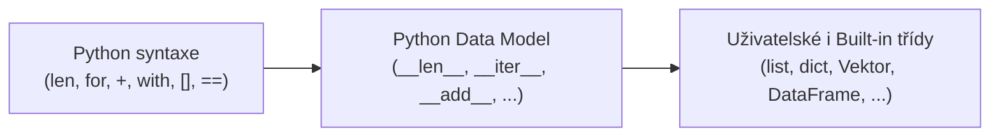

<!-- slide: id1, Úvod, Core, paradigm -->
## Python Data Model a magické dunder metody

V Pythonu neexistují žádné privilegované „interní“ typy, které by měly schopnosti odepřené uživatelským třídám. Celé chování jazyka je řízeno tzv. **Python Data Model** (často označovaným jako *Pythonic Object Model*).

Chování objektu při použití operátorů (`+`, `*`, `@`), vestavěných funkcí (`len()`, `str()`, `abs()`) nebo syntaktických konstrukcí (`for`, `with`, `in`, `[]`) je definováno pomocí speciálních metod se dvěma podtržítky na začátku a na konci – **dunder metod** (*double underscore*):

> Chcete-li, aby se vaše vlastní třída chovala jako číslo, seznam, slovník, funkce nebo kontextový manažer, stačí implementovat příslušné dunder metody!

---
<!-- slide: id2, Matematika – unární operace, Skip, basics -->
## Unární operátory a matematické konverze

Unární operace působí na jediný operand `x`:

| Kód v Pythonu | Volaná dunder metoda | Význam |
| :--- | :--- | :--- |
| `-x` | `x.__neg__()` | Aritmetická negace |
| `+x` | `x.__pos__()` | Unární plus |
| `abs(x)` | `x.__abs__()` | Absolutní hodnota |
| `~x` | `x.__invert__()` | Bitová inverze (NOT) |
| `int(x)` | `x.__int__()` | Celočíselná konverze |
| `float(x)` | `x.__float__()` | Převod na plovoucí řádovou čárku |
| `round(x, n)` | `x.__round__(n)` | Zaokrouhlení na $n$ desetinných míst |
| `xs[x]` | `x.__index__()` | Ztrátově bezeztrátový převod na index výřezu (PEP 357) |

---
<!-- slide: id3, Matematika – binární operace, Core, paradigm -->
## Binární operátory: Levostranné vs. Pravostranné (Reflected)

Při operaci `x + y` se Python nejprve pokusí zavolat levostrannou metodu `x.__add__(y)`.  
Pokud `x` sčítání s objektem `y` nezná (vrátí `NotImplemented`), interpret automaticky vyzkouší **pravostrannou zrcadlovou metodu** `y.__radd__(x)`:

| Operátor | Levá metoda (`x + y`) | Pravá metoda (`y + x`) |
| :---: | :--- | :--- |
| `+` | `__add__(self, other)` | `__radd__(self, other)` |
| `-` | `__sub__(self, other)` | `__rsub__(self, other)` |
| `*` | `__mul__(self, other)` | `__rmul__(self, other)` |
| `/` | `__truediv__(self, other)` | `__rtruediv__(self, other)` |
| `//` | `__floordiv__(self, other)` | `__rfloordiv__(self, other)` |
| `%` | `__mod__(self, other)` | `__rmod__(self, other)` |
| `**` | `__pow__(self, other)` | `__rpow__(self, other)` |
| `divmod(x, y)` | `__divmod__(self, other)` | `__rdivmod__(self, other)` |

Díky pravostranným metodám může vaše vlastní třída (např. `Vektor`) podporovat operace jako `2 * v` i `v * 2`!

---
<!-- slide: id4, Matematika – binární operace zkráceně, Core, pythonic -->
## Zkrácené in-place operátory přiřazení

Operátory rozšířeného přiřazení (`+=`, `*=`, ...) volají in-place varianty dunder metod s předponou `__i...__`:

| Kód | In-place dunder metoda | Fallback při absenci |
| :---: | :--- | :--- |
| `x += y` | `x.__iadd__(y)` | `x = x + y` (`__add__`) |
| `x -= y` | `x.__isub__(y)` | `x = x - y` (`__sub__`) |
| `x *= y` | `x.__imul__(y)` | `x = x * y` (`__mul__`) |
| `x /= y` | `x.__itruediv__(y)` | `x = x / y` (`__truediv__`) |
| `x //= y` | `x.__ifloordiv__(y)` | `x = x // y` (`__floordiv__`) |
| `x %= y` | `x.__imod__(y)` | `x = x % y` (`__mod__`) |
| `x **= y` | `x.__ipow__(y)` | `x = x ** y` (`__pow__`) |

> [!IMPORTANT] In-place mutace
> In-place metoda musí vrátit `self`! U mutabilních struktur (např. `list`) operátor `+=` přímo modifikuje původní paměťový blok, zatímco u neměnných (např. `tuple`, `int`) vrací nový objekt.

---
<!-- slide: id5, Matematika – násobení matic, WOW, pythonic -->
## Maticové násobení: Operátor `@` (PEP 465)

Python 3.5 zavedl dedikovaný infixový operátor **`@`** pro maticové násobení a tenzorové kontrakce:

| Kód | Dunder metoda |
| :--- | :--- |
| `A @ B` | `A.__matmul__(B)` / `B.__rmatmul__(A)` |
| `A @= B` | `A.__imatmul__(B)` |

Tento operátor byl přidán na žádost vědecké komunity (NumPy, SciPy, PyTorch), aby se zabránilo nepřehlednému zanořování volání `numpy.dot(A, numpy.dot(B, C))` a odlišilo se maticové násobení od po-prvkového násobení `*`.

---
<!-- slide: id6, Bitové operace, Skip, resyntax -->
## Bitové a logické operátory

Operace na úrovni jednotlivých bitů:

| Kód | Operace | Levá metoda | Pravá metoda |
| :---: | :--- | :--- | :--- |
| `x << y` | Bitový posun vlevo | `__lshift__` | `__rlshift__` |
| `x >> y` | Bitový posun vpravo | `__rshift__` | `__rrshift__` |
| `x & y` | Bitové AND | `__and__` | `__rand__` |
| `x ^ y` | Bitové XOR | `__xor__` | `__rxor__` |
| `x \| y` | Bitové OR / Sjednocení | `__or__` | `__ror__` |

Od Pythonu 3.9 se operátor `|` používá také pro sloučení slovníků (`dict1 | dict2`) a v Pythonu 3.10 pro typové unie (`int | str`).

---
<!-- slide: id7, Bitové operace zkráceně, Skip, resyntax -->
## Zkrácené bitové operátory

Obdobně existují i in-place verze pro bitové manipulace:

```python
x <<= y   # x.__ilshift__(y)
x >>= y   # x.__irshift__(y)
x &= y    # x.__iand__(y)
x ^= y    # x.__ixor__(y)
x |= y    # x.__ior__(y)
```

Tyto operátory hojně využívá množinový typ `set` (např. `s1 |= s2` pro in-place sjednocení množin).

---
<!-- slide: id8, Nápodoba množin…, Core, paradigm -->
## Protokoly kontejneru: `len()` a operátor `in`

Chceme-li, aby náš objekt podporoval zjištění velikosti a test příslušnosti, implementujeme:

```python
class CiselnyRozsah:
    def __init__(self, start: int, stop: int) -> None:
        self.start = start
        self.stop = stop

    def __len__(self) -> int:
        """Volá se funkcí len(obj). Musí vrátit nezáporné celé číslo."""
        return max(0, self.stop - self.start)

    def __contains__(self, item: object) -> bool:
        """Volá se operátorem 'item in obj'."""
        if isinstance(item, int):
            return self.start <= item < self.stop
        return False

r = CiselnyRozsah(10, 50)
print(len(r))       # 40
print(25 in r)      # True
print(100 in r)     # False
```

---
<!-- slide: id9, …a slovníků, Core, paradigm -->
## Protokol mapování a indexace `[]`

Pro chování ve stylu slovníku nebo sekvence slouží trojice metod:

```python
class PristupovyLog:
    def __init__(self) -> None:
        self._data: dict[str, str] = {}

    def __getitem__(self, klic: str) -> str:
        """Čtení: log[klic]"""
        return self._data[klic]

    def __setitem__(self, klic: str, hodnota: str) -> None:
        """Zápis: log[klic] = hodnota"""
        self._data[klic] = hodnota

    def __delitem__(self, klic: str) -> None:
        """Smazání: del log[klic]"""
        del self._data[klic]

    def __missing__(self, klic: str) -> str:
        """Zavolá se při přístupu k neexistujícímu klíči (jako v defaultdict)."""
        return "NEZNÁMÝ"
```

---
<!-- slide: id10, Nejen řetězcové reprezentace objektů, Core, pythonic -->
## Reprezentace a formátování objektů

Kdykoliv objekt převádíme na text, binární data nebo jej formátujeme ve f-stringu:

| Kód | Dunder metoda | Účel |
| :--- | :--- | :--- |
| `str(x)` / `print(x)` | `x.__str__()` | Čitelný text pro uživatele |
| `repr(x)` | `x.__repr__()` | Jednoznačný technický popis pro vývojáře |
| `f"{x:spec}"` | `x.__format__(spec)` | Vlastní formátovací specifikace (minijazyk) |
| `bytes(x)` | `x.__bytes__()` | Binární serializace |

```python
class Meno:
    def __init__(self, castka: float, mena: str = "CZK") -> None:
        self.castka = castka
        self.mena = mena

    def __format__(self, format_spec: str) -> str:
        if format_spec == "short":
            return f"{self.castka:.0f} {self.mena}"
        return f"{self.castka:,.2f} {self.mena}"

m = Meno(1250000.5)
print(f"{m:short}")  # 1250001 CZK
print(f"{m}")        # 1,250,000.50 CZK
```

---
<!-- slide: id11, Nápodoba funkcí, WOW, paradigm -->
## Volatelné objekty: Dunder metoda `__call__()`

Implementací metody `__call__()` proměníme jakoukoliv instanci třídy na **volatelný objekt** (*callable*):

```python
class Nasobic:
    def __init__(self, koeficient: float) -> None:
        self.koeficient = koeficient

    def __call__(self, x: float) -> float:
        return x * self.koeficient

krat_tri = Nasobic(3.0)
print(callable(krat_tri))  # True
print(krat_tri(10))        # 30.0
```

Instance si pamatuje svůj vnitřní stav a chová se jako běžná funkce (perfektní pro uzávěry, dekorátory tříd a strategie).

---
<!-- slide: id12, Další užitečné metody, Skip, basics -->
## Pravdivost a hashovatelnost: `__bool__` a `__hash__`

Dvě zásadní metody ovlivňující chování objektů v podmínkách a množinách:

### 1. Pravdivost: `__bool__()`
Řídí vyhodnocení objektu v podmínkách `if obj:`.  
Pokud `__bool__` chybí, Python použije výsledek `__len__() > 0`. Pokud chybí i `__len__`, objekt je vždy vyhodnocen jako `True`.

### 2. Hashovatelnost: `__hash__()`
Umožňuje objekt použít jako prvek v `set` nebo klíč v `dict`.
- Musí vracet celé číslo.
- **Pravidlo integrity**: Pokud se dva objekty rovnají (`a == b`), musí mít identický hash (`hash(a) == hash(b)`).
- Objekty s `__hash__` musí být neměnné (*immutable*).

---
<!-- slide: id13, Poznámka, Skip, basics -->
## Shrnutí: Python Data Model jako stavební kámen

Dunder metody dávají Pythonu jeho typickou soudržnost:



Nemusíte se učit desítky nesourodých API metod jako `getSize()`, `plus()`, `dispose()`. Stačí naimplementovat odpovídající dunder metodu a váš objekt se okamžitě přirozeně začlení do celého ekosystému Pythonu.
