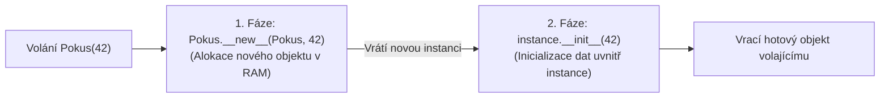

<!-- slide: id1, Úvod, Core, paradigm -->
## Metaprogramování a metatřídy v Pythonu

V Pythonu platí absolutní pravidlo: **všechno je objekt**.
- Čísla, řetězce a seznamy jsou objekty.
- Funkce jsou objekty (mají atributy, `__call__`, `__doc__`).
- A samotné **třídy jsou rovněž objekty**!

Pokud je třída objektem, kdo je jejím tvůrcem a jakého je typu?
Odpovědí jsou **metatřídy** (*metaclasses*).

> *„Metatřídy jsou hluboká magie, o které 99 % uživatelů nemusí vůbec vědět. Pokud váháte, zda metatřídu potřebujete, nepotřebujete ji.“*  
> — **Tim Peters** (autor *The Zen of Python*)

---
<!-- slide: id2, Metatřídy, Core, paradigm -->
## Co je to metatřída?

Zatímco třída je šablonou pro tvorbu instancí, **metatřída je šablonou pro tvorbu samotných tříd**:

$$\text{Metatřída} \xrightarrow{\text{vytvoří}} \text{Třída} \xrightarrow{\text{vytvoří}} \text{Instance}$$

- Běžný objekt je instancí své třídy: `isinstance(alisa, Skolak)`.
- Třída je instancí své metatřídy: `isinstance(Skolak, type)`.

Výchozí univerzální metatřídou v Pythonu je **`type`**.

---
<!-- slide: id3, Jak je vytvořena instance třídy, Core, newconcept -->
## Dvoufázové vytvoření instance: `__new__` a `__init__`

Při zavolání konstruktoru `p = Pokus(42)` proběhne proces ve dvou oddělených fázích:



1. **`__new__(cls, *args, **kwargs)`**:
   - Skutečný konstruktor. Alokuje paměť a vrací novou, dosud nenaplněnou instanci třídy.
2. **`__init__(self, *args, **kwargs)`**:
   - Inicializátor. Přebírá hotovou instanci z `__new__` a nastaví její výchozí atributy.

---
<!-- slide: id4, Co dělá „__new__()“, Core, newconcept -->
## Práce s metodou `__new__()`

Metoda `__new__` je statická metoda s automaticky předaným prvním argumentem `cls`:

```python
class Pokus:
    def __new__(cls, *args, **kwargs) -> "Pokus":
        print(f"1. __new__ pro třídu: {cls.__name__}")
        # Vytvoření instance delegujeme na bázový object:
        instance = super().__new__(cls)
        return instance

    def __init__(self, hodnota: int) -> None:
        print(f"2. __init__ pro instanci s hodnotou: {hodnota}")
        self.hodnota = hodnota

p = Pokus(42)
# 1. __new__ pro třídu: Pokus
# 2. __init__ pro instanci s hodnotou: 42
```

Kdy implementovat `__new__`?
- Při dědění z neměnných built-in typů (`int`, `str`, `tuple`).
- Při implementaci vzoru Singleton nebo Object Poolingu.

---
<!-- slide: id5, O důležitosti vraceného typu, Tricky, newconcept -->
## Podmínka pro spuštění `__init__()`

Klíčové pravidlo interpretu CPython:
> **Metoda `__init__()` se zavolá POUZE tehdy, pokud metoda `__new__()` vrátila instanci třídy `cls` (nebo jejího potomka).**

```python
class Podvod:
    def __new__(cls):
        print("Vracím obyčejný string namísto instance Podvod!")
        return "nejsem instance"

    def __init__(self):
        print("Tento kód se NIKDY nespustí!")

obj = Podvod()
# Vytiskne: Vracím obyčejný string namísto instance Podvod!
print(type(obj))  # <class 'str'>
```

Pokud `__new__` vrátí již existující instanci (např. v mezipaměti Singletonu), můžeme tím řídit, zda má reinicializace proběhnout znovu.

---
<!-- slide: id6, Od „__new__()“ k metatřídám, Core, paradigm -->
## Od `__new__()` k metatřídám

Stejný dvoufázový mechanismus, jakým vznikají instance z tříd, se uplatňuje i při **vzniku samotných tříd z metatříd**:
- Když interpret narazí na definici `class MojeTrida: ...`, zavolá se metoda `__new__` příslušné metatřídy!
- Metatřída převezme název třídy, n-tici rodičů a slovník všech nadefinovaných metod a proměnných.
- Výsledkem je nový objekt typu `type`.

---
<!-- slide: id7, Jak je vytvořena třída, WOW, paradigm -->
## Životní cyklus vzniku třídy

Když Python vyhodnocuje tělo bloku `class`, postupuje v těchto krocích:

1. **Určení metatřídy**: Vybere metatřídu (výchozí je `type`, nebo zadanou přes `metaclass=...`).
2. **Příprava jmenného prostoru (`__prepare__`)**: Metatřída vytvoří prázdné mapování (slovník) pro atributy.
3. **Vykonání těla třídy**: Všechny řádky, `def metody` a přiřazení se provedou uvnitř tohoto jmenného prostoru.
4. **Vytvoření třídy (`metaclass.__new__`)**: Metatřída zkompiluje třídu a vrátí její objekt.
5. **Aplikace dekorátorů třídy (`@decorator`)**: Případné dekorátory upraví hotovou třídu.
6. **Uložení do scope**: Hotová třída je svázána se svým jménem v modulu.

---
<!-- slide: id8, „type()“ jako metatřída, Core, paradigm -->
## Tříargumentový `type()`: Dynamická tvorba tříd

Funkce `type` má dvě zcela odlišné tváře:
1. `type(obj)`: Jednoargumentový dotaz na typ.
2. `type(name, bases, dict)`: **Tříargumentový konstruktor nové třídy za běhu!**

$$\Large \mathbf{type}(\underbrace{\text{JménoTřídy}}_{\text{str}}, \;\; \underbrace{\text{Rodiče}}_{\text{tuple}}, \;\; \underbrace{\text{AtributyAMetody}}_{\text{dict}})$$

Tento zápis je přesným ekvivalentem klasického bloku `class` zapsaného ve zdrojovém kódu.

---
<!-- slide: id9, „type()“ – příklad, Core, pythonic -->
## Dynamická syntéza třídy bez `class`

Vytvořme funkční třídu s atributem a metodou čistě dynamicky za běhu programu:

```python
def pozdrav(self) -> str:
    return f"Ahoj, já jsem {self.jmeno}!"

# Dynamické sestrojení třídy 'Robot':
Robot = type(
    "Robot",                     # __name__
    (object,),                   # __bases__
    {                            # __dict__
        "vyrobce": "Cyberdyne",
        "pozdrav": pozdrav,
        "__init__": lambda self, jmeno: setattr(self, "jmeno", jmeno)
    }
)

r = Robot("T-800")
print(type(r))          # <class '__main__.Robot'>
print(r.vyrobce)        # 'Cyberdyne'
print(r.pozdrav())      # 'Ahoj, já jsem T-800!'
```

---
<!-- slide: id10, Jak fungují metatřídy? I, Core, pythonic -->
## Deklarace vlastní metatřídy

Vlastní metatřídu vytvoříme děděním z `type`:

```python
class MojeMetatrina(type):
    pass

class Trida(metaclass=MojeMetatrina):
    pass

print(type(Trida))  # <class '__main__.MojeMetatrina'>
```

Každá podtřída, která z `Trida` v budoucnu podědí, automaticky zdědí i tuto metatřídu.

---
<!-- slide: id11, Jak fungují metatřídy? II, Core, newconcept -->
## Zachycení a modifikace třídy v metatřídě

V metatřídě můžeme zachytit vznikající třídu a vynutit pravidla (např. automaticky převést všechny názvy metod na velká písmena nebo validovat API):

```python
class StriktniMeta(type):
    def __new__(mcs, name: str, bases: tuple[type, ...], namespace: dict[str, object]) -> type:
        print(f"[META] Vytvářím třídu: {name}")
        
        # Validace: každá třída musí mít docstring!
        if "__doc__" not in namespace or not namespace["__doc__"]:
            raise TypeError(f"Třída '{name}' musí obsahovat dokumentační řetězec!")

        return super().__new__(mcs, name, bases, namespace)

# class ChybiDoc(metaclass=StriktniMeta):
#     pass
# TypeError: Třída 'ChybiDoc' musí obsahovat dokumentační řetězec!
```

---
<!-- slide: id12, Jak napsat metatřídu, Core, paradigm -->
## Metody metatřídy: `__prepare__` a `__new__`

Metatřída může ovlivnit celý proces tvorby:
- **`__prepare__(mcs, name, bases)`**: Musí vrátit mapovací objekt. Umožňuje zachytit definice atributů v přesném pořadí, v jakém byly zapsány v kódu (historicky se vracel `OrderedDict`, v moderním Pythonu si pořadí pamatuje i standardní `dict`).
- **`__new__(mcs, name, bases, namespace)`**: Alokuje a vytvoří finální objekt třídy.
- **`__init__(cls, name, bases, namespace)`**: Inicializuje atributy na vytvořené třídě.

---
<!-- slide: id13, Příklad I, WOW, paradigm -->
## Příklad: Metatřída zaznamenávající pořadí atributů

```python
class AuditMeta(type):
    @classmethod
    def __prepare__(mcs, name: str, bases: tuple[type, ...]) -> dict:
        print(f"1. __prepare__ pro {name}")
        return {}

    def __new__(mcs, name: str, bases: tuple[type, ...], namespace: dict) -> type:
        print(f"2. __new__ pro {name}")
        # Uložíme seznam všech uživatelsky definovaných atributů:
        namespace["_seznam_clenu"] = [
            k for k in namespace.keys() if not k.startswith("__")
        ]
        return super().__new__(mcs, name, bases, namespace)

class Model(metaclass=AuditMeta):
    id = 1
    jmeno = "Test"
    aktivni = True

print(Model._seznam_clenu)
# ['id', 'jmeno', 'aktivni']
```

---
<!-- slide: id14, Příklad IIa, Skip, newconcept -->
## Vztahy instancí při použití metatřídy

Zkoumejme typové vztahy vytvořených objektů:

```python
m = Model()

# Model je instancí AuditMeta:
print(isinstance(Model, AuditMeta))  # True
print(type(Model) is AuditMeta)      # True

# Objekt m je instancí Model, nikoli AuditMeta:
print(isinstance(m, Model))          # True
print(isinstance(m, AuditMeta))      # False
```

Metatřída ovlivňuje chování třídy, nikoli přímo metody její instance.

---
<!-- slide: id15, Příklad IIb, Skip, basics -->
## Dědičnost metatříd

Metatřída se automaticky dědí do všech dalších potomků:

```python
class SpecialniModel(Model):
    datum = "2026-10-27"

# SpecialniModel má stejnou metatřídu AuditMeta:
print(SpecialniModel._seznam_clenu)
# ['datum']
```

Právě dědičnost byla historicky hlavním důvodem volby metatřídy před běžným dekorátorem třídy.

---
<!-- slide: id16, Příklad III, Skip, basics -->
## Konflikt metatříd (Metaclass Conflict)

Pokud se pokusíte dědit ze dvou tříd, z nichž každá má jinou, vzájemně nesouvisející metatřídu:

```python
class MetaA(type): pass
class MetaB(type): pass

class A(metaclass=MetaA): pass
class B(metaclass=MetaB): pass

# class C(A, B): pass
# TypeError: metaclass conflict: the metaclass of a derived class
# must be a (non-strict) subclass of the metaclasses of all its bases
```

Řešením je vytvořit společnou metatřídu dědící z obou: `class MetaAB(MetaA, MetaB): pass`.

---
<!-- slide: id17, Poznámky, Core, paradigm -->
## Metatřída jako libovolný Callable objekt

Ačkoliv se metatřídy nejčastěji píší jako třídy dědící z `type`, klíčové slovo `metaclass=` přijímá **jakýkoliv volatelný objekt** (včetně obyčejné funkce!):

```python
def tovarna_na_tridy(name: str, bases: tuple, namespace: dict) -> type:
    print(f"Továrna vyrábí třídu: {name}")
    namespace["vyrobeno_funkci"] = True
    return type(name, bases, namespace)

class MojeTrida(metaclass=tovarna_na_tridy):
    x = 10

print(MojeTrida.vyrobeno_funkci)  # True
```

---
<!-- slide: id18, Když metatřídy nejsou třídy, Skip, pythonic -->
## Omezení funkcionální metatřídy

Pokud je metatřídou pouhá funkce:
- Nelze na ní dědit (děti nezdědí funkci jako metatřídu).
- Nefunguje `isinstance(Trida, Meta)`.
- Chybí podpora pro `__prepare__`.

Proto se v praxi téměř vždy používá podtřída `type`.

---
<!-- slide: id19, Metoda „__call__()“ & singletony I, WOW, paradigm -->
## Řízení instanciace: Metoda `__call__()` metatřídy

Když napíšeme `obj = Trida()`, ve skutečnosti zavoláme metodu **`__call__()` na metatřídě** dané třídy!

Přepsáním `__call__` na metatřídě získáme absolutní kontrolu nad tvorbou instancí (např. dokonalý Singleton):

```python
class SingletonMeta(type):
    _instances: dict[type, object] = {}

    def __call__(cls, *args, **kwargs) -> object:
        if cls not in cls._instances:
            # Zavolá standardní type.__call__, který provede __new__ a __init__:
            cls._instances[cls] = super().__call__(*args, **kwargs)
        return cls._instances[cls]

class Nastaveni(metaclass=SingletonMeta):
    def __init__(self) -> None:
        self.verze = "2.0"

s1 = Nastaveni()
s2 = Nastaveni()
print(s1 is s2)  # True!
```

---
<!-- slide: id20, Metoda „__call__()“ & singletony II, Skip, pythonic -->
## Proč je metatřídní Singleton lepší?

Oproti přepsání `__new__` uvnitř samotné třídy má metatřídní řešení zásadní výhodu:
- Při přepsání `__new__` v obyčejné třídě se při každém dalším volání `Trida()` znovu zavolá `__init__()`, což přepíše již nastavený stav instance.
- V `SingletonMeta.__call__` se při druhém volání **`__init__` vůbec nespustí**, takže stav zůstává 100% chráněn!

---
<!-- slide: id21, Použití, Skip, basics -->
## Moderní alternativa: `__init_subclass__` (PEP 487)

V Pythonu 3.6+ přibyl magický háček **`__init_subclass__`**, který nahrazuje metatřídy v **95 % běžných scénářů**:

```python
class RegistrovanyModel:
    registrovane_modely: list[type] = []

    # Spustí se automaticky při definici libovolného potomka:
    def __init_subclass__(cls, **kwargs) -> None:
        super().__init_subclass__(**kwargs)
        print(f"Registruji nového potomka: {cls.__name__}")
        cls.registrovane_modely.append(cls)

class Uzivatel(RegistrovanyModel): pass
class Objednavka(RegistrovanyModel): pass

print(RegistrovanyModel.registrovane_modely)
# [<class '__main__.Uzivatel'>, <class '__main__.Objednavka'>]
```

> [!TIP] Moderní doporučení
> Před psaním metatřídy vždy nejprve zvažte **`__init_subclass__`** nebo **dekorátor třídy**. Metatřídu použijte pouze tehdy, když potřebujete změnit `__prepare__` nebo řídit instanciaci přes `__call__`.
