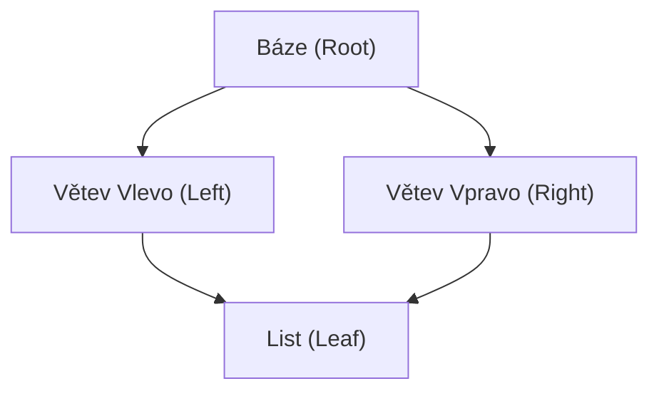

<!-- slide: id1, Úvod, Core, newconcept -->
## Hloubkový pohled na funkci `super()`

V objektovém programování slouží volání rodičovských metod k rozšíření chování předka namísto jeho úplného přepsání.

Zatímco v mnoha jazycích (Java, C#) znamená `super` přímý odkaz na jediného statického rodiče třídy, v Pythonu funguje funkce **`super()`** zcela odlišně:
- Neodkazuje fixně na „rodiče zapsaného v závorce“.
- Dynamicky vyhledává další třídu v lineárním seznamu **MRO** (*Method Resolution Order*).
- Řeší kooperativní vícenásobnou dědičnost (*Cooperative Multiple Inheritance*).

---
<!-- slide: id2, Možnosti dědění, Core, basics -->
## Dvě dimenze dědičnosti

Při návrhu tříd se v Pythonu setkáváme se dvěma strukturami dědičnosti:

1. **Vertikální řetězec (Hluboká dědičnost)**:
   ```python
   class A: ...
   class B(A): ...
   class C(B): ...
   class D(C): ...
   ```
2. **Horizontální větvení (Vícenásobní rodiče / Mixiny)**:
   ```python
   class D(A, B, C): ...
   ```

Ve složitějších systémech (např. Django modely nebo GUI knihovny) se obě formy kombinují do komplexních acyklických orientovaných grafů (DAG).

---
<!-- slide: id3, Dlouhý řetězec předků I, Core, resyntax -->
## Procházení vertikálním řetězcem

V jednoduchém řetězci předků vyhledá `super().mtd()` první implementaci směrem nahoru k bázové třídě `object`:

```python
class A:
    def mtd(self) -> None:
        print("A")

class B(A):
    def mtd(self) -> None:
        print("B")

class C(B):
    pass  # C metodu nedefinuje

class D(C):
    def mtd(self) -> None:
        super().mtd()

d = D()
d.mtd()  # Vytiskne: B (první nalezená metoda nad C je v B)
```

---
<!-- slide: id4, Dlouhý řetězec předků II, Core, newconcept -->
## Parametrizované volání: `super(Trida, self)`

Funkci `super()` lze předat dva explicitní argumenty:

$$\mathbf{super}(\text{KdeZačít}, \text{Instance})$$

Říká interpretu: *„Začni hledat metodu v MRO řetězci instance `self`, ale až **za** třídou `KdeZačít`!“*

```python
class A:
    def mtd(self) -> None:
        print("A")

class B(A):
    def mtd(self) -> None:
        print("B")

class C(B):
    def mtd(self) -> None:
        print("C")

class D(C):
    def mtd(self) -> None:
        # Přeskočí C a B, začne hledat až za B -> najde A!
        super(B, self).mtd()

d = D()
d.mtd()  # Vytiskne: A
```

---
<!-- slide: id5, Více rodičů I, Core, resyntax -->
## Vícenásobní rodiče: Pořadí zleva doprava

Pokud má třída více přímých bází, vyhodnocují se zleva doprava:

```python
class A:
    def mtd(self) -> None:
        print("A")

class B:
    def mtd(self) -> None:
        print("B")

class C:
    def mtd(self) -> None:
        print("C")

class D(A, B, C):
    def mtd(self) -> None:
        super().mtd()

d = D()
d.mtd()  # Vytiskne: A (A je první v pořadí bází)
```

---
<!-- slide: id6, Více rodičů II, Tricky, newconcept -->
## Sourozenecké volání přes `super()`

Co se stane, když v předchozím příkladu zavoláme `super(A, self).mtd()`?

```python
class D(A, B, C):
    def mtd(self) -> None:
        super(A, self).mtd()

d = D()
d.mtd()  # Vytiskne: B!
```

> [!IMPORTANT] Proč se zavolá sourozenec `B`?
> Třída `A` není rodičem třídy `B`. Přesto `super(A, self)` zavolá metodu z `B`!  
> Důvod: `super` se neptá na rodokmen třídy `A`, ale nahlíží do **MRO instance `d`** (která je typu `D`), kde je po `A` na řadě `B`!

---
<!-- slide: id7, „MRO“ (Method Resolution Order) I, Core, paradigm -->
## Algoritmus C3 Linearization (MRO)

Python od verze 2.3 sestavuje MRO pomocí algoritmu **C3 Linearization**, který garantuje dvě klíčové vlastnosti:
1. **Předek následuje potomka**: Dětská třída má vždy přednost před rodičem.
2. **Monotónnost pořadí**: Pořadí rodičů uvedené v závorce třídy `class D(A, B)` je striktně zachováno.

```python
class A1:
    def mtd(self) -> None: print("A1")

class A2(A1):
    def mtd(self) -> None: print("A2")

class B1:
    def mtd(self) -> None: print("B1")

class B2(B1):
    def mtd(self) -> None: print("B2")

class D(A2, B2):
    pass

# MRO třídy D:
print([cls.__name__ for cls in D.__mro__])
# ['D', 'A2', 'A1', 'B2', 'B1', 'object']
```

Nejprve se prozkoumá větev `A2 -> A1`, a teprve poté větev `B2 -> B1`.

---
<!-- slide: id8, „MRO“ (Method Resolution Order) II, Tricky, paradigm -->
## Posun v MRO řetězci

Mějme stejnou hierarchii `D(A2, B2)`. Pomocí parametru určíme počáteční bod:

```python
class D(A2, B2):
    def mtd(self) -> None:
        # MRO: [D, A2, A1, B2, B1, object]
        # Prvek za B2 je B1:
        super(B2, self).mtd()

d = D()
d.mtd()  # Vytiskne: B1
```

Každé volání `super(T, self)` je pouhým posunem ukazatele v předem zkompilovaném poli `self.__class__.__mro__`.

---
<!-- slide: id9, „MRO“ (Method Resolution Order) III, Skip, paradigm -->
## Diamantová dědičnost v praxi

Klasický problém diamantu nastává, když více větví dědí ze společného kořene:



```python
class Root:
    def ping(self) -> None:
        print("Root")

class Left(Root):
    def ping(self) -> None:
        print("Left")
        super().ping()

class Right(Root):
    def ping(self) -> None:
        print("Right")
        super().ping()

class Leaf(Left, Right):
    def ping(self) -> None:
        print("Leaf")
        super().ping()

Leaf().ping()
# Leaf -> Left -> Right -> Root (každý uzel proběhne právě jednou!)
```

---
<!-- slide: id10, Souhrn, Tricky, newconcept -->
## Formální sémantika `super()`

V moderním Pythonu 3 píšeme uvnitř metod zkráceně **`super()`** bez argumentů.

Kompilátor Pythonu při překladu metody automaticky vloží do skrytého uzávěru proměnnou `__class__` (aktuální třídu) a z prvního parametru metody vezme instanci `self`:

$$\mathbf{super}() \iff \mathbf{super}(\_\_class\_\_, self)$$

> [!WARNING] Volání super() mimo metodu
> Pokud zavoláte bezparametrický `super()` mimo tělo metody třídy (např. v obyčejné funkci nebo generátoru), interpret skončí chybou: `RuntimeError: super(): __class__ cell not found`.

---
<!-- slide: id11, Použití, Core, paradigm -->
## Proč je `super()` považován za „Super“?

Raymond Hettinger ve své slavné přednášce *„Python’s super() considered super!“* shrnul hlavní přínosy:

1. **Bezpečný refaktoring**:
   - Přejmenování rodičovské třídy v hlavičce `class Potomek(NovyRodic)` nevyžaduje úpravu vnitřku metod.
2. **Kooperativní Mixin architektura**:
   - Umožňuje skládat znovupoužitelné komponenty (Mixiny), které rozšiřují funkcionalitu (např. `LoggingMixin`, `JsonSerializableMixin`).
3. **Předcházení duplicitnímu volání předků**:
   - V diamantových hierarchiích zajistí MRO, že inicializátor společného předka proběhne právě jednou bez korupce dat.
