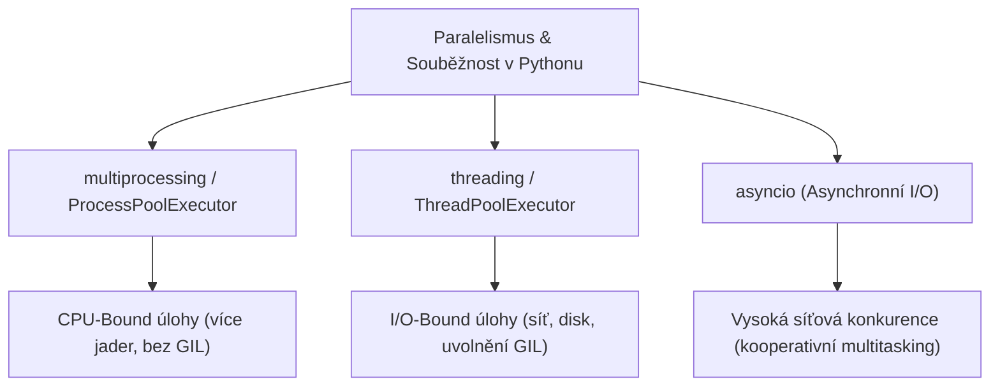
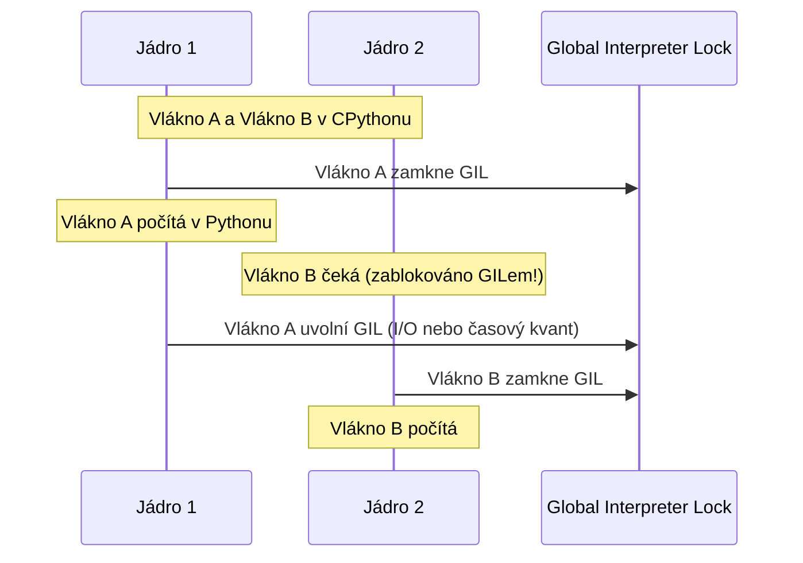

<!-- slide: id1, Úvod, Core, basics -->
## Paralelní a souběžné programování v Pythonu

V moderních vícejádrových architekturách CPU je efektivní rozložení práce zásadní pro dosažení vysoké propustnosti a responzivity aplikací.

Python nabízí tři hlavní modely souběžnosti a paralelismu:



1. **`multiprocessing`**: Skutečný paralelismus napříč jádry procesoru. Každý proces má vlastní interpret CPythonu a vlastní paměťový prostor (žádný GIL limit).
2. **`threading`**: Vlákna v rámci jednoho procesu se sdílenou pamětí. Omezeno GILem pro čistý Python kód, ale ideální pro I/O operace a C-rozšíření.
3. **`subprocess`**: Spouštění nezávislých externích systémových binárek.

---
<!-- slide: id2, Základní pojmy, Core, basics -->
## Proces vs. Vlákno vs. Asynchronní korutina

| Vlastnost | Proces (`multiprocessing`) | Vlákno (`threading`) | Korutina (`asyncio`) |
|---|---|---|---|
| **Paměťový prostor** | Izolovaný (vlastní adresa) | Sdílený (společná paměť) | Sdílený (jediné vlákno) |
| **Přepínání kontextu** | Jádro OS (těžká váha) | Jádro OS (lehká váha) | Uživatelský prostor (event loop) |
| **Riziko souběhu** | Nízké (komunikace přes IPC) | **Vysoké (Race Conditions, Deadlock)** | Nízké (kooperativní přepínání) |
| **Vhodné pro** | **CPU-bound** (výpočty, grafika) | **I/O-bound** (stahování, zápis na disk) | **Network I/O** (tisíce webových soketů) |
| **Škálovatelnost** | Limitováno počtem jader CPU | Stovky vláken | Desítky tisíc spojení |

> [!NOTE]
> Proces obsahuje alespoň jedno hlavní vlákno. Vlákno nemůže existovat bez svého nadřazeného procesu.

---
<!-- slide: id3, „GIL“, Tricky, paradigm -->
## Globální zámek interpretu: GIL (Global Interpreter Lock)

CPython (standardní C-implementace Pythonu) používá pro správu paměti **počítání referencí** (*reference counting*). Pokud by dvě vlákna současně inkrementovala či dekrementovala čítač téhož objektu, došlo by k poškození paměti nebo úniku paměti (*memory leak*).

Aby CPython zajistil bezpečnost paměti bez nutnosti zamykat každý jednotlivý `PyObject`, používá **GIL**:
- **Pravidlo GIL**: V jednom okamžiku smí bajtkód CPythonu vykonávat **pouze jediné vlákno**, i kdyby měl počítač 128 jader!



### Kdy GIL NEPŘEKÁŽÍ?
1. **Při I/O operacích**: Při čtení ze souboru, čekání na databázi nebo síťový socket CPython automaticky uvolňuje GIL.
2. **V Céčkovských knihovnách**: NumPy, SciPy, OpenCV a Cython (`nogil`) uvolňují GIL během výpočtů a škálují na všechna jádra!
3. **Revoluce v Pythonu 3.13 (PEP 703)**: Zavedení experimentálního **Free-Threaded CPythonu (`python3.13t`)**, kde je GIL zcela volitelný a odstranitelný.

---
<!-- slide: id4, „subprocess“, Core, pythonic -->
## Paralelní procesy pomocí modulu `subprocess`

Nejjednodušší způsob izolovaného paralelismu představuje spuštění více nezávislých procesů přes `subprocess.Popen`:

```python
import subprocess
import time

print("Spouštím 3 paralelní výpočty...")

# Procesy běží v operačním systému zcela nezávisle a paralelně:
p1 = subprocess.Popen(["python", "worker.py", "cast_1.dat"])
p2 = subprocess.Popen(["python", "worker.py", "cast_2.dat"])
p3 = subprocess.Popen(["python", "worker.py", "cast_3.dat"])

# Čekání na dokončení všech tří úloh:
p1.wait()
p2.wait()
p3.wait()

print("Všechny podprocesy úspěšně dokončeny!")
```

Procesy nesdílí paměť, nehrozí paměťové kolize a komunikace probíhá přes roury (`stdout`), soubory nebo argumenty.

---
<!-- slide: id5, Poznámka, Skip, basics -->
## Nebezpečí nekontrolovaného forkingu (*Fork Bomb*)

Při vytváření procesů je nutné striktně hlídat počet spouštěných instancí. Nekontrolované rekurzivní spouštění v cyklu může zahltit tabulku procesů operačního systému (*fork bomb*):

```python
# CHYBA: Nikdy nespouštějte procesy v nekonečné smyčce bez bazénu (Pool)!
# while True:
#     subprocess.Popen(["python", "worker.py"])
```

Správný přístup pro paralelní zpracování úloh představuje **Process Pool** (fond pracovních procesů) s pevnou velikostí odpovídající počtu jader CPU (`os.cpu_count()`).

---
<!-- slide: id6, „threading“, Core, newconcept -->
## Vícevláknové programování: Modul `threading`

Vlákna jsou ideální pro **I/O operace** (stahování stovek URL, dotazy do databáze, komunikace s IoT senzory):

```python
import threading
import time
import urllib.request

def stahni_stranku(url: str) -> None:
    print(f"[{threading.current_thread().name}] Začínám stahovat: {url}")
    with urllib.request.urlopen(url) as odpoved:
        data = odpoved.read()
    print(f"[{threading.current_thread().name}] Staženo {len(data)} bajtů")

urls = [
    "https://httpbin.org/delay/1",
    "https://httpbin.org/delay/1",
    "https://httpbin.org/delay/1"
]

vlakna = []
for u in urls:
    # Vytvoření vlákna: target=funkce, args=n-tice argumentů
    t = threading.Thread(target=stahni_stranku, args=(u,))
    vlakna.append(t)
    t.start()  # Spuštění vlákna na pozadí

# Čekání na dokončení všech vláken:
for t in vlakna:
    t.join()

print("Všechny stránky staženy za ~1 sekundu (místo 3 s sériově)!")
```

---
<!-- slide: id7, „multiprocessing“ I, Tricky, pythonic -->
## Skutečný vícejádrový paralelismus: Modul `multiprocessing`

Pokud potřebujete provádět **výpočetně náročné CPU operace** (šifrování, analýza obrazu, numerické simulace), modul **`multiprocessing`** spustí samostatné procesy, z nichž každý obdrží vlastní plnohodnotné jádro CPU:

```python
from multiprocessing import Process
import os

def spocitej_prvocisla(od_cisla: int, do_cisla: int) -> None:
    pid = os.getpid()
    print(f"Proces {pid} počítá v intervalu {od_cisla} až {do_cisla}...")
    pocet = sum(1 for n in range(od_cisla, do_cisla) if all(n % d != 0 for d in range(2, int(n**0.5) + 1)))
    print(f"Proces {pid} nalezl {pocet} prvočísel.")

# KRITICKY DŮLEŽITÉ: Ochranný blok na Windows a macOS!
if __name__ == "__main__":
    p1 = Process(target=spocitej_prvocisla, args=(1, 500_000))
    p2 = Process(target=spocitej_prvocisla, args=(500_000, 1_000_000))

    p1.start()
    p2.start()

    p1.join()
    p2.join()
    print("Oba výpočty proběhly současně na 2 jádrech!")
```

> [!CAUTION]
> **Proč je `if __name__ == '__main__':` povinné?**
> Na Windows a macOS (`spawn` metoda) nově spuštěný proces znovu importuje hlavní skript. Bez této podmínky by každý nový proces rekurzivně nastartoval další procesy v nekonečném cyklu a shodil systém!

---
<!-- slide: id8, „multiprocessing“ II, Core, newconcept -->
## Životní cyklus a identifikace procesů: PID a PPID

Každý proces v operačním systému disponuje unikátním identifikátorem **PID** (*Process ID*) a zná své rodičovské **PPID** (*Parent Process ID*):

```python
import os
from multiprocessing import Process

def pracovnik(nazev: str) -> None:
    print(f"[{nazev}] Můj PID: {os.getpid()}, Rodič PPID: {os.getppid()}")

if __name__ == "__main__":
    print(f"[Hlavní proces] PID: {os.getpid()}")
    p = Process(target=pracovnik, args=("Dělník-1",))
    p.start()
    p.join()
```

### Výstup:
```text
[Hlavní proces] PID: 12450
[Dělník-1] Můj PID: 12451, Rodič PPID: 12450
```

Dělník-1 je potomkem hlavního procesu. Ukončením hlavního procesu jsou standardně ukončeni i jeho potomci.

---
<!-- slide: id9, „multiprocessing“ III, Core, newconcept -->
## Synchronizace přístupu: Zámky (`Lock`)

Protože procesy běží skutečně současně, při zápisu do sdíleného souboru nebo tisku na konzoli dochází k proplétání znaků (*Race Condition*).

K ochraně kritických sekcí slouží synchronizační primitivum **`Lock`**:

```python
from multiprocessing import Process, Lock
import time
import os

def bezpecny_tisk(zamek: Lock, zprava: str) -> None:
    # Kontextový manažer automaticky zajistí acquire() a release():
    with zamek:
        print(f"Proces {os.getpid()} vstupuje do kritické sekce: {zprava}")
        time.sleep(0.5)
        print(f"Proces {os.getpid()} opouští kritickou sekci.")

if __name__ == "__main__":
    zamek = Lock()
    procesy = [Process(target=bezpecny_tisk, args=(zamek, f"Úloha {i}")) for i in range(4)]

    for p in procesy: p.start()
    for p in procesy: p.join()
```

V jeden okamžik smí do těla bloku `with zamek:` vstoupit pouze jeden jediný proces; ostatní čekají ve frontě.

---
<!-- slide: id10, „multiprocessing“ IV, WOW, newconcept -->
## Sdílení paměti a meziprocesová komunikace (IPC)

Protože procesy mají oddělenou paměť, běžná globální proměnná není mezi procesy sdílena. Modul `multiprocessing` nabízí pro sdílení dat nízkoúrovňové sdílené paměťové struktury **`Value`** a **`Array`**:

```python
from multiprocessing import Process, Lock, Value
import ctypes

def inkrementuj(pocitadlo: Value, zamek: Lock) -> None:
    for _ in range(10_000):
        with zamek:
            # pocitadlo.value přistupuje k hodnotě ve sdílené C-paměti:
            pocitadlo.value += 1

if __name__ == "__main__":
    zamek = Lock()
    # 'i' = signed int z ctypes, počáteční hodnota 0:
    sdilene_pocitadlo = Value("i", 0)

    p1 = Process(target=inkrementuj, args=(sdilene_pocitadlo, zamek))
    p2 = Process(target=inkrementuj, args=(sdilene_pocitadlo, zamek))

    p1.start()
    p2.start()
    p1.join()
    p2.join()

    print(f"Konečná hodnota (očekáváno 20 000): {sdilene_pocitadlo.value}")
```

### Moderní alternativa pro předávání dat: `multiprocessing.Queue`
Místo sdílené paměti se zámky je v praxi mnohem bezpečnější model **předávání zpráv (*Message Passing*)** pomocí thread-safe i process-safe fronty **`Queue`**.

---
<!-- slide: id11, Závěr, Skip, basics -->
## Moderní doporučení: `concurrent.futures`

Od Pythonu 3.2 přibyla v knihovně vysokoúrovňová abstrakce **`concurrent.futures`**, která sjednocuje API vláken i procesů do elegantních bazénů (*Executors*):

```python
from concurrent.futures import ProcessPoolExecutor, ThreadPoolExecutor

def vypocet(x: int) -> int:
    return x * x

if __name__ == "__main__":
    vstupy = list(range(10))

    # Automaticky rozdistribuuje data na všechna dostupná jádra CPU:
    with ProcessPoolExecutor() as executor:
        vysledky = list(executor.map(vypocet, vstupy))

    print(f"Výsledky: {vysledky}")
```

### Rozhodovací strom:
- **Čekám na síť, REST API, stahování souborů?** -> `ThreadPoolExecutor` nebo `asyncio`.
- **Zpracovávám čísla, provádím těžké transformace dat?** -> `ProcessPoolExecutor` nebo `NumPy` / `Numba`.
- **C-knihovna uvolňující GIL (OpenCV, BLAS)?** -> `ThreadPoolExecutor` (minimální režie na přepínání procesů).
