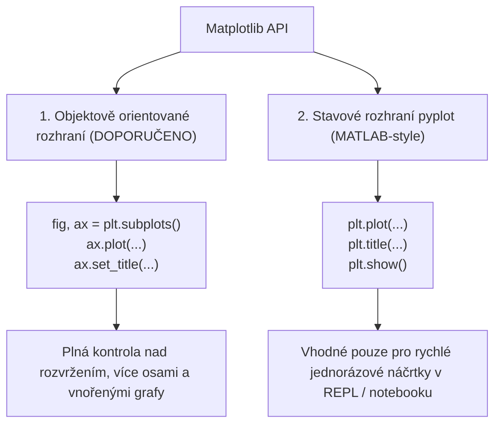

<!-- slide: id1, Úvod, Skip, basics -->
## Vědecká vizualizace dat: Knihovna `matplotlib`

Knihovna **`matplotlib`** (ve verzi 3.8+) je de facto standardem pro vizualizaci vědeckých, inženýrských a statistických dat v ekosystému Pythonu. Vznikla v roce 2003 (John D. Hunter) s cílem přinést do Pythonu možnosti vykreslování grafů známé z prostředí MATLAB.

Dnes tvoří základní vizualizační vrstvu, nad kterou staví řada moderních knihoven:
- **Pandas**: metoda `df.plot()` přímo volá backend Matplotlibu.
- **Seaborn**: statistická vizualizace s nádhernými moderními barevnými paletami.
- **Scikit-learn**: vizualizace ROC křivek, matic záměn (*Confusion Matrix*) a rozhodovacích stromů.

> [!NOTE]
> Matplotlib je určen pro tvorbu 2D i 3D statických, animovaných a interaktivních grafů v **publikační kvalitě** (s podporou vektorových formátů PDF, SVG a EPS s LaTeXovou typografií).

---
<!-- slide: id2, Přehled, Skip, basics -->
## Dva přístupy k tvorbě grafů v Matplotlibu

Při práci s Matplotlibem se setkáte se dvěma odlišnými programátorskými styly:



V moderním Pythonu je **striktně doporučeno používat objektové rozhraní `fig, ax`**, které je přehledné, znovupoužitelné a netrpí skrytými vedlejšími efekty globálního stavového automatu.

---
<!-- slide: id3, Instalace, Skip, basics -->
## Instalace a backendy

Instalace v moderním prostředí:

```bash
# Přes standardní balíčkovací manažer:
pip install matplotlib

# Nebo ve vědeckém prostředí Conda / Pixi:
conda install -c conda-forge matplotlib
```

### Koncepce backendů (`Backends`):
Matplotlib odděluje samotnou logiku vykreslování od výstupního zařízení:
- **Interaktivní backendy**: TkAgg, QtAgg, MacOSX — otevřou okno s grafem a navigační lištou na obrazovce (`plt.show()`).
- **Neinteraktivní (bezhlavé) backendy**: `Agg`, `PDF`, `SVG` — ideální pro webové servery, Docker kontejnery a CI/CD, kde není k dispozici grafický server X11 / Wayland:
  ```python
  import matplotlib
  matplotlib.use("Agg")  # Vypne otevírání oken, umožní rychlé ukládání do souboru
  import matplotlib.pyplot as plt
  ```

---
<!-- slide: id4, Ia – „pyplot()“, Core, basics -->
## První graf: Minimální příklad

Nejjednodušší spojnicový graf:

```python
import matplotlib.pyplot as plt

# Pokud předáme jediné pole čísel, Matplotlib jej považuje za osu Y
# Osa X se automaticky očísluje od 0 do N-1:
prvocisla = [2, 3, 5, 7, 11, 13, 17]

plt.plot(prvocisla)
plt.show()
```

Zobrazí se okno s interaktivním grafem, ve kterém můžete zoomovat, posouvat pohled a ukládat obrázek na disk.

---
<!-- slide: id5, Ib – styl grafu, osy, Core, resyntax -->
## Formátovací řetězec, barvy a rozsah os

Předáním dvou polí určíme souřadnice $[x_i, y_i]$. Třetím nepovinným argumentem je kompaktní **formátovací řetězec** (*format string*):

```python
import matplotlib.pyplot as plt

x = [1, 2, 3, 4, 5, 6, 7]
y = [2, 3, 5, 7, 11, 13, 17]

# 'ro' = červená barva (r = red) + bodové kroužky (o = circle marker)
# 'b--' = modrá čárkovaná čára, 'g^' = zelené trojúhelníčky
plt.plot(x, y, "ro")

# Nastavení mezí os: [xmin, xmax, ymin, ymax]
plt.axis([0, 8, 0, 20])

# Pojmenování os:
plt.xlabel("Pořadí")
plt.ylabel("Hodnota prvočísla")
plt.title("Růst prvních 7 prvočísel")

plt.show()
```

---
<!-- slide: id6, Ic – popisky, Core, pythonic -->
## Anotace a popisky bodů: `ax.annotate()`

Pro přidání textových popisků přímo ke konkrétním bodům slouží metoda **`annotate()`**:

```python
import matplotlib.pyplot as plt

x = [1, 2, 3, 4, 5, 6, 7]
y = [2, 3, 5, 7, 11, 13, 17]

fig, ax = plt.subplots()
ax.plot(x, y, "ro")

# Přidání popisku ke každému bodu:
for xi, yi in zip(x, y):
    ax.annotate(
        text=str(yi),
        xy=(xi, yi),                      # Cílové souřadnice bodu
        xytext=(xi + 0.15, yi - 0.2)      # Posun textu o kousek vedle
    )

ax.set_xlim(0, 8)
ax.set_ylim(0, 20)
plt.show()
```

Pomocí `zip(x, y)` elegantně procházíme dvojice souřadnic.

---
<!-- slide: id7, IIa – více grafů v jednom, Skip, pythonic -->
## Vykreslení více křivek do stejného grafu

Opakovaným voláním `ax.plot()` vrstvíme další datové řady na tutéž plochu:

```python
import matplotlib.pyplot as plt

fig, ax = plt.subplots()

# 1. Prvočísla (červené kroužky):
x_prvocisla = [2, 3, 5, 7, 11, 13, 17, 19]
y_prvocisla = x_prvocisla
ax.plot(x_prvocisla, y_prvocisla, "ro", label="Prvočísla")

# 2. Složená čísla (zelené křížky):
x_slozena = [4, 6, 8, 9, 10, 12, 14, 15, 16, 18]
y_slozena = x_slozena
ax.plot(x_slozena, y_slozena, "g+", label="Složená čísla")

ax.set_xlabel("Hodnota")
ax.set_ylabel("Hodnota")
plt.show()
```

---
<!-- slide: id8, IIb – legenda, Core, resyntax -->
## Přidání legendy: Parametr `label` a `ax.legend()`

Aby se uživatel v grafu s více řadami vyznal, opatříme každé volání parametrem **`label="..."`** a následně zobrazíme legendu zavoláním **`ax.legend()`**:

```python
import matplotlib.pyplot as plt

fig, ax = plt.subplots()

ax.plot([1, 2, 3, 4], [1, 4, 9, 16], "b-o", label="Kvadratická fce $y = x^2$")
ax.plot([1, 2, 3, 4], [1, 8, 27, 64], "r--s", label="Kubická fce $y = x^3$")

# Zobrazení legendy na optimálním místě:
ax.legend(loc="upper left", frameon=True)

plt.show()
```

> [!TIP]
> Matplotlib plně podporuje **LaTeX matematickou notaci** v řetězcích ohraničených dolary `r"$y = x^2$"`.

---
<!-- slide: id9, IIc – popisky os a mřížka, Core, resyntax -->
## Mřížka a formátování značek na osách: `grid()` a `set_xticks()`

```python
import matplotlib.pyplot as plt

fig, ax = plt.subplots()
ax.plot([0, 1, 2, 3, 4], [0, 2, 4, 6, 8], "bo-")

# 1. Explicitní nastavení ticků (značek na osách):
ax.set_xticks(range(0, 5, 1))
ax.set_yticks(range(0, 9, 2))

# 2. Přidání pomocné mřížky pro snadnější odečítání hodnot:
ax.grid(True, linestyle="--", alpha=0.6, color="gray")

# 3. Popisky:
ax.set_xlabel("Vstupní proměnná $x$")
ax.set_ylabel("Odezva systému $y$")

plt.show()
```

---
<!-- slide: id10, IId – vlastnosti textů, Skip, resyntax -->
## Rotace popisků a formátování písma

Při velkém množství hodnot na ose X (např. názvy měst nebo data) je nutné popisky pootočit, aby se vzájemně nepřekrývaly:

```python
import matplotlib.pyplot as plt

kategorie = ["Praha", "Brno", "Ostrava", "Plzeň", "Liberec", "Olomouc"]
hodnoty = [1300, 380, 280, 175, 105, 100]

fig, ax = plt.subplots()
ax.bar(kategorie, hodnoty, color="steelblue")

# Rotace popisků osy X o 45 stupňů:
ax.set_xticklabels(kategorie, rotation=45, ha="right", fontsize=11)
ax.set_ylabel("Počet obyvatel (v tisících)", fontsize=12)

plt.tight_layout()  # Automaticky upraví okraje, aby text nebyl oříznut!
plt.show()
```

---
<!-- slide: id11, III – více obrázků v jednom, WOW, pythonic -->
## Obdélníková mřížka grafů: `plt.subplots(rows, cols)`

Moderní objektový způsob tvorby mřížky grafů (*multi-panel figures*):

```python
import numpy as np
import matplotlib.pyplot as plt

x = np.linspace(0, 2 * np.pi, 200)

# Vytvoření mřížky 2 řádky × 1 sloupec:
fig, (ax1, ax2) = plt.subplots(nrows=2, ncols=1, figsize=(8, 6), sharex=True)

# 1. Horní graf:
ax1.plot(x, np.sin(x), "b-", linewidth=2)
ax1.set_title("Harmonické funkce")
ax1.set_ylabel("$\sin(x)$")
ax1.grid(True, linestyle=":")

# 2. Dolní graf:
ax2.plot(x, np.cos(x), "r--", linewidth=2)
ax2.set_xlabel("Úhel $x$ [rad]")
ax2.set_ylabel("$\cos(x)$")
ax2.grid(True, linestyle=":")

# Uložení do souboru s vysokým rozlišením:
fig.savefig("harmonicke_funkce.png", dpi=300, bbox_inches="tight")
plt.show()
```

---
<!-- slide: id12, IVa – více os (kopie), Skip, newconcept -->
## Duplicitní a sekundární osy: `twinx()` a `secondary_xaxis()`

Pokud chceme vynést do jednoho grafu dvě různé veličiny s odlišnými jednotkami a měřítky (např. teplotu ve °C a tlak v hPa):

```python
import matplotlib.pyplot as plt
import numpy as np

cas = np.linspace(0, 10, 100)
teplota = 20 + 5 * np.sin(cas)
tlak = 1013 + 50 * np.cos(cas)

fig, ax1 = plt.subplots()

# První křivka na levé ose Y:
barva = "tab:red"
ax1.set_xlabel("Čas [hodiny]")
ax1.set_ylabel("Teplota [°C]", color=barva)
ax1.plot(cas, teplota, color=barva)
ax1.tick_params(axis="y", labelcolor=barva)

# Druhá křivka sdílející stejnou osu X, ale s nezávislou pravou osou Y:
ax2 = ax1.twinx()
barva = "tab:blue"
ax2.set_ylabel("Atmosférický tlak [hPa]", color=barva)
ax2.plot(cas, tlak, color=barva)
ax2.tick_params(axis="y", labelcolor=barva)

plt.show()
```

---
<!-- slide: id13, IVb – více os (změna měřítka), Skip, newconcept -->
## Sekundární osa se změnou jednotek

Pomocí metody `ax.secondary_xaxis()` nebo `secondary_yaxis()` lze přidat horní osu s automatickým přepočtem jednotek (např. radiány na stupně, nebo Celsius na Fahrenheit):

```python
import numpy as np
import matplotlib.pyplot as plt

x = np.linspace(0, 2 * np.pi, 100)
y = np.sin(x)

fig, ax = plt.subplots()
ax.plot(x, y)
ax.set_xlabel("Úhel [rad]")

# Horní osa automaticky přepočítává radiány na stupně:
def rad2deg(r): return r * 180 / np.pi
def deg2rad(d): return d * np.pi / 180

secax = ax.secondary_xaxis("top", functions=(rad2deg, deg2rad))
secax.set_xlabel("Úhel [°]")

plt.show()
```

---
<!-- slide: id14, V – časová osa, Core, pythonic -->
## Vizualizace časových řad: Práce s objekty `datetime`

Matplotlib nativně rozumí standardním Python objektům `datetime.datetime` a NumPy `datetime64`:

```python
import matplotlib.pyplot as plt
from datetime import datetime, timedelta

# Příprava časové řady:
pocatek = datetime(2026, 1, 1)
dny = [pocatek + timedelta(days=i) for i in range(10)]
namerene_hodnoty = [12.4, 11.8, 14.2, 15.0, 13.9, 16.2, 17.5, 15.8, 14.9, 16.0]

fig, ax = plt.subplots()
ax.plot(dny, namerene_hodnoty, "o-")

# Automatické zešikmení datových popisků:
fig.autofmt_xdate()

ax.set_ylabel("Teplota [°C]")
ax.set_title("Měření teploty v lednu 2026")
plt.show()
```

---
<!-- slide: id15, VI – histogram, WOW, pythonic -->
## Statistické histogramy: `ax.hist()`

Metoda **`ax.hist()`** automaticky rozdělí data do přihrádek (*bins*) a vykreslí četnosti nebo hustotu pravděpodobnosti (*density*):

```python
import numpy as np
import matplotlib.pyplot as plt

# 10 000 náhodných hodnot z normálního rozdělení (průměr 100, směr. odchylka 15):
rng = np.random.default_rng(seed=42)
iq_data = rng.normal(loc=100, scale=15, size=10_000)

fig, ax = plt.subplots()

# Vykreslení histogramu s 50 přihrádkami:
cetnosti, biny, patche = ax.hist(
    iq_data,
    bins=50,
    density=True,
    facecolor="royalblue",
    edgecolor="black",
    alpha=0.7
)

# Teoretická Gaussova křivka:
x_osa = np.linspace(50, 150, 200)
gauss = (1 / (15 * np.sqrt(2 * np.pi))) * np.exp(-0.5 * ((x_osa - 100) / 15) ** 2)
ax.plot(x_osa, gauss, "r--", linewidth=2.5, label="Teoretická hustota $N(100, 15^2)$")

ax.set_title("Rozdělení IQ v populaci")
ax.set_xlabel("Hodnota IQ")
ax.set_ylabel("Hustota pravděpodobnosti")
ax.legend()
plt.show()
```

---
<!-- slide: id16, VII – pokročilé funkce, Skip, newconcept -->
## Vyplněné plochy a integrály: `Polygon` a `fill_between()`

Pro zvýraznění plochy pod křivkou (např. určitý integrál nebo interval spolehlivosti):

```python
import numpy as np
import matplotlib.pyplot as plt

x = np.linspace(0, 10, 200)
y = np.sin(x)

fig, ax = plt.subplots()
ax.plot(x, y, "b-", linewidth=2)

# Zvýraznění plochy pod křivkou v intervalu od x=2 do x=6:
oblast_x = (x >= 2) & (x <= 6)
ax.fill_between(x[oblast_x], y[oblast_x], color="skyblue", alpha=0.5, label="Integrál $\int_2^6 \sin(x)dx$")

ax.axhline(0, color="black", linewidth=0.8, linestyle=":")
ax.legend()
plt.show()
```

---
<!-- slide: id17, Animace, Skip, basics -->
## Tvorba animací v Matplotlibu

Pro tvorbu dynamických vědeckých animací (simulace vlnění, pohyb částic, průběh trénování neuronových sítí) poskytuje Matplotlib modul **`matplotlib.animation`**:

- **`FuncAnimation`**: Opakovaně volá uživatelskou funkci v zadaném časovém intervalu a překresluje data grafu.
- Export animací do formátů **MP4** (vyžaduje `ffmpeg`) nebo animovaného **GIFu** (přes `Pillow`).

Podrobný rozbor tvorby animací naleznete v samostatné přednášce [Matplotlib – animace](#MatPlotLib_animace).

---
<!-- slide: id18, Kam dál?, Skip, basics -->
## Moderní ekosystém vizualizace v Pythonu

Matplotlib je pilířem, ale pro specializované úlohy zvažte další moderní knihovny:

| Knihovna | Zaměření | Kdy ji zvolit? |
|---|---|---|
| **`Matplotlib`** | Základní vědecká a publikační grafika | Články, LaTeX export, plná kontrola nad každým pixelem |
| **`Seaborn`** | Statistická vizualizace | Boxploty, heat mapy, korelační matice, regrese |
| **`Plotly`** | Interaktivní webové grafy | Dashboardy, zoom v prohlížeči, HTML výstupy |
| **`Bokeh`** | Velkoobjemová webová data | Interaktivní aplikace streamující živá data |
| **`Altair`** | Deklarativní gramatika grafiky | Přehledná statistická explorace dat |
