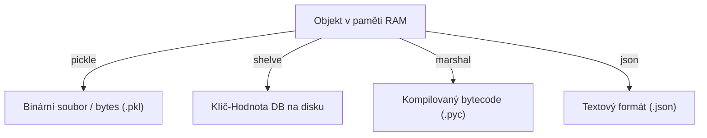

<!-- slide: id1, Motivace, Skip, basics -->
## Úvod do serializace dat v Pythonu

V programátorské praxi běžně pracujeme se složitými paměťovými strukturami (vnořené slovníky, seznamy objektů, instance vlastních tříd, modely neuronových sítí).

Dříve či později vyvstane potřeba tyto živé objekty z paměti RAM **uchovat nebo přenést**:
- **Uložení stavu (perzistence)**: Uložení rozehrané hry, checkpointu trénování modelu nebo nastavení aplikace před ukončením.
- **Meziprocesní komunikace (IPC)**: Předávání úloh a objektů mezi různými procesy (`multiprocessing`).
- **Přenos po síti**: Odeslání výsledků na server nebo do fronty úloh (Celery, Redis).

Převod objektu z paměti na proud bajtů se nazývá **serializace** (*marshalling* / *pickling* / *deflation*), opačný proces se nazývá **deserializace** (*unpickling* / *inflation*).

---
<!-- slide: id2, Řešení, Core, paradigm -->
## Možnosti serializace: Textové vs. binární formáty

Proč pro ukládání objektů nepoužít prostý text nebo `eval()`?
- Funkce `eval()` je z hlediska bezpečnosti **extrémně nebezpečná** a textová reprezentace `repr()` nedokáže zachovat cyklické reference ani stav složitých objektů.

Dva základní přístupy:
1. **Univerzální textové standardy (`json`, `tomllib`, `yaml`)**:
   - Vynikající pro konfigurace a interoperabilitu s jinými jazyky (Java, C#, JavaScript).
   - Omezeno pouze na základní typy (čísla, řetězce, seznamy, slovníky). Neumí přímo ukládat instance tříd, n-tice `tuple` jako odlišný typ, množiny `set` ani cyklické grafy.
2. **Nativní binární protokoly (`pickle`, `shelve`, `marshal`)**:
   - Dokáží uložit téměř jakýkoliv Python objekt včetně vlastních tříd, funkcí a sdílených referencí.
   - Bleskově rychlé binární kódování.
   - Proprietární pro Python (jiné jazyky jim nerozumí).

---
<!-- slide: id3, Dostupné serializační nástroje, Core, pythonic -->
## Přehled serializačních modulů standardní knihovny

Python nabízí tři hlavní vestavěné nástroje pro nativní binární serializaci:

- **`pickle`**: Hlavní serializační modul. Podporuje libovolné datové struktury, rekurzivní odkazy, instance tříd i protokoly 0 až 5 (s podporou out-of-band bufferů pro NumPy).
- **`shelve`**: Perzistentní úložiště fungující jako slovník `dict`, jehož hodnoty jsou automaticky serializovány přes `pickle` do souborové databáze (SQLite, DBM).
- **`marshal`**: Interní modul CPythonu pro čtení a zápis bajtkódu `.pyc`. Není určen pro běžná aplikační data.

---
<!-- slide: id4, Veledůležitá poznámka, Tricky, paradigm -->
## Bezpečnostní varování: Nekontrolovaná deserializace

> [!CAUTION]
> ### Nikdy nenačítejte data přes `pickle` z nedůvěryhodných zdrojů!
> Formát `pickle` není jen pasivní formát dat — jedná se o **kompletní zásobníkový virtuální stroj**.
> Pomocí speciální metody `__reduce__()` může útočník do binárního souboru vložit instrukce, které při deserializaci (`pickle.load()`) **okamžitě spustí libovolný kód v operačním systému** (např. `os.system("rm -rf /")` nebo reverse shell)!

Bezpečnostní pravidla:
- Pokud přijímáte data ze sítě, od uživatele nebo z nedůvěryhodného API, **vždy použijte formát `json`** (nebo kryptograficky podepište pickle přes HMAC).
- `pickle` používejte výhradně pro interní komunikaci mezi vlastními důvěryhodnými procesy nebo lokální cache.
