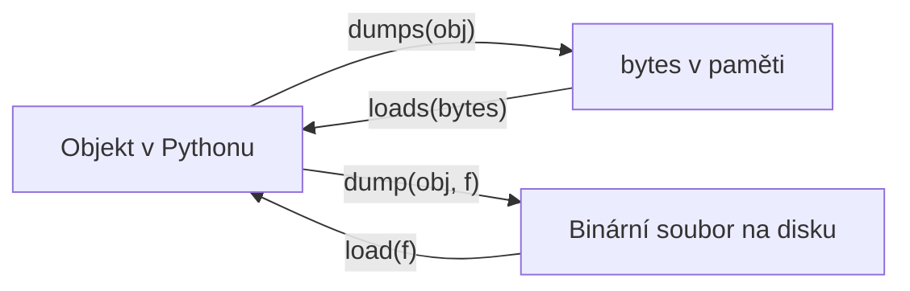

<!-- slide: id1, Úvod, Core, newconcept -->
## Úvod do modulu `pickle`: Binární serializace v Pythonu

Modul **`pickle`** ze standardní knihovny implementuje binární protokoly pro serializaci a deserializaci hierarchických Python objektů:

```python
import pickle
```

Klíčové vlastnosti:
- **Kompletní rekonstrukce stavu**: Dokáže serializovat libovolné vestavěné i uživatelské objekty (včetně instancí tříd, n-tic, množin a cyklických odkazů).
- **Sdílené reference**: Pokud dva prvky v seznamu odkazují na stejný objekt v paměti, `pickle` tuto identitu zachová (nevytvoří dvě nezávislé kopie).
- **Uložení do souboru nebo paměti**: Podporuje zápis do binárního proudu i převod na surový objekt `bytes`.

---
<!-- slide: id2, Protokol, Skip, newconcept -->
## Verze Pickle protokolů (0 až 5)

Formát `pickle` prošel postupným vývojem. Dnes existuje 6 verzí protokolu:

| Protokol | Verze Pythonu | Popis |
|:---:|:---|:---|
| **0** | Python 1.x | Původní textový (ASCII) protokol čitelný pro člověka. |
| **1** | Python 1.x | Původní binární formát. |
| **2** | Python 2.3 | Efektivnější kódování pro třídy v novém stylu. |
| **3** | Python 3.0 | Výchozí podpora pro nativní `bytes` typ. |
| **4** | Python 3.4 | Optimalizace pro velké objekty (> 4 GB) a 64bitové datové typy. |
| **5** | **Python 3.8+** | **Současný standard**: Podpora *out-of-band* datových bufferů (nulové kopírování pro NumPy pole). |

> [!NOTE]
> V moderním Pythonu (3.8+) je výchozí hodnotou **Protokol 4 nebo 5** (`pickle.DEFAULT_PROTOCOL = 4`, `pickle.HIGHEST_PROTOCOL = 5`).

---
<!-- slide: id3, Metody modulu „pickle“, Core, newconcept -->
## Čtveřice základních funkcí modulu `pickle`

Podobně jako modul `json` rozlišuje `pickle` operace nad soubory a operace v paměti:



```python
import pickle

data = {'id': 1, 'hodnoty': [10, 20, 30]}

# 1. Do paměti RAM jako bytes:
bajtovy_proud = pickle.dumps(data)
obnoveno = pickle.loads(bajtovy_proud)

# 2. Do fyzického souboru (vyžaduje binární mód 'wb' a 'rb'):
with open('data.pkl', mode='wb') as f:
    pickle.dump(data, f)

with open('data.pkl', mode='rb') as f:
    nacteno = pickle.load(f)
```

---
<!-- slide: id4, Příklad – data, Core, basics -->
## Serializace datových struktur v praxi

Serializace slovníku s vnořenými kolekcemi:

```python
import pickle

katalog = {
    'nazev': "Experiment A",
    'vzorky': [1.5, 2.7, 3.9],
    'parametry': {'krok': 10, 'aktivni': True}
}

# Uložení do souboru:
with open('katalog.pickle', mode='wb') as f:
    pickle.dump(katalog, f)

# Načtení v jiném běhu programu:
with open('katalog.pickle', mode='rb') as f:
    nacteny_katalog = pickle.load(f)

print(nacteny_katalog['nazev'])
# Experiment A
print(nacteny_katalog['vzorky'][1])
# 2.7
```

Všechny datové typy i vnitřní vazby jsou přesně zachovány.

---
<!-- slide: id5, Co lze zapiklit, Core, paradigm -->
## Co lze (a co nelze) serializovat?

### Co `pickle` bez problémů zvládne:
- Skalární typy: `None`, `bool`, `int`, `float`, `complex`, `str`, `bytes`, `bytearray`.
- Kolekce: `tuple`, `list`, `set`, `frozenset`, `dict` obsahující piklitelné prvky.
- Funkce a třídy definované na **globální úrovni modulu** (na úrovni `top-level`).
- Instance tříd (serializuje se jejich stav v `__dict__`).

### Co `pickle` ve výchozím stavu NEUMÍ:
- Otevřené systémové deskriptory (`open()` handlery, síťové sockety).
- Vlákna a zámky (`threading.Thread`, `Lock`).
- Generátory a iterátory v rozpracovaném stavu.
- Lambda funkce a lokální funkce definované uvnitř jiných funkcí (*closures*).

> [!NOTE]
> Pro složité objekty (např. lambda funkce a generátory) existují externí rozšíření jako `dill` nebo `cloudpickle`.

---
<!-- slide: id6, Příklad – funkce, Tricky, paradigm -->
## Jak `pickle` ukládá funkce a třídy: Jméno, nikoliv kód!

Zásadní architektonický princip modulu `pickle`:

> [!IMPORTANT]
> **`pickle` neukládá zdrojový kód ani bajtkód funkcí a tříd!**
> Ukládá pouze jejich **plně kvalifikovaný název** (`module.__name__` + `func.__name__`).

```python
# modul: my_code.py
import pickle

def moje_funkce():
    return 42

data = {'fn': moje_funkce}

# Uloží se pouze odkaz: "my_code.moje_funkce"
with open('data.pkl', 'wb') as f:
    pickle.dump(data, f)
```

Při deserializaci (`pickle.load()`) musí být modul `my_code` importovatelný a funkce `moje_funkce` v něm musí existovat. Pokud funkci přejmenujete nebo modul smažete, deserializace selže s chybou `AttributeError`!

---
<!-- slide: id7, K (ne)bezpečnosti piklení, Tricky, paradigm -->
## Bezpečnostní riziko `pickle`: Spuštění kódu při `load()`

Jak jsme již zmínili v úvodu, formát `pickle` provádí při deserializaci kód na virtuálním stroji:

```python
# Příklad útočného vektoru:
import pickle
import os

class Exploit:
    def __reduce__(self):
        # Spustí libovolný příkaz systému při zavolání pickle.load()!
        return (os.system, ('whoami',))

malicious_bytes = pickle.dumps(Exploit())

# Oběť zavolá:
# pickle.loads(malicious_bytes)  <-- V TENTO OKAMŽIK SE SPUSTÍ PŘÍKAZ!
```

> [!CAUTION]
> **Pravidlo č. 1**: Nikdy nenačítejte pickle soubor z internetu, od neověřeného uživatele nebo z nezabezpečené sítě!

Pro bezpečné zkoumání neznámých `.pickle` souborů slouží modul **`pickletools`**.

---
<!-- slide: id8, Modul „pickletools“, Skip, newconcept -->
## Analýza a disasemblace: Modul `pickletools`

Standardní modul **`pickletools`** umožňuje prozkoumat interní instrukce zapiklených dat bez jejich skutečného spuštění:

```python
import pickle
import pickletools

data = [1, 2, "ahoj"]
raw = pickle.dumps(data)

# Bezpečná disasemblace instrukcí pickle virtuálního stroje:
pickletools.dis(raw)
```

Výstup zobrazí přesný sled operačních kódů (opcodes) jako `PROTO`, `EMPTY_LIST`, `MARK`, `BININT1`, `BINUNICODE`, `APPENDS`, `STOP`.

Můžete tak odhalit podezřelé instrukce `GLOBAL` nebo `REDUCE` předtím, než data načtete.

---
<!-- slide: id9, Modul „pickletools“ – příkazová řádka, Skip, basics -->
## Inspekce souborů přes CLI: `python -m pickletools`

`pickletools` lze spustit přímo z terminálu bez psaní skriptu:

```bash
# Výpis operačních kódů pickle souboru:
python -m pickletools data.pickle

# Podrobný výpis s vysvětlujícími anotacemi (-a):
python -m pickletools -a data.pickle

# Optimalizace souboru (odstranění zbytečných instrukcí):
python -m pickletools -o optimalizovano.pickle data.pickle
```

Přepínač `-a` (`--annotate`) připojí ke každé nízkoúrovňové instrukci lidsky čitelný popis její funkce.

---
<!-- slide: id10, Modul „pickletools“ – příklad (bez anotací), Skip, newconcept -->
## Příklad disasemblace bez anotací

Pohled do nitra zapikleného slovníku `{'seznam': [1, 2], 12: 'Ahoj'}`:

```text
    0: \x80 PROTO      3
    2: }    EMPTY_DICT
    3: q    BINPUT     0
    5: (    MARK
    6: K        BININT1    12
    8: X        BINUNICODE 'Ahoj'
   17: q        BINPUT     1
   19: X        BINUNICODE 'seznam'
   30: q        BINPUT     2
   32: ]        EMPTY_LIST
   33: q        BINPUT     3
   35: (        MARK
   36: K            BININT1    1
   38: K            BININT1    2
   40: e            APPENDS    (MARK at 35)
   41: u        SETITEMS   (MARK at 5)
   42: .    STOP
highest protocol among opcodes = 2
```

Každý řádek ukazuje offset v souboru, bajtový kód a příslušnou instrukci zásobníku.

---
<!-- slide: id11, Modul „pickletools“ – příklad (s anotacemi), Skip, newconcept -->
## Příklad disasemblace s anotacemi (`-a`)

S přepínačem `-a` vidíme přesný popis práce zásobníku:

```text
    0: \x80 PROTO      3         Protocol version indicator.
    2: }    EMPTY_DICT           Push an empty dict onto stack.
    3: q    BINPUT     0         Store stack top into memo table.
    5: (    MARK                 Push markobject onto stack.
    6: K        BININT1    12    Push a one-byte unsigned integer.
    8: X        BINUNICODE 'Ahoj'Push a Python Unicode string.
   32: ]        EMPTY_LIST       Push an empty list.
   41: u        SETITEMS         Add key/value pairs to dict.
   42: .    STOP                 Stop the unpickling machine.
```

---
<!-- slide: id12, Poznámka – protokol 0, Skip, basics -->
## Historický Protokol 0: Čistý text

Pro zajímavost, nejstarší Protokol 0 generoval lidsky čitelný textový zápis:

```python
import pickle

data = {'x': 10, 'y': 20}
raw0 = pickle.dumps(data, protocol=0)
print(raw0.decode('ascii'))
# (dp0
# Vx
# p1
# I10
# sVy
# p2
# I20
# s.
```

Tento formát byl v 90. letech navržen pro přenositelnost přes 7bitové e-mailové protokoly. V moderním Pythonu se používá výhradně binární Protokol 4 a 5 s maximální kompresí a rychlostí.
