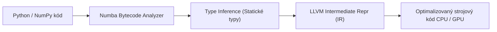
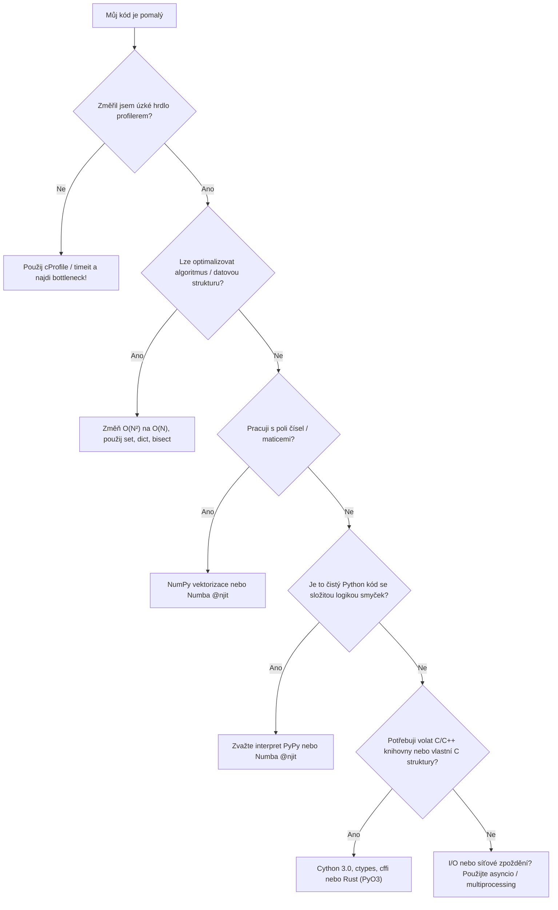

<!-- slide: id1, Úvod, Core, newconcept -->
## Výkon v Pythonu: Kdy a jak optimalizovat?

Python je proslulý svou expresivitou, elegancí a rychlostí vývoje. Avšak jako dynamický, interpretovaný jazyk s dynamickým typováním a referenčním počítáním objektů (*PyObject overhead*) dosahuje v čistě numerických a cykly vytížených úlohách znatelně nižšího výpočetního výkonu než kompilované jazyky C, C++ nebo Rust.

> [!IMPORTANT]
> **Zlaté pravidlo optimalizace (Donald Knuth)**:
> *„Premature optimization is the root of all evil.“* (Předčasná optimalizace je kořenem všeho zla).
> 1. Nejprve napište kód čistě a správně.
> 2. Otestujte funkcionalitu automatizovanými testy.
> 3. Změřte skutečná úzká hrdla profilerem (`cProfile`, [profiling](#id2)).
> 4. Teprve 1–5 % kritického kódu optimalizujte.

### Úrovně akcelerace Pythonu

1. **Algoritmická optimalizace & Standardní knihovna**:
   - Přechod od $O(n^2)$ k $O(n \log n)$ či $O(1)$ (např. vyhledávání v `set` místo v `list`).
   - Využití vestavěných C-funkcí CPythonu (`sum()`, `min()`, `map()`, `itertools`, `collections.deque`).
2. **CPython 3.11–3.13 "Faster CPython"**:
   - Specializující adaptivní interpret (PEP 659) a experimentální JIT kompilátor (Python 3.13+).
3. **Vektorizace (NumPy)**:
   - Eliminace smyček v interpretu a delegace na SIMD/BLAS knihovny v C a Fortranu.
4. **JIT kompilace (Numba, PyPy)**:
   - Překlad Python/NumPy kódu za běhu přímo do strojových instrukcí přes LLVM ([PyPy](#id2), [Numba](#id3)).
5. **Kompilace do C/C++ (Cython, FFI, PyO3)**:
   - Statické C-typování a přímá kompilace do nativní binární sdílené knihovny ([Cython](#id5)).

---
<!-- slide: id2, PyPy, Core, newconcept -->
## PyPy: Alternativní interpret s tracing JIT

[PyPy](https://www.pypy.org/) je alternativní, plně kompatibilní implementace interpretu Pythonu napsaná v **RPythonu** (*Restricted Python*), která se překládá do C a obsahuje pokročilý **Tracing JIT kompilátor**.

### Jak PyPy funguje?
- Za běhu analyzuje prováděné smyčky a horké cesty kódu (*hot paths*).
- Zaznamená sekvenci operací pro konkrétní typy a zkompiluje je přímo do optimalizovaného strojového kódu CPU.
- V čistém Python kódu s mnoha smyčkami a objekty dosahuje typicky **4× až 10× zrychlení** oproti standardnímu CPythonu bez nutnosti měnit jediný řádek zdrojového kódu.

### Výhody a limity PyPy

| Vlastnost | CPython (výchozí) | PyPy (JIT) |
|---|---|---|
| **Typ kompilace** | Bajtkód interpret (od 3.13 s Tier 2 JIT) | Pokročilý Tracing JIT do strojového kódu |
| **Čistý Python kód** | Standardní rychlost | **Výrazně rychlejší (až o řád)** |
| **C-API rozšíření** | Nativní, nulová režie | Pomalejší emulace přes `cpyext` |
| **Start-up čas** | Okamžitý | Vyšší režie při zahřívání JITu |
| **Paměťová náročnost** | Nižší základní režie | Vyšší (JIT cache, metadata smyček) |

> [!NOTE]
> PyPy je ideální pro dlouhoběžící procesy (webové servery, zpracování síťových dat, číselné simulace v čistém Pythonu). Pokud váš projekt závisí primárně na C-rozšířeních (NumPy, SciPy, Pandas), výhoda PyPy se ztrácí kvůli emulační vrstvě C-API.

---
<!-- slide: id3, Numba, Core, newconcept -->
## Numba: LLVM JIT akcelerátor pro vědecké výpočty

[Numba](https://numba.pydata.org/) je open-source JIT kompilátor vyvinutý společností Anaconda, který překládá podmnožinu Pythonu a pole **NumPy** přímo do rychlých strojových instrukcí pomocí kompilátorové infrastruktury **LLVM**.



### Hlavní přednosti Numby:
1. **Nulové změny v instalaci C toolchainu**: Není potřeba externí gcc/clang nebo Microsoft Visual C++ — LLVM je součástí instalace balíčku Numba (`pip install numba`).
2. **100% integrace s NumPy**: Pole `np.ndarray` jsou přímo mapována na souvislé paměťové C-buffery.
3. **Paralelizace bez GIL**: Snadné uvolnění Global Interpreter Locku a paralelní běh na více jádrech procesoru (`nogil=True`, `parallel=True`).
4. **Cílení na GPU**: Možnost kompilace CUDA jader pro grafické karty NVIDIA přímo z Python syntaxe.

---
<!-- slide: id4, Numba – „@jit“, WOW, newconcept -->
## Numba v praxi: Dekorátory `@jit` a `@njit`

Nejčastější a doporučený způsob použití představuje dekorátor **`@njit`** (zkratka pro `@jit(nopython=True)`):

```python
import numpy as np
from numba import njit, prange

# Režim nopython=True garantuje, že kód se zkompiluje bez zásahu CPython interpretu
@njit(fastmath=True)
def monte_carlo_pi(vzorky: int) -> float:
    trefy: int = 0
    for _ in range(vzorky):
        x = np.random.random()
        y = np.random.random()
        if x * x + y * y <= 1.0:
            trefy += 1
    return 4.0 * trefy / vzorky

# Automatická vícevláknová paralelizace přes všechna jádra CPU:
@njit(parallel=True)
def paralelni_vektorovy_soucet(a: np.ndarray, b: np.ndarray) -> np.ndarray:
    n = len(a)
    vysledek = np.empty(n, dtype=np.float64)
    for i in prange(n):  # prange rozdělí iterace mezi vlákna bez GILu
        vysledek[i] = a[i] * 2.0 + b[i]
    return vysledek
```

### Porovnání režimů `@jit`:
- **`nopython=True` (`@njit`)**: Striktní režim. Pokud kód obsahuje operaci, kterou Numba nedokáže přeložit do nativních typů (např. neznámý objekt či volání nepodporované knihovny), vyvolá výjimku `TypingError`. Kód dosahuje rychlosti čistého C/Fortranu.
- **`fastmath=True`**: Povoluje agresivní optimalizace IEEE 754 (reordering, ignorování NaN/Inf kontrol), analogicky přepínači `-ffast-math` v GCC/Clang.
- **`@vectorize`**: Zkompiluje skalární funkci na ufunc operující nad celými poli s plnou podporou broadcatsingu.

---
<!-- slide: id5, Cython, Skip, newconcept -->
## Cython: Most mezi Pythonem a C/C++

Pokud Numba nestačí nebo potřebujete integrovat existující C/C++ knihovny a definovat vlastní nízkoúrovňové datové struktury, přichází na řadu **Cython** (verze 3.0+).


### Dva styly zápisu Cythonu:

1. **Klasická Cython syntax (`.pyx`)**:
   ```cython
   # cython: language_level=3
   def fibonacci_cython(int n):
       cdef int a = 0
       cdef int b = 1
       cdef int i
       for i in range(n):
           a, b = b, a + b
       return a
   ```

2. **Moderní Pure Python Mode (čistý `.py` s PEP 484 anotacemi)**:
   ```python
   import cython

   @cython.cfunc
   @cython.exceptval(-1, check=False)
   def rychly_vypocet(n: cython.int) -> cython.int:
       i: cython.int
       soucet: cython.int = 0
       for i in range(n):
           soucet += i
       return soucet
   ```

> [!TIP]
> Moderní **Cython 3.0+** podporuje psaní veškerého kódu v čistém Pythonu se statickými typy. Kód lze ladit standardním CPythonem bez kompilace a následně zkompilovat do nativní C-binárky pro produkční nasazení.

---
<!-- slide: id6, Závěr, Skip, basics -->
## Rozhodovací strom akcelerace kódu

Jak postupovat, když program v Pythonu běží pomalu?



### Přehled nástrojů:

- **Algoritmy & C-API vestavěné prvky**: Základ pro každého vývojáře.
- **NumPy & Pandas**: Vektorizované pole, maticové operace v paměti.
- **Numba**: Okamžité zrychlení numerických smyček s `@njit` bez nutnosti C kompilátoru.
- **Cython / Rust PyO3**: Maximální kontrola nad pamětí, C-rozšíření, uvolnění GIL.
- **PyPy**: Celkový drop-in interpret pro dlouhoběžící čistě pythonní služby.
