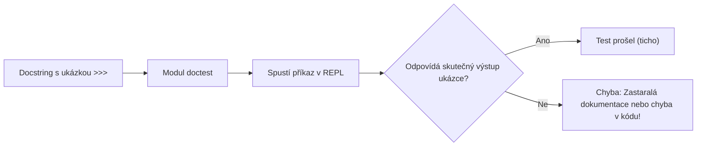

<!-- slide: id1, Úvod, WOW, pythonic -->
## Dokumentační testy v Pythonu: Modul `doctest`

Jednou z unikátních a nejelegantnějších vlastností Pythonu je koncept **spustitelné dokumentace** (*executable documentation*).

V rámci dokumentačních řetězců (**docstrings**) funkcí, tříd a modulů uvádíme ukázky interaktivního volání tak, jak by vypadaly v interaktivním shellu Pythonu (s uvozujícími znaky `>>>` a očekávaným výstupem).



### Proč psát doctesty?
1. **Živá dokumentace**: Příklady kódu v nápovědě (`help()`) nikdy nezastarávají. Pokud se implementace změní a příklad přestane fungovat, automatický test okamžitě selže.
2. **Nulová režie na psaní testů**: Nemusíte vytvářet samostatné testovací třídy ani soubory pro ověření základních invariantů a reprezentativních případů užití.
3. **Výuková hodnota**: Čtenář kódu ihned vidí vstupy i očekávané výstupy přímo nad definicí těla funkce.

---
<!-- slide: id2, Příklad zápisu, Core, pythonic -->
## Příklad zápisu doctestu

Představme si bioinformatickou funkci pro nalezení komplementární báze v sekvenci DNA:

```python
def komplementarni_baze(baze: str) -> str:
    """Vrátí komplementární nukleotidovou bázi pro zadanou bázi DNA.

    >>> komplementarni_baze('A')
    'T'
    >>> komplementarni_baze('T')
    'A'
    >>> komplementarni_baze('C')
    'G'
    >>> komplementarni_baze('G')
    'C'
    >>> komplementarni_baze('X')
    ''
    """
    pary: dict[str, str] = {'A': 'T', 'T': 'A', 'C': 'G', 'G': 'C'}
    return pary.get(baze.upper(), '')
```

### Pravidla syntaxe:
- Každý řádek s kódem začíná interaktivním promptem `>>> ` (nebo `... ` pro víceřádkové bloky s odsazením).
- Přímo pod promptem následuje **přesný očekávaný výstup** tak, jak by jej vypsal Python REPL (včetně uvozovek u řetězců `'T'`).
- Pokud funkce nic nevypíše ani nevrátí hodnotu (vrací `None`), neočekává se pod promptem žádný řádek výstupu.

> [!NOTE]
> Doctesty nejsou náhradou za vyčerpávající sadu unit testů pokrývající všechny okrajové stavy (*edge cases*). Slouží primárně jako demonstrativní příklady chování a sanity testy.

---
<!-- slide: id3, Jak otestovat?, Core, basics -->
## Tři způsoby spuštění doctestů

Modul **`doctest`** nabízí tři hlavní cesty, jak dokumentační testy ověřit:

1. **Automaticky při spuštění skriptu jako hlavního programu**:
   - Vhodné pro knihovní moduly: při přímém spuštění `python modul.py` se spustí testy, při importu `import modul` se testy nespouštějí ([testování modulu](#id4)).
2. **Univerzálně z příkazové řádky (CLI)**:
   - Pomocí přepínače modulu `python -m doctest -v skript.py` bez nutnosti zasahovat do zdrojového kódu ([ruční testování](#id5)).
3. **Jako součást sady `unittest` nebo `pytest`**:
   - Automatická integrace do CI/CD pipeline a jednotného reportu testů ([unittest integrace](#id7)).

> [!TIP]
> **Unixová filozofie ticha**: Pokud všechny doctesty projdou úspěšně, příkaz nevyprodukuje na výstup vůbec nic (exit code 0). Oznámení se vypíše pouze v případě nesouladu nebo při zapnutí přepínače upovídanosti `-v` (*verbose*).

---
<!-- slide: id4, Testování modulu, Core, pythonic -->
## Automatické spouštění modulu: Idiom `if __name__ == '__main__':`

Pro snadné ladění modulu stačí na konec souboru vložit volání funkce **`doctest.testmod()`**:

```python
"""Knihovní modul pro práci s nukleotidy."""

def transkripce_dna_do_rna(dna: str) -> str:
    """Převede sekvenci DNA na RNA transkript (záměna thymidinu za uracil).

    >>> transkripce_dna_do_rna('ATGCGAT')
    'AUGCGAU'
    """
    return dna.upper().replace('T', 'U')


if __name__ == '__main__':
    import doctest
    # Spustí testy pouze pokud byl soubor spuštěn přímo z terminálu
    doctest.testmod()
```

### Chování v terminálu:

```bash
# Všechny testy v pořádku -> tichý úspěch (žádný výstup):
$ python dna_tools.py

# Pokud kód selže, vypíše se detailní diff:
$ python dna_tools.py
**********************************************************************
File "dna_tools.py", line 6, in __main__.transkripce_dna_do_rna
Failed example:
    transkripce_dna_do_rna('ATGCGAT')
Expected:
    'AUGCGAU'
Got:
    'AUGCGA'
**********************************************************************
1 items had failures:
   1 of   1 in __main__.transkripce_dna_do_rna
***Test Failed*** 1 failures.
```

---
<!-- slide: id5, Ruční testování z příkazové řádky I, Core, resyntax -->
## Spouštění doctestů z příkazové řádky: `python -m doctest`

Pokud nechcete do produkčního kódu přidávat blok `if __name__ == '__main__':`, můžete spustit vestavěný modul přímo z příkazové řádky:

```bash
# 1. Tiché spuštění (ozve se pouze při chybě):
python -m doctest muj_skript.py

# 2. Detailní výpis každého provedeného testu (-v / --verbose):
python -m doctest -v muj_skript.py
```

### Příklad výstupu s přepínačem `-v`:

```text
Trying:
    komplementarni_baze('A')
Expecting:
    'T'
ok
Trying:
    komplementarni_baze('T')
Expecting:
    'A'
ok
Trying:
    komplementarni_baze('C')
Expecting:
    'G'
ok
1 items had no tests:
    muj_skript
1 items passed all tests:
   3 tests in muj_skript.komplementarni_baze
3 tests in 2 items.
3 passed and 0 failed.
Test passed.
```

---
<!-- slide: id6, Ruční testování z příkazové řádky II, Skip, basics -->
## Doctesty na úrovni celého modulu

Všimněte si ve výstupu předchozího slajdu hlášky:
`1 items had no tests: muj_skript`

Doctest totiž automaticky kontroluje nejen funkce a třídy, ale i **docstring samotného modulu** (umístěný na začátku souboru před importy). Do něj je zvykem umístit ukázku komplexnějšího pracovního postupu:

```python
"""Modul pro manipulaci s genetickými sekvencemi.

Ukázka typického workflow:
>>> sekvence = "ACGT"
>>> [komplementarni_baze(b) for b in sekvence]
['T', 'G', 'C', 'A']
>>> ''.join(komplementarni_baze(b) for b in sekvence)
'TGCA'
"""

def komplementarni_baze(baze: str) -> str:
    """Vrací komplementární bázi.

    >>> komplementarni_baze('A')
    'T'
    """
    mapping = {'A': 'T', 'T': 'A', 'C': 'G', 'G': 'C'}
    return mapping.get(baze, '')
```

Při spuštění `python -m doctest -v sekvence.py` nyní modul ověří jak ukázku workflow na úrovni modulu, tak jednotlivé funkce.

---
<!-- slide: id7, Použití v rámci unittestů, Core, newconcept -->
## Integrace s testovacím frameworkem `unittest`

V reálných projektech spouštíme unit testy automatizovaně nástrojem test discovery (`python -m unittest discover`).

Aby `unittest` automaticky našel a spustil i doctesty, stačí ve standardním testovacím skriptu definovat protokolovou funkci **`load_tests`**:

```python
import unittest
import doctest
import bio_modul  # Modul obsahující funkce s doctesty


def load_tests(loader, tests, pattern):
    """Protokol unittestu pro načtení dodatečných testů."""
    # Vytvoří TestCase sadu ze všech doctestů v modulu:
    suite = doctest.DocTestSuite(bio_modul)
    tests.addTests(suite)
    return tests


if __name__ == '__main__':
    unittest.main()
```

### Integrace s `pytest`:
Pokud používáte moderní testovací nástroj **`pytest`**, doctesty spustíte jednoduše přidáním jediného přepínače:

```bash
pytest --doctest-modules
```
Pytest projde všechny Python soubory, extrahuje docstringy a reportuje je jako plnohodnotné testovací případy s přehlednými barevnými výstupy.

---
<!-- slide: id8, Další možnosti testování, Skip, basics -->
## Testování dokumentace v Markdownu a textových souborech: `testfile()`

Doctesty nemusí žít pouze v komentářích zdrojového kódu `.py`. Mohou být součástí vývojářské dokumentace v souborech `README.md` nebo `tutorial.rst`!

Funkce **`doctest.testfile()`** prohledá libovolný textový soubor a spustí všechny interaktivní bloky začínající `>>>`:

### V Python kódu:
```python
import doctest

# Otestuje správnost všech příkladů v souboru dokumentace:
doctest.testfile("README.md")
```

### Z příkazové řádky:
```bash
python -m doctest -v README.md
```

> [!TIP]
> Díky tomu zajistíte, že ukázky instalace a použití v `README.md` vašeho GitHub repozitáře nikdy nezastarají vůči měnícímu se API knihovny!

---
<!-- slide: id9, Kontext testu, Core, newconcept -->
## Kontext a izolace doctestů

Při psaní doctestů je klíčové rozumět jmennému prostoru (*scope*):

1. **Izolace mezi docstringy**: Každý docstring má svůj vlastní lokální jmenný prostor. Proměnná vytvořená v docstringu funkce `foo()` není viditelná v docstringu funkce `bar()`.
2. **Přístup ke globálním symbolům**: Všechny doctesty vidí globální proměnné a importované moduly svého vlastního `.py` souboru.
3. **Injekce kontextu přes `globs`**: Při volání `testmod()` nebo `testfile()` můžeme předat vlastní slovník proměnných:

```python
import doctest

data_pro_testy = {"vzorek_1": "ACGT", "vzorek_2": "TGCA"}

# Předání globálních dat do kontextu doctestů:
doctest.testfile("navod.txt", globs=data_pro_testy)
```

---
<!-- slide: id10, Řízení testů, Tricky, pythonic -->
## Směrnice doctestu (Directives)

Ne každý výstup je deterministický (např. náhodná čísla, adresy objektů v paměti `<object at 0x...>`, nebo dlouhé výpisy). Chování porovnávání se řídí **směrnicemi** v komentáři `# doctest: ...`:

### 1. `+ELLIPSIS` (Zástupný symbol `...`):
Ignoruje variabilní části výstupu, jako jsou adresy v paměti nebo dlouhé číselné řady:

```python
def vytvor_objekt():
    """
    >>> vytvor_objekt()  # doctest: +ELLIPSIS
    <Objekt at 0x...>
    """
    return object()
```

### 2. `+NORMALIZE_WHITESPACE`:
Považuje jakékoliv sekvence mezer, tabulátorů a konců řádků za ekvivalentní jedné mezeře:

```python
def ziskej_seznam():
    """
    >>> ziskej_seznam()  # doctest: +NORMALIZE_WHITESPACE
    [1, 2, 3,
     4, 5, 6]
    """
    return list(range(1, 7))
```

### 3. `+SKIP`:
Zcela přeskočí vyhodnocení konkrétního řádku (např. náhodné operace nebo příklady závislé na síti):

```python
import random

def hod_kostkou() -> int:
    """Vrátí číslo 1 až 6.

    >>> hod_kostkou()  # doctest: +SKIP
    4
    """
    return random.randint(1, 6)
```

### 4. `+IGNORE_EXCEPTION_DETAIL`:
Testuje vyvolání správného typu výjimky bez ohledu na přesný text chybové zprávy.

---
<!-- slide: id11, Kam dál, Skip, basics -->
## Shrnutí a doporučené postupy

Doctesty představují skvělý most mezi srozumitelnou dokumentací a základním ověřením integrity kódu.

### Best Practices pro doctesty:
- **Pište reprezentativní příklady**: Docstring má v prvé řadě sloužit člověku jako návod k použití, ne jako nepřehledná změť desítek hraničních testů.
- **Složité testy patří do `unittest` / `pytest`**: Komplexní integrační testy, testy se složitým mockováním a testy chybových stavů umisťujte do dedikované složky `tests/`.
- **Zapojte doctesty do CI/CD**: Přidejte spuštění `pytest --doctest-modules` do GitHub Actions / GitLab CI pipeline.

### Odkazy na dokumentaci:
- Oficiální Python dokumentace: [`doctest` — Test interactive Python examples](https://docs.python.org/3/library/doctest.html)
- Kniha Python 3 Module of the Week: [Doug Hellmann: `doctest`](https://pymotw.com/3/doctest/)
- Následující přednáška: [Unit-testy s modulem `unittest`](#unittests)
