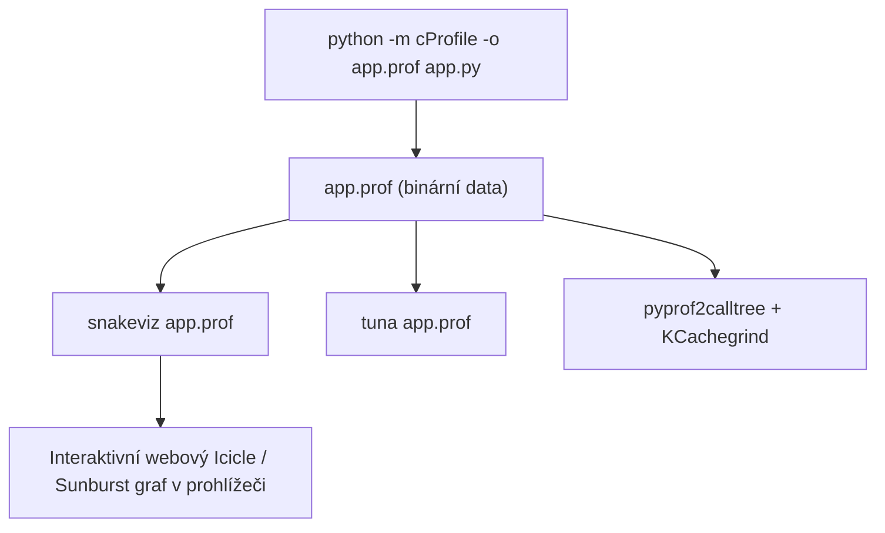

<!-- slide: id1, Úvod, Skip, basics -->
## Profilování a ladění výkonu programu

Když je aplikace dokončena, dokumentována a spolehlivě otestována unit testy, často nastává otázka její efektivity: *Běží program dostatečně rychle a kde tráví nejvíce procesorového času?*

> [!IMPORTANT]
> **Pravidlo 90/10**:
> 90 % času provádění programu je typicky stráveno v pouhých 10 % řádků zdrojového kódu (úzká hrdla — *bottlenecks*).
> Nikdy nehádejte, kde je kód pomalý! Lidská intuice při odhadování výkonu selhává. Měřte skutečný běh pomocí **profileru**.

### Co je to profilování (*profiling*)?
Profilování je dynamická analýza programu, která za běhu měří:
- Kolikrát byla každá funkce zavolána (*number of calls*).
- Kolik času strávil procesor v těle dané funkce bez jejích potomků (*total time* / *exclusive time*).
- Kolik času zabralo volání funkce včetně všech vnořených podfunkcí (*cumulative time* / *inclusive time*).
- Která funkce volala kterou (volací graf — *caller / callee graph*).

---
<!-- slide: id2, Profilování běhu programu pomocí „cProfile“, Core, pythonic -->
## Deterministický profiler: Modul `cProfile`

Ve standardní knihovně Pythonu jsou k dispozici dva vestavěné profilery:
1. **`cProfile`**: Implementován v jazyce C jako součást jádra CPythonu. Přidává minimální režii (*low overhead*) a je doporučeným standardem pro všechna měření.
2. **`profile`**: Čistě pythonní implementace. Je pomalá a slouží primárně pro akademické zkoumání implementace profilovacích háčků.

### Dva základní způsoby spuštění:

```bash
# 1. Spuštění celého skriptu s textovým výpisem tabulky na konzoli:
python -m cProfile skript.py

# 2. Uložení binárního profilovacího záznamu do souboru pro pozdější analýzu:
python -m cProfile -o vysledek.prof skript.py
```

### Programové profilování v kódu:
```python
import cProfile
import pstats

def kriticka_operace():
    return sum(i * i for i in range(1_000_000))

# Profilování vybraného bloku:
with cProfile.Profile() as pr:
    kriticka_operace()

# Zobrazení výsledků:
stats = pstats.Stats(pr)
stats.sort_stats("cumulative").print_stats(10)
```

---
<!-- slide: id3, Testovací skript, Skip, basics -->
## Ukázkový testovací skript pro profilování

Představme si skript `skript.py` obsahující různé typy zátěže: I/O čekání, výpočetní cykly a rekurzivní volání:

```python
#!/usr/bin/env python3
"""Ukázkový skript s různými typy zátěže pro demonstraci profilování."""
import time


def fn1() -> None:
    """Simulace I/O operace nebo síťového zpoždění."""
    time.sleep(1.0)


def fn2() -> None:
    """Výpočetně náročná CPU smyčka s alokací bajtových objektů."""
    for _ in range(500_000):
        _ = bytes(64)


def fn3() -> None:
    """Volání vnořené funkce."""
    fn1()


def fn4(citac: int = 0) -> None:
    """Hluboká rekurzivní posloupnost."""
    if citac < 100:
        fn4(citac + 1)


def main() -> None:
    fn1()
    fn2()
    fn3()
    fn4()


if __name__ == '__main__':
    main()
```

---
<!-- slide: id4, „cProfile“ – výstup na obrazovku I, Skip, basics -->
## Analýza základního výstupu `cProfile`

Spustíme profilování skriptu přímo z příkazové řádky:

```bash
python -m cProfile skript.py
```

### Typický výstup v terminálu:

```text
         500115 function calls (500015 primitive calls) in 2.215 seconds

   Ordered by: standard name

   ncalls  tottime  percall  cumtime  percall filename:lineno(function)
        1    0.000    0.000    2.215    2.215 skript.py:1(<module>)
        2    0.000    0.000    2.002    1.001 skript.py:6(fn1)
        1    0.212    0.212    0.212    0.212 skript.py:11(fn2)
        1    0.000    0.000    1.001    1.001 skript.py:17(fn3)
    101/1    0.001    0.000    0.001    0.001 skript.py:22(fn4)
        1    0.000    0.000    2.215    2.215 skript.py:27(main)
        2    2.002    1.001    2.002    1.001 {built-in method time.sleep}
   500000    0.000    0.000    0.000    0.000 {built-in method builtins.bytes}
        1    0.000    0.000    0.000    0.000 {method 'disable' of '_lsprof.Profiler' objects}
```

Vidíme okamžitě přehled o počtu volání funkcí i celkovém spotřebovaném čase.

---
<!-- slide: id5, „cProfile“ – výstup na obrazovku II, Tricky, newconcept -->
## Význam sloupců v reportu `cProfile`

Pochopení jednotlivých metrik je zásadní pro správnou interpretaci výsledků:

| Sloupec | Anglický termín | Význam |
|---|---|---|
| **`ncalls`** | Number of calls | Počet volání dané funkce. Pokud je zapsán jako `101/1`, první číslo je celkový počet volání a druhé číslo je počet primárních (nerekurzivních) volání. |
| **`tottime`** | Total time (exclusive) | Celkový čas strávený **výhradně v těle dané funkce**, vyjma času stráveného ve volaných podfunkcích. Zde hledáme CPU hrdla! |
| **`percall`** | Time per call | Podíl `tottime / ncalls` (průměrná doba jednoho volání těla funkce). |
| **`cumtime`** | Cumulative time (inclusive) | Celkový čas strávený ve funkci **včetně všech jejích vnořených volání**. Zde vidíme, které větve programu trvají nejdéle. |
| **`percall`** | Cumulative per call | Podíl `cumtime / primitive calls` (průměrná kumulativní doba jednoho vnějšího volání). |
| **`filename:lineno`** | Location | Soubor, číslo řádku a název funkce. |

> [!NOTE]
> Pokud má funkce vysoké `tottime`, samotný její kód je výpočetně neefektivní. Pokud má funkce nízké `tottime`, ale obrovské `cumtime`, kód funkce je v pořádku, ale volá nějakou pomalou podfunkci (např. čekání na I/O či databázi).

---
<!-- slide: id6, „cProfile“ – výstup na obrazovku III, Skip, basics -->
## Řazení výstupu podle kumulativního času: `-s cumtime`

Ve výchozím nastavení řadí `cProfile` funkce podle abecedy (`standard name`), což je u rozsáhlejších projektů s tisíci voláními nepraktické.

Přepínačem **`-s`** (*sort*) můžeme výstup seřadit podle libovolného sloupce:

```bash
# Seřazení podle celkového kumulativního času (od nejdéle trvajících):
python -m cProfile -s cumtime skript.py

# Seřazení podle čistého času stráveného v těle funkce (hledání CPU zátěže):
python -m cProfile -s tottime skript.py

# Seřazení podle počtu volání (hledání zbytečně často volaných funkcí):
python -m cProfile -s ncalls skript.py
```

### Příklad seřazení podle `cumtime`:
Na prvních místech vidíme `main()`, následované funkcí `fn1()` a voláním `time.sleep`, které spotřebovalo většinu celkového času.

---
<!-- slide: id7, „cProfile“ – výstup do souboru, Skip, basics -->
## Ukládání profilu do binárního souboru: Přepínač `-o`

Výpis na standardní výstup je statický a u reálných aplikací může mít desítky tisíc řádků.

Mnohem efektivnější je uložit kompletní surová profilovací data do binárního souboru pomocí přepínače **`-o`**:

```bash
python -m cProfile -o profil_programu.prof skript.py
```

### Proč ukládat profil do souboru?
1. **Opakovaná analýza bez nutnosti znovuspuštění**: Můžete data filtrovat, měnit řazení a zkoumat různé větve programu dodatečně.
2. **Možnost vizualizace**: Soubor `.prof` lze načíst do moderních vizualizačních nástrojů s interaktivními grafy a flamegraphy (např. **SnakeViz**, **KCachegrind**, **Tuna**).
3. **Programové zpracování**: Standardní modul `pstats` umožňuje psát automatické skripty hlídající výkonnostní regrese.

---
<!-- slide: id8, Modul „pstats“, Core, pythonic -->
## Analýza profilu s modulem `pstats`

Knihovní modul **`pstats`** slouží k interaktivnímu i programovému procházení uložených profilovacích souborů:

### 1. Programové použití v Pythonu:
```python
import pstats

# Načtení uloženého binárního profilu:
stats = pstats.Stats("profil_programu.prof")

# Odstranění dlouhých systémových cest pro přehlednost:
stats.strip_dirs()

# Seřazení podle kumulativního času a výpis prvních 5 funkcí:
stats.sort_stats("cumulative").print_stats(5)

# Zobrazení, kdo volal funkci 'fn1':
stats.print_callers("fn1")

# Zobrazení, koho volala funkce 'main':
stats.print_callees("main")
```

---
<!-- slide: id9, „pstats“ – ukázka, WOW, pythonic -->
## Interaktivní prohlížeč v terminálu: `python -m pstats`

Modul `pstats` lze spustit také jako interaktivní CLI nástroj pro prozkoumávání profilu:

```bash
python -m pstats profil_programu.prof
```

### Příklad interaktivní relace:

```text
Welcome to the profile statistics browser.
profil_programu.prof% help

Documented commands (type help <topic>):
========================================
EOF  add  callees  callers  help  quit  read  reverse  sort  stats  strip

profil_programu.prof% sort cumulative
profil_programu.prof% stats 3
         500115 function calls in 2.215 seconds
   Ordered by: cumulative time
   List reduced from 9 to 3 due to restriction <3>

   ncalls  tottime  percall  cumtime  percall filename:lineno(function)
        1    0.000    0.000    2.215    2.215 skript.py:27(main)
        2    0.000    0.000    2.002    1.001 skript.py:6(fn1)
        2    2.002    1.001    2.002    1.001 {built-in method time.sleep}

profil_programu.prof% callers fn1
   Function         was called by...
   skript.py:6(fn1)  <-   1   skript.py:17(fn3)
                          1   skript.py:27(main)

profil_programu.prof% quit
Goodbye.
```

Příkazy `callers` a `callees` vám přesně ukáží vztahy ve volacím stromu.

---
<!-- slide: id10, Poznámky, Core, newconcept -->
## Moderní vizualizace profilů: SnakeViz a Flamegraphy

Čtení textových tabulek je užitečné, ale moderní vizuální nástroje poskytují okamžitý přehled o celkové struktuře volání:



### 1. SnakeViz (Doporučený webový nástroj)
Jednoduchá instalace a okamžité otevření interaktivního zobrazení v prohlížeči:
```bash
pip install snakeviz
snakeviz profil_programu.prof
```
Zobrazí interaktivní **Icicle graf** (ledový diagram), kde šířka každého bloku odpovídá spotřebovanému času. Kliknutím na funkci se přiblížíte k jejím potomkům.

### 2. Profilování paměti:
Pokud není problémem CPU čas, ale spotřeba operační paměti RAM:
- **`tracemalloc`**: Standardní knihovní modul pro trasování alokací paměťových bloků.
- **`memory_profiler`**: Řádkové profilování spotřeby RAM (`@profile`).
