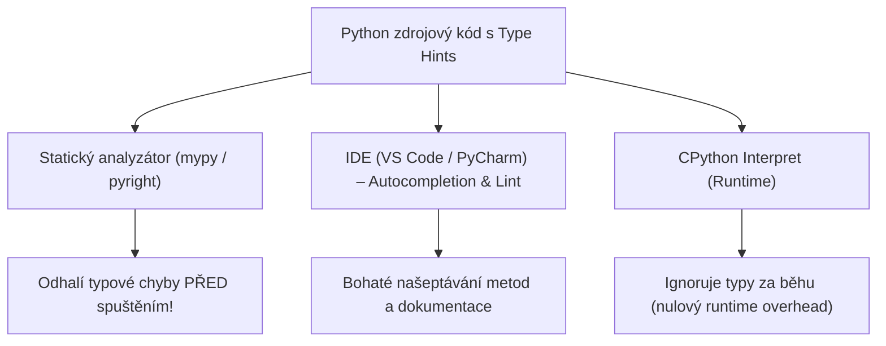

<!-- slide: id1, Úvod, Core, paradigm -->
## Typové anotace v Pythonu (Type Hints)

Python je od svého vzniku **dynamicky typovaný jazyk** se silnou typovou kontrolou za běhu (*strongly typed, dynamically checked*). Proměnná v Pythonu je pouhou jmenovkou (referencí) ukazující na libovolný objekt v paměti (`PyObject`).

S rostoucí velikostí projektů v produkčních týmech však vyvstala potřeba **statické verifikace kódu před spuštěním**, známé z jazyků C, C++, Rust nebo Java.



### Proč používat typové anotace?
1. **Prevence chyb před spuštěním**: Nástroje jako **`mypy`** nebo **`pyright`** zachytí volání neexistující metody, předání `None` tam kde se čeká číslo, nebo překlep v typu argumentu dříve, než kód dorazí do produkce.
2. **Čitelnost a sebe-dokumentující kód**: Nemusíte v docstringu složitě popisovat strukturu parametrů — signatura funkce mluví sama za sebe.
3. **Inteligentní IDE**: Vývojové prostředí ví, jaké metody a atributy objekt nabízí, a okamžitě je nabízí v našeptávači.

---
<!-- slide: id2, Zápis, Core, resyntax -->
## Základní syntaxe typových anotací (PEP 526)

Od Pythonu 3.6 (PEP 526) lze anotovat jak parametry a návratové hodnoty funkcí, tak lokální, globální a třídní proměnné:

### 1. Anotace proměnných
```python
# Proměnná s počáteční hodnotou:
jmeno: str = "Alice"
vek: int = 30
aktivni: bool = True
teplota: float = 36.6

# Deklarace typu bez přiřazení počáteční hodnoty:
# (Proměnná není vytvořena v paměti, pouze její typ v metadatech!)
kapitan: str
```

### 2. Anotace funkcí a metod
```python
def spocitej_prumer(cisla: list[float]) -> float:
    """Spočítá aritmetický průměr seznamu reálných čísel."""
    if not cisla:
        return 0.0
    return sum(cisla) / len(cisla)
```

> [!NOTE]
> Syntaxe se skládá ze jména proměnné, dvojtečky `:`, typu a volitelně rovnítka `=` s výchozí hodnotou. U funkcí se návratový typ označuje šipkou `->` před dvojtečkou bloku.

---
<!-- slide: id3, Přístup k anotacím, Core, pythonic -->
## Runtime reflexe: Magický atribut `__annotations__`

Jak interpret s anotacemi nakládá? CPython provede syntaktickou kontrolu a uloží typy do interního slovníku **`__annotations__`** příslušného modulu, funkce nebo třídy:

```python
# modul_anotace.py
jmeno: str = "Guido"
cisla: list[int] = [1, 2, 3]

def pozdrav(kdo: str) -> str:
    return f"Ahoj {kdo}"

print(__annotations__)
# Vypíše: {'jmeno': <class 'str'>, 'cisla': list[int]}

print(pozdrav.__annotations__)
# Vypíše: {'kdo': <class 'str'>, 'return': <class 'str'>}
```

### Inspekce v moderním Pythonu (PEP 563 / Python 3.10+):
Místo přímého čtení dunder atributu `__annotations__` je doporučeno používat standardní funkci **`inspect.get_annotations()`**:

```python
import inspect

typy = inspect.get_annotations(pozdrav)
print(typy["kdo"])  # <class 'str'>
```

Tato funkce korektně vyřeší zpožděné vyhodnocování řetězcových anotací a dědičnost tříd.

---
<!-- slide: id4, Jaké typy používat?, WOW, pythonic -->
## Moderní typový systém (Python 3.9–3.12+)

Původně (Python 3.5, PEP 484) bylo nutné veškeré složené generické typy importovat ze speciálního modulu `typing` (`List`, `Dict`, `Tuple`, `Set`, `Union`, `Optional`). Moderní Python přinesl dramatické zjednodušení:

```python
# 1. Vestavěné generické typy (PEP 585, Python 3.9+):
prvocisla: list[int] = [2, 3, 5, 7]
slovnik_bodu: dict[str, float] = {"x": 1.5, "y": 2.8}
souradnice: tuple[int, int, str] = (10, 20, "GPS_FIX")

# 2. Sjednocení typů operátorem | (PEP 604, Python 3.10+):
# Nahrazuje dřívější Union[int, str] a Optional[str]:
def zpracuj_id(identifikator: int | str) -> str:
    return str(identifikator)

def najdi_uzivatele(id_uzivatele: int) -> str | None:
    if id_uzivatele == 1:
        return "Admin"
    return None

# 3. Zavedení vlastních typových aliasů (PEP 695, Python 3.12+):
type JsonHodnota = dict[str, int | str | list[str]]
data: JsonHodnota = {"status": 200, "zpravy": ["ok", "hotovo"]}
```

| Starý zápis (`typing`) | Moderní zápis (Python 3.10+) | Význam |
|---|---|---|
| `from typing import List; List[int]` | `list[int]` | Seznam celých čísel |
| `from typing import Dict; Dict[str, int]` | `dict[str, int]` | Slovník mapující `str` na `int` |
| `from typing import Union; Union[int, str]` | `int | str` | Hodnota může být `int` nebo `str` |
| `from typing import Optional; Optional[str]` | `str | None` | Řetězec nebo hodnota `None` |

---
<!-- slide: id5, Anotace třídních proměnných, Tricky, newconcept -->
## Anotace třídních a instančních atributů

Při objektovém programování je klíčové rozlišovat, zda atribut patří **třídě** jako celku (sdílený pro všechny instance), nebo zda jde o atribut konkrétní **instance**:

```python
from typing import ClassVar

class HvezdnaLod:
    # 1. Třídní proměnná (ClassVar): sdílená pro všechny lodě
    pocet_vyrobenych_lodi: ClassVar[int] = 0

    # 2. Instanční atributy (budou existovat na instanci self):
    nazev: str
    stit: float

    def __init__(self, nazev: str, stit: float = 100.0) -> None:
        self.nazev = nazev
        self.stit = stit
        HvezdnaLod.pocet_vyrobenych_lodi += 1


print(HvezdnaLod.__annotations__)
# {'pocet_vyrobenych_lodi': typing.ClassVar[int], 'nazev': <class 'str'>, 'stit': <class 'float'>}
```

> [!NOTE]
> Typový analyzátor (`mypy`) díky anotaci `ClassVar` zabrání chybě, kdy by se programátor pokusil přepsat třídní proměnnou na konkrétní instanci (`self.pocet_vyrobenych_lodi = 5`).

---
<!-- slide: id6, Poznámka, Tricky, paradigm -->
## Klíčové pravidlo: Anotace nevynucují typovou kontrolu za běhu!

Mnoho programátorů přicházejících z jazyků C++, Java nebo C# se dopouští zásadního omylu: předpokládají, že pokud označí parametr jako `int`, interpret při předání řetězce vyvolá chybu.

**V Pythonu to tak NENÍ!**

```python
def secti(a: int, b: int) -> int:
    return a + b

# CPython interpret kód provede bez protestů, protože operátor + funguje i na str:
vysledek = secti("Ahoj ", "světe")
print(vysledek)  # Vytiskne: "Ahoj světe" (žádný TypeError!)
```

### Proč tomu tak je?
- Zachování maximální rychlosti běhu (*zero runtime overhead*): CPython nekontroluje typy při každém volání funkce.
- Kontrola probíhá **staticky** během vývoje nebo v CI/CD pipeline:

```bash
$ mypy program.py
program.py:5: error: Argument 1 to "secti" has incompatible type "str"; expected "int"  [arg-type]
Found 1 error in 1 file (checked 1 source file)
```

> [!TIP]
> Pokud v aplikaci potřebujete validovat typy přímo za běhu (např. při parsování příchozích JSON požadavků z webu), sáhněte po knihovnách **Pydantic** nebo **attrs**, které využívají typové anotace pro automatickou serializaci a runtime validaci.

---
<!-- slide: id7, PS: Reference na budoucí objekty, WOW, newconcept -->
## Zpožděné vyhodnocování: `from __future__ import annotations` (PEP 563)

Co se stane, když metoda třídy vrací instanci téže třídy? V době definice metody samotná třída ještě není plně vytvořena v paměti:

```python
# Bez postponed evaluation by tento kód selhal s NameError: name 'Strom' is not defined!
from __future__ import annotations

class Strom:
    def __init__(self, hodnota: int) -> None:
        self.hodnota = hodnota
        self.levy: Strom | None = None
        self.pravy: Strom | None = None

    def pridej_potomka(self, potomek: Strom) -> Strom:
        self.pravy = potomek
        return self
```

### Jak `from __future__ import annotations` funguje?
- Interpret nehodnotí typové anotace v okamžiku definice třídy jako živé Python výrazy.
- Všechny anotace jsou uloženy jako obyčejné textové řetězce (např. `'Strom | None'`).
- **Výhody**:
  1. Řeší cyklické závislosti a rekurzivní datové struktury (stromy, grafy, spojové seznamy).
  2. Zrychluje start programů, protože se nemusí při startu vyhodnocovat tisíce typových objektů.
  3. Umožňuje bezpečně používat moderní syntaxi (`X | Y`) i na starších verzích interpretu.
