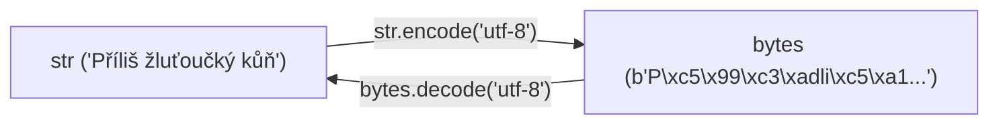

<!-- slide: id1, Úvod, Core, paradigm -->
## Binární data v Pythonu: Typ `bytes`

Jedním z nejzásadnějších architektonických přechodů mezi Pythonem 2 a Pythonem 3 bylo **striktní oddělení lidského textu (`str`) od surových binárních dat (`bytes`)**.

- **`str` (Unicode text)**: Sekvence abstraktních znaků (*code points*). Nemá žádnou pevnou bajtovou reprezentaci, dokud není explicitně zakódován.
- **`bytes` (Binární sekvence)**: **Neměnná (*immutable*) sekvence celých čísel** v pevném rozsahu $0$ až $255$ (8-bitové bajty `0x00`–`0xFF`).


K neměnnému typu `bytes` existuje měnitelný (*mutable*) protějšek **`bytearray`** (fungující jako seznam bajtů, do kterého lze vkládat a přepisovat jednotlivé hodnoty).

---
<!-- slide: id2, Zavedení – přímou notací, Core, basics -->
## Zápis bajtových literálů: Prefix `b'...'`

Bajtový literál se zapisuje s předřazeným prefixem `b` nebo `B`:

```python
# ASCII tisknutelné znaky lze psát přímo:
data = b"Hello World"
print(type(data))  # <class 'bytes'>
print(len(data))   # 11 bajtů

# Netisknutelné a binární hodnoty zapisujeme hexadecimálně \xNN:
hlavicka_png = b"\x89PNG\r\n\x1a\n"
print(hlavicka_png)
```

> [!CAUTION]
> V literálu `b"..."` lze přímo zapisovat **pouze ASCII znaky** (kódy 0–127). Pokus o vložení českého znaku přímo do literálu (např. `b"Příliš"`) skončí okamžitou chybou kompilátoru:
> `SyntaxError: bytes can only contain ASCII literal characters`!

---
<!-- slide: id3, „Řetězce“ bajtů, Tricky, paradigm -->
## Rozdíl v iteraci: Znaky vs. celá čísla

Porovnejme, co se stane při iteraci přes textový řetězec a přes bajtový řetězec:

```python
# 1. Textový řetězec: iterace vrací jednoznakové řetězce str
text = "ahoj"
print([znak for znak in text])
# ['a', 'h', 'o', 'j']

# 2. Bajtový řetězec: iterace vrací CELÁ ČÍSLA (int 0–255)!
bajty = b"ahoj"
print([bajt for bajt in bajty])
# [97, 104, 111, 106]
```

Čísla `97`, `104`, `111`, `106` odpovídají ASCII hodnotám písmen `a`, `h`, `o`, `j`.

### Hexadecimální a oktalová ekvivalence:
```python
assert b"ahoj" == b"\x61\x68\x6f\x6a"  # Hexadecimální zápis
assert b"ahoj" == b"\141\150\157\152"  # Oktalový zápis
```

---
<!-- slide: id4, Zavedení – konstruktorem „bytes()“, Tricky, resyntax -->
## Konstruktor `bytes()` a jeho chování

Konstruktor `bytes()` se chová odlišně podle typu předaného argumentu:

```python
# 1. Bez parametrů: vytvoří prázdný bajtový objekt b''
prazdne = bytes()

# 2. Celé číslo (int): vytvoří sekvenci zadaného počtu NULOVÝCH bajtů (0x00)!
nulovy_buffer = bytes(5)  # b'\x00\x00\x00\x00\x00'

# 3. Řetězec (str): VYŽADUJE povinný parametr encoding!
z_textu = bytes("Příliš", encoding="utf-8")

# 4. Iterovatelná kolekce celých čísel (0-255):
cisla = [65, 66, 67, 255]
z_cisel = bytes(cisla)  # b'ABC\xff'

# 5. Z hexadecimálního řetězce (třídní metoda fromhex):
z_hex = bytes.fromhex("48 65 6c 6c 6f")  # b'Hello'
```

> [!WARNING]
> Pozor na častou chybu: `bytes(10)` **nevytvoří** bajt s hodnotou 10, ale vyalokuje **10 nulových bajtů**! Pokud chcete vytvořit bajt s hodnotou 10, musíte předat seznam: `bytes([10])`.

---
<!-- slide: id5, Bajtové řetězce jako sekvence, Core, basics -->
## Sekvenční operace nad `bytes`

Jako každá sekvence v Pythonu podporuje `bytes` indexaci, výřezy, zjištění délky i operátory členství:

```python
data = b"ABCDEF"

# Délka v bajtech:
print(len(data))  # 6

# Výřezy vracejí nový objekt bytes:
print(data[1:4])   # b'BCD'
print(data[::-1])  # b'FEDCBA' (obrácení)

# Operátor in:
print(b"BC" in data)  # True
print(65 in data)     # True (hledání hodnoty bajtu 65 = 'A')

# Násobení a spojování:
hlavicka = b"=" * 5 + b"START"  # b'=====START'
```

---
<!-- slide: id6, Poznámka, Tricky, paradigm -->
## Klíčová záludnost indexace: `b[i]` vs. `b[i:i+1]`

Tento rozdíl způsobuje v Pythonu nejvíce chyb při přechodu z textových řetězců na bajtové:

```python
data = b"ahoj"

# A) Jediný index vrací celé číslo int:
prvek = data[0]
print(type(prvek), prvek)
# <class 'int'> 97

# B) Jednoprvkový výřez vrací objekt bytes o délce 1:
vyrez = data[0:1]
print(type(vyrez), vyrez)
# <class 'bytes'> b'a'
```

U textového řetězce `s = "ahoj"` vrací `s[0]` i `s[0:1]` tentýž typ `str`. U bajtů je `data[0]` číslo `97`, zatímco `data[0:1]` je bajtový objekt `b'a'`.

---
<!-- slide: id7, Bajtové řetězce jako sekvence – „for-in“, Skip, basics -->
## Procházení bajtů v cyklu `for`

```python
buffer = b"\x01\x02\x03\xff"

# 1. Přímá iterace přes hodnoty bajtů (celá čísla):
for bajt in buffer:
    print(f"Bajt: dec={bajt:3d}, hex=0x{bajt:02x}")

# 2. S indexem přes enumerate():
for idx, val in enumerate(buffer):
    print(f"Offset {idx}: {val}")

# 3. Obrácené procházení:
for val in reversed(buffer):
    pass
```

Každá iterace předá do těla smyčky standardní Python `int`.

---
<!-- slide: id8, Bajtové řetězce jako neměnitelné sekvence, Core, basics -->
## Neměnnost (`immutability`) a typ `bytearray`

Objekt `bytes` je **neměnný** — jakmile je vytvořen, jeho obsah nelze modifikovat:

```python
data = b"ahoj"
# data[0] = 65  # Vyvolá TypeError: 'bytes' object does not support item assignment!
```

### Kdy použít měnitelný `bytearray`?
Pokud potřebujete přijímat data ze sítě po blocích nebo in-place modifikovat bajty v paměti:

```python
buffer = bytearray(b"ahoj")
buffer[0] = 65           # Změna prvního bajtu na 'A'
buffer.extend(b" lidi")  # Přidání dalších bajtů bez realokace
print(buffer)            # bytearray(b'Ahoj lidi')

# Převod zpět na neměnný bytes:
hotovo = bytes(buffer)
```

---
<!-- slide: id9, Interpolace v bajtových řetězcích pomocí „%“, Skip, pythonic -->
## Formátování bajtových řetězců: Operátor `%` (PEP 461)

Bajtové řetězce nepodporují moderní f-stringy (zápis `fb"..."` v Pythonu neexistuje) ani metodu `.format()`.

Od Pythonu 3.5 byla proto do jazyka vrácena podpora klasického **operátoru `%` (PEP 461)**:

```python
# %b: vložení bajtového řetězce (bytes nebo bytearray)
# %d: vložení celého čísla
# %x: vložení v hexadecimálním tvaru
hlavicka_http = b"HTTP/1.1 %d %b\r\nContent-Length: %d\r\n" % (200, b"OK", 1024)
print(hlavicka_http)

# %a: bezpečné ASCII kódování libovolného objektu (repr):
zprava = b"Hodnota senzoru: %a" % 23.5
print(zprava)  # b'Hodnota senzoru: 23.5'
```

Tato technika je hojně využívána při sestavování nízkoúrovňových síťových paketů a binárních protokolů.

---
<!-- slide: id10, Dekódování textových řetězců – „BYTES.decode()“ vs „STR.encode()“, Core, paradigm -->
## Konverze mezi textem a bajty: `encode()` a `decode()`



### 1. `str.encode(encoding="utf-8", errors="strict")`:
Převede abstraktní znaky na bajty podle zvoleného kódování.
```python
text = "Čeština"
utf8_bajty = text.encode("utf-8")    # 9 bajtů (č a š zabírají 2 bajty)
cp1250_bajty = text.encode("cp1250") # 7 bajtů (Windows-1250 kódování)
```

### 2. `bytes.decode(encoding="utf-8", errors="strict")`:
Dekóduje sekvenci bajtů zpět na textový řetězec.
```python
prijato_ze_site = b"Ahoj sv\xc4\x9bte"
zprava = prijato_ze_site.decode("utf-8")
print(zprava)  # "Ahoj světe"
```

### Strategie při chybách kódování (`errors`):
- `errors="strict"`: Vyvolá `UnicodeDecodeError` při neplatném bajtu (výchozí).
- `errors="replace"`: Nahradí neplatné znaky zástupným symbolem `\ufffd` (``).
- `errors="ignore"`: Neplatné bajty tiše přeskočí.
