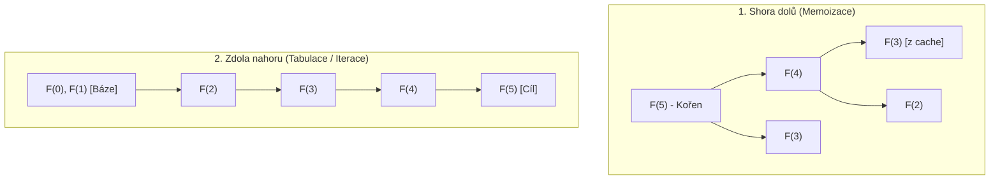

<!-- slide: id1, Úvod, Core, basics -->
## Optimalizace rekurze: Memoizace a dynamické programování

Jak jsme viděli v úvodu do rekurze, rekurzivní algoritmy bývají elegantní a matematicky přímočaré, ale při naivním zápisu vedou k **exponenciální časové složitosti** $O(2^n)$ a vyčerpání zásobníku volání (*RecursionError*).

Důvodem je **opakovaný přepočet týchž podúloh** ve stromu rekurze.

Pro zrychlení používáme dvě hlavní strategie:
1. **Memoizace (Shora dolů / Top-Down)**: Ponecháme rekurzivní strukturu, ale výsledky již vyřešených podúloh si ukládáme do mezipaměti (slovníku).
2. **Dynamické programování (Zdola nahoru / Bottom-Up)**: Problém počítáme iterativně od nejjednodušších bází směrem k cíli (tabulace).

---
<!-- slide: id2, Memoizace, Core, basics -->
## Princip memoizace

Princip memoizace (*memoization*, od slova *memo* = poznámka):
> **„Každou spočítanou hodnotu pro dané vstupní argumenty si uložíme do mezipaměti. Při dalším požadavku na stejný výpočet vrátíme přímo uložený mezivýsledek.“**

Pokud strom rekurzivního volání obsahuje překrývající se podproblémy (*overlapping subproblems*), memoizace dramaticky srazí složitost z exponenciální $O(2^n)$ na lineární $O(n)$.

---
<!-- slide: id3, Příklad – faktoriál, Skip, pythonic -->
## Manuální memoizace pomocí slovníku

Pro uložení mezivýsledků je v Pythonu ideální `dict`, jehož klíčem jsou vstupní argumenty funkce (čísla, řetězce nebo neměnné n-tice `tuple`):

```python
_fakt_cache: dict[int, int] = {}

def faktorial(n: int) -> int:
    if n in _fakt_cache:
        return _fakt_cache[n]

    if n <= 1:
        vysledek = 1
    else:
        vysledek = n * faktorial(n - 1)

    _fakt_cache[n] = vysledek
    return vysledek

print(faktorial(5))  # 120
```

> [!NOTE] Lineární rekurze
> U faktoriálu se podproblémy nepřekrývají (každé číslo $n$ se počítá jen jednou), takže memoizace urychlí až následná další volání pro menší $n$. Skutečná síla memoizace se projeví u větvící se stromové rekurze.

---
<!-- slide: id4, Příklad – fibonacci, WOW, pythonic -->
## Srovnání na Fibonacciho číslech: $O(2^n)$ vs. $O(n)$

Definice Fibonacciho posloupnosti: $F(n) = F(n-1) + F(n-2)$.

### Naivní verze (exponenciální katastrofa):
```python
def fib_naivni(n: int) -> int:
    if n <= 1:
        return n
    return fib_naivni(n - 1) + fib_naivni(n - 2)
```
Pro $n = 35$ provede tato naivní funkce přes **29 milionů rekurzivních volání** a trvá několik sekund!

### Verze s memoizací (lineární $O(n)$):
```python
_fib_cache: dict[int, int] = {}

def fib_memo(n: int) -> int:
    if n in _fib_cache:
        return _fib_cache[n]
    if n <= 1:
        return n
    vysledek = fib_memo(n - 1) + fib_memo(n - 2)
    _fib_cache[n] = vysledek
    return vysledek
```
Pro $n = 35$ proběhne pouze **35 výpočtů** za zlomek mikrosekundy. Zrychlení je více než 10 000×!

---
<!-- slide: id5, Pár poznámek, WOW, pythonic -->
## Moderní Python: Dekorátor `@functools.cache`

V moderním Pythonu nepíšeme manuální správu slovníku `_cache` ani `try-except KeyError`. Standardní knihovna nabízí dekorátor **`@functools.cache`** (Python 3.9+):

```python
from functools import cache

@cache
def fibonacci(n: int) -> int:
    if n <= 1:
        return n
    return fibonacci(n - 1) + fibonacci(n - 2)

# Spočte 300. Fibonacciho číslo okamžitě:
print(fibonacci(300))
# 222232244629420445529739893461909967206666939096499764990979600

# Diagnostika mezipaměti:
print(fibonacci.cache_info())
# CacheInfo(hits=298, misses=301, maxsize=None, currsize=301)
```

Pro omezení paměti (např. max 1024 posledních výsledků) použijte `@functools.lru_cache(maxsize=1024)`.

---
<!-- slide: id6, Dynamické programování, Core, paradigm -->
## Dynamické programování: Shora dolů vs. Zdola nahoru

Dynamické programování (DP) řeší úlohy rozkladem na překrývající se podproblémy s optimální podstrukturou:



| Vlastnost | Shora dolů (Memoizace) | Zdola nahoru (Tabulace) |
| :--- | :--- | :--- |
| **Přirozenost** | Zachovává rekurzivní vzorec | Vyžaduje návrh iteračního cyklu |
| **Zásobník volání** | Hrozí `RecursionError` při velké hloubce | Žádná rekurze, nehrozí přetečení zásobníku |
| **Paměťová složitost** | $O(n)$ pro slovník a rámce | Lze často optimalizovat na $O(1)$! |

---
<!-- slide: id7, Příklad – fibonacci, WOW, pythonic -->
## Fibonacci zdola nahoru: $O(n)$ čas a $O(1)$ paměť

Metodou *zdola nahoru* počítáme hodnoty v jednoduché smyčce. Jelikož pro další číslo potřebujeme znát pouze dvě předchozí hodnoty, stačí nám dvě proměnné namísto celé mezipaměti:

```python
def fibonacci_iterativni(n: int) -> int:
    """Iterativní výpočet zdola nahoru v čase O(n) a paměti O(1)."""
    if n <= 0:
        return 0
    if n == 1:
        return 1

    a, b = 0, 1
    for _ in range(2, n + 1):
        a, b = b, a + b
    return b

print(fibonacci_iterativni(100))
# 354224848179261915075
```

Žádné přetečení zásobníku (*stack overflow*), minimální paměťová režie a maximální rychlost.

---
<!-- slide: id8, Další příklady, Skip, basics -->
## Klasická úloha: Problém rozměnění mincí (Coin Change)

Máme k dispozici mince zadaných nominálních hodnot `[1, 3, 4]`. Jaký je minimální počet mincí pro zaplacení částky `castka`?

```python
from functools import cache

mince = [1, 3, 4]

@cache
def min_minci(castka: int) -> int:
    if castka == 0:
        return 0
    if castka < 0:
        return float("inf")  # type: ignore

    # Vyzkoušíme odečíst každou dostupnou minci:
    return 1 + min(min_minci(castka - m) for m in mince)

print(f"Minimální počet mincí pro 6 Kč: {min_minci(6)}")
# 2 (mince 3 + 3)
```

Naivní hladový algoritmus (*greedy*) by pro 6 Kč chybně vybral `4 + 1 + 1` (3 mince). Rekurze s memoizací bezpečně a rychle najde globální optimum.
